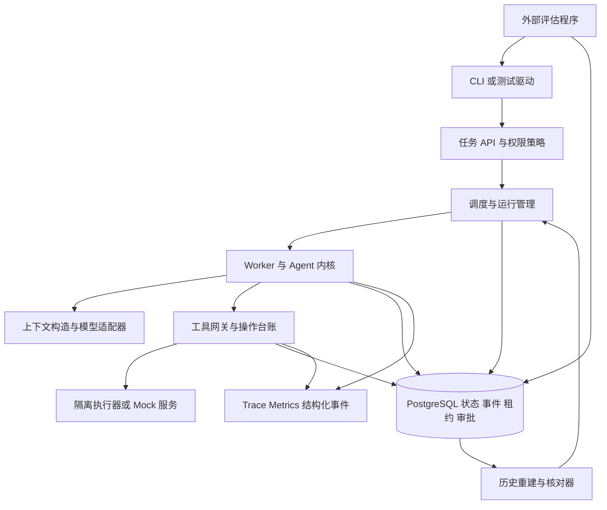

# Agent Systems Engineering 深入研究与落地计划

基于 2026 年 10 月 19 日的讨论与官方资料，沿用《Agent Systems Engineering》的七篇三十章结构，以一套 Elixir/OTP 教学 Runtime 贯穿源码研究、实验和写作。

**建议先用 24 周完成可复现的教学系统、12 个实验和 6 章试读稿，再用后续 36 周推进三十章初稿、试教与技术审校。** 每个学习主题都必须对应一段调用链、一项系统不变量、一份实现和一份验证记录。工程进度按验收推进，教材按已经验证的行为写作。

# 01 目标与交付范围

## 时间与人员假设

以一名主要作者每周投入 15 至 20 小时估算，首阶段共 360 至 480 小时。默认开始日期为 2026 年 10 月 26 日；日期是排期假设，可以整体平移。当前工作目录为空，以下按照新建教学项目估算，不把之前对话提到的开发方向当作现有实现。

总工时中预留 20% 用于环境问题、返工和未预见故障，净计划容量为 288 至 384 小时。同一实验的代码、验收记录和教材素材作为一项工作估算，避免重复计算产出。超过容量时，先缩减 DAG 分支、Reviewer 返工与可选集成。

主要作者负责实现、源码阅读与教材初稿。建议另请一位有后端系统经验的同行，每两周进行一次约 1 小时的技术审阅；从第 20 周开始招募 3 至 5 名试读者。若只能独立完成，每四周安排一次专门的自审，外部审校仍应作为出版前交付条件。

若尚不熟悉 GenServer、监督树、SQL 事务和自动化测试，在正式排期前增加 2 至 4 周预备学习。每周只有 8 至 10 小时时，将首阶段延长至约 40 至 48 周，不削减可靠性实验。

## 第 24 周的明确交付

| 交付物 | 范围 | 完成证据 |
| --- | --- | --- |
| Agent Systems Lab v0.1 | 单 PostgreSQL、多 Worker 的教学级 Coding Agent Runtime | 全新环境启动指南、锁定依赖、CI、版本标签 |
| 12 个连续实验 | 从状态机到恢复、调度、审批与评估 | 每个实验有起始版本、学生任务、参考实现和验收命令 |
| 6 章试读稿 | 第 2、5、8、14、16、20 章 | 与固定代码版本对应，并经试读反馈修订 |
| 30 张章节设计卡 | 保留七篇三十章的知识结构 | 每章有目标、前置知识、源码入口、实验、题目和证据 |
| 评估与故障报告 | 机械正确性与真实模型效果分别统计 | 原始结果、环境说明、失败案例和复现入口 |
| 设计决策记录 | 恢复语义、工具契约、存储、调度、安全与版本迁移 | 可以解释为什么采用当前方案及其边界 |

v0.1 面向受控教学环境：一套数据库、少量可信参与者、有限并发和固定工具。商业多租户、跨区域高可用、任意不可信代码托管、完整分布式共识，以及出版定稿，另设交付阶段。

# 02 研究结论与路线修正

## 开源系统应按责任边界学习

| 系统 | 核实后的定位 | 本项目的用法 |
| --- | --- | --- |
| Pi | Agent Loop、Session 和上下文的直接源码案例；Pi Durable 是独立且标记 Experimental 的包 | 精读内核与 durable 工具提交边界，独立复现关键机制 |
| Codex | Coding Agent Harness 与 App Server 的案例 | 学 turn、item、事件、工具执行和权限控制 |
| Jido | Agent 状态与 Action、Directive、运行进程之间的职责分层 | 对照纯状态转换与 OTP 进程生命周期，首版不设为核心依赖 |
| Temporal | 事件历史与确定性 Workflow replay 的参考 | 用来校准恢复语义，首版不同时嵌入第二套执行引擎 |
| Oban | 作业队列、重试与执行生命周期的成熟案例 | 对比教学队列；未来作为替换方案评估 |
| Symphony | 任务追踪器、工作区与 Coding Agent 的编排参考 | 学 reconcile 和工作区管理，不承担本项目的 durable 内核 |
| LangGraph | Checkpoint、线程状态与长期 Store 的对照案例 | 区分恢复、记忆和从旧 checkpoint 重新执行 |
| Inspect | Dataset、Scorer 和 sandbox 组织方式的参考 | 评估放在外部测试进程中，按冻结数据集检验 Runtime |

Pi 官方 durable 文档将该包标为 Experimental。其恢复采用先提交 intent、在事务外执行 effect、再提交 outcome 的边界；running task 重开后可回到 pending 并保留 checkpoint。它恢复的是已定义状态机，不是任意指令位置；当前存储还要求单进程拥有，不能直接当作多 Worker 的共享调度后端。[Pi Durable 规范](https://github.com/earendil-works/pi/blob/d2e7d8b7c1d31d3661f769d5caef7ba8d50c3e03/packages/durable/docs/spec.md)、[Pi Durable README](https://github.com/earendil-works/pi/blob/d2e7d8b7c1d31d3661f769d5caef7ba8d50c3e03/packages/durable/README.md)

Jido 的 Agent 决策与运行进程分层，但 Action 可以产生副作用；Jido.AI 也区分 canonical thread 与模型 Context。其恢复中，活动的 streamed request 可转成 stream_interrupted，而 steer/inject 的排队确认不等于持久化接收。这些差异适合用于检验本项目自己的 admission 和恢复契约。[Jido Agent](https://github.com/agentjido/jido/blob/d0bf7c567a91f7b25e8f06a33c5c3ab10d1f1106/lib/jido/agent.ex)、[Jido AI 请求生命周期](https://github.com/agentjido/jido_ai/blob/fead7acbd8381ed393d75aefe6302114a8248f89/guides/user/request_lifecycle_and_concurrency.md)

Symphony 的规范明确：重启主要依靠任务追踪器和文件系统重新协调，不恢复精确的内存调度状态；它也不定位为通用工作流引擎或分布式作业调度器。因此，工作区编排与任务恢复需要分开设计。[Symphony 规范](https://github.com/openai/symphony/blob/be10a1b79df723d6d7612b5651c8522704dafb2e/SPEC.md)

Temporal 已记录完成的 Activity 不会因 Workflow replay 再执行，但外部动作成功、完成回执尚未被服务端记录时仍可能重试。确定性 replay 与外部副作用幂等是两项不同责任。[Temporal Activity](https://docs.temporal.io/activity-definition)、[Workflow 定义](https://docs.temporal.io/workflow-definition)

Oban unique 主要控制作业插入，并不等于执行期串行；其 Lifeline 文档还指出，按时间恢复可能重新调度仍在运行的作业。教学系统必须显式测试旧 Worker 复活和重复 attempt。[Oban Unique Jobs](https://oban.hexdocs.pm/unique_jobs.html)、[Oban Lifeline](https://oban.hexdocs.pm/Oban.Lifeline.html)

## 四项具体调整

1. **从首次持久化起采用 PostgreSQL。** SQLite/WAL 保留为第 4 章的小实验，不承担主项目后续多 Worker 的持久化。这是为了控制数据库迁移和重复测试的工作量。
2. **首版用纯 OTP 实现小内核。** 只手写需要讲清楚的 reducer、操作台账、领取与恢复机制；复用数据库、网络客户端和观测组件。避免同时学习多个框架的隐含状态。
3. **先实现有明确边界的历史重建。** 保存模型与工具的已确认结果，重放纯状态转换。首版不追求任意用户程序的透明、确定性恢复。
4. **安全、评估和事件记录从第一阶段开始。** Shell 工具在隔离执行器通过验收后才接入；前期使用模拟工具和受控文件工具。

上述四项属于本项目的设计选择，不是这些开源系统的官方最佳实践结论。

# 03 学习方法与理论补课

每周针对一个工程问题完成四步：先画调用链，再写出不变量，接着独立实现，最后用故障或反例验证。源码笔记必须回答：状态归谁、提交在哪里、失败后谁负责继续、测试证明了什么。

建议每周分配：源码与理论 4 小时，实现 7 至 9 小时，实验 2 至 3 小时，教材与复盘 2 至 4 小时。每四周回顾一次估算；若连续两周超量，优先删除可选集成和界面工作。

| 理论主题 | 何时学 | 必须能解释的工程问题 |
| --- | --- | --- |
| 状态机与不变量 | 第 1 至 2 周 | 哪些状态转换合法，为什么终态不能被迟到结果覆盖 |
| OTP 与进程故障 | 第 2 至 4 周 | 进程重启后，业务事实如何从持久化存储恢复 |
| 事务与 WAL | 第 3 至 8 周 | 事务确认后杀进程，哪些事实应仍存在 |
| 事件历史与确定性 | 第 7 至 10 周 | 重放时如何避免再次访问模型与工具 |
| 锁、时间与租约 | 第 11 至 14 周 | 时间超时为什么不能证明旧执行者已停止 |
| 权限与隔离 | 第 1 周建模，第 15 至 16 周强化 | 文件夹分开为什么不足以隔离进程和网络 |
| 实验设计与统计 | 第 2 周起 | 任务失败来自模型、环境还是 Runtime |

分布式系统部分采用“论文或讲义、真实案例、编程实验、设计题”的组合，参考 MIT 6.5840 的课程结构；只选与当前实验有关的容错、复制和一致性内容，不把完成整门课程作为项目启动前提。[MIT 6.5840](https://pdos.csail.mit.edu/6.5840/)

# 04 源码研究清单

## 固定研究版本

以下 SHA 是本次研究读取到的版本基线。源码讲解引用这些版本；实施依赖还需在第 1 周实际安装、运行并保存自己的锁文件。后续上游更新通过独立更新记录处理。

| 项目 | 固定提交 | 阅读入口 |
| --- | --- | --- |
| Pi 与 Pi Durable | d2e7d8b7c1d31d3661f769d5caef7ba8d50c3e03 | [packages](https://github.com/earendil-works/pi/tree/d2e7d8b7c1d31d3661f769d5caef7ba8d50c3e03/packages) |
| Jido | d0bf7c567a91f7b25e8f06a33c5c3ab10d1f1106 | [仓库](https://github.com/agentjido/jido/tree/d0bf7c567a91f7b25e8f06a33c5c3ab10d1f1106) |
| Jido AI | fead7acbd8381ed393d75aefe6302114a8248f89 | [仓库](https://github.com/agentjido/jido_ai/tree/fead7acbd8381ed393d75aefe6302114a8248f89) |
| Codex | e4568a3538c9cab6627d64ff8cdfc7d98b79b7db | [codex-rs](https://github.com/openai/codex/tree/e4568a3538c9cab6627d64ff8cdfc7d98b79b7db/codex-rs) |
| Symphony | be10a1b79df723d6d7612b5651c8522704dafb2e | [Elixir 参考实现](https://github.com/openai/symphony/tree/be10a1b79df723d6d7612b5651c8522704dafb2e/elixir) |

Oban 文档核验版本为 2.24.2；源码阅读入口为 [Basic Engine](https://github.com/oban-bg/oban/blob/main/lib/oban/engines/basic.ex)。Temporal、LangGraph、Inspect、PostgreSQL 与 OpenTelemetry 在此作为官方文档案例；真正复现实验时，也要记录包版本、文档版本或提交，不能仅保存 main 链接。

## 七次定向源码研究

| 次序 | 追踪问题 | 阅读任务 | 必交成果 |
| --- | --- | --- | --- |
| S1 | 一轮 Agent 如何继续运行 | Pi 的 prompt、model stream、tool call、tool result 到下一轮 | 一张时序图和一次带事件序号的实测轨迹 |
| S2 | 对话历史与模型上下文有何不同 | Pi Session、Compaction 与消息转换 | 压缩前后输入对照和被保留约束清单 |
| S3 | 工具意图何时成为事实 | Pi Durable 的 harness/tool 与 task storage | 列出每个持久化点及其前后崩溃结果 |
| S4 | 状态转换如何与进程解耦 | Jido Agent、Action、Directive 与 AgentServer | 无进程 reducer 测试和进程重启实验 |
| S5 | Harness 如何对外报告生命周期 | Codex core、app-server 与协议类型 | 映射 thread、turn、item 到本项目模型 |
| S6 | 作业如何被领取和恢复 | Oban fetch、rescue、ack 路径 | 比较其领取条件与本项目的 lease/fence |
| S7 | 编排器重启后如何知道该做什么 | Symphony orchestrator、agent_runner、codex/app_server 与 SPEC | 明确哪些状态可重建，哪些状态已丢失 |

## 关键文件与相邻测试

以下是后续复现的源码入口，本次研究未运行上游测试。

| 问题 | 实现入口 | 验证入口 |
| --- | --- | --- |
| Agent Loop | [Pi agent-loop.ts](https://github.com/earendil-works/pi/blob/d2e7d8b7c1d31d3661f769d5caef7ba8d50c3e03/packages/agent/src/agent-loop.ts) | packages/agent/test/agent-loop.test.ts |
| 中断工具如何恢复 | [Pi durable tool.ts](https://github.com/earendil-works/pi/blob/d2e7d8b7c1d31d3661f769d5caef7ba8d50c3e03/packages/durable/src/harness/tool.ts) | [harness-tools-recovery.test.ts](https://github.com/earendil-works/pi/blob/d2e7d8b7c1d31d3661f769d5caef7ba8d50c3e03/packages/durable/test/harness-tools-recovery.test.ts) |
| 状态与进程 | [Jido agent_server.ex](https://github.com/agentjido/jido/blob/d0bf7c567a91f7b25e8f06a33c5c3ab10d1f1106/lib/jido/agent_server.ex) | Jido AI 的 test/jido_ai/checkpoint_test.exs |
| 当前 turn 调用链 | [Codex session/turn.rs](https://github.com/openai/codex/blob/e4568a3538c9cab6627d64ff8cdfc7d98b79b7db/codex-rs/core/src/session/turn.rs) | [App Server v2 测试](https://github.com/openai/codex/tree/e4568a3538c9cab6627d64ff8cdfc7d98b79b7db/codex-rs/app-server/tests/suite/v2) |
| 会话历史与部分恢复 | [Codex daemon_recovery.rs](https://github.com/openai/codex/blob/e4568a3538c9cab6627d64ff8cdfc7d98b79b7db/codex-rs/core/src/session/daemon_recovery.rs) | 对照 thread_resume 与 turn_interrupt 测试 |
| 编排及审批阻塞 | [Symphony orchestrator.ex](https://github.com/openai/symphony/blob/be10a1b79df723d6d7612b5651c8522704dafb2e/elixir/lib/symphony_elixir/orchestrator.ex) | [app_server_test.exs](https://github.com/openai/symphony/blob/be10a1b79df723d6d7612b5651c8522704dafb2e/elixir/test/symphony_elixir/app_server_test.exs) |

Codex 已有会话历史与部分恢复实现，教材应研究其具体保证；不能笼统写成“没有持久化”，也不能从会话恢复推导出任意业务工具的幂等保证。

每次阅读限 2 至 4 小时，围绕问题查看实现和相邻测试。读到的文件、符号、提交、命令、实际输出和结论，统一写入 source study 记录；由 AI 生成的解释也必须回到对应实现核对。

# 05 贯穿项目与架构

## 贯穿任务

选择一个小型、离线可重建的代码仓库。任务输入包含 issue 描述、仓库基线提交、验收测试和预算。系统依次完成读取源码、生成补丁、运行测试、Reviewer 检查、等待审批，再向模拟远程服务提交结果。

同一个任务从第 5 周持续演化到第 24 周。真实模型只通过 Provider 适配器接入；外部提交先用可查询、可注入故障的 Mock 服务。最终演示应能暂停、重启、换 Worker 和继续审批。

## 架构边界



Queue 领取的单位是可运行的 Run。每个 Run 持有自己的 owner、lease_until 与单调递增 fence_token；工具 Attempt 记录发起时的 Run token，子 Agent 则使用独立 Run。续租和 Run 投影更新必须匹配当前 token；工具回执核对不能绕过这个提交条件。

首版每个 Run 的决策与状态转换串行化，依靠事件序号及 CAS 拒绝竞争提交；只允许有明确合流规则的工具或子任务并行。静态 DAG 最多 3 个分支，Reviewer 只返回结构化意见，最多触发 1 次自动返工，并共享任务预算。

数据库保存已确认事实；模型只提出候选动作；工具网关决定是否允许执行并记录操作生命周期；Worker 持有短期执行权；评估程序在被测系统之外检查产物。

先用一个 Mix 项目和清晰的模块目录，等模块边界稳定后再考虑 umbrella：

```text
lib/agent_systems/
  kernel/       # reducer、命令、事件、turn
  providers/    # scripted 与一个真实模型适配器
  context/      # 裁剪、摘要、输入清单
  storage/      # Ecto、事件、快照、版本
  operations/   # 工具台账、重试、核对
  scheduling/   # claim、lease、heartbeat、fence
  execution/    # 工具、进程、容器、权限
  workflows/    # DAG、Reviewer、审批
test/           # 单元、集成、故障与属性测试
fixtures/       # 任务仓库、模型录制与 Mock 数据
labs/           # 学生手册、起始点、验收说明
book/           # 章节卡、试读稿、图和术语表
docs/           # ADR、源码研究、威胁模型、操作手册
evals/          # 数据集、scorer、结果与环境清单
```

界面以 CLI、结构化 JSON 和 Trace 查看器为主。首阶段暂不投入独立 Web 产品、浏览器自动化平台和通用插件市场。

# 06 核心数据与执行契约

## 九个需要先定义的对象

| 对象 | 关键标识与字段 | 责任 |
| --- | --- | --- |
| Task | task_id、repo_commit、acceptance、limits | 用户目标与验收约束 |
| Run | run_id、task_id、status、state_version、schema_version、owner、lease_until、fence_token | 一次执行及其业务状态 |
| Turn | turn_id、run_id、model_attempt、context_hash | 一次模型决策及其输入 |
| Event | run_id、seq、event_id、type、payload、schema_version | 有序且可重建的事实 |
| Operation | operation_id、tool_version、args_hash、status、receipt | 一次逻辑工具动作，跨 attempt 保持身份 |
| Attempt | attempt_id、operation_id、owner、fence_token | 一次具体执行尝试 |
| Checkpoint | run_id、last_seq、state、schema_version | 加速恢复，不替代事件契约 |
| Approval | approval_id、operation_id、args_hash、artifact_hash、repo_commit、actor、expiry | 对具体动作的授权事实 |
| Artifact | content_hash、path、repo_commit、producer | 补丁、日志和报告等产物的引用 |

同样的工具名和参数可以是两次合法业务动作，因此 operation_id 不能只取参数哈希。重试复用同一 operation_id；新动作使用新 ID。args_hash 用于防止同一 ID 被错误地用于不同参数。

Run 主要状态为 queued、running、waiting、reconciling、succeeded、failed、cancelled；waiting 额外记录 approval、retry_timer 等原因。终态与取消的转换条件在 reducer 中定义，不能让迟到消息任意覆盖。

Operation 状态为 planned、dispatched、succeeded、failed、unknown。网络超时无法证明动作未发生时进入 unknown；核对结果和人工处理都作为新事件追加。

## 需要保持的系统不变量

1. 对外返回“任务已接收”前，Task 和首次调度意图已经提交。
2. 同一 Run 的事件序号唯一且递增；追加事件、更新投影和调度意图在同一数据库事务内完成。
3. 重放 reducer 不访问网络、不运行 Shell、不产生新的外部副作用。
4. 只调度已完整记录且通过校验的模型工具调用；不从半截 JSON 参数恢复执行。
5. 一个 operation_id 绑定一个工具版本和一份规范化参数；attempt 变化不改变逻辑身份。
6. 本地状态提交必须校验当前 fence_token 和预期 state_version。
7. 只有最终写入端校验 fencing，才能阻止旧执行者在该端写入；对不支持的外部服务另用幂等键或核对。
8. 审批绑定操作、参数、产物版本与有效期；补丁变化后重新判断授权。
9. Context 压缩不得修改任务事实、操作回执、权限和原始验收条件。
10. Trace 可采样和丢失；恢复所需的业务事件与操作台账不得依赖 Trace。

取消只阻断后续调度，不能撤销已经发生的外部效果。迟到回执由可信工具网关写入不可变收件记录，绑定 operation_id 与 attempt_id；当前执行权持有者或核对器再更新操作事实。Run 终态保持不变，回执不得因 token 过期或 Run 已取消而被丢弃，也不得凭迟到回执直接把 Run 改回成功。

## 推荐的执行顺序

第一步，在数据库事务中记录模型完整响应、拟执行操作和待调度意图。第二步，Worker 原子领取任务并取得执行代次。第三步，工具网关验证权限、审批、参数与操作状态。第四步，在事务外执行工具。第五步，在新事务内校验执行权并保存回执、结果和下一步意图。

首阶段故障模型覆盖应用进程崩溃、Worker 暂停、重复消息、网络超时及可恢复数据库断连；不承诺数据库介质损坏后的零数据丢失。实验记录 PostgreSQL 的 fsync 与 synchronous_commit 配置，主路径启用持久提交；副本故障转移另做案例。

事务只覆盖本地事实。外部工具与数据库之间无法共享事务时，必须处理“效果已经发生、回执尚未确认”的窗口。Outbox 能保证待发送意图随业务提交，不能单独消除这个窗口。

教学队列用 PostgreSQL 表作为事实来源，可选 NOTIFY 加速唤醒，并保留周期扫描。SKIP LOCKED 适合多个消费者领取行，但不自动保证全局 FIFO、公平性或外部效果唯一。[PostgreSQL SELECT](https://www.postgresql.org/docs/current/sql-select.html)、[PostgreSQL NOTIFY](https://www.postgresql.org/docs/current/sql-notify.html)

## 工具与模型的恢复语义

| 类别 | 示例 | 恢复规则 |
| --- | --- | --- |
| 可重复读取 | 固定提交的文件读取 | 按契约重试；需要复现时保存读取版本或结果 |
| 可证明幂等的写入 | 支持稳定幂等键的 Mock 提交 API | 复用 operation_id，对方返回已有回执 |
| 可查询确认的动作 | 创建后可按业务 ID 查询的资源 | 先查询结果，再决定补发 |
| 结果无法确认的动作 | 无幂等、无查询能力的外部提交 | unknown，进入人工核对；禁止盲目自动重发 |
| 受控工作区操作 | 应用补丁、构建、测试 | 记录基线和产物哈希，按前后条件判断是否可以重做 |
| 模型调用 | 生成完整响应 | 已保存结果直接复用；未确认调用可重试但可能增加费用 |

需要分别提供三个命令概念：rebuild 用历史重建状态；resume 在相同业务执行上继续未完成工作；fork 从旧状态开启新分支并允许重新调用模型。它们不可都叫 replay。LangGraph 的历史 checkpoint replay 会重新执行 checkpoint 之后的节点，包括模型和 API 调用，说明“重放”在不同系统中并不具有相同语义。[LangGraph Checkpointers](https://docs.langchain.com/oss/python/langgraph/checkpointers)

# 07 二十四周工程排期

## 阶段与日历

| 阶段 | 周次与日期 | 主交付 | 准入下一阶段的条件 |
| --- | --- | --- | --- |
| P0 契约与基线 | W1 至 W2，2026.10.26 至 11.08 | 状态机、fixture、Mock、最小 CI | 离线执行和事件序列可复现 |
| P1 单 Agent 内核 | W3 至 W6，2026.11.09 至 12.06 | 持久化内核、stream、tool、session | 离线补丁闭环和取消语义通过 |
| P2 可靠执行 | W7 至 W10，2026.12.07 至 2027.01.03 | 历史重建、操作台账、unknown 核对 | 外部成功后崩溃的实验通过 |
| P3 并发调度 | W11 至 W14，2027.01.04 至 01.31 | 多 Worker、租约、fencing、背压 | 旧 Worker 复活无法覆盖新状态 |
| P4 隔离与编排 | W15 至 W18，2027.02.01 至 02.28 | sandbox、MCP、DAG、审批 | 越权与审批绕过用例通过 |
| P5 评估与修订 | W19 至 W22，2027.03.01 至 03.28 | 评估报告、恢复演练、六章试读 | 外部试读者可独立完成主实验 |
| P6 冻结与发布准备 | W23 至 W24，2027.03.29 至 04.11 | v0.1、12 实验、30 章卡片 | 所有发布门槛有结果和证据链接 |

日期按连续工作周计算，春节和其他个人假期尚未扣除；确定可投入时间后，应移动日历而非压缩验收。

## 每周任务与验收

| 周 | 实现与研究任务 | 当周必须留下的结果 |
| --- | --- | --- |
| W1 | 写 Task、Run、Turn、Operation 定义；锁定源码基线；建 fixture 仓库 | ADR 001、威胁模型草稿、10 条任务样例和环境清单 |
| W2 | 实现纯 reducer、Scripted Provider、Mock Tool；建立事件格式 | 同一输入得到相同状态；非法转换有测试；L01；第 2 章初稿 |
| W3 | Ecto 与 PostgreSQL；事务保存 Run、Event 和当前状态 | 提交前后杀进程，数据库事实符合预期；L02 |
| W4 | OTP Run 进程、监督树、模型 stream、取消与预算 | 取消后不调度新动作；超限有明确终态 |
| W5 | 工具 schema、调用 ID、结果配对；受控文件读写与补丁 | 完成一次离线修复并生成 diff；L03 |
| W6 | Session 与 Context 构造、裁剪、摘要和 manifest | 压缩后仍满足固定任务约束；L04；P1 演示；第 5、8 章初稿 |
| W7 | 事件重建、checkpoint、schema_version、模型结果录制 | 新进程重建相同状态，重建不调用模型；L05 |
| W8 | Operation 与 Attempt 分层；持久化 intent 和结果回执 | 幂等 Mock 的效果数始终为 1；L06 |
| W9 | 分类重试、退避、timeout、unknown 与 reconcile | 无幂等工具的模糊结果进入可见核对队列 |
| W10 | 工具成功后崩溃、恢复中再次崩溃；运行手册 | P2 故障报告；第 14、16 章初稿 |
| W11 | 教学 Queue、原子 claim、优先级与有限并发 | 多消费者无重复有效 claim；L07 |
| W12 | lease、heartbeat、fence；暂停和恢复旧 Worker | 旧执行代次无法提交新状态；L08 |
| W13 | 背压、每任务预算、超时回收、公平性测量 | 饱和时队列和进程数量受控，有饥饿检测 |
| W14 | Oban 领取与恢复源码对照；数据库断连演练 | P3 报告；队列选型 ADR；第 20 章初稿 |
| W15 | 隔离执行器、文件与网络策略、进程树清理 | 越界读取、网络和资源用例被阻断；L09 |
| W16 | 接入一个 MCP 工具端；schema 与权限映射 | MCP 适配器不能绕过工具网关；L10 |
| W17 | 静态 DAG、子任务状态、Reviewer 与独立工作区 | 单 Agent 与双 Agent 在同组任务上对照 |
| W18 | 持久化审批、取消、结果核对和补丁冲突 | 重启后审批仍有效或正确失效；L11 |
| W19 | Trace、metrics、结构化事件的统一关联 | 按 run_id 找到所有 attempt 与核对记录；六章完成首轮技术审阅 |
| W20 | 冻结开发集和保留测试集，加入外部 scorer | 基线报告含成功率、成本、延迟和失败分类；L12；开始六章试读 |
| W21 | 一次旧历史迁移、恢复和备份还原演练 | 升级策略有成功及拒绝不兼容历史的证据；收集试读反馈 |
| W22 | 3 至 5 人试读，修订六章与实验步骤 | 汇总卡点，至少一次全新环境独立复现 |
| W23 | 清理接口、锁版本、补齐操作手册和章节卡 | 12 实验入口完整，修复已发现的发布阻断问题 |
| W24 | 运行冻结验收矩阵，打包教学发布材料 | v0.1 候选标签、已知限制、结果索引、后续 backlog |

P1 的编码闭环限定为 Scripted Provider、受控文件工具与补丁校验；运行代码的完整闭环在 W15 隔离执行器通过后验收。

每周只围绕一项主验收推进。上阶段门槛未通过时，挪动后续周次；至少 W10、W14、W22、W24 不再新增功能，留给实验和修订。

# 08 十二个实验与故障验收

## 连续实验清单

| 实验 | 学生要完成的机制 | 核心验收 |
| --- | --- | --- |
| L01 | 状态机与 reducer | 随机合法事件序列保持不变量，非法转换被拒绝 |
| L02 | 事务与持久化 | ACK 后重启不丢任务；提交前不留下半个事实 |
| L03 | Agent Loop 与工具调用 | 多轮工具调用、ID 配对、终止和预算控制正确 |
| L04 | Session 与 Context | Context 可由已保存事实构建，摘要不覆盖硬约束 |
| L05 | 历史与 checkpoint | 重建状态一致，已确认模型和工具步骤不再次调用 |
| L06 | 工具幂等与不确定结果 | 支持幂等时效果唯一；不支持时可见 unknown |
| L07 | Queue 与 Worker | 有限并发、重新领取、任务状态可追踪 |
| L08 | Lease 与 fencing | 旧 Worker 恢复后，本地状态及受控端拒绝旧 token |
| L09 | Sandbox 与权限 | 越权路径、网络、资源和残留进程测试通过 |
| L10 | MCP 工具适配 | 协议错误、schema 不匹配和权限映射可验证 |
| L11 | DAG 与人工审批 | 依赖、取消、审批持久化、产物变化失效正确 |
| L12 | 评估与回归 | 用冻结任务集比较版本，并能复现失败和解释来源 |

## 必须精确注入的故障点

建立独立 Mock Tool Server，用 barrier 把程序停在指定位置，记录请求次数、真实效果数和回执；不能只在随机时间 kill 后观察日志。

| 故障点 | 操作 | 必须满足的断言 |
| --- | --- | --- |
| 本地事务提交前 | 杀 Run 进程 | Run 更新与调度意图同时存在或同时不存在 |
| 提交后通知前 | 丢弃 NOTIFY | 周期扫描仍找到已提交任务 |
| claim 后工具执行前 | SIGKILL Worker | 到期后可重新领取，任务不永久悬挂 |
| 外部效果成功后回执前 | Mock 丢响应，随后杀 Worker | 幂等接口效果为 1；其他接口进入 unknown |
| 保存工具结果后下一轮前 | 重启整个应用 | 使用既有结果继续，不再次调用已确认工具 |
| lease 到期后 | SIGSTOP、接管、SIGCONT | 旧 token 提交被拒，拒绝行为可观测 |
| 同一逻辑操作并发提交 | 100 个相同 operation_id | 台账唯一；相同参数关联同一逻辑结果 |
| 同 key 改参数 | 并发发送不同 args_hash | 明确冲突，不复用不匹配的回执 |
| 重试持续失败 | 固定返回可重试错误 | 达到次数或时间预算后停止，无热循环 |
| 审批后产物改变 | 替换补丁或基线提交 | 原批准不能用于变化后的产物 |
| 数据库短暂不可用 | 断开连接后恢复 | 已提交任务不丢；无数据库确认时不虚报完成 |
| 版本不兼容 | 用新 reducer 读取旧事件 | 迁移成功或明确拒绝，不能静默误读 |

v0.1 建议门槛：每个故障点至少重复 20 次；在这组受控测试中，幂等 Mock 出现 0 次重复业务效果、0 个丢失的已确认任务、0 次旧 token 覆盖成功。非终态操作必须能继续或进入可见人工核对状态。这些是测试范围内的验收结果，不构成对任意外部服务的数学保证。

恢复时间从“数据库和 Worker 均已恢复可用”开始计时，分别记录 lease 剩余时间、扫描等待、排队等待和核对耗时。先在无负载下给出配置推导的上界，再报告实测分布；人工审批等待不计入自动恢复延迟。

# 09 安全与评估方案

## 安全范围

W1 就定义 Executor 契约，固定工作目录、命令与参数、超时、输出上限、资源和网络策略。W15 之前只用 Mock Executor 与受控临时目录文件工具；测试执行由固定的受控测试驱动完成，不开放模型生成的任意 Shell。首发仅支持一种 Linux 容器后端。

首版使用一次性 Linux 容器执行不可信 Shell 工作：仅挂载任务工作区，限制 CPU、内存、PID、磁盘和执行时间，默认限制网络出口，不挂载宿主 Docker socket。Provider 密钥留在受信任控制进程；工具执行器只取得完成当前动作必需的能力。

Git worktree 用于分开代码变更，不承担进程与网络隔离。模型产出的路径、命令、MCP 描述、仓库文档和工具返回均不能自行扩大权限。Shell 取消应覆盖整个进程树；已发送到外部系统的动作则按真实回执核对。

MCP 是工具互通协议，权限策略由 Runtime 显式执行。本次官方 latest 指向 2026-07-28 规范；首版选择受控 stdio 工具端，只实现调用所需的传输与功能子集，记录协议版本。HTTP 授权与 stdio 凭证方式不同，远程 OAuth 交由成熟实现，避免把完整授权服务器列为学生必做项。[MCP 规范](https://modelcontextprotocol.io/specification/2026-07-28)、[MCP Authorization](https://modelcontextprotocol.io/specification/2026-07-28/basic/authorization)

## 机械正确性与模型效果分开统计

建立 60 条受控任务：20 条用于开发，10 条用于调参和阈值选择，30 条保留为发布评估集。任务覆盖小型修复、补丁冲突、错误工具参数、上下文压缩、取消、审批和恢复；安全与故障用例另有专门测试，不混入模型成功率分母。

机械正确性主要使用 Scripted Provider 与模拟工具，全部离线运行。真实模型用于测量完成任务的能力，不承担 lease 或幂等机制的正确性证明。与 Inspect 的 Dataset、Scorer 和 sandbox 分层方式对照，优先以测试、差异和产物规则评分，再由人工或模型评价补充难以机械判断的部分。[Inspect Scoring](https://inspect.aisi.org.uk/scoring.html)、[Inspect Sandboxing](https://inspect.aisi.org.uk/sandboxing.html)

| 指标 | 计算与解释 |
| --- | --- |
| 任务成功率 | 通过全部预定验收条件的任务数 / 全部被分配任务数；超时与基础设施错误单列并保留总分母 |
| 重复业务效果 | 由 Mock 服务的效果台账计数，不由客户端“调用成功”日志推断 |
| 恢复正确率 | 对每个故障点分别统计成功、失败、unknown 和人工处理数量 |
| 延迟 | 分开报告排队、模型、工具、自动恢复和人工等待时间 |
| 成本 | 输入、输出、缓存用量及计费版本；同时报告全部执行成本和每成功任务成本 |
| 越权行为 | 以执行器实际访问结果为准；给出测试种类和次数 |
| 多 Agent 增益 | 同任务、同模型、同预算对比成功率、耗时和成本 |

发布评估中，每个真实模型任务建议重复 3 次，并保存模型标识、配置、提示版本和代码版本。小样本只用于教学项目的回归判断，报告区间与原始计数；不把一次结果包装成普适能力排名。

多 Agent 从静态的“实施者加 Reviewer”开始。只有当相同预算下的实验支持它时，才把更复杂的 Planner 或动态 DAG 加入后续版本。

业务事件保留 run_id、turn_id、operation_id、attempt_id、fence_token 与代码版本；Trace 和指标复用这些关联关系，默认不记录密钥和完整敏感输入。OpenTelemetry 的 GenAI 约定已迁移至独立仓库，接入时锁定对应版本并保持内部事件契约独立。[OpenTelemetry 迁移说明](https://opentelemetry.io/docs/specs/semconv/gen-ai/)、[GenAI 约定仓库](https://github.com/open-telemetry/semantic-conventions-genai)

# 10 三十章教材的落地方式

## 章节与实验映射

保留上次讨论的七篇结构。阅读顺序遵循知识依赖；写作顺序优先选择已经实现、最能体现系统边界的章节。

| 篇 | 章 | 主题 | 主要实验或交付 |
| --- | --- | --- | --- |
| 一 | 01 | 从 LLM 应用到 Agent Systems Engineering | 贯穿任务、责任边界与失败案例 |
| 一 | 02 | 状态机 事件 命令与系统不变量 | L01，首批试读 |
| 一 | 03 | 进程 线程 异步 Actor 与消息传递 | 监督树与进程重启对照 |
| 一 | 04 | 事务 WAL 持久化与故障模型 | L02 与 SQLite 小实验 |
| 二 | 05 | Agent Loop 的理论 设计与实现 | L03，首批试读 |
| 二 | 06 | Model Streaming 事件流 取消与控制 | 中断与预算测试 |
| 二 | 07 | Tool Calling 与工具生命周期 | 工具参数及结果契约 |
| 二 | 08 | Session Turn Message 与状态演化 | L04，首批试读 |
| 三 | 09 | Context Engineering 与上下文构造 | 输入 manifest 与硬约束 |
| 三 | 10 | Compaction 短期记忆 长期记忆与检索 | 摘要质量实验，长期 Store 为扩展 |
| 三 | 11 | Tool Registry MCP Transport 与 Schema | L10 |
| 三 | 12 | 状态版本化 隔离与 Context Recovery | 旧数据迁移与输入重建 |
| 四 | 13 | Checkpoint Snapshot 与持久化状态 | L05 |
| 四 | 14 | Event Sourcing Event History 与 Replay | L05，首批试读 |
| 四 | 15 | Retry Timeout Idempotency 与故障语义 | L06 |
| 四 | 16 | External Side Effects 与提交协议 | L06，首批试读 |
| 四 | 17 | Resume Recovery 状态迁移与任务恢复 | 升级和恢复手册 |
| 五 | 18 | Queue Priority Backpressure 与流量控制 | L07 |
| 五 | 19 | Worker Pool 并发控制与公平调度 | 饱和及饥饿实验 |
| 五 | 20 | Lease Heartbeat 超时与任务所有权 | L08，首批试读 |
| 五 | 21 | Distributed State Consistency 与 Replication | 数据库语义与只读副本案例 |
| 五 | 22 | 故障转移 资源调度与多租户隔离 | 故障演练；多租户作为后续扩展 |
| 六 | 23 | Task Planning DAG 与 Workflow Engine | L11 的静态图 |
| 六 | 24 | Multi Agent Handoff Reviewer 与人工审批 | L11 与对照实验 |
| 六 | 25 | Sandbox 文件系统 进程与网络隔离 | L09 |
| 六 | 26 | Authentication Authorization Secrets 与 Audit | 权限和审计用例 |
| 七 | 27 | OpenTelemetry Trace Span 与 Metrics | 观测与事件关联 |
| 七 | 28 | Agent Evaluation Dataset Rubric 与 Scorer | L12 |
| 七 | 29 | Replay Testing Regression 与 Fault Injection | 完整故障矩阵 |
| 七 | 30 | 完整 Agent 系统设计 实现 测试与部署 | 期末系统与答辩 |

第 21、22 章的复制、多租户与故障转移，要明确区分概念案例、受控实验和项目实际支持的范围。主项目复用 PostgreSQL 的数据库能力，不安排手写 Raft 或把多 Worker 等同于多数据库高可用。

## 每章的完成标准

每章以一个可复现故障或具体任务开篇，随后给出模型、不变量、架构权衡、固定源码案例、实现及实验。固定的六层结构用于检查完整性，正文可按问题组织，避免机械重复模板。

一章完成需要同时具备：清晰的学习目标与前置知识；可以运行的代码版本；至少一个失败再修复的案例；对应实验和评分标准；3 至 5 道由概念到设计的习题；教师参考解答；术语与引用；经另一位读者执行的反馈记录。代码和图表必须能定位到版本，不能靠截图证明行为。

## 后续三十章与出版排期

| 周期 | 日期假设 | 交付 | 资源条件 |
| --- | --- | --- | --- |
| W25 至 W48 | 2027.04.12 至 09.26 | 其余 24 章初稿，平均每周一章；分批技术审阅 | Runtime 基线冻结；需要新增实验的章节另分配工时 |
| W49 至 W54 | 2027.09.27 至 11.07 | 以 8 至 12 次研讨或实验课进行试教，修订术语和依赖关系 | 有试读者或课程参与者 |
| W55 至 W60 | 2027.11.08 至 12.19 | 全书技术审校、代码复现、答案集、引用与授权清单 | 至少一名外部技术审阅者 |
| 出版准备 | W60 之后 | 编辑、排版、正式出版或开放教材发布 | 依出版方流程另排 |

W25 至 W48 是初稿目标：每章按约 3000 至 5000 中文字的正文初稿估算，图、代码与习题另计。若试读显示需要教材级的更长推导或更多原创实验，应放慢为两周一章。60 周对应技术初稿与试教修订的目标，不是商业出版日期承诺。

可将教材编成两学期各 16 周的课程：第一学期以状态机、内核与可靠执行为主，第二学期以调度、安全、编排与评估为主。课程周数与作者工程周数分开，避免让学生按作者研发速度完成实验。

# 11 执行管理与资源控制

## 做哪些机制与复用哪些组件

| 类别 | 首阶段选择 | 理由 |
| --- | --- | --- |
| 自己实现 | reducer、Context assembly、操作台账、有限队列、lease/fence、reconcile、审批 | 是本教材必须解释与验证的系统契约 |
| 直接复用 | OTP、Ecto/PostgreSQL、HTTP/JSON、Trace SDK、容器运行时 | 工作量集中在 Agent 系统机制 |
| 定向对照 | Pi、Codex、Jido、Temporal、Oban、Symphony、LangGraph | 用真实设计校准实现和边界 |
| 后续可选 | Oban 适配器、Jido 适配器、更多 Provider、远程 MCP 授权 | 通过同一契约测试后再加入 |
| 延后 | 自研数据库、Raft、跨区域复制、通用沙箱平台、动态多 Agent 群 | 不属于首版必要交付 |

如果后续采用 Oban，同一队列的领取、重试和恢复必须明确由哪一层负责，不能让教学 Scheduler 和 Oban 同时领取同一组任务。先完成契约测试，再替换执行路径。

## 成本与环境

先在普通开发机上运行 PostgreSQL、Mock Server 和少量 Worker；沙箱实验需要可用的 Linux 容器或等价隔离环境。第 1 周记录实际 CPU、内存、磁盘、操作系统和容器配置，第 13 周的负载结果始终与该环境绑定。

默认 CI 使用 Scripted Provider；真实模型评估由显式命令触发，并设 turn、token、时间和总费用上限。先用 5 个任务测量单次消耗，再估算“任务数乘重复次数乘候选版本数”的评估费用。按实际供应商计费表填入预算，不预先假定某个模型价格长期不变。

原始日志和大产物按内容哈希存储，制定保留期。清理 checkpoint 或事件之前，应证明仍保留足够的恢复依据、幂等去重记录和审批审计；操作幂等记录保留期覆盖允许的重试及人工恢复窗口。

## 风险与应对

| 风险 | 触发信号 | 调整 |
| --- | --- | --- |
| 范围扩大 | 连续两周没有通过主验收 | 删除可选集成与 UI，保留故障矩阵 |
| 自研恢复引擎过深 | W10 仍无法解释外部成功后崩溃 | 冻结功能，只处理 operation ledger 与 unknown |
| 误把进程监督当恢复 | 重启后任务身份或回执丢失 | 从持久化事实恢复，不从进程局部变量猜测 |
| 过早多 Agent | 单 Agent 基线尚未建立 | 推迟 DAG 和 Planner，保留静态 Reviewer 对照 |
| 测试被模型随机性干扰 | 相同机制测试时好时坏 | 用 Scripted Provider 证明机制，真实模型另评估 |
| 主版本变动 | 教材路径或接口失效 | 固定提交和依赖，更新单独开版本 |
| 教材脱离实现 | 章节无法指出验收命令 | 章节回到草稿状态，补齐实验后再定稿 |
| 缺乏审阅 | 所有验证都由作者自己完成 | 在 v0.1 前完成至少一次外部独立复现 |

每两周做一次 30 分钟验收评审，只检查三个问题：哪些事实已经被证明、哪些失败仍无法解释、下两周最重要的不变量是什么。每个里程碑保留演示、结果文件和 ADR，不用阅读时长或代码行数作为进度指标。

# 12 前十个工作日与下一步

以下安排合计约 34 小时，对应前两周，可按实际时间拆分。它是实施 backlog，本次交付到研究与计划为止。

| 工作日 | 预计投入 | 动作 | 当日验收 |
| --- | --- | --- | --- |
| D1 | 3 小时 | 写一页项目范围、先修诊断、交付与环境清单 | 能明确说明 v0.1 支持的故障模型 |
| D2 | 3 小时 | 建立版本清单，下载精读所需源码并记录 SHA | 每项引用都能定位同一提交 |
| D3 | 4 小时 | 设计一个修复任务及其仓库基线、隐藏验收条件 | 人工修复一次，确认任务和测试有效 |
| D4 | 3 小时 | 定义 Run 与 Operation 状态图、错误分类和不变量 | 对 5 个失败场景手工推演无歧义 |
| D5 | 4 小时 | 初始化 Mix 项目、质量检查、fixture 和离线测试 | 全新环境能够运行首个测试 |
| D6 | 4 小时 | 实现纯 reducer 与非法转换测试 | 同事件历史得到相同状态 |
| D7 | 4 小时 | 实现 Scripted Provider 和基础 Mock Tool | 固定两轮工具调用轨迹可重复 |
| D8 | 3 小时 | 给 Mock 加 effect counter、查询和丢响应开关 | 可观察“效果成功但客户端未知” |
| D9 | 3 小时 | 完成 L01 手册、第 2 章设计卡和时序图 | 读者知道输入、任务、运行方式和预期结果 |
| D10 | 3 小时 | 复盘范围、演示轨迹、整理 W3 数据库任务 | P0 验收记录与下阶段问题清单 |

**第一项应启动的工程任务是状态机、Scripted Provider 与 Mock Tool。** 先让完整执行轨迹和外部效果能够被精确观测，再接模型、数据库恢复和多 Worker。这样，后续每项机制都可以在同一个可控实验中验证，并直接成为教材材料。
