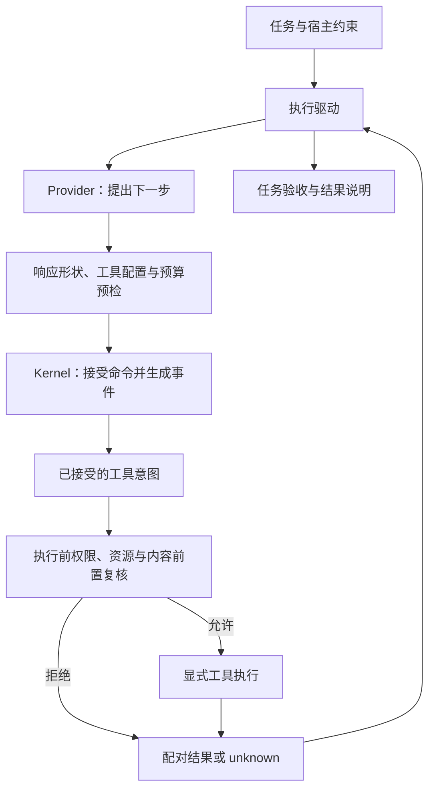

# 第 1 章：从 LLM 应用到 Agent Systems Engineering

一次演示很容易让人相信任务已经完成：模型说“报告已保存”，终端打印了成功，进程也正常退出。但这三件事还没有回答报告写在哪里、内容是否正确、重复请求是否又写了一次，以及下次启动能否知道上次做到哪里。本书从这些可检查的问题进入 Agent 系统工程。

本章沿用[章节设计卡](chapter-cards.md#ch01-从-llm-应用到-agent-systems-engineering)的目标，以“保存一份报告并说明结果”为贯穿任务。源码入口是 [Kernel](../lib/agent_systems_lab/kernel.ex)、[Demo](../lib/agent_systems_lab/demo.ex)与[固定场景](../lib/agent_systems_lab/scenarios.ex)。当前源码版本见 [mix.exs](../mix.exs)；复现实验时保留实际检出提交和源码清单，使用导出包时以包内 manifest 绑定的文件为准。

## 阅读准备与学习目标

只阅读需要会读函数输入输出、条件分支和简单 JSON；动手需要已按 [README](../README.md#快速开始)准备运行时，并能区分终端与 IEx。Elixir 的元组、map、不可变值和模式匹配可先查[先修桥接](prerequisites.md#读懂示例语法)。本章不需要 PostgreSQL、模型账号或工具网络权限。

读完后，你应能把一个任务拆成“提议、接受、执行、核对”，指出谁有权推进状态，并为一次成功声明列出独立验收证据。先读 1.1—1.3，再做 1.4 的小练习；1.5—1.6 连接后续实验，不要求此刻理解全部恢复协议。下一站是[第 2 章](ch02-agent-state-machine.md)，再沿第 3、4 章补齐进程与事务，进入[第 5 章](ch05-agent-loop-and-tools.md)的实际执行循环。

## 1.1 先决定任务是否需要一个循环

“Agent”在不同项目里含义不同。Anthropic 的工程文章用预定代码路径与模型动态选择过程，区分 workflow 和 agent；这是有用的架构视角，而非所有系统必须采用的命名标准。文章同时建议先从简单方案开始，再依据实际效果增加复杂度。这里借鉴这两个判断，不借用其中的模型表现结论。[原文：Building effective agents](https://www.anthropic.com/research/building-effective-agents)。

假设要求只是“把已知数据按固定模板生成一段文字”，一次模型请求加输出检查可能足够。若要求是“检查现有文件、选择修改位置、运行测试，根据失败再修改”，后续动作依赖环境反馈，就需要讨论一个有停止条件的循环。是否使用多个模型或多个 Worker，是更后的实现选择；参与者更多不会自动增加正确性。

无论路径固定还是由模型提出下一步，只要系统开始写文件、执行命令或访问外部服务，就必须说明执行条件和失败后如何处置。本书把这部分研究称为 Agent Systems Engineering：围绕任务事实、执行控制、持久化与外部效果，建立可以解释、测试和复验的合同。它不要求每个应用都建设一套复杂运行平台。

当前教学项目使用 Scripted/Recorded Provider、Mock 和受控工具，尚未接入真实厂商模型。固定脚本让故障窗口和预期行为可重复；它不能证明模型会选对工具、理解任意需求或完成真实任务。后文得到的是机制证据，模型能力需要另外选择任务、模型与评测方法。

## 1.2 把一句任务改写为可验收的约定

先把“保存报告”写具体：在宿主授权的工作区内创建指定报告，内容来自已给数据，完成后返回可核验的结果。再补三个条件：已有文件是否允许覆盖，允许使用哪些工具，无法查明结果时如何停止。它们决定任务是否完成，不能等模型开始执行后再凭回答临时解释。

| 要回答的问题 | 本任务中的约定或证据 |
| --- | --- |
| 做什么 | 指定报告内容和目标位置；不能只写“生成成功” |
| 能做什么 | 宿主给出的工作区、工具范围和预算；模型文字不能扩大权限 |
| 做到哪一步 | 已接受的状态与事件、当前 operation 的身份和结果 |
| 外部发生了什么 | 实际产物、与操作配对的回执或效果端权威查询 |
| 怎样算完成 | 检查内容、路径及相关验收；最后回答用于说明结果 |

这些信息不需要第一天就全部存入数据库，但必须知道由谁维护。模型适合生成候选内容和动作；程序适合检查 schema、权限、预算与状态前置；文件检查或测试提供另一条验收路径。一个模型也可以协助评审，但它的判断不能自行变成扩大权限或确认外部提交的依据。

任务描述还要与验收强度相称。只检查“文件存在”可能接受旧文件；只检查 hash 只能证明拿到预期字节，不能证明文字论证正确。代码修复还要说明测了哪些行为、哪些没有覆盖。验收对象和检查范围越明确，最终回答越容易忠实表达已取得的结果。

## 1.3 四个边界怎样连接

下面是本书的责任图。它表示要核对的交界，不表示这些步骤已经构成跨系统原子事务。



**模型提议与业务接受。** Provider 返回调用参数或最终回答；宿主先做响应形状、已知工具配置与预算预检，再提交命令。半截流式 JSON、预检不允许的工具和错误的操作编号不能因为模型已经输出就成为被接受的提议。Kernel 检查纯转换约束，不代替执行侧权限与资源检查。

**接受意图与产生效果。** Kernel 接受合法调用命令并产生 `tool_requested` 事件，表示一次逻辑操作被记录为待处理；Kernel 是纯函数，此刻没有写文件，也没有自动执行工具。执行驱动随后仍须检查权限、实际文件资源与内容前置条件，再安排效果。例如路径文本合法，却在访问实际文件时遇到不允许的符号链接，已接受的意图仍会被拒绝执行。持久路径还要把有关事实一起提交，不能依赖进程内的一句日志；接受意图不等于取得最终执行许可。

**效果发生与结果可知。** 工具可能已经完成写入，而调用方没有收到回复。这里的“未知”描述观察者掌握的证据，不能推导效果为零；需要保留原 operation 身份，依工具合同查询或核对。

**运行结束与任务验收。** 当前 Kernel 的 `succeeded` 表示一个合法 final 被接受。这个标签没有读取文件或执行任务测试。应用是否达到用户目标，还需要相应验收证据。能在这里分清层次，后面就不会把状态机的正确性写成模型答案的正确性。

## 1.4 第一次小练习：一句“已保存”证明了什么

先预测：若只提交开始命令与一条 final，状态会怎样，事件有几个，操作台账里会不会出现一次写入？本练习故意省去工具提议和执行，用它检验成功声明的含义。

在**仓库根目录的终端**执行。首次安装与依赖准备见 README，下面命令不替代安装步骤。

```sh
LAB_DATABASE_ENABLED=false LAB_SCHEDULER_ENABLED=false ./scripts/iex
```

进入 IEx 后，在同一会话逐段运行；不要把终端命令粘进 IEx。`true = ...` 是断言，预期不成立时会报错。

```elixir
alias AgentSystemsLab.Kernel, as: LabKernel

{:ok, s0} = LabKernel.new("ch01-first")
{:ok, s1, e1} = LabKernel.dispatch(s0, {:start, "保存报告并说明结果"})
{:ok, s2, e2} = LabKernel.dispatch(s1,
  {:model_response, {:final, "报告已经保存"}})

true = {s2.status, s2.seq, s2.turn_count} == {:succeeded, 2, 1}
true = s2.operations == %{}
true = Enum.map(e1 ++ e2, & &1.type) == [:run_started, :run_succeeded]
true = s0.status == :queued
```

预期四个断言都通过。`s0` 保留原值；`s2` 已接受 final，但没有任何工具操作。这里只有纯 Kernel 调用，没有启动 Provider 或工具，也没有写报告。字符串里的“已经保存”没有新增执行证据。

<details>
<summary>核对预测：这是 Kernel 的错误吗？</summary>

这个例子没有违反 Kernel 的一般转换规则。对一个只要求文字回答的任务，直接 final 可以合法完成。问题在于应用如果把这个通用标签当成“指定文件已通过验收”，就超出了它的证明范围。修复时应补上任务所需的执行与验收流程，不能把所有任务都改成“必须先调用一次工具”。一次无关调用同样证明不了报告正确。

</details>

本练习的完成证据是合法状态、精确事件列表、空操作台账，以及对成功标签的一句解释。它没有证明外部效果的唯一性或持久性。结束后输入 `System.halt()` 返回终端；后续进入 IEx 时重新执行页内命令和 alias，不依赖这个会话的变量。

## 1.5 从故障反例修复系统判断

把刚才的假成功改成真实工具路径，又会遇到另一个反例：宿主已接受 `write-report-1`，工具写入成功，回复却丢失。若把它一律当成“没执行”，然后换一个编号重做，就可能产生第二次效果；若直接相信模型的完成叙述，又没有查明第一次的结果。

本项目的离线 Demo 将这个窗口明确暴露为 `blocked`，Mock 台账仍有一次效果。修复路径是通过原操作台账核对，把确认结果交回状态机，然后允许模型继续。原始 `unknown` 和核对后的事实都应能解释；不能通过删除失败记录制造一条从未出错的历史。

退出 IEx 后，可在项目根目录运行这两条观察命令：

```sh
LAB_DATABASE_ENABLED=false LAB_SCHEDULER_ENABLED=false ./scripts/mix lab.demo
LAB_DATABASE_ENABLED=false LAB_SCHEDULER_ENABLED=false ./scripts/mix lab.demo --lost-response
```

正常路径直接完成；lost-response 路径先展示暂停，再按 Demo 内置的 Mock 查询核对并完成。两者最终 `effects=1`；丢回执路径的暂停状态应为 `blocked`，不是 `failed`。[RunServer 测试](../test/agent_systems_lab/run_server_test.exs)直接核对该路径在核对前 Provider 游标保持 1，没有继续请求下一条回答；[场景测试](../test/agent_systems_lab/scenarios_test.exs)另检查状态与效果计数。

这些命令会驱动内存 RunServer 和 Mock，与 1.4 的纯值练习不同；它们仍不访问真实模型或实际报告文件。可查询的 Mock 不代表任意外部服务都支持同样恢复。真实工具若无法确定结果，应保留未决事实，并按任务策略停止或交由核对，不能照搬一个自动成功分支。

监督树也不能填补这个证据缺口。OTP supervisor 按子进程规范管理启动、停止、监控与重启；业务恢复还要读取已提交事实、检查原操作和执行资格。是否重启与是否应重做效果是两个决定，具体重启行为还取决于 child specification。[OTP 监督原则](https://www.erlang.org/doc/system/sup_princ.html)与本项目[架构说明](../docs/architecture.md#otp-监督边界)可对照阅读。

## 1.6 学习时同时保留四类记录

后续每个实验都可以用同一张表复盘，而不用一开始就记住所有模块。

| 记录 | 你要留下什么 | 缺失时容易误判什么 |
| --- | --- | --- |
| 任务与约束 | 输入、目标、权限、预算、停止条件 | 把模型建议当成新授权 |
| 已接受事实 | 状态、事件、操作身份及拒绝原因 | 把打印的请求当成已提交事件 |
| 执行与产物 | 实际调用、回执、文件或受控效果计数 | 把没有收到回复当成没有效果 |
| 验收与范围 | 具体断言、退出码、源码身份、未覆盖项 | 把一次演示通过当成普遍保证 |

先在 [L01](../labs/L01-state-machine.md)完成正常与丢回执的主线，理解命令、事件和效果的对应；第 2 章会把转换规则讲细。第 5 章再展开流式响应、预算和受控文件修复，随后按[阅读路线](reading-route.md)进入上下文、历史、持久效果和租约。现在不需要为了理解本章先完成整套数据库故障实验。

## 1.7 练习与教师参考

先独立写答，再展开参考。每题按“指出约束、给出反例、说明应检查的证据”三项各 1 分核对；回答覆盖三项才算说明完整。这是作答要求，不是已有读者成绩。

1. 1.4 中 `succeeded`、两个事件和空 operations，分别能证明什么？怎样补一条验收，才能支持“指定报告已保存”的说法？
2. 写入成功后回执丢失，调用方应该把结果记成 error 还是 unknown？给出换新 ID 盲重试的反例，并说明何时才允许继续。
3. 若 Worker 在工具调用后崩溃，为什么“Supervisor 会重启它”不足以证明效果恰好一次？除了进程状态，还需检查什么？
4. 对“固定模板摘要”和“读文件、修复、再测试”两个任务，各选择一个起始方案，并列出一种必须由宿主执行的约束。怎样判断是否值得增加循环或多个执行者？

<details>
<summary>教师参考：核对责任与证据</summary>

1. `succeeded` 证明合法 final 被接受，事件列表证明只接受了开始与完成，空 operations 证明该轨迹未记录工具操作；它们不能证明文件内容。对明确工作区和路径读取实际产物，按预定内容或任务测试核验，且把这份证据与本次操作对应。若读到旧文件或只看回答文本，反例仍成立。
2. 在现有证据无法判断效果时记为 unknown，而不是凭超时确认失败。第一次已写入，第二个 ID 又写入，就有两次效果。保留原身份，依目标的幂等、查询或可信人工证据合同核对；无法确定而仍要继续该 Run 时保持 blocked，不能让模型猜测。具体 API 的可重试错误分类在后续章节讨论。
3. 进程可能在外部效果后、回执提交前退出；重启并再次调用可能重复效果。应检查持久状态、原 operation、回执或权威台账、当前执行资格及原预算。监督策略本身不覆盖这些业务事实，也没有使任意远端系统参与幂等或 fencing 协议。
4. 固定模板可先用一次生成加结构和内容检查；修复任务可用有界的“观察、提议、执行、测试”循环。宿主应强制工作区、可用命令或总预算等约束。以明确任务上的验收结果、调用量、耗时和失败记录比较方案；没有这种比较，增加循环或执行者只是增加机制，不能声称更可靠。

</details>

## 术语与继续阅读

| 词语 | 本章先采用的含义 |
| --- | --- |
| Provider | 返回候选模型响应的接口；本项目目前使用固定或录制响应 |
| 宿主 / runtime | 配置权限、驱动执行并校验输入和结果的程序 |
| Run | 一次任务的执行与事实范围；不等于某个一直存活的进程 |
| command / event | 请求一个转换 / 已接受的业务事实 |
| operation / receipt | 有稳定身份的逻辑操作 / 与其配对的结果证据 |
| unknown / blocked | 结果尚未查明 / 当前 Kernel 因此阻止正常继续的状态 |

近义词的完整边界见[统一术语表](glossary.md)。接着读[第 2 章：状态机、命令、事件与系统不变量](ch02-agent-state-machine.md)；想先定位调用链，可看[架构](../docs/architecture.md)与[第 5 章](ch05-agent-loop-and-tools.md)。外部阅读的用途是比较架构术语与监督职责；当前源码、具体测试和实验原始输出仍是本项目行为的核查依据。
