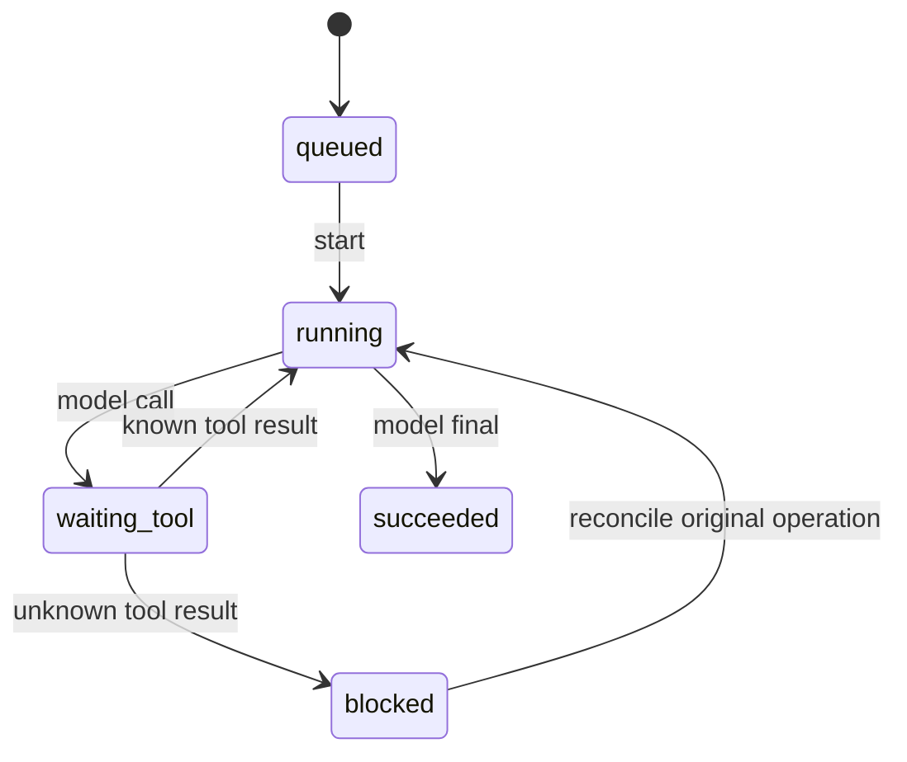

# 第 2 章：状态机、命令、事件与系统不变量

本章始写于第 22 周，主题沿用原计划第 2 章。对应当前仓库的 [L01](../labs/L01-state-machine.md)，代码入口是 [Kernel](../lib/agent_systems_lab/kernel.ex)、[State](../lib/agent_systems_lab/kernel/state.ex) 与 [Event](../lib/agent_systems_lab/kernel/event.ex)。本章可以完全离线完成；本轮采用多代理模拟评审，范围与实际执行证据见[修订评审记录](../docs/learning-revision-review.md)。模拟发现的问题和自动化结果不能换算为真人学习效果。

读完后，你应能从一段合法命令轨迹推出状态和事件，解释为什么拒绝命令不能顺手修改状态，并指出重放与实际续跑之间缺少的边界。先读状态，再接触进程和数据库，有助于把业务规则与执行策略分开。

## 阅读准备与路线

本章是六章技术主线的起点；新读者可先读[第 1 章导读](ch01-from-llm-apps-to-agent-systems-engineering.md)，认识模型提议、宿主控制、外部效果与证据的区别。概念阅读只需知道“请求可能被拒绝、外部操作可能丢回执”；动手前应会打开仓库根目录的终端，分辨 shell 与 IEx，并读懂 Elixir 的 tuple、Map、模式匹配和不可变值。先完成[先修知识与最小桥接](prerequisites.md)的对应检查；环境安装耗时另计，不必一次完成整个 L01。

先读 2.1—2.2，再做 2.3 的小练习和完整轨迹，最后用 2.4—2.6 检查反例。本章只推进内存中的值；下一站是[第 5 章](ch05-agent-loop-and-tools.md)中真正区分模型提议与工具效果的循环。当前完整路线为 **2 → 5 → 8 → 14 → 16 → 20**，各章依赖见[课程地图](../docs/course-map.md)。

| 本章词语 | 先抓住的含义 |
| --- | --- |
| command / event | 待接受的请求 / 已获接受的业务事实；拒绝请求没有新事件 |
| State / seq | 当前业务值 / 已接受事件的位置；不是进程与时钟 |
| operation / unknown | 有稳定身份的逻辑操作 / 效果是否成立尚未查明 |

随时查[统一术语表](glossary.md)；遇到 `replay`，先按“根据事件计算 State”理解，不按“重新执行工具”理解。

## 2.1 一个最小任务的七种状态

贯穿任务是“保存一份报告并说明结果”。模型只能提出下一步，宿主决定是否接受；工具产生外部效果，回执再交给状态机。

| 状态 | 已知事实 | 下一步合法动作的例子 |
| --- | --- | --- |
| `queued` | 尚未接受输入 | `start` |
| `running` | 可以接受一轮模型回答 | 工具提议或最终回答 |
| `waiting_tool` | 已接受一个工具操作，尚未记入结果 | 配对的 `tool_result` |
| `blocked` | 当前操作结果未知 | 对原操作显式 `reconcile` |
| `succeeded` | 已接受最终回答 | 无后续业务命令 |
| `failed` | 已记录失败原因 | 无后续业务命令 |
| `cancelled` | 已记录取消原因 | 无后续业务命令 |



图省略了所有非终态都可接受的 `fail` 和 `cancel`。这两条路径保留已有操作事实；取消并不声称撤销文件写入或其它已经发生的效果。`blocked` 不是一个可以随意恢复的暂停按钮，它要求先澄清某次具体操作。

## 2.2 命令可以失败，事件必须已经成立

命令表达请求，例如“接受这条工具结果”。事件表达状态机已经接受的事实，例如“操作 A 的结果已记入”。`Kernel.dispatch/2` 先验证当前 State 和命令，成功后产生下一序号的一个事件，再通过同一套规则应用事件。

```text
旧 State + Command
        │ 验证身份、前置状态、预算、结果配对
        ├── 拒绝 → {:error, reason}，无新事件
        └── 接受 → {:ok, 新 State, [Event]}
```

State 是不可变的 Elixir 值，不是 GenServer。Kernel 中没有时钟、随机数、模型、文件访问或进程创建。调用方只有拿到成功返回值后，才选择以新值替换旧值。拒绝时不返回一个“部分修改”的 State。

Event 包含 `run_id`、连续 `seq`、`schema_version`、事件类型和数据。操作编号 `operation_id` 标识当前 Run 内的一次逻辑工具操作，不能重复使用；它与 Event 序号、流式请求引用、Worker 执行代次分别回答不同问题。

## 2.3 用值跑完一次完整轨迹

在仓库根目录运行以下命令；本章不需要数据库、模型密钥或网络工具。

```sh
export LAB_SCHEDULER_ENABLED=false
LAB_DATABASE_ENABLED=false ./scripts/mix test test/agent_systems_lab/kernel_test.exs test/agent_systems_lab/kernel_tool_pairing_test.exs
LAB_DATABASE_ENABLED=false ./scripts/iex
```

本章后续 shell 命令沿用这个终端；新开终端时先重新设置 `LAB_SCHEDULER_ENABLED=false`，避免继承其他实验启用的后台调度器。

在同一个 IEx 会话逐段执行。所有工具结果都由教学代码手动提供，尚未产生外部效果。

**第一次小练习：先证明一次拒绝。** 先预测：尚未 `start` 时提交最终回答，`status`、`seq`、`turn_count` 会不会变化？只运行下面这段，再继续完整轨迹。提示：接收错误返回不等于接收一个失败事件。

```elixir
alias AgentSystemsLab.Kernel, as: LabKernel
{:ok, first} = LabKernel.new("ch02-first")
before_rejection = first
{:error, {:invalid_transition, :queued, :model_response}} =
  LabKernel.dispatch(first, {:model_response, {:final, "过早回答"}})
true = first == before_rejection
true = {first.status, first.seq, first.turn_count} == {:queued, 0, 0}
```

可验证结果是匹配错误原因成功，两个 `true` 断言都通过。不要把它改成 `{:fail, reason}` 来“修好”：后者是另一个合法命令，会产生新的失败事件。

```elixir
alias AgentSystemsLab.Kernel, as: LabKernel

{:ok, s0} = LabKernel.new("ch02-report", max_turns: 2)
{:ok, s1, e1} = LabKernel.dispatch(s0, {:start, "保存模拟报告"})
call = %{
  operation_id: "report-1",
  tool: "mock_write",
  arguments: %{key: "report", value: "hello"}
}
{:ok, s2, e2} = LabKernel.dispatch(s1, {:model_response, {:call, call}})
true = s2.status == :waiting_tool
true = s2.turn_count == 1
true = s2.pending_operation_id == "report-1"

{:ok, s3, e3} = LabKernel.dispatch(s2,
  {:tool_result, "report-1", {:ok, %{saved: true}}})
{:ok, s4, e4} = LabKernel.dispatch(s3, {:model_response, {:final, "报告已记录"}})
true = {s4.status, s4.turn_count, s4.seq} == {:succeeded, 2, 4}
true = s4.operations["report-1"].status == :ok
events = e1 ++ e2 ++ e3 ++ e4
{:ok, rebuilt} = LabKernel.rebuild("ch02-report", events, max_turns: 2)
true = rebuilt == s4
```

两轮是工具提议和最终回答各一轮。工具结果与核对不消耗模型轮数。`max_turns` 属于运行配置，非默认值必须在重建时原样提供；不能只凭事件列表猜测原预算。

现在故意提交不合法命令，并保留实际返回的原因：

```elixir
{:error, _} = LabKernel.dispatch(s0, {:model_response, {:final, "尚未开始"}})
{:error, _} = LabKernel.dispatch(s2, {:tool_result, "other", {:ok, :saved}})
{:error, _} = LabKernel.dispatch(s2, {:model_response, {:final, "仍在等工具"}})
{:error, _} = LabKernel.dispatch(s3, {:model_response, {:call, call}})
{:error, {:terminal_run, :succeeded}} = LabKernel.dispatch(s4, {:cancel, :too_late})
```

第四个错误证明已经完成的操作编号也不能再次申请。调用 ID 不能只与“当前待处理”比较，还要与完整 operations 台账比较。

## 2.4 结果未知为什么要成为业务状态

工具超时可能发生在效果之前，也可能发生在效果之后。客户端看不到回执时，不能根据自己等待了多久推断效果不存在。下面构造一条独立轨迹：

```elixir
{:ok, u0} = LabKernel.new("ch02-unknown", max_turns: 2)
{:ok, u1, _} = LabKernel.dispatch(u0, {:start, "核对报告"})
{:ok, u2, _} = LabKernel.dispatch(u1, {:model_response, {:call, call}})
{:ok, u3, _} = LabKernel.dispatch(u2,
  {:tool_result, "report-1", {:unknown, :response_lost}})
true = u3.status == :blocked
true = u3.operations["report-1"].status == :unknown
{:error, _} = LabKernel.dispatch(u3, {:model_response, {:final, "假定成功"}})
{:ok, u4, _} = LabKernel.dispatch(u3,
  {:reconcile, "report-1", {:ok, %{saved: true}}})
true = u4.status == :running
true = u4.turn_count == u3.turn_count
```

这里手写的核对结果只说明协议形状。实际系统必须凭原 operation ID 查询可信台账或经明确的人工核对，不能让模型凭叙述确认成功。只要仍希望继续这个 Run，无法查明的非幂等效果就应保持 `blocked`，不能换 ID 盲重试。

取消是另一种选择，但它结束任务推进，并不查清效果。下面从同一个 `u3` 值演示另一条分支；不接续上面的 `u4`：

```elixir
{:ok, cancelled_unknown, _} = LabKernel.dispatch(u3, {:cancel, :stop_task})
true = cancelled_unknown.status == :cancelled
true = cancelled_unknown.operations["report-1"].status == :unknown
true = cancelled_unknown.turn_count == u3.turn_count
{:error, {:terminal_run, :cancelled}} = LabKernel.dispatch(cancelled_unknown,
  {:reconcile, "report-1", {:ok, %{saved: true}}})
```

因此，任务已取消不代表原操作已失败、已撤销或已核对；终态也不允许在这个 Run 中继续 `reconcile`。若业务需要后续调查，宿主必须保留原操作身份与审计证据并安排独立核对流程，不能仅靠一个 `cancelled` 标签关闭效果账目。

普通 `{:error, reason}` 工具结果与 `unknown` 不同：前者是已知结果，Kernel 返回 `running` 让模型选择下一步；后者阻止继续推理。是否重试已知错误由后续重试策略决定，Kernel 不替调用者循环执行。

## 2.5 重放不是把旧命令再执行一次

`rebuild/3` 依序读取事件，通过 `apply_event/2` 检查 Run 身份、序号、业务 schema、类型、载荷和合法转换。它计算 State，不调用 Provider，不执行工具，也不写数据库。顺序错误和重复事件必须拒绝。

```elixir
{:error, _} = LabKernel.rebuild("different-run", events, max_turns: 2)
{:error, _} = LabKernel.rebuild("ch02-report", Enum.reverse(events), max_turns: 2)
{:error, _} = LabKernel.rebuild("ch02-report", events ++ [List.last(events)], max_turns: 2)
```

重放的相等结论有前提：完整且合法的原事件、同一 Run ID、同一运行配置，以及支持这些数据版本的代码。本章并未证明内存列表在 BEAM 退出后仍然存在。持久化需 [L02](../labs/L02-transactions.md) 的 Run/Event/调度意图原子提交；读取与检查点见 [第 14 章](ch14-history-checkpoints-and-replay.md)。

第 21 周的历史存储 envelope v2 只改变持久载荷封装。它不等于 Kernel 业务 schema v2，也不把不支持的 schema 自动降级。升级边界见 [L20](../labs/L20-history-migration-backup-restore.md)。

## 2.6 把不变量写成能失败的断言

| 不变量 | 最短反例 | 现有测试 |
| --- | --- | --- |
| 终态不可改写 | 成功后再取消或提交最终回答 | [kernel_test](../test/agent_systems_lab/kernel_test.exs) |
| 一次只等一个操作 | 等待 A 时提交另一个模型调用 | 同上 |
| 结果必须匹配操作 | 等待 A 时提交 B 的回执 | [kernel_tool_pairing_test](../test/agent_systems_lab/kernel_tool_pairing_test.exs) |
| 未知结果不能默默继续 | unknown 后提交最终回答 | kernel_test |
| 重放不能绕过转换规则 | 伪造合法序号但非法的事件 | kernel_test |

轮数预算也要覆盖边界：`max_turns: 1` 时，接受工具提议、接受工具结果之后，再提交最终回答会返回 `{:turn_budget_exhausted, 1}`；Kernel 保持 `running`。RunServer 决定把资源耗尽记录为显式 `failed`。把“拒绝命令”和“产生失败事件”写成同一动作，会模糊谁有权结束任务。

权限同样有边界。Kernel 验证通用调用形状与结果配对；当前工具白名单、文件路径和 schema 由 Gateway/工具执行层验证。直接调用 Kernel 的手写示例不能证明文件访问已获授权，更不能替代隔离执行器。

## 2.7 验收与常见卡点

完成 [L01](../labs/L01-state-machine.md) 的 Mock 效果丢回执实验，提交状态图、命令/事件轨迹、拒绝原因、工具请求数与效果数、重放相等断言。用这些证据解释每一步，而不是只提交一个 `succeeded` 截图。

| 卡点 | 如何定位 |
| --- | --- |
| `Kernel` 与 Elixir 自带模块混淆 | 使用本章 `LabKernel` alias |
| 非默认预算重放失败 | 将原 `max_turns` 传回 `rebuild/3` |
| 手工输入回执被误认为效果证明 | 分别列出 Kernel 事实与 Mock 台账 |
| 取消后仍有操作记录 | 检查效果是否已经发生；取消不回退已用轮数，也不撤销效果 |
| 看到 unknown 就再执行一次 | 先按原操作身份核对，不能先换新 ID |

练习：删除一条事件、交换两条事件、篡改业务 schema，各写一个拒绝断言；再解释为什么仅保存最终 State 无法提供同样的执行解释。参考 [ADR 0001](../docs/adr/0001-pure-kernel-and-explicit-effects.md) 与 [L01 解答](../labs/solutions/L01.md)。
