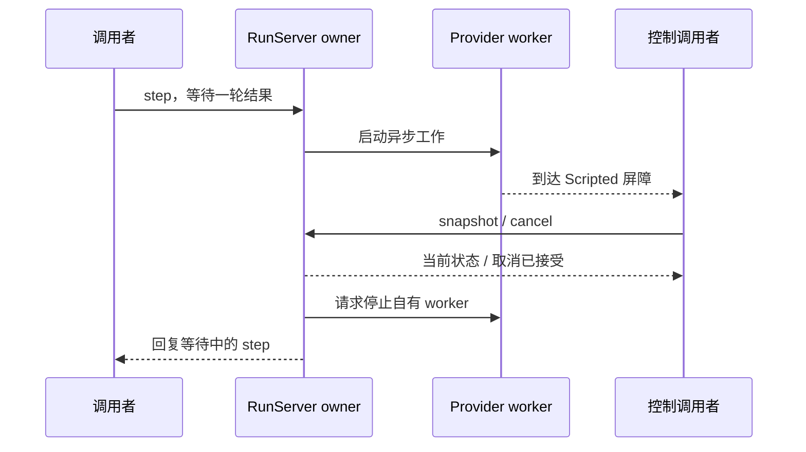

# 第 3 章：进程、线程、异步、Actor 与消息传递

[第 2 章](ch02-agent-state-machine.md)把任务写成纯状态转换，本章给这些值安排一个活着的 owner。问题不只是“把函数放到另一个进程”：当模型卡住、旧消息晚到、owner 退出时，谁仍能接收取消，谁能判断结果属于哪一轮，哪些事实又会随进程消失？

本章对照 [RunServer](../lib/agent_systems_lab/run_server.ex)、[应用监督树](../lib/agent_systems_lab/application.ex)与 [Scripted Provider](../lib/agent_systems_lab/providers/scripted.ex)。源码身份以实际检出提交、[固定运行时](../.tool-versions)及导出包 manifest 为准。本项目使用离线脚本与受控工具；这里不要求模型账号或数据库。

## 阅读准备与学习目标

应能解释 State、事件和不可变值，并读懂 tuple、匿名函数、模式匹配。`pid` 是进程标识，`ref` 是用于区分本次交互的引用；模式中的 `^value` 要求收到的值与已有变量相等。先看[语法桥接](prerequisites.md#读懂示例语法)，不必先会实现 GenServer。

读完应能区分 Run、BEAM 进程与 OS 进程，画出 owner 与异步 worker 的消息路径，用精确 PID/ref 观察退出，并解释监督重启与任务恢复各需要什么证据。先完成 3.2 的小练习，再读 3.3—3.6；数据库恢复留到后面的历史与效果章节。

## 3.1 同一个任务有几种身份

BEAM 进程是运行时调度的执行单位，持有自己的邮箱与状态。一个 BEAM 虚拟机中可有许多这样的进程；不要把架构图中的每个 Actor 画成一台操作系统进程。调度器与 OS 线程怎样使用机器资源是另一层问题，本章不根据进程数量推算性能。

Actor 可以先理解为一种组织责任的方法：一个 owner 持有当前状态，其他参与者通过消息提出请求。它不自动赋予消息持久性、跨主机唯一性或业务上的恰好一次保证。发送一个 map 也不意味着两个进程从此共同就地修改同一份业务状态；接收者仍需决定是否接受消息及如何产生新值。

| 身份 | 在当前项目中回答什么 | 不能据此推导什么 |
| --- | --- | --- |
| Run ID | 哪一次逻辑任务及其事实范围 | 某个执行进程永远存活 |
| BEAM PID | 当前正在运行的进程 | 数据库中的任务已完成 |
| request ref | 当前模型请求与相关通知 | 外部工具获得了授权 |
| OS PID | 哪个虚拟机或外部程序实例 | 其中只有一个业务任务 |

RunServer 用 Registry 的唯一 key 注册当前本机 owner。旧进程退出、名称释放后，可以创建同名的新内存 Run；新进程不会因此继承旧事件、Provider 游标或 Mock 台账。命名解决“此刻去哪里找它”，历史解决“先前发生了什么”。这也是后面需要持久恢复协议的原因。

## 3.2 第一次小练习：回复与退出是两条消息

在仓库根目录终端运行以下命令；环境安装见 [README](../README.md#快速开始)。本章所有示例只操作自己创建的进程。

```sh
LAB_DATABASE_ENABLED=false LAB_SCHEDULER_ENABLED=false ./scripts/iex
```

进入 IEx 后整块运行下面代码。先预测：邮箱里先放了一条旧回复，新请求的匹配会不会取走它？收到业务回复后，是否还需要单独观察进程退出？这里的五秒是失败时的有界等待，不是用于猜测执行先后的 sleep。

```elixir
parent = self()
request_ref = make_ref()
old_ref = make_ref()
send(parent, {:reply, old_ref, parent, :old})

{worker, monitor} = spawn_monitor(fn ->
  receive do
    {:work, ^request_ref, from} ->
      send(from, {:reply, request_ref, self(), :done})
  after
    5_000 -> exit(:request_missing)
  end
end)
send(worker, {:work, request_ref, parent})

:matched = receive do
  {:reply, ^request_ref, ^worker, :done} -> :matched
after
  5_000 -> raise "没有收到当前请求的回复"
end
:observed_exit = receive do
  {:DOWN, ^monitor, :process, ^worker, :normal} -> :observed_exit
after
  5_000 -> raise "没有观察到自有进程退出"
end
:old_still_present = receive do
  {:reply, ^old_ref, ^parent, :old} -> :old_still_present
after
  0 -> raise "旧消息不应被当前匹配取走"
end
true = worker != parent
```

预期三次 receive 均匹配成功，最后断言为 true。选择性 receive 寻找符合模式的消息，不匹配的旧消息并不会自动成为当前回复，也不会因一次成功匹配而消失。代码最后特意收走自己制造的旧消息，避免污染后面的会话。

`:reply` 是我们定义的业务消息，`:DOWN` 是 monitor 的退出通知，不能相互替代。这个裸消息练习只核对元组里的数据：其中的 PID 仍是发送者可以填写的字段，并不构成发送者身份认证。RunServer 后面还会核对调用协议提供的实际 caller；不要把一段相关性练习解释成防伪协议。

## 3.3 串行决策与异步等待如何同时成立

GenServer 把特定 owner 的回调逐个处理，便于把检查和状态替换集中起来。但如果 `handle_call` 自己同步执行耗时模型请求，owner 就要等它返回，期间无法及时处理新的 snapshot 或 cancel。只把代码放进 GenServer，并没有解决这个阻塞。

当前 RunServer 在 Task.Supervisor 下启动 Provider worker，保留待回复的调用者，然后返回消息循环。`step/1` 的调用者仍在等待结果，owner 却已经能够处理其他请求。`start_stream/1` 则立即返回本轮 request ref，结果由订阅通知和后续 snapshot 观察。两种 API 的等待方式不同，业务接受规则相同。



图里有两个等待者：业务调用者等待一步的结果，控制调用者等待状态或取消确认。它们不需要是同一个进程。这个安排让控制保持可响应；它没有使外部 I/O 自动可撤销，也没有保证所有回调都不会耗时。应继续检查每条执行路径把工作放在哪里。

还要分清 API 的等待期限与任务的执行期限。普通 `GenServer.call` 的调用者等待超时，不等于服务器已取消收到的工作；本项目 `step/1` 显式无限等待，由 RunServer 自己的模型与 Run deadline 结束请求。给调用者增加一个外部超时，只改变它愿意等多久，不能替代对原任务的状态查询与清理证据。

邮箱也没有因采用 Actor 就天然有界。若消息到达比 owner 消费更快，排队仍会增长；把每个请求都丢给新 worker，可能进一步放大压力。并发上限、背压与持久队列应单独设计，后面会在调度章节展开。本章先保证控制路径可解释，不根据一次响应及时就推断系统在任意负载下都能及时取消。

## 3.4 用屏障证明 owner 仍可响应

下面创建全新的内存 Run，把 Provider 明确停在一轮文本输出之前。整块代码可以在当前 IEx 执行。model 和 Run 时限分别给五分钟、十分钟，方便人工观察；每次 receive 仍有自己的等待上限。`storage: :memory` 与前面的环境开关一起说明执行范围。

```elixir
alias AgentSystemsLab.RunServer
id = "ch03-#{System.unique_integer([:positive])}"
gate_ref = make_ref()
controller = self()
{:ok, server} = AgentSystemsLab.start_run(
  run_id: id, input: "观察异步控制", storage: :memory,
  model_timeout_ms: 300_000, run_timeout_ms: 600_000,
  script: [{:stream, [{:gate, controller, gate_ref}, {:text_delta, "late"}, :done]}])
{caller, caller_monitor} = spawn_monitor(fn ->
  send(controller, {:step_reply, id, RunServer.step(server)})
end)

try do
  worker = receive do
    {:scripted_gate, ^gate_ref, pid} -> pid
  after
    5_000 -> raise "Provider 未到达本次屏障"
  end
  worker_monitor = Process.monitor(worker)
  true = RunServer.snapshot(server).state.seq == 1
  :waiting = receive do
    {:step_reply, ^id, _} -> raise "屏障释放前不应完成"
  after
    0 -> :waiting
  end
  {:ok, cancelled} = RunServer.cancel(server, :lesson_stop)
  true = cancelled.state.status == :cancelled
  :same_result = receive do
    {:step_reply, ^id, {:ok, returned}} ->
      true = returned.state == cancelled.state
      :same_result
  after
    5_000 -> raise "step 调用者没有收到取消结果"
  end
  :worker_exited = receive do
    {:DOWN, ^worker_monitor, :process, ^worker, :killed} -> :worker_exited
  after
    5_000 -> raise "未观察到 Provider worker 退出"
  end
  :caller_exited = receive do
    {:DOWN, ^caller_monitor, :process, ^caller, :normal} -> :caller_exited
  after
    5_000 -> raise "未观察到本次调用者退出"
  end
after
  if Process.alive?(server), do: GenServer.stop(server)
  if Process.alive?(caller), do: Process.exit(caller, :kill)
end
```

屏障到达证明本轮 Provider 已经运行并停在指定位置，比“等 10 毫秒应该够了”更有解释力。此时读取 seq=1，说明开始事件已经接受，模型响应尚未接受；等待中的 step 没有阻止第二个进程发出取消。取消回复与 worker 的 DOWN 另行匹配，形成两条证据。

当前教学 RunServer 先接受取消转换，再发出清理；`stop_worker/1` 不等待 DOWN。例子额外观察退出，不能反过来声称 cancel 的返回值已经保证调用者看到了退出通知。收尾只停止本段自己创建的 server 与 caller，没有关闭应用的共享监督树。

## 3.5 ref、caller、monitor 与 link 各管哪件事

Provider 的帧交互采用本轮 request ref、登记的 worker PID 和 `GenServer.call` 提供的实际 caller 三者核对。只在 payload 填对 PID 不够；旧 ref 和其他 caller 会得到 `:stale_request`，不能推进当前请求。这是当前单可信宿主的相关性防护，不是跨主机的工具授权或持久 fencing token。

Monitor 是观察关系，匹配时要同时绑定 monitor ref 与目标 PID。一个不相关进程的退出通知不能用于收尾当前 worker；一个正常退出也不能证明文件没有写入。link 则涉及退出信号传播，还需结合 `trap_exit` 与处理分支理解。GenServer 不会仅因采用这个 behaviour 就自动捕获所有退出；RunServer 在初始化时显式设置了 `trap_exit`。

因此，“同时 link 和 monitor，再写一个 DOWN 分支”不是通用容错配方。先说明哪个进程可以因哪种原因退出，哪个 owner 承担清理，何时向业务调用者回复。小练习选择 `spawn_monitor`，避免让一个故意失败的链接进程把交互 owner 一并带走；并不因此保证业务操作回滚。

## 3.6 监督树修复进程结构，历史修复业务理解

当前应用的子树按 Repo（可选）、Registry、ProviderSupervisor、RunSupervisor 等依赖顺序启动，顶层采用 `rest_for_one`。本例验证有序停止完整 Registry 子树（包含分区）时，后续依赖者被停止并按策略重建，以免旧 Run owner 仍活着、新 Registry 却接纳另一个同名 owner；任意 kill 某个分区或破坏监督树不在这项证明范围内。具体行为见[监督测试](../test/agent_systems_lab/supervision_test.exs)。

另一方面，RunServer 自身的 child specification 为 `temporary`：不能仅看 RunSupervisor 的 `one_for_one` 就断言每个任务子进程都会自动重启。策略决定如何处理依赖，child specification 决定某个子进程是否符合重启条件。示意图中的“重启”箭头必须带上这些前提。

即使进程重新启动，内存事件、游标、流片段和 Mock 回执也可能已经消失。持久恢复需要读取已提交历史，核对原 operation 与结果，检查预算和当前执行资格，再决定下一步。Supervisor 不会查询远端效果，也不会替业务协议选择一个新 operation ID。后续[第 14 章](ch14-history-checkpoints-and-replay.md)与[第 16 章](ch16-durable-effects-and-reconciliation.md)分别展开这些事实。

需要运行 `supervision_test.exs` 时，使用关闭数据库和全局 Scheduler 的独占新测试 BEAM。该测试用有序停止完整 Registry 子树观察依赖清理，不等于任意 kill 分区。不要把其内部停止语句复制到有其他教学任务的共享 IEx。上面的章节练习已经足以证明消息和控制边界，无需为此破坏共享运行环境。

## 3.7 练习与教师参考

每题先写反例，再列证据。不变量、反例、实际证据三项各 0—2 分；至少 5/6 且没有把进程退出当成效果回滚，才算说明完整。这是练习判据，不是已有读者成绩。

1. 同一个 Run ID 创建了新的 PID，能否据此称为“恢复原任务”？列出内存模式丢失的一类事实，以及持久恢复必须读取的一类事实。
2. 3.2 的旧回复为什么还在邮箱里？若只匹配 `{:reply, _, _, result}`，哪一条结论会失效？原始消息中的 PID 又能否证明真实 sender？
3. 3.4 中 step 尚在等待，为什么 cancel 可以返回？分别用哪条证据证明取消接受、worker 退出和等待者得到结果？
4. `one_for_one`、`temporary`、`rest_for_one` 分别约束什么？为什么监督测试应放在独占新 BEAM，而不在共享 IEx 随意停止 Registry？

<details>
<summary>教师参考：先分清事实与生命周期</summary>

1. 不能。名称可以重新注册，新内存 Run 没有自动继承旧 events、Provider 游标或效果台账。持久路径需读取已提交状态/历史和原操作事实，不能只检查名称与新 PID；否则已完成的效果可能被重新执行。
2. 选择性 receive 只取符合已有 ref/PID 模式的消息，旧 ref 不匹配。宽泛模式可能把旧回复当成本次成功。PID 只是原始 tuple 的字段；本机 RunServer 还核对实际 caller，且这仍不是远端授权证明。
3. owner 把 Provider 工作放到异步进程，并将 step 的等待者留待以后回复。cancel 返回的终态说明转换已接受；精确 monitor 的 DOWN 说明 worker 退出；本轮 `step_reply` 说明调用者收到相同业务状态。三者不可替代，且均不表示撤销外部效果。
4. `one_for_one` 是故障处理策略，`temporary` 是该子进程的重启属性，`rest_for_one` 处理有序依赖。本例有序停止完整 Registry 子树会影响依赖 Run，不据此证明任意分区故障；共享会话中照抄停止语句会干扰别的任务。独占测试应同时观察旧 PID 退出、依赖子树代次与新 owner 的初始状态。

</details>

## 术语与继续阅读

PID 指当前进程；mailbox 保存待接收消息；ref 用于区分交互；monitor 观察退出；link 参与退出传播；Supervisor 按规范管理生命周期。它们都不等于持久业务历史。完整近义词对照见[术语表](glossary.md)。

OTP 官方的[进程说明](https://www.erlang.org/doc/system/ref_man_processes.html)、[GenServer 接口](https://www.erlang.org/doc/apps/stdlib/gen_server.html)与[监督原则](https://www.erlang.org/doc/system/sup_princ.html)用于核对通用职责；在线文档可能对应更新版本，项目实际固定运行时仍以仓库配置为准。接下来读[第 4 章：事务、WAL 与故障模型](ch04-transactions-wal-and-failures.md)，将“进程里看到的状态”连接到“已提交的持久事实”；流式时间线见[第 6 章](ch06-streaming-cancellation-and-control.md)。
