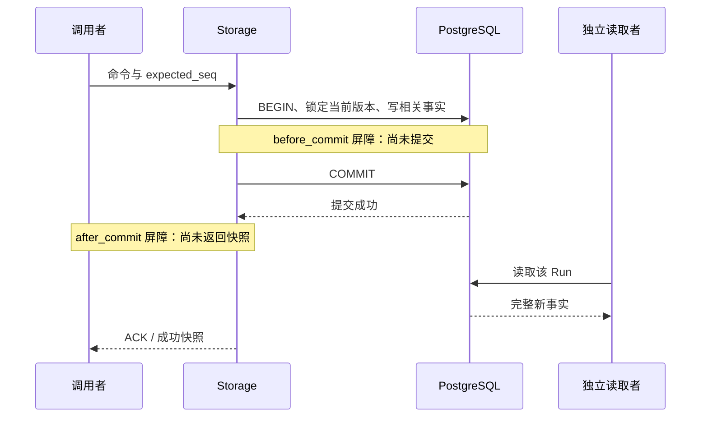

# 第 4 章：事务、WAL、持久化与故障模型

进程退出后，变量消失；任务却可能已经改变了数据库。第 3 章回答了如何识别进程和消息，本章接着问：一次任务转换究竟在哪一刻成为可重新读取的事实？如果调用者在收到答复前被杀，后来者依据什么判断下一步？

本章沿用[第 2 章](ch02-agent-state-machine.md)的纯状态机，对照 [Storage](../lib/agent_systems_lab/storage.ex)、[StorageVerification](../lib/agent_systems_lab/storage_verification.ex)与 [L02](../labs/L02-transactions.md)。实际源码版本由 [mix.exs](../mix.exs)与检出提交标识；复现时保留提交和源码清单。例子使用真实 PostgreSQL，但不调用模型或执行报告文件写入。

## 阅读准备与学习目标

先能解释 State、Command、Event 和 seq，并知道进程内存与数据库是不同位置。需要补 SQL 的读者先把事务理解为“一组写入共同接受或共同撤销”；不必先掌握索引、查询优化或 PostgreSQL 运维。第一次小练习只用内存；数据库段需要按 [README](../README.md#快速开始)准备自己拥有的可丢弃实例。完整的 L02 作业安排在本章最小观察之后。

读完后应能画出 Run、Event、intent 的共同提交边界，解释 COMMIT 与调用方 ACK 的区别，并为提交前后四个故障窗分别列出旧、新事实。先读 4.1—4.3，再做 4.4；具备数据库环境后继续 4.5—4.7。下一站是[第 5 章](ch05-agent-loop-and-tools.md)的执行循环。

## 4.1 为什么保存三个值仍可能丢任务

设旧版本 Run 位于 seq=1，下一步准备接受一个工具提议。纯 Kernel 可以一次算出 seq=2 的 State 和一个 `tool_requested` 事件；执行驱动还需要一项 tool intent，说明后续应处理这个版本。若程序先更新 Run，再写 Event，最后新增 intent，每次写入都独立提交，就会出现三个不同的失败窗口。

Run 已前进而 Event 尚未保存，重建会得到旧状态；Event 已保存而 Run 仍旧，投影与历史不一致；两者都新却没有 intent，扫描器没有可发现的待办。反过来，旧意图没有一同失效，扫描器可能继续处理上一版本。这些问题不能靠“重启监督树”补出缺失事实，因为监督者不知道哪几个写入原本应属于同一次决定。

本项目把 Run 投影、已接受 Event、旧意图 superseded 和下一意图纳入一个数据库事务。非终态有与当前版本相配的待办，终态没有 pending 意图。相关恢复记录或预算等后续事实也必须沿其明确的事务入口保存；不能因为三个基础表一致，就认为任意辅助写入已经获得相同保证。

| 材料 | 它回答什么 | 它单独不能证明什么 |
| --- | --- | --- |
| Run 投影 | 当前状态、序号与配置是什么 | 完整历史一定存在 |
| Event 历史 | 哪些业务转换已被接受 | 下一步实际执行了什么 |
| intent | 当前版本接下来需要被驱动什么 | Provider 或工具已经被调用 |
| 调用返回值 | 这次调用者看到了什么 | 没收到返回值就代表没有提交 |

事务的单位应从业务不变量倒推。PostgreSQL 的事务把多个步骤作为一个整体处理，其他事务不能看见这组步骤的未提交中间结果；具体概念可对照[官方事务教程](https://www.postgresql.org/docs/18/tutorial-transactions.html)。本章关注的是这组事实共同提交，而不是把全部系统活动放进一个无限大的事务。

## 4.2 COMMIT 是事实边界，ACK 是知识边界

Storage 先读取并锁住当前 Run，检查 `expected_seq`，调用纯 Kernel 得到转换，再写入相关行。COMMIT 成功后，新的数据库事实已经成立；Storage 随后才向调用者返回快照。因此至少存在两个不同时间点：数据库接受提交，以及调用者知道提交成功。



图中的 ACK 是应用调用的成功答复，不是要求读者寻找一张名为 ACK 的表。真实网络还可能在不同位置断开；本章用明确的受控屏障固定观察窗口。调用者没有收到成功时，可能处于尚未提交、已回滚或已经提交的不同情况，单凭错误字符串不能选定其中一种。

如果 COMMIT 已成立，却按“调用失败，所以重新创建”处理，可能遇到 `already_exists`；如果已经接受了某次转换，却把它当旧序号重发，会得到版本冲突。这些拒绝是查找事实的线索，不是要求程序不停修改编号直至某次成功。先读取原 Run、核对序号和事件，再决定请求是否已经被接受。

这里仍只有一个 PostgreSQL 事务。外部文件、HTTP 服务或模型供应商没有因为 intent 入库而参与它。将文件写入放在事务函数中，也不会自动把文件系统变成可随数据库 ROLLBACK 撤销的参与者。外部效果与回执的协议留到[第 16 章](ch16-durable-effects-and-reconciliation.md)。

## 4.3 WAL 保护什么，配置又限制什么

WAL 的基本次序是先把描述变化的日志刷到持久存储，再让相应数据页写入；崩溃恢复可据此重做已经记录而尚未反映到数据页的变化。[PostgreSQL 18 的 WAL 说明](https://www.postgresql.org/docs/18/wal-intro.html)解释了这一顺序。业务 Event 与数据库 WAL 用途不同：前者是本项目可重建的业务事实，后者由数据库管理，不能互相充当格式兼容的备份。

在通常的同步提交下，服务器等到相应 WAL 已持久化才报告成功。异步提交允许更早报告成功，因此服务器崩溃时可能丢失最近一段已报告完成的事务；这不等同于关闭 fsync 的风险。两种设置的差异见[异步提交文档](https://www.postgresql.org/docs/18/wal-async-commit.html)。本项目实验要求记录实际的持久性配置，不能只写“默认配置”。

`fsync`、`synchronous_commit` 与 `full_page_writes` 分别参与数据库持久性策略；本章不把三个开关相同当成所有宿主具有相同故障行为。操作系统、存储设备和断电条件仍影响结论范围。实际读取了 on，再杀掉应用调用进程，只能证明这次配置和这类进程故障下的观察，不能写成已经拔电、损坏磁盘或验证异地容灾。

还有一个容易忽略的限制：让三张表同时提交，不保证不同 SQL 语句在任意隔离级别下都读到同一个长期不变的世界。这里的写入协议通过 Run 行锁串行化竞争决策，并用 seq 指明决策依据；后续租约与执行代次还有各自校验。不要把“用了事务”简化为“任何并发问题都已解决”。

## 4.4 第一次小练习：能编码不等于已持久化

先预测：把一个 map 编成二进制，是否已经创建数据库行？PID 能否成为保存给下一次启动的业务值？在项目根目录的终端运行以下命令进入 IEx；它显式关闭数据库和全局 Scheduler。

```sh
LAB_DATABASE_ENABLED=false LAB_SCHEDULER_ENABLED=false ./scripts/iex
```

在这个 IEx 会话运行：

```elixir
alias AgentSystemsLab.Storage.Codec
payload = %{"run_id" => "ch04-first", "seq" => 1}
{:ok, bytes} = Codec.encode(payload)
true = is_binary(bytes)
{:ok, ^payload} = Codec.decode(bytes)
{:error, :unsupported_term} = Codec.encode(self())
true = Codec.version() == 1
```

匹配均应成功。这个例子没有调用 Repo，也没有写文件；`bytes` 仍只是当前进程中的值。编码协议解决“哪些值能被保存和检查”，事务解决“哪些业务写入共同成立”，持久性配置解决另一层故障问题。只有第一层通过，不能把后两层也勾选为完成。

Codec v1 使用受限的本地 ETF，拒绝 PID、函数等运行时对象，解码还检查版本、大小与可接受类型。字符串业务键值有助于避免依赖接收 VM 中尚不存在的 atom；`:safe` 解码也不意味着可以把任意未知二进制当成可信业务输入。未来换格式应有新版本和明确迁移，而不是删除校验以便“兼容”。结束本节后用 `System.halt()` 返回终端。

## 4.5 用真实数据库观察一个完整转换

先按 README/L02 准备自己的可丢弃 PostgreSQL，通过 `PGHOST`、`PGPORT`、`PGUSER`、`PGPASSWORD` 选择实例。以下操作会创建和迁移实验库，不应指向其他任务的数据库；密码不进入报告。在项目根目录的同一终端执行：

```sh
export LAB_DATABASE_ENABLED=true
export LAB_SCHEDULER_ENABLED=false
./scripts/mix setup
./scripts/iex
```

新 IEx 不继承 4.4 的变量或别名。先核对服务器配置，再执行小轨迹：

```elixir
alias AgentSystemsLab.{Repo, Storage}
alias AgentSystemsLab.Kernel, as: LabKernel
[["on", "on", "on"]] = Ecto.Adapters.SQL.query!(Repo,
  "SELECT current_setting('fsync'), current_setting('synchronous_commit'), current_setting('full_page_writes')", []).rows

id = "ch04-#{System.system_time(:microsecond)}-#{System.unique_integer([:positive])}"
{:ok, accepted} = Storage.create_run(id, "观察数据库中的一次转换")
true = {accepted.state.status, accepted.state.seq, accepted.intent.kind} == {:running, 1, "model"}
{:error, {:stale_sequence, 0, 1}} =
  Storage.dispatch(id, 0, {:model_response, {:final, "基于旧版本"}})
{:ok, unchanged} = Storage.load(id)
true = unchanged.state == accepted.state
true = unchanged.events == accepted.events

{:ok, finished} = Storage.dispatch(id, 1, {:model_response, {:final, "转换完成"}})
true = {finished.state.status, finished.state.seq, finished.intent} == {:succeeded, 2, nil}
{:ok, loaded} = Storage.load(id)
{:ok, rebuilt} = LabKernel.rebuild(id, loaded.events, max_turns: loaded.state.max_turns)
true = rebuilt == loaded.state
[[1, 2, 1, 0]] = Ecto.Adapters.SQL.query!(Repo, """
SELECT
  (SELECT count(*) FROM lab_runs WHERE id = $1),
  (SELECT count(*) FROM lab_events WHERE run_id = $1),
  (SELECT count(*) FROM lab_intents WHERE run_id = $1),
  (SELECT count(*) FROM lab_intents WHERE run_id = $1 AND status = 'pending')
""", [id]).rows
```

最后四个数分别是 Run、Event、历史 intent 和 pending intent 行数。终态没有待办，但原 model 意图仍有历史行；不能把“无 pending”说成“没有发生过调度”。这条轨迹手动提交了 final，证明数据库转换与重建，不证明模型回答正确。它也没有实际执行文件工具。

`expected_seq` 要求调用方明确“我根据哪一个版本作决定”。过期序号被拒绝后，读取保持原状态与事件；它与之后的 fencing token 用途不同。独立挑战是从同一个 accepted 序号并发提交两个不同 final，并解释为何恰好一个成功；完整要求和精确错误检查见 L02。先保留当前证据，再给挑战使用新的 Run ID。

## 4.6 在四个窗口里验证，而不是靠 sleep 猜测

退出 IEx 回到同一终端，运行项目已有的有界提交验证器：

```sh
LAB_DATABASE_ENABLED=true LAB_SCHEDULER_ENABLED=false ./scripts/mix lab.verify_db
```

它分别针对 create 与已有 Run 的 dispatch，在 COMMIT 前后到达受控屏障，再杀掉它自己创建的调用进程。父进程使用独立数据库读取，比较屏障处和退出后的行数，并核对未收到成功 ACK、历史重建与原身份的重试结果。屏障和对应 PID 的退出通知共同确定窗口，固定短 sleep 不能替代这些条件。

| 故障窗口 | 应保留的事实 | 对返回值的解释 |
| --- | --- | --- |
| create 提交前 | 无该 Run、Event、intent | 没有收到成功，且独立查询确认未创建 |
| create 提交后、ACK 前 | 完整 running/首事件/model 意图 | 没有收到成功，但创建已提交 |
| dispatch 提交前 | 完整旧版本、旧 Event 与原意图 | 新转换未提交，旧任务仍存在 |
| dispatch 提交后、ACK 前 | 完整新版本、新 Event 与对应意图 | 新转换已提交，调用者尚未获知 |

成功输出包含 `PostgreSQL crash verification passed` 及四项观察报告。验证器会删除自己创建的探针 Run，报告应保存 stdout 和退出码；不要期待运行结束后还能在数据库里找到每个临时探针。它只删除这些专属探针，未授权你清理别人的实验记录。4.5 自己创建的任务也要在可丢弃实验库中按自己的记录管理。

Storage 的公开写入口拒绝外层 Repo 事务，返回 `nested_transaction_not_supported`。否则外部测试事务尚未真正 COMMIT，内层函数就可能返回“成功”，破坏这里要观察的边界。因此不能给这些崩溃验证套上 SQL Sandbox 外层事务，再宣称已经测试真实提交。

## 4.7 失败后怎样修复判断

最小反例是三次独立提交：Run 已更新，插入 Event 前进程退出。修复首先是把属于同一接受决定的写入纳入一个事务；随后加提交前后的故障断言，要求旧事实或新事实完整，而不是只要求最终状态叫 succeeded。用真实失败断言驱动修复，才知道保护的是哪条不变量。

第二个反例属于调用者：after_commit 已有完整新版本，却因为没有 ACK 就用新编号再做一项业务。修复是保留原身份并核对已提交状态；需要继续执行外部效果时，再依原操作的结果与执行资格决定，而不是把“换个 ID 能成功”当恢复算法。完整 L02 还要求换新 BEAM 读取，证明事实不依赖原 IEx 内存；这与新建另一个 Run 是两种实验。

本项目当前没有交付 SQLite/WAL 小实验，也未以本章命令验证主机断电、磁盘损坏或复制故障转移。把故障模型写清楚，反而能让结论被后续实验可靠复用：杀应用进程、杀数据库进程、断开连接和丢存储各自需要不同观察路径。

## 4.8 练习与教师参考

先独立写出预测与证据。每题按“不变量、反例、实际检查”三项各 1 分自查；没有执行的项目写作待验证，不填成观察结果。

1. Run 已是 seq=2，但事件只到 seq=1，为什么“任务状态保存了”仍不够？应共同提交哪些基础事实？
2. `Storage.dispatch` 没有返回成功，独立读取却得到完整 seq=2，能否据此判定事务回滚？下一次请求应使用什么身份？
3. `fsync=on`、`synchronous_commit=on` 且四个进程 kill 窗口通过，支持哪些结论，还缺哪些故障实验？
4. 两个调用都基于 seq=1，为什么不能把失败者改成最新 seq 后自动重发到终态？行锁、seq 和后续 fencing token 分别负责什么？

<details>
<summary>教师参考：把事实与调用者知识分开</summary>

1. 投影与可重建历史不一致，未来读取无法认证转换。Run、Event、旧意图失效及下一意图必须共同提交；终态没有新 pending。保护测试应在各提交边界比较相关行与重建状态。
2. 不能，读取表明这次转换已成立；无 ACK 只说明调用者知识不足。保留原 Run/操作身份，检查已接受的序号与结果。更换身份可能重复业务，改序号则改变了原决策的前提。
3. 支持所记录配置与实际应用进程故障窗下的提交、可见性与重建观察。没有做的主机断电、介质故障、远程服务与复制切换仍不在证据范围；WAL 的机制说明不能冒充这些实测。
4. 失败者的决定依据已过期，终态也不接受另一条 final。行锁组织并发写入的检查顺序，seq 指认决策版本，fencing 校验后续执行者的当前资格。仅靠旧序号冲突不能证明远端效果只发生一次。

</details>

## 术语与继续阅读

事务把一组写入共同提交；WAL 是数据库恢复日志；业务 Event 是应用已接受的事实；投影是该事实的当前表示；intent 是当前版本的待办；ACK 是调用者收到的成功答复。完整易混对照见[术语表](glossary.md)。继续读第 5 章，观察纯状态转换怎样与 Provider、工具执行和预算协作；需要实际练习再进入 L02，不以阅读本章代替完成它的独立挑战。
