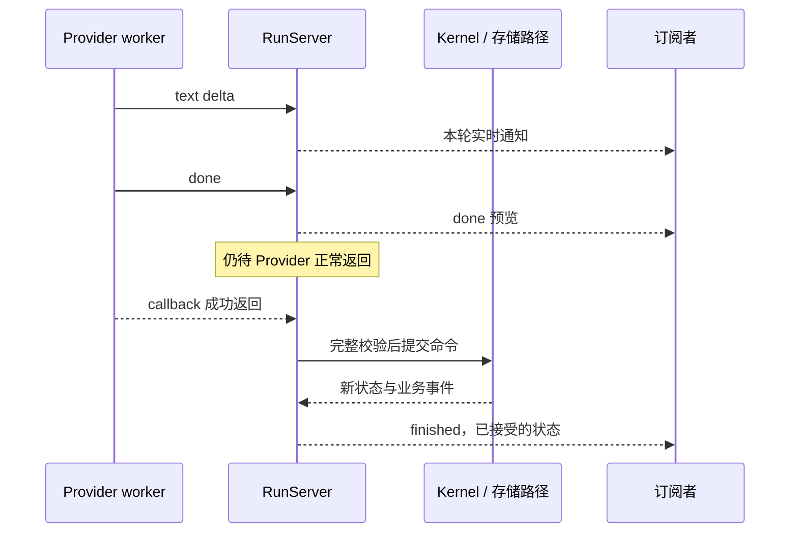

# 第 6 章：Model Streaming、事件流、取消与控制

一轮模型回答可以拆成很多片段，业务却不能因每到一段就提前推进。尤其当片段里是半截工具参数、取消请求已经到达、或者 `:done` 后 Provider 又报错时，界面上的进度与已经接受的事实会分开。本章沿这条缝隙解释控制协议。

主要实现是 [Stream](../lib/agent_systems_lab/stream.ex)、[RunServer](../lib/agent_systems_lab/run_server.ex)、[Budget](../lib/agent_systems_lab/budget.ex)与 [Scripted](../lib/agent_systems_lab/providers/scripted.ex)。它们提供项目内的通用教学协议；厂商 HTTP/SSE、远程取消和真实计费仍需适配，不能用离线流推断模型能力。复现时保留实际检出提交与源码清单。

## 阅读准备与学习目标

先读[第 3 章](ch03-processes-actors-and-messages.md)的 owner、邮箱、ref 与 monitor，再读[第 5 章](ch05-agent-loop-and-tools.md)中提议、执行与结果接受的边界。动手需读懂二进制、map、模式匹配和有界 receive；不需要 PostgreSQL 或模型账号。

读完应能同时画出输入片段、实时通知、业务 Event 三条线，说明完整响应怎样形成，取消怎样与结果竞赛，以及哪些预算跨请求累计。先做 6.2 的纯值练习，再按 6.3—6.5 观察实际 RunServer。所有 shell 命令在仓库根目录执行。

## 6.1 三条时间线不能共用一个“完成”标签

Provider 的 `:done` 是输入协议的完成标志；订阅通知是 owner 接受片段后发出的现场预览；业务 Event 是状态机接受的事实。三者的序号、保存方式和失败含义不同。

| 轨迹 | 何时新增条目 | 当前保存范围 |
| --- | --- | --- |
| Provider frame | worker 发出一段输入 | 本轮拼装过程；fixture 的 gate 不属于模型 frame |
| `agent_stream` 通知 | owner 接受片段或发布开始/结束 | 面向已订阅进程；snapshot 只保留最近 128 条预览 |
| Kernel Event | 合法完整命令被接受 | 完整业务历史；持久路径另提交 PostgreSQL |

同一轮可能发出许多 text delta，却只产生一个 `run_succeeded` Event，模型轮数也只增加一次。`agent_stream` 的 seq 从本轮通知开始计数，不能拿它与业务 seq 做相等断言。订阅只面向未来消息，不是历史回放；迟订阅者应先明确自己缺了哪一段，而不是据缺失通知断言业务没有发生。

观察者还要区分“预览保存有界”和“整个通知链路有界”。snapshot 只保留 128 条，不表示订阅者邮箱也只会有 128 条。当前通知通过消息发送，订阅者处理太慢仍会积压；这个接口没有给慢读者提供持久重放或端到端背压。界面应该把通知当现场观察，并在需要确认已接受事实时查询 snapshot 或业务历史。



因此，即使页面展示了完整文字，仍不能单凭它宣布任务成功。接下来先拆开“拼装完整”和“运行时接受”两个判据，再把取消插入这条时间线。

## 6.2 第一次小练习：字符与 JSON 都可能跨帧

在终端进入明确关闭数据库与后台调度器的会话：

```sh
LAB_DATABASE_ENABLED=false LAB_SCHEDULER_ENABLED=false ./scripts/iex
```

先预测：把“你”的第一个字节单独交给拼装器，是否已经得到一个合法最终回答？下面是纯值操作；没有启动 Provider worker，也不会写文件。

```elixir
alias AgentSystemsLab.Stream, as: ResponseStream
empty = ResponseStream.new()
<<head, tail::binary>> = "你"
{:ok, partial} = ResponseStream.push(empty, {:text_delta, <<head>>})
{:error, :incomplete_stream} = ResponseStream.finish(partial)
{:ok, joined} = ResponseStream.push(partial, {:text_delta, tail})
{:done, {:final, "你"}, complete} = ResponseStream.push(joined, :done)
{:ok, {:final, "你"}} = ResponseStream.finish(complete)
{:error, :stream_already_complete} =
  ResponseStream.push(complete, {:text_delta, "!"})
true = empty.phase == :empty
```

预期全部匹配成功。片段可以暂时不是有效 UTF-8；到 `:done` 才检查拼接后的文本。原始 `empty` 仍不变，已完成状态拒绝额外帧。这里没有业务 Event，`{:done, ...}` 只是拼装器的返回标签，不能解释为 Kernel 已接受回答。

工具参数同样先拼接、后解析。在同一会话继续：

```elixir
alias AgentSystemsLab.Stream, as: ResponseStream
{:ok, tool0} = ResponseStream.push(ResponseStream.new(),
  {:tool_start, %{operation_id: "draft-6", tool: "mock_write"}})
{:ok, tool1} = ResponseStream.push(tool0, {:arguments_delta, "{\"value\":"})
{:error, :incomplete_stream} = ResponseStream.finish(tool1)
{:ok, tool2} = ResponseStream.push(tool1, {:arguments_delta, "\"yes\"}"})
{:done, {:call, call}, tool3} = ResponseStream.push(tool2, :done)
true = call.arguments == %{"value" => "yes"}
{:ok, {:call, ^call}} = ResponseStream.finish(tool3)
true = tool0.arguments == []
```

JSON 键保留为字符串，不把任意模型文本变成 atom。得到合法 JSON 对象只证明这层拼装成功，仍须经过当前工具 schema、宿主策略和执行前复核；本段没有创建 Run 的 Operation。完整 JSON 数组也不满足参数必须为对象的合同。

本项目一轮只支持 final 或一个 tool call；混合文本与工具、多次 tool_start、参数先于工具声明、完成后续帧都会拒绝。这是当前协议子集，不是对所有模型 API 的断言。旧 `{:complete, response}` 兼容帧只能独占一轮，并保留原 binary 与 map 合同；不能把新流文本的 UTF-8 规则擅自套到旧完整接口。

## 6.3 done 已到，为什么还不能提交

Provider 可能在发出 `:done` 后返回错误。RunServer 必须等回调成功，并再次核对完整响应、预算及状态，才能推进业务事实。下面把屏障故意放在 done 之后，给这段间隙一个可观察的位置。

仍在前面的内存 IEx，整块执行。五分钟模型时限、十分钟 Run 时限供人工观察；新开会话须重新执行 shell 命令。每段会停止自己创建的 server。

```elixir
alias AgentSystemsLab.RunServer
id = "ch06-done-#{System.unique_integer([:positive])}"
gate_ref = make_ref()
{:ok, server} = AgentSystemsLab.start_run(
  run_id: id, input: "done 后再返回", storage: :memory,
  model_timeout_ms: 300_000, run_timeout_ms: 600_000,
  script: [{:stream, [{:text_delta, "ready"}, :done, {:gate, self(), gate_ref}]}])
try do
  :ok = RunServer.subscribe(server)
  {:ok, request_ref} = RunServer.start_stream(server)
  worker = receive do
    {:scripted_gate, ^gate_ref, pid} -> pid
  after
    5_000 -> raise "未到达 done 后屏障"
  end
  before_return = RunServer.snapshot(server)
  true = {before_return.state.status, before_return.state.seq,
    before_return.state.turn_count, before_return.provider.cursor} == {:running, 1, 0, 0}
  true = Enum.any?(before_return.stream.events, fn {_seq, event} -> event == :done end)
  send(worker, {:release, gate_ref})
  :finished = receive do
    {:agent_stream, ^id, ^request_ref, _seq, {:finished, :succeeded}} -> :finished
  after
    5_000 -> raise "未收到本轮 finished"
  end
  after_return = RunServer.snapshot(server)
  true = {after_return.state.output, after_return.state.seq,
    after_return.state.turn_count, after_return.provider.cursor} == {"ready", 2, 1, 1}
  true = Enum.map(after_return.events, & &1.type) == [:run_started, :run_succeeded]
after
  if Process.alive?(server), do: GenServer.stop(server)
end
```

屏障中的 snapshot 已有 done 预览，但状态仍为 running、turn_count=0，Provider 的已接受游标也未前进。释放后才看到业务完成。这里使用 gate 明确同步，不靠短 sleep 猜“应该已输出完”。

反例是把最后一个 gate 换成 fixture 的 `{:error, :late_error}`：运行时应记录 `{:provider_error, :late_error}` 的失败原因，不能提交那段看起来完整的文字。已有[异步流测试](../test/agent_systems_lab/run_server_stream_test.exs)覆盖 done 后错误与不完整流；构造自己的变体时同时检查 output、events 与操作/效果计数。

这也解释了为什么排错记录应保留真实终止原因，而不能只截取最后一段屏幕文字作为完成证明。

## 6.4 取消半截参数，需要几份证据

再创建一个独立 Run，将 gate 放在工具 JSON 中间。收到 gate 后，才能断言取消发生在半截参数的位置。除了取消返回，还要单独观察 worker 的退出。

```elixir
alias AgentSystemsLab.RunServer
id = "ch06-cancel-#{System.unique_integer([:positive])}"
gate_ref = make_ref()
{:ok, server} = AgentSystemsLab.start_run(
  run_id: id, input: "半截参数处取消", storage: :memory,
  model_timeout_ms: 300_000, run_timeout_ms: 600_000,
  script: [{:stream, [
    {:tool_start, %{operation_id: "draft-6", tool: "mock_write"}},
    {:arguments_delta, "{\"value\":"}, {:gate, self(), gate_ref},
    {:arguments_delta, "\"yes\"}"}, :done]}])
try do
  :ok = RunServer.subscribe(server)
  {:ok, request_ref} = RunServer.start_stream(server)
  worker = receive do
    {:scripted_gate, ^gate_ref, pid} -> pid
  after
    5_000 -> raise "未到达半截参数屏障"
  end
  worker_monitor = Process.monitor(worker)
  partial = RunServer.snapshot(server)
  true = {partial.state.turn_count, partial.state.operations,
    partial.tool_stats.effects} == {0, %{}, 0}
  {:ok, cancelled} = RunServer.cancel(server, :partial_arguments)
  true = cancelled.state.status == :cancelled
  :worker_exited = receive do
    {:DOWN, ^worker_monitor, :process, ^worker, :killed} -> :worker_exited
  after
    5_000 -> raise "未观察到本轮 worker 退出"
  end
  :finished = receive do
    {:agent_stream, ^id, ^request_ref, _seq, {:finished, :cancelled}} -> :finished
  after
    5_000 -> raise "未收到本轮取消通知"
  end
  send(worker, {:release, gate_ref})
  unchanged = RunServer.snapshot(server)
  true = unchanged.state == cancelled.state
  true = unchanged.events == cancelled.events
  true = unchanged.tool_stats == %{requests: 0, effects: 0}
after
  if Process.alive?(server), do: GenServer.stop(server)
end
```

本段分别验证：半截参数没有 Operation；取消转换进入终态；确切 worker 退出；本轮订阅结束；迟到的释放不会改写终态。`finished` 只表示 owner 发布了本轮结束通知，并不是操作系统清理或远程取消的通用证明。

当前教学 RunServer 接受取消后再清理，停止 Provider 时不等待 DOWN，所以示例的 monitor 观察不能省略。若取消到达时合法响应已先被接受，可能看到不同边界；如果工具效果已经发生，取消也不撤销它。[第 5 章](ch05-agent-loop-and-tools.md)和后面的[效果核对](ch16-durable-effects-and-reconciliation.md)提供对应反例。

取消实验的修复重点是建立先后证据，不是让终端恰好打印 cancelled。先等 gate，记录当前 operations 和效果，再发 cancel，最后观察退出和状态稳定；如果把 gate 去掉只等待一小段时间，成功与取消两种结果都可能发生。这样的不确定测试不能说明协议错误，也不能因某次“碰巧取消成功”就算完成了指定窗口的验证。

## 6.5 预算计数与字符数不是一回事

输出预算按实际二进制字节累计，不是字符数、模型 token 或费用。流事件上限每请求重置，输出字节则跨请求累计；工具名称、操作编号和旧完整调用参数也有自己的编码成本。`started`、`finished` 是运行时通知，不等于每一个都由 Budget 作为 Provider frame 计数；`:done` 则会计入输入事件上限。

下面只操作纯 Budget 值，先预测“你”是否正好占满三字节，以及换一轮请求会不会退回额度。

```elixir
alias AgentSystemsLab.Budget
{:ok, b0} = Budget.new(max_output_bytes: 3, max_stream_events: 4)
{:ok, b1} = Budget.consume(b0, {:text_delta, "你"})
true = {b1.output_bytes, b1.events} == {3, 1}
b2 = Budget.reset_request(b1)
true = {b2.output_bytes, b2.events} == {3, 0}
{:error, {:budget_exceeded, :output_bytes}} = Budget.consume(b2, {:text_delta, "!"})
true = {b0.output_bytes, b2.output_bytes} == {0, 3}
```

拒绝片段不会把这段超限字节记成已接受输出；已用额度仍保留。模型轮数由 Kernel 接受完整响应时另计，tool call 数量还受独立上限约束。一个限制通过不能替代另一个限制，尤其不能用“还有模型轮数”批准无限大参数。

这些 RunServer 控制计数属于当前进程，并不是跨重启的持久成本台账。后面的持久 Recovery 有自己的保存与核对协议；这里的字节计数也没有提供任何真实供应商账单。记录测试时应明确计量对象及其来源。

## 6.6 定时器是提醒，绝对 deadline 才是边界

Run 总时限从进程初始化开始；单轮模型时限从请求发起开始，两者都使用单调时间。Runtime 在处理帧、完成响应和执行工具前还要检查实际 deadline，不能因为定时器消息尚在邮箱就继续执行。旧 request ref 的超时消息也不能关闭新请求。

默认模型五秒、Run 六十秒。人工逐段观察时，时间也在流逝，所以示例显式给较长时限；自动化测试中的百毫秒窗口用于受控快速验证，不适合照搬成人工阅读等待。若观察时确已超时，应保留这个失败，另建独立 Run 重做练习；不能把重建、续租或增加消息当作期限退款。

超时表示控制策略已经到达边界，不直接证明外部效果不存在。尤其工具调用与远端响应之间还有不确定窗口；真实服务也未必支持收到本地取消就撤销远端工作。把这种不确定性归属原 operation，是后续重试与 unknown 协议的任务。

## 6.7 持久化保存什么，预览又丢了什么

内存路径的片段、游标与控制状态会随进程消失。当前教学 PostgreSQL 路径持久保存已接受的 Kernel 转换，部分流预览不成为业务历史；不能仅凭旧通知重启 Provider 或恢复一半 JSON。输入 Context capture、业务转换及外部执行也各有边界，不能画成一个跨系统原子动作。

因此，排错时同时保存本轮通知 ref/seq、业务 Event seq、实际退出原因及原始产物。只保留最终 status 会隐藏“在哪一层停住”。完整动手路线见 [L03](../labs/L03-streaming-control.md)，先按其前置完成 L01/L02，再进入真实数据库实验；本章内存小练习不冒充该整册验收。

## 6.8 练习与教师参考

每题按不变量、反例和实际证据三项各 0—2 分核对，至少 5/6，且不能将半截参数或未查明效果当成可直接执行的成功结果。

1. 一轮有两段 text delta、一个 done，为什么模型轮数不是三？实时通知 seq、Event seq 和 Provider cursor 分别回答什么？
2. 6.3 中 done 已到、Provider 未返回时，哪些事实还不能声明？若返回 `:late_error`，应检查哪些字段来证明没有提交表面上的答案？
3. 6.4 的 cancel 返回、worker DOWN、finished 通知分别证明什么？为什么原有工具效果不能由这三条证据推导为已撤销？
4. 把每请求 frame 上限设为 1，Provider 输出一段文本再 done，会怎样？为什么 `reset_request` 不能为下一轮恢复已经用掉的输出字节？

<details>
<summary>教师参考：按边界解释完整与停止</summary>

1. 模型轮数计接受的完整响应，不按 frame 累加。通知 seq 定位本轮现场预览，Event seq 定位已接受业务事实，游标定位教学 Provider 的已接受响应进度。三者有各自起点，不能互相代替或直接断言相等。
2. 拼装可以完整，但尚未取得 Provider 正常返回与业务接受；running/seq=1/turn=0/cursor=0 是本例证据。late_error 应留下 failed、相应 provider_error、output=nil，事件仅有 start 与 fail；同时检查没有 Operation 或效果，不能只看错误日志。
3. cancel 返回说明终态转换被接受，精确 DOWN 说明自有 worker 退出，finished 说明本轮通知结束。它们不检查任意外部台账。半截参数处本例本来就无操作；已发生效果的另一条轨迹必须保留并核对原事实。
4. 文本占第一帧，done 是第二帧，因上限失败，不能提交完整响应。reset_request 只重置本请求事件计数，累计字节保留；否则每换一轮就能绕过 Run 输出上限。需对比预算值、失败原因、输出与事件，而不是修改上限让预期通过。

</details>

## 术语与继续阅读

frame 是本轮 Provider 输入，stream notice 是实时观察，Event 是被接受的业务事实；deadline 是绝对时间边界，timeout message 是促使处理的通知。完整对照见[统一术语表](glossary.md)。项目协议与测试见 [Provider](../lib/agent_systems_lab/provider.ex)、[纯拼装测试](../test/agent_systems_lab/stream_test.exs)与[异步控制测试](../test/agent_systems_lab/run_server_stream_test.exs)。下一站[第 7 章：Tool Calling 与工具生命周期](ch07-tool-calling-and-lifecycle.md)，把完整提议继续连接到授权、执行前检查与结果配对。
