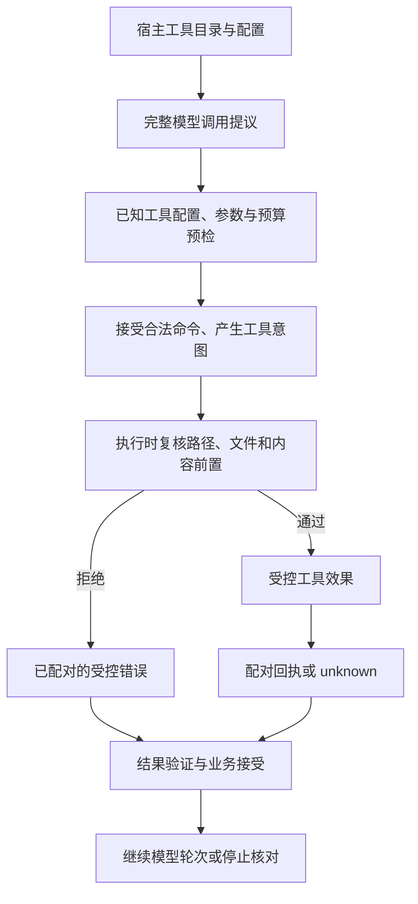

# 第 7 章：Tool Calling 与工具生命周期

模型生成了一个格式正确的 `file_write`，并不意味着文件应该立刻被写入。它还可能没有获准使用文件工具，目标文件可能已变化，结果也可能属于另一项操作。本章沿“发现、提议、接受、执行、回执、核对”走完工具生命周期，解释每一层为什么需要自己的检查。

前一章讨论了完整响应何时产生；本章对照 [Catalog](../lib/agent_systems_lab/tools/catalog.ex)、[Gateway](../lib/agent_systems_lab/tools/gateway.ex)、[Files](../lib/agent_systems_lab/tools/files.ex)、[Workspace](../lib/agent_systems_lab/tools/workspace.ex)及 [Result](../lib/agent_systems_lab/tools/result.ex)。贯穿任务仍是受控文件修复，完整实验在 [L04](../labs/L04-controlled-tools.md)。当前源码身份由检出提交与 [mix.exs](../mix.exs)记录，不以模型自报的工具版本为准。

## 阅读准备与学习目标

先读第 5、6 章，能区分模型响应、业务 Event、工具效果和取消。需要会读字符串键的 map，并把 SHA-256 暂时理解成“比较预期文件字节的摘要”；它不是签名、权限或正确性证明。第一次练习只检查纯值，下一段才在学习者创建的私有目录写真实文件；两者都无需数据库或真实模型。

读完后应能解释 schema 合法与有权执行的差异，指出执行前仍需复核的资源条件，并判断一个回执是否与待处理调用配对。先读 7.1—7.3，做首次练习，再按 7.4—7.6 检查错误与重复。下一站是[第 8 章](ch08-session-context.md)的 Session/Context：输入中该保留哪些调用事实，不能靠摘要替它们作主。

## 7.1 一项操作怎样穿过不同的门

工具目录描述宿主愿意公开的名字和参数形状。Provider 可以据此提出候选调用；宿主仍要检查工具是否启用、参数是否满足本项目支持的 schema，以及任务预算和当前状态是否允许接受。接受后产生意图，之后的显式执行步骤才访问外部资源。



这个图描述责任次序，不是一项跨数据库和文件系统的原子事务。Kernel 接受一个合法调用命令并记录 `tool_requested`，没有因此读取文件或确认最终执行许可。实际文件可能在提议之后被修改，也可能是一个不允许访问的符号链接；执行侧必须在产生效果前再次核对。

本项目的 Gateway 会对已知文件工具检查配置和参数，Files/Workspace 再核对真实路径、类型、大小与内容前置。未知的普通工具名保留了兼容行为：提议可被记录，执行时得到受控的 unsupported-tool 错误；这没有赋予它白名单以外的能力。不要把“未知工具一定在 Kernel 前拒绝”写成这里的协议。

工具发现也不是授权。一个目录展示 `sandbox_exec` 的参数形状，不意味着模型能在任意宿主执行任意命令；隔离和 MCP 还有独立宿主策略。[第 11 章](ch11-tool-registry-mcp-and-schema.md)会进一步区分协议发现、目录装配与执行权限，本章只使用三个受控文件工具。

## 7.2 Schema 检查的是形状与本项目支持的规则

文件工具使用 JSON 风格的字符串键，拒绝未知字段。`file_read` 只接受 path；写入还需 content 与 expected_sha256；补丁则需文件摘要和一组精确替换。把参数键从字符串换成 atom，或者增加一个“顺便执行”的字段，都会改变合同。目录中的 schema 不是对任意 JSON Schema 功能的完整实现承诺，应对照 Catalog 的实际验证器。

| 调用 | 最小参数 | 后续仍需核对 |
| --- | --- | --- |
| `file_read` | 相对路径 | 实际对象为允许的普通文件，大小和文本可接受 |
| `file_write` | 路径、内容、预期 hash 或 absent | 当前文件与预期基线一致，写入前再次复核 |
| `file_patch` | 路径、预期 hash、edits | 每个旧片段唯一，完整候选满足限制，实际基线未变化 |

路径文本的合法性和文件系统事实是两次检查。`report.txt` 形状合法，却可能指向符号链接；`../report.txt` 在文本层就应拒绝。内容符合 UTF-8 和大小限制，也不证明它回答了任务；语义正确仍需要独立验收。把这几个问题写成不同断言，失败后才知道应修参数、权限、资源条件还是业务算法。

目录和参数合同也应有可追溯来源。若宿主换了一套工具配置，先前模型看过的描述不能自动覆盖新策略；应核对当前实际装配与调用检查。这里的目录是执行前的信息输入，不是能由模型自行修改的能力清单。

## 7.3 第一次小练习：拒绝多余参数与半个补丁

先预测：增加一个未声明字段会被忽略吗？两个 edit 中第一个能匹配、第二个找不到时，应返回半份修改结果吗？在项目根目录的终端进入无数据库的 IEx：

```sh
LAB_DATABASE_ENABLED=false LAB_SCHEDULER_ENABLED=false ./scripts/iex
```

在同一 IEx 会话运行：

```elixir
alias AgentSystemsLab.Tools.{Catalog, Patch}
:ok = Catalog.validate("file_read", %{"path" => "report.txt"})
{:error, {:invalid_tool_arguments, :keys}} =
  Catalog.validate("file_read", %{"path" => "report.txt", "extra" => true})
original = "rate = 1\ntax = 2\n"
{:error, :patch_not_found} = Patch.apply(original, [
  %{"old" => "rate = 1", "new" => "rate = 3"},
  %{"old" => "missing", "new" => "replacement"}
])
true = original == "rate = 1\ntax = 2\n"
```

所有匹配应成功。这里仅构造候选字符串，没有真实文件写入。第一个 edit 的候选中间值没有作为成功结果返回；`original` 的不变也符合 Elixir 值语义。要证明真实文件没有留下半个补丁，还必须走下面的 Files 路径，不能只把这条纯值练习当作磁盘证据。

## 7.4 在自己的目录里观察真实效果

继续同一 IEx。下面的目录和初始文件由学习者充当可信宿主创建，文件工具只获准访问这个目录。每次使用新后缀，保留自己的输出，不覆盖以前的实验材料。

```elixir
alias AgentSystemsLab.Tools.{Files, Workspace}
suffix = "#{System.system_time(:microsecond)}-#{System.unique_integer([:positive])}"
root = Path.join(File.cwd!(), "artifacts/ch07-files-#{suffix}")
File.mkdir_p!(root)
File.chmod!(root, 0o700)
path = Path.join(root, "report.txt")
source = "rate = 1\ntax = 2\n"
File.write!(path, source)
{:ok, f0} = Files.new(root)
bad_args = %{
  "path" => "report.txt", "expected_sha256" => Workspace.sha256(source),
  "edits" => [
    %{"old" => "rate = 1", "new" => "rate = 3"},
    %{"old" => "missing", "new" => "replacement"}
  ]
}
{{:error, :patch_not_found}, f1} = Files.execute(f0, "bad-1", "file_patch", bad_args)
true = File.read!(path) == source
true = Files.stats(f1) == %{requests: 1, reads: 0, writes: 0}

good_args = %{bad_args | "edits" => [%{"old" => "rate = 1", "new" => "rate = 3"}]}
{{:ok, receipt}, f2} = Files.execute(f1, "good-1", "file_patch", good_args)
true = File.read!(path) == "rate = 3\ntax = 2\n"
true = receipt["before_sha256"] == Workspace.sha256(source)
true = receipt["sha256"] == Workspace.sha256(File.read!(path))
{{:ok, ^receipt}, f3} = Files.execute(f2, "good-1", "file_patch", good_args)
true = Files.stats(f3) == %{requests: 3, reads: 0, writes: 1}
{{:error, :operation_id_conflict}, f4} =
  Files.execute(f3, "good-1", "file_patch", bad_args)
true = Files.stats(f4).writes == 1
```

失败的补丁没有修改文件；修正参数后用新的逻辑调用执行一次写入；相同 ID 和完全相同参数再投递，返回内存台账的原结果，没有再次访问文件。这里的 `reads` 只计文件工具的成功 read 调用，不把 patch 内部读取基线算成另一项 read 效果；学习者直接 `File.read!` 的核对也不计入这个工具统计。

本例补丁失败的结果同样会记入此内存台账。若失败后改参数，却继续复用 `bad-1`，会冲突而非重新执行。需要区分两种情形：本例已明确拒绝且没有效果，可以在修正后的独立调用中用新 ID；如果第一次结果是 unknown，则不能靠新 ID 重做来“修复”，它可能制造重复效果。

Files 的台账是当前 Elixir 值的一部分。丢弃 f3、重建 Files 或重启进程，不会自动恢复旧台账；它不提供跨重启的 exactly-once。保存了成功 receipt 也不保证文件以后不被改动，更不证明文字论证正确。本例文件目录应只由自己的实验进程管理；Workspace 的路径检查不是抵抗恶意并发 rename 的生产隔离沙箱。

## 7.5 结果配对与结果真实性是不同的检查

实际 Gateway 会把当前文件工具的结果包装为 `tool_result.v1`，其中有 operation_id、tool 和 output。Runtime 接收新结果时要求这个封装与待处理调用相配，避免把另一次读取或写入的返回值塞给当前操作。外层业务命令的 operation ID 与封装中的 ID 也不能各写各的。

在同一会话继续做一个纯值配对练习；这里手动包装的内容不是外部写入证据：

```elixir
alias AgentSystemsLab.Tools.Result
result = Result.wrap({:ok, %{"saved" => true}}, "write-1", "file_write")
:ok = Result.validate_required(result, "write-1", "file_write")
{:error, {:invalid_tool_result_envelope, "write-2", "file_write"}} =
  Result.validate_required(result, "write-2", "file_write")
{:error, {:invalid_tool_result_envelope, "write-1", "file_read"}} =
  Result.validate_required(result, "write-1", "file_read")
```

这些断言证明配对规则，不证明手写的 `saved=true` 为真。可信宿主仍负责让真正的工具执行路径产生结果，并保留可核对产物。在历史重放中，Kernel 为旧 v1 事实保留不透明 payload 的兼容语义；当前 Runtime 对新文件结果要求封装，不能为了让新输入通过而引用旧历史的兼容规则。第 14 章会进一步区分重建与执行。

同样，`{:error, reason}` 与 `{:unknown, reason}` 不能随意互换。已知基线不匹配且未写入，可以记录受控错误；调用方在效果后丢失回执，则需要保留原操作并核对。第 16 章使用持久协议研究这件事，本章的 Files 台账与手动 Result.wrap 不能替代那个协议。

## 7.6 内容前置、补丁完整性与任务验收

`expected_sha256` 回答“我准备修改的是否仍是先前看到的字节”。`absent` 明确要求创建目标不存在；它不是遇到任何错误都覆盖的开关。当前字节不同就应停止并重新审阅基线，不能把 expected hash 改成最新值后继续盲写，因为原提议可能已不再适用于新内容。

Patch 按顺序在内存中构造完整候选，每一项 old 必须唯一匹配。第二项失败时，不返回第一项的半成品；Files 只有拿到完整候选才进入 Workspace.write。Workspace 写入使用同目录独占临时文件、复查基线后 rename，但这仍不是任意多文件事务，也没有与业务数据库共同提交。原子替换一个路径不等于整个修复任务已经原子完成。

本章的失败与修复是具体的：多余字段先在 schema 层拒绝；第二个 edit 缺失时文件不变；修改后的独立调用在明确基线下成功。完整 L04 再运行固定配送费 fixture，将 `subtotal > 100` 改为 `subtotal >= 100`，并比较修复前后测试、diff 和配对回执。这个离线机制证明受控工具路径可审查，不证明真实模型能发现任意缺陷。

取消也要放回时间线判断。意图接受后、文件执行前取消可阻止该次后续执行；已经写入后取消不能撤销文件或退回已消耗预算。如果效果状态不明，单看 cancelled 或活动队列为空都不能判定没有效果。把业务结束、执行者退出、文件核验分别留证，才能避免把清理动作误当补偿事务。

## 7.7 练习与教师参考

每题先写自己的判断，再指出一个反例与应保存的证据，三项各 1 分。实际运行与静态推理分开记录。

1. `Catalog.validate("file_read", %{"path" => "report.txt"})` 通过，是否保证执行时一定能读？举出一个需要访问实际资源才能发现的拒绝条件。
2. 7.4 中 requests=3、writes=1，而宿主曾直接读取文件多次，为什么没有矛盾？重建一个新的 Files 值后还能继承去重保证吗？
3. 第二个 edit 不唯一或不存在时，应保留哪些证据证明没有半次写入？为什么只比较纯字符串 original 不够？
4. 一个合法封装中的 operation_id 与工具名都正确，能否独立证明文件内容满足任务？如果第一次调用结果为 unknown，能否换 ID 重做？

<details>
<summary>教师参考：分别核对提议、效果与接受</summary>

1. 不能。文本形状合法后，实际目标仍可能是符号链接、超限文件或已变化的对象。schema 结果、执行侧受控错误与零写入/产物核验应分别保存；参数合法不是最终执行许可。
2. requests 计 Files.execute 投递，writes 计 Files 成功写效果；宿主直接读取和 patch 内部基线读取不增加该工具 read 计数。相同调用返回台账缓存；新的 Files 值没有旧台账，因此不能声称跨重启去重。
3. 保留完整 edits、基线 hash、受控错误、执行前后真实文件字节及写入计数。纯值不可变只说明旧字符串没被就地修改，不能排除另一条文件执行路径的副作用；Files 路径才提供这条实际观察。
4. 不能。封装验证相关性，真实产物和任务测试验证内容与范围。unknown 表示效果尚未查明，必须保留原操作身份并按目标合同核对；换 ID 可能产生第二次效果。可明确判定未执行的错误与 unknown 要分开处理。

</details>

## 术语与继续阅读

工具目录是可发现描述，schema 是参数约束，宿主策略决定能力边界，operation 标识逻辑操作，receipt 提供配对结果证据，内容 hash 表示字节基线。它们共同帮助审查工具生命周期，但没有任何一个单独代替任务验收。接着读[第 8 章](ch08-session-context.md)：把 Session 叙述与 Run 中的完整调用/回执分别作为来源，再构造有限 Context，不能把回执改写成会话消息来代替操作事实；完整动手按 L04 的前置和检查表推进。
