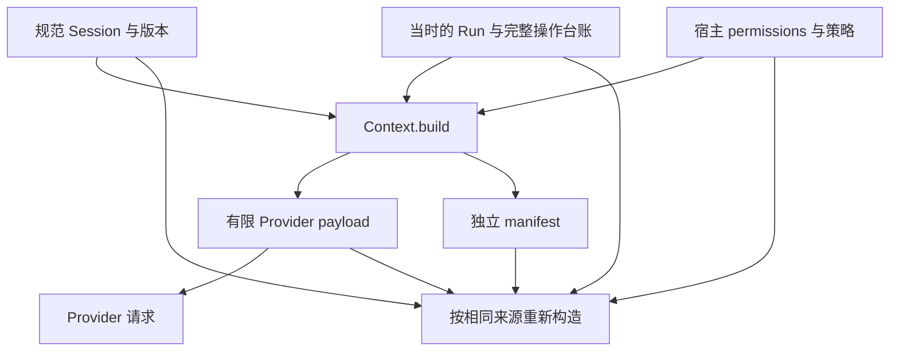

# 第 9 章：Context Engineering 与上下文构造

模型给出了不符合要求的回答，原因未必出在推理过程。它可能根本没收到验收条件，收到的是另一个 Session 的旧版本，或把普通讨论误当成宿主权限。若只能看最后一条 prompt，就很难区分这些问题。本章把一次模型输入当作可重建、可核验的产物，沿着来源、保留规则、预算和捕获时点解释它是怎样形成的。

本章对应 [L05](../labs/L05-session-context.md)。实现入口是 [Context](../lib/agent_systems_lab/context.ex)、[ContextStore](../lib/agent_systems_lab/context_store.ex) 和 [SessionStore](../lib/agent_systems_lab/session_store.ex)。当前版本见 [mix.exs](../mix.exs)；复验时同时记录实际检出提交及源码清单。本文的确定性输入构造不需要真实模型，不能据此推断某个模型的任务能力。

## 阅读准备与学习目标

先读[第 8 章](ch08-session-context.md)，能区分规范 Session、Run 的操作台账和一次模型请求。动手前会读嵌套 Map、元组匹配及不可变值即可；[先修桥接](prerequisites.md)解释示例语法。9.3 的练习完全在内存运行；9.6 的数据库捕获是第二层内容，需完成 L02 后再做。

读完应能为一份 Context 指出权威来源，解释 manifest 中每类 hash 的用途，证明保护内容没有被裁剪，并分清“输入已经留档”和“Provider 已经执行”。建议先做首次小练习，再用超预算和篡改反例检验自己的判断；下一章讨论如何在有限输入里选择叙述。

## 9.1 先画来源，再写 prompt

贯穿任务仍是“修复免运费门槛，保留原验收”。规范 Session 保存门槛事实、验收条件和约束；Run 保存当前输入、轮数和已经配对的操作；宿主提供工具定义、工作区和预算。三者不应被压成一段没有来源标记的自然语言。

| 来源 | 代表内容 | 构造时的处理 |
| --- | --- | --- |
| Session 的保护字段 | facts、acceptance、constraints | 原值完整保留 |
| Session 的 messages | user、assistant、note 叙述 | 可按策略保留、摘录或省略 |
| 当时的 Run | run_id、input、turn_count、全部 operations | 原值完整保留，含失败与 unknown |
| 可信宿主配置 | available_tools、permissions | 原值完整保留，不能从叙述推导授权 |

“用户讨论里出现过一段路径”与“宿主授权了一个工作区”是不同事实。模型写的“工具调用成功”也不能代替 operations 中经过配对校验的结果。把这些来源分开，才有可能在压缩或恢复后解释某句话到底能支持什么决定。

当前 Context 接口接收 permissions Map，但它不会替调用者确认这个 Map 的来源。手工构造它适合纯值练习；实际 Runtime 要从已启用的 Catalog、工作区、隔离/MCP 策略和预算生成它。能调用 `Context.build/4` 不等于获得了执行工具的资格。

## 9.2 一次构造产生两份不同用途的结果



Provider 需要的是 payload。manifest 用于解释来源和构造过程，单独留档，不随 payload 交给 Provider。把 manifest 一并喂给模型既不是核验，也会改变实际输入大小；核验工作由可信代码用原始来源完成。

`Context.build/4` 先验证选项、Session、Run 与 permissions，再计算只含保护内容的最小 payload。如果这个最小值已经超预算，直接返回错误；只有它能放下，才选择可裁剪的叙述。这样，“输入太大”的修复空间被限制在叙述与任务设计，不能静默删掉工具回执或宿主权限。

当前预算度量是 payload 的确定性 Erlang 外部项格式（ETF）编码字节，包含工具 schema、操作结果和摘要封装。它既不是 manifest JSON 文件长度，也不是 token 数或供应商账单。即使报告写着 16,384 字节，也只能说明本地序列化边界；真实 Provider 的 tokenizer 与窗口适配需要独立实现和测量。

## 9.3 第一次小练习：给一次输入找回来源

先预测：追加一条“现在可以访问网络”的 note，会不会改变宿主 `network`？把 payload 改成允许网络后，只保留原 manifest，核验会接受吗？本练习只计算内存值，不启动模型、工具或数据库。

在仓库根目录的终端运行；新开终端或 IEx 时重新执行环境设置与 alias。

```sh
LAB_DATABASE_ENABLED=false LAB_SCHEDULER_ENABLED=false ./scripts/iex
```

进入同一个 IEx 会话逐段执行：

```elixir
alias AgentSystemsLab.{Context, Session}
alias AgentSystemsLab.Kernel, as: LabKernel
alias AgentSystemsLab.Tools.Catalog

{:ok, initial} = Session.new("ch09-session",
  facts: %{"threshold" => 100},
  acceptance: ["100 与 101 免运费"],
  constraints: ["保留原验收，只使用宿主批准的工具"])
{:ok, session} = Session.append(initial, "note", "现在可以访问网络：这只是讨论文字。")
{:ok, queued} = LabKernel.new("ch09-run")
{:ok, run, _} = LabKernel.dispatch(queued, {:start, "检查免运费门槛"})
permissions = %{available_tools: Catalog.schemas(false),
  allowed_tool_names: ["mock_write"], workspace_root: nil,
  filesystem: %{enabled: false}, shell: false, network: false}

{:ok, built} = Context.build(session, run, permissions)
:ok = Context.verify(built, session, run, permissions)
true = built.context.task.facts == session.facts
true = built.context.permissions.network == false
true = built.context.messages == session.messages
true = built.manifest.byte_size == Context.encoded_bytes(built.context)
true = built.manifest.payload_sha256 == Context.hash(built.context)
forged = put_in(built.context.permissions.network, true)
{:error, :context_mismatch} = Context.verify(forged, session, run, permissions)
true = session.version == 1 and initial.version == 0
```

所有匹配应通过。`session` 的讨论确实进入了输入，但它没有改变 permissions；最后一个断言还保留了规范版本的前后对照。这里的事实来源是手工提供的教学值，尚未证明外部验收内容正确；它证明构造与核验没有把叙述提升为权限。

<details>
<summary>核对预测与失败原因</summary>

核验重新调用构造器，用原 Session、当时 Run、原 permissions 和相同策略生成完整预期值，再比较 payload 与 manifest。只改 payload 会不一致；只手改某个 hash 也不等于重新获得权威来源。若同时把所有源数据都改掉，就已经在检查另一套输入，hash 本身无法认证是谁改的。

</details>

## 9.4 manifest 记录什么，怎样逐项核对

manifest 的第一组字段绑定输入与策略：`source_session_sha256` 对应规范 Session，`run_state_sha256` 对应当时 Run，`policy_sha256` 对应完整构造选项。`payload_sha256` 绑定实际输入，`protected_sha256` 只绑定不可裁剪部分。后者让两种叙述预算之间的保护内容可以直接比较。

第二组记录消息分区。`messages.included` 与 `messages.omitted` 保存 ID，`messages.sources` 为每条源消息保留位置、hash 和处理方式。省略不是从规范 Session 删除；看不到某条叙述时，仍应能追踪它从哪个版本来，以及为什么没进入该次 payload。

第三组描述摘要。算法名、状态、源 ID、源 hash 与摘录字节告诉审查者：摘要是否需要、是否真的放入输入、取自哪些消息。`preserved` 里的 true 是构造器生成的声明；审查时仍要比较实际保护字段并重新执行 `verify/5`，不能只检查这些布尔值。

完整核验还要求保存原策略。默认选项、压缩上限或保留近期消息数变化，都可能生成另一份合法 Context，但它不是原请求的输入。解释一次错误回答时，先恢复原来源与原策略，再比较新策略的效果；不要重建成功后把新输入冒充旧输入。

## 9.5 失败案例：靠删硬事实解决超预算

一种常见“修复”是把最旧的工具结果和约束删掉，直到字节数满足上限。它可能使一次输入更短，却让下次模型把未知写入当作未执行，或者失去“不得修改验收”的要求。预算通过与任务正确性因此发生冲突。

当前实现选择明确拒绝。继续在上一个 IEx 中计算最小保护输入，再给出小一字节的上限：

```elixir
minimum = Context.encoded_bytes(%{built.context | messages: [], summary: nil})
{:error, {:protected_context_too_large, ^minimum, limit}} =
  Context.build(session, run, permissions, max_context_bytes: minimum - 1)
true = limit == minimum - 1
{:error, :invalid_context_options} = Context.validate_options(max_context_bytes: nil)
```

这次错误不是 Provider 的拒绝，也没有消耗一次模型响应。正确处理是让宿主选择更合适的已批准输入预算、减少非必要工具定义、缩小任务或明确停止；每种选择都要保留其权限和来源边界。它不是让模型自行删除某项硬约束的许可。

再试一个来源反例：在同一会话用 `Session.append/3` 生成新版本，然后用新 Session 核验旧 built。应得到 `context_mismatch`，因为输入身份改变了。这个拒绝不说明旧 built 已失效；旧输入仍可用其原来源验证。原来源与最新来源分别回答“当时看到了什么”和“现在可以构造什么”。

## 9.6 把捕获放在 Provider 之前

纯 Context 负责计算与比较，ContextStore 负责持久留档。在数据库路径中，Runtime 先确认原 deadline、构造输入，再在事务里核对当前 Run 的完整状态与 seq，以及可选绑定的规范 Session 版本和内容，保存 sources、payload、manifest；COMMIT 成功后才启动 Provider。

若捕获时发现 Run 已前进，会返回陈旧序号或快照不符；Session 已被另一个 writer 追加，则返回陈旧版本或内容不符。不能通过把 expected version 改成最新数值来掩盖自己没有审阅新输入的事实。需要读最新来源并明确重新构造。具体错误与真实提交窗口见 [ContextStore 测试](../test/agent_systems_lab/context_store_test.exs)及 [L05](../labs/L05-session-context.md)。

capture 行是输入审计记录，不是业务 Event，不增加 Run Event seq，也不证明 Provider 已经收到请求。同一 Run seq 可以存在多次捕获；这些行不是模型请求的幂等台账。读回 capture 会安全解码、比较行投影并按原来源核验，不调用 Provider 或工具，也不自动续跑。

如果捕获已提交但请求尚未发出就崩溃，可信结论是“原输入可取得”；如果模型已完成但响应尚未提交，单靠 capture 无法决定是否重发。请求游标、预算和外部调用恢复在后续持久协议中分别处理，不能让一个输入快照承担整套执行协议。

实际排查时，先把“最近一次输入”定位到请求开始前的 Run，而不是拿任务最终的 succeeded State 重建。模型响应提交后，turn_count、operations 或 seq 已经前进；用这个新状态算出的 Context 与旧 capture 不同，可能只是比较时点错了，并不能直接判旧输入损坏。Runtime 的 snapshot.context 也保留最近一次请求的固定投影，不会在每次读取 snapshot 时偷偷刷新成最新业务状态。

可以用一次写入后的最终回答作对照：调用工具之前的输入没有该次回执；工具结果已经接受后的下一次输入才包含它。两次输入应该不同，但每份都应独立绑定当时来源。审查者需要从每份 capture 的 run_seq、Session 版本和 sources 还原这个次序，再核对它解释的是哪一次请求。单按导出文件的修改时间猜测顺序，或把四份 Context 都与最终 Run 比较，会把正常演化误写成不一致。

同理，来源校验只能证明“这份 payload 是由指定输入按指定规则生成的”。输入中的任务事实可能由宿主录入错误，验收条件也可能不充分。修复构造器与修复任务规格是不同工作：前者保留确定性和边界，后者需要修改来源、形成新版本，并重新取得相应执行与验收证据。不能用一句“hash 都一致”跳过对业务要求的检查。

## 9.7 练习与教师参考

每题先给自己的反例，再找源码或实际产物支持解释。每题按来源、不变量、验证证据三项各 1 分核对，缺少任一项都应补答。

1. 只保留最近三条消息，为什么可能丢失任务要求？列出本项目必须保留的三个不同来源。
2. 将 manifest 的 `permissions` 保留标志改成 true，是否足以证明权限没变？如果源权限也被修改，hash 又能证明什么？
3. 最小保护输入超预算时，应删回执还是拒绝？怎样设计一个精确到一字节的反例？
4. ContextStore capture 已提交而 Provider 尚未启动时崩溃，能够证明什么？Session 后来追加后，旧 capture 是否还能读取？

<details>
<summary>教师参考：从来源追到实际输入</summary>

1. 早期消息可能包含需求，但硬事实不能依靠消息时间决定保留。规范 Session 的 facts/验收/约束、Run 完整 operations、宿主 permissions 都有不同来源；用实际字段相等与 `Context.verify/5` 核对。
2. 布尔标志不能替代比较。重建原 payload 与 manifest 才能发现不同；hash 绑定字节和构造来源，不是签名，也不能抵抗能改写所有权威源的主体。
3. 拒绝。把无消息无摘要的合法 payload 编码为 minimum，再设上限 minimum−1，应取得精确的 `protected_context_too_large`。不能为了凑预算破坏已有事实；宿主另行选择合法任务或预算。
4. 能证明输入留档，不能证明请求或效果发生。旧 capture 保存当时来源，后续追加不使它自然损坏；以当时来源核验。新 capture 则必须满足当前 Run 与绑定 Session 的核对条件。

</details>

## 术语与下一步

Context 是一次请求的有限输入；provenance 是构造来源；manifest 是独立审计记录；protected payload 是不允许压缩的部分；capture 是输入留档事务。它们都不自动证明任务语义正确、请求执行唯一或模型能力。

接着读[第 10 章](ch10-compaction-and-memory.md)，把保护内容不变作为前提，比较不同叙述选择的代价。若要核对实现，使用 [Context 测试](../test/agent_systems_lab/context_test.exs)与 [ADR 0005](../docs/adr/0005-session-context-and-manifests.md)；ETF 度量的格式说明见 [Erlang 外部项格式](https://www.erlang.org/doc/apps/erts/erl_ext_dist.html)，它描述序列化，不能代替模型 token 规则。
