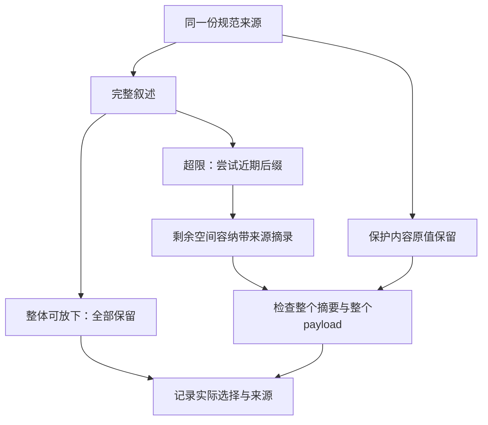

# 第 10 章：Compaction、短期记忆、长期记忆与检索

一次运行留下了很多讨论，下一次请求却只容得下一部分。把旧消息统统删除，可能使模型忘掉需求；把它们改成一句流畅摘要，也可能掩盖来源、否定条件或不确定性。问题不只是“怎样少占一点输入”，而是哪些信息允许损失、损失后如何解释，以及谁有权决定某段文字仍可用于当前任务。

本章沿用 [L05](../labs/L05-session-context.md) 的固定 Session/Context 实现，入口为 [Context](../lib/agent_systems_lab/context.ex) 的 `compact_recent`、`fit_summary` 与 manifest 生成逻辑。当前代码实现确定性提取与裁剪，没有长期 Memory Store、向量索引或在线 retrieval。本章后半给出这些扩展应回答的问题，并将它们作为设计练习，不计为已运行功能。

## 阅读准备与学习目标

先完成[第 8 章](ch08-session-context.md)的规范会话与[第 9 章](ch09-context-construction.md)的来源核验。需要理解不可变值、消息 ID、payload 的 ETF 字节及宿主权限；不要求使用 embedding 或数据库。首次练习只在内存中对同一组来源比较三种输入，没有模型请求和真实工具效果。

读完应能解释 full、trimmed、summary 三种输入各损失了什么，给出“字节更少而信息更差”的反例，并为未来检索设计出处、新鲜度和权限条件。接着读[第 11 章](ch11-tool-registry-mcp-and-schema.md)，把输入中的工具描述与宿主真正批准的能力连接起来。

## 10.1 先分清四种“记住了”

| 层次 | 保留什么 | 不能单靠它证明什么 |
| --- | --- | --- |
| 规范 Session | 原始任务字段与完整追加消息 | 每次请求都看到了全部消息 |
| 本轮 Context | 本次实际发送的有限投影 | 原记录已被删除或永久遗忘 |
| 提取摘要 | 被省略叙述的带来源前缀 | 已提取所有关键信息或内容真实 |
| 未来长期检索 | 另行选择的外部记录或索引结果 | 仍然新鲜、获准、适用于当前任务 |

这里的短期记忆首先是可取得的任务记录与单次输入选择，不是模型参数改变。规范 Session 没变，只代表原材料仍在；某条旧消息被省略后，模型当前可能完全看不到它。相反，输入出现一段旧摘录，也不能证明它已经成为可信事实。

长期记忆还要解释生命周期。另一任务写下的记录可能过期，原作者的访问权可能已经撤销，索引可能滞后。给这些记录做 embedding 只改变查找方式，不会使旧权限继续有效，更不会把某个工具成功叙述变成实际效果回执。

## 10.2 压缩的对象是叙述，不是责任

前两章已经确定保护边界：任务事实、验收与约束、当前 Run 输入和轮数、完整 operations、工具定义与宿主 permissions 必须原值保留。当前构造器只对 Session.messages 做选择；失败或 unknown 操作也在保护范围内。

这意味着压缩不是通用的“按重要性删字段”。一份很大的工具结果可能比很多普通消息都占空间，但它仍是已接受事实的一部分。保护内容本身放不下时，应明确拒绝，再由宿主重新设计任务或合法预算。不能仅因模型更喜欢短输入，就把未查明的写入从台账删除。



图中没有“理解并保存所有知识”的一步。它表达固定策略怎样分配输入空间，最后仍需要独立任务验收来判断被省略的信息是否影响回答。

## 10.3 当前算法怎样选择叙述

若全部 messages 加上保护内容能放下，直接全部保留，summary 为 nil，状态为 `not_needed`。`keep_recent_messages` 只在需要压缩时限制近期后缀的最大数量，不会强迫每次都删到这个数。

超限时，先尝试最近的若干条完整消息；若后缀仍太大，就继续移除其中最旧的一条，直到基本 payload 能放下。`keep_recent_messages: 2` 因而不保证两条一定都能保留。这个选择优先保护近期消息，不把每条消息按字节切碎。

之后才给被省略的消息生成 `extractive_prefix.v1` 摘要。算法按源消息顺序拼接带 seq、ID、role 的文字，取能满足预算的 UTF-8 安全前缀；它不调用模型，也没有语义上的关键事实选择器。摘录中若先出现一大段闲聊，更后面的关键否定句可能没有进入前缀。

摘要预算统计的是整个摘要对象，包括来源 ID、来源 hash、算法、trust 标签和 excerpt；同时还检查完整 payload。即使 excerpt 很短，元数据也需要空间。若元数据或至少一段有效摘录放不下，就不放摘要，manifest 记 `omitted_budget`，而不是伪造一段“信息已保留”的文字。

## 10.4 第一次小练习：同一来源，三份输入

先预测：关闭摘要后，完整 Session 会不会变短？开了摘要后，operations 或权限是否可以变化？下面用计算得出的预算为近期两条消息保留空间，避免依赖某次环境碰巧出现的字节数。

在仓库根目录的终端进入新 IEx；这里没有 PostgreSQL 或模型账号前置。

```sh
LAB_DATABASE_ENABLED=false LAB_SCHEDULER_ENABLED=false ./scripts/iex
```

在同一会话执行：

```elixir
alias AgentSystemsLab.{Context, Session}
alias AgentSystemsLab.Kernel, as: LabKernel
alias AgentSystemsLab.Tools.Catalog

{:ok, initial} = Session.new("ch10-session",
  facts: %{"threshold" => 100},
  acceptance: ["100 与 101 免运费"],
  constraints: ["保留验收，摘要不能新增权限"])
session = Enum.reduce(1..8, initial, fn n, current ->
  {:ok, next} = Session.append(current, "note",
    "旧讨论 #{n}：" <> String.duplicate("讨论文字不构成新的授权。", 60))
  next
end)
{:ok, queued} = LabKernel.new("ch10-run")
{:ok, run, _} = LabKernel.dispatch(queued, {:start, "检查压缩策略"})
permissions = %{available_tools: Catalog.schemas(false),
  allowed_tool_names: ["mock_write"], workspace_root: nil,
  filesystem: %{enabled: false}, shell: false, network: false}
{:ok, full} = Context.build(session, run, permissions)
recent = %{full.context | messages: Enum.take(session.messages, -2), summary: nil}
opts = [max_context_bytes: Context.encoded_bytes(recent) + 1024,
  keep_recent_messages: 2, max_summary_bytes: 1024]
{:ok, compact} = Context.build(session, run, permissions, opts)
{:ok, trimmed} = Context.build(session, run, permissions,
  Keyword.put(opts, :max_summary_bytes, 0))

true = full.context.summary == nil
true = compact.context.messages == Enum.take(session.messages, -2)
true = compact.context.summary.algorithm == "extractive_prefix.v1"
true = compact.context.summary.trust == "untrusted_session_narrative"
true = compact.context.summary.source_ids == compact.manifest.messages.omitted
true = String.valid?(compact.context.summary.excerpt)
true = trimmed.context.summary == nil
true = trimmed.manifest.summary.status == "omitted_budget"
true = compact.manifest.protected_sha256 == full.manifest.protected_sha256
true = trimmed.manifest.protected_sha256 == full.manifest.protected_sha256
true = length(session.messages) == 8 and session.version == 8
:ok = Context.verify(compact, session, run, permissions, opts)
```

预期全部断言通过。再直接读取 `compact.context.summary.excerpt`，比较它与前六条源消息；它只是一个前缀，不是把六条消息的要点均匀提取。这个观察让“带来源”与“充分覆盖内容”成为两个可分别检查的条件。

<details>
<summary>核对三份输入的变化</summary>

full 保留全部叙述，compact 保留后缀与受限摘录，trimmed 只保留后缀。三者保护部分相同，原 Session 也相同。较短的输入证明选择发生了，不能证明模型更准确；相同 protected hash 证明保护字节一致，也不能证明源事实本身正确。

</details>

## 10.5 失败案例：把摘要当成新的事实库

假设旧消息先写“门槛可能是大于 100”，后面再更正为“大于等于 100”。如果摘录刚好在更正之前截断，一段语法自然的摘要仍可能留下过时判断。另一种情况是消息里写“允许访问网络”，压缩器完整保留了它，读者却误以为这就构成权限。

当前实现的修复策略是把可靠任务条件放在保护字段，以 Session.facts 和 acceptance 为输入事实来源；叙述与摘要始终带不可信标签。对于还没澄清的冲突，宿主应先决定真实任务要求，再显式创建合适来源，不能让压缩器凭位置替业务作裁决。

这种修复不会让所有摘要都变好。它减少了一个危险类别：把过程讨论当成硬事实或授权。摘要是否漏掉有用背景，仍要用具体任务检查。设计实验时可以固定事实与工具回执，分别给 full、compact、trimmed 同一离线 Provider 路径，核对构造不变量；如果要比较真实模型表现，则需要另外记录模型版本、任务集、请求参数和全部尝试。

不要把字节下降率当作学习或任务成功率。本项目的 P1 用固定脚本完成固定修复，能证明流程和保护字段在压缩后仍闭合，不能证明真实模型对任意摘要都理解正确。一次压缩机制通过，也没有评估模型生成摘要的忠实性，因为当前算法根本不调用模型。

## 10.6 预算变化也是策略变化

构造策略包含整体字节上限、近期消息保留上限、摘要字节上限。相同来源和相同策略应得到同一 payload 与 manifest；换策略得到另一份输入则是预期行为，应保留各自身份，而不是把后一次结果覆盖前一次。

比较策略时至少分开记录四件事：原规范来源是否相同，保护字段是否相同，具体叙述/摘要哪些变化，实际任务验收有什么差异。只留下“少了 60%”无法说明代价，也无法确定是否误删了关键回执。压缩失败应保留错误与所需最小字节，不把一条失败样本从报告中去掉。

若近期一条消息本身太大，算法可能保留零条近期消息。若摘要元数据都放不下，摘要也可能为 nil。这些都是可以描述和核验的结果；消费方必须读取实际 messages 和 manifest，而不是从配置值猜测模型看见了什么。

## 10.7 未来检索要补哪些合同

下面是设计练习，不是已有检索 API。设想为报告修复引入一个长期资料库，查询返回若干片段。每个片段至少应能追溯到文档身份、版本或内容 hash、原始出处，并记录这次查询与选择规则。否则“搜到了相同一句话”无法判断是不是旧资料或错误副本。

新鲜度与权限需要在读取时重新判定。索引建立时有权访问，不代表当前任务仍有权；文档被撤回或更新后，旧向量可能仍能命中。把结果放进 Context 之前，可信宿主要核对当前授权、版本和任务范围，并明确缺资料、冲突或过期时怎样返回。

检索内容的角色也应固定。它可以提供待检查的参考信息，不能自己生成工具权限、清空 unknown 或替代效果台账。即使检索结果声称“上次已经写入”，也要回到当前 Run 的 operation/receipt 或目标权威查询。新的数据通道不能绕过已有提交与核对协议。

还需单独评估查询是否找到需要的信息、选入的片段是否支持回答、权限变化是否及时生效。文档里缺答案与模型没有用好答案是不同失败；不能把它们合并成一个笼统准确率。这里没有给出向量数据库、检索质量或遗忘策略的已完成结论。

## 10.8 练习与教师参考

每题按“保护边界、反例、可查证据”各 1 分核对。先写自己的答案，再展开参考。

1. full、compact、trimmed 的 protected hash 相等，能否证明三次真实模型回答一样正确？还缺哪些证据？
2. `keep_recent_messages: 2` 是否保证保留两条？怎样构造只保留一条或零条的条件？
3. 为什么一字节的 summary 预算可能连一个字都保留不了？应在哪里查源消息仍存在？
4. 为未来检索列出出处、新鲜度和授权三类字段或检查；为什么文档 hash 不能代替它们？

<details>
<summary>教师参考：解释压缩的损失</summary>

1. 只能证明保护字节一致，不能证明叙述一样或模型答案正确。还需实际 payload、同一任务的独立验收及真实模型调用记录；本项目固定脚本的成功不承担这种模型评测。
2. 不保证，它是压缩阶段的上限。让两条后缀加保护内容超过整体上限，而一条或零条能放下即可；保护内容自身超限则直接拒绝，不进入该选择。
3. 摘要还有来源 ID/hash、算法和 trust 等结构开销，预算限制整个 ETF 对象。查原 Session 与 manifest.messages.sources；省略于某次输入不等于删掉规范消息。
4. 需要文档身份/版本或内容绑定、更新与撤回状态、当前任务读取权限和查询来源。hash 只能绑定字节，不决定这些字节是否新鲜或获准，也不证明文字真实。

</details>

## 术语与继续阅读

compaction 是在边界内选择/压缩叙述；extractive summary 是带来源的原文摘录；provenance 是材料出处；retrieval 是从外部集合选择材料的过程，当前未实现。以上概念都不能自动改变业务事实或宿主权限。

实现与实际反例见 [Context 测试](../test/agent_systems_lab/context_test.exs)、[L05](../labs/L05-session-context.md)及 [ADR 0005](../docs/adr/0005-session-context-and-manifests.md)。下一站[第 11 章](ch11-tool-registry-mcp-and-schema.md)讨论工具目录和协议：模型能看见一个定义，与宿主允许执行它，仍是两个问题。
