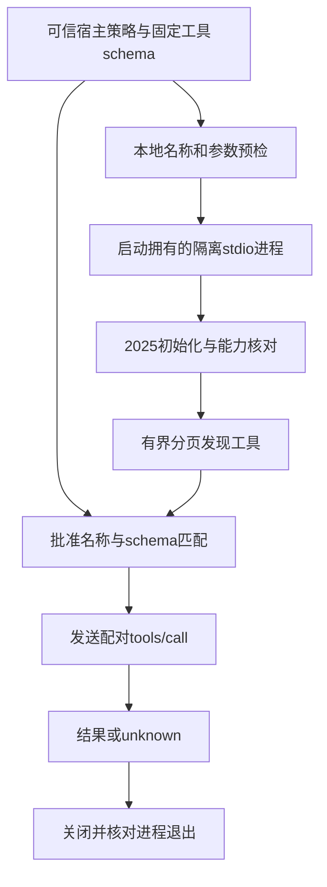

# 第 11 章：Tool Registry、MCP Transport 与 Schema

一个服务器列出了 `write_note`，工具说明还写着“只读、安全、可重试”。模型现在能调用它吗？如果客户端连上服务器、收到合法 JSON，是否就能证明写入只发生一次？这些问题不能只由连接协议回答。本章沿工具目录、宿主批准、参数校验、stdio 生命周期与结果核对，把“能发现”拆成可检查的几个边界。

本章对应 [L15](../labs/L15-mcp-stdio.md)，实现入口为 [Catalog](../lib/agent_systems_lab/tools/catalog.ex)、[MCP.Policy](../lib/agent_systems_lab/mcp/policy.ex)、[MCP.Schema](../lib/agent_systems_lab/mcp/schema.ex)、[MCP.Connection](../lib/agent_systems_lab/mcp/connection.ex)。当前源码固定 `2025-11-25` 的 stateful stdio 子集，不是任意 MCP server 的通用客户端，也没有接入真实模型。

## 阅读准备与学习目标

先读[第 7 章](ch07-tool-calling-and-lifecycle.md)，区分提议、授权、执行和结果配对；第 9 章解释哪些宿主工具定义进入 Context。阅读 JSON 对象、请求 ID、stdin/stdout 和有限等待的概念即可开始。11.3 纯校验练习不需要数据库、编译器或 MCP server；11.5 的真实 stdio 观察另需 macOS Seatbelt、clang 与自有临时工作区。

读完应能指出工具目录中谁提供名字、schema 和描述，解释发现与授权的区别，区分本地拒绝、协议错误、工具错误和 unknown，并查到关闭连接后的实际退出证据。完整 L15 还包含持久恢复，需要按它的实验前置继续，不能把本章小练习等同于完成整份手册。

## 11.1 从固定 Catalog 到宿主批准的远端工具

固定 Catalog 同时给出广告给模型的定义与匹配验证器。当前本地文件工具使用有界参数和封闭对象，未知键直接拒绝；`mock_write` 保留教学用的任意 Map 输入，不能把它当成所有工具的 schema 规则。

MCP 将一部分实现移到独立 server 进程，但宿主仍先指定绝对命令、argv、工作区、隔离策略和批准工具。模型看到的局部名字是 `mcp.<server_name>.<remote_name>`。本机工具名、远端名和 operation ID 回答不同问题，不应靠字符串相似就放行。

| 字段或身份 | 来源与用途 |
| --- | --- |
| 本地 Catalog descriptor | 宿主决定广告内容；内部字段为 `input_schema` |
| `tools/list` 条目 | server 的发现结果；协议字段为 `inputSchema` |
| Policy 工具列表 | 宿主批准的名称、描述和精确输入 schema |
| operation ID | 一次逻辑工具操作的稳定身份 |
| JSON-RPC request ID | 一条连接内请求与响应的配对身份 |

发现完成后，Policy 检查所有批准工具是否存在，解码后的 schema 是否与批准值严格相等。它不是语义等价推理器，不能根据“这个新 schema 看上去也安全”接受漂移。额外发现的工具保持未批准；服务器描述和 `idempotentHint` 等提示不会覆盖宿主描述、权限或恢复策略。

## 11.2 连接协议与执行许可怎样衔接



图中每一关都可能拒绝。建立连接不能代替本地名称校验；发现不能安装新权限；工具结果也不能代替连接清理。正常 Runtime 通过工具网关进入这些步骤，模型不负责构造 server command、环境、隔离 profile 或新 policy。

当前每条连接最多一个在途请求，分页数、工具数、消息字节、连接与请求时间都有上限。完整发现会检查重复工具名、重复 cursor、缺少批准工具和 schema 漂移，再决定能否发送调用。把第一批列表当成全部结果，会漏掉这些一致性条件。

## 11.3 第一次小练习：schema 通过了，权限有了吗

先预测：一个额外 `command` 键会被忽略还是拒绝？schema 中出现 `$ref`，当前验证器会加载它吗？下面仅读取本机定义并校验值，不启动 stdio 连接或执行工具。

在仓库根目录的终端进入新 IEx：

```sh
LAB_DATABASE_ENABLED=false LAB_SCHEDULER_ENABLED=false ./scripts/iex
```

在同一会话执行：

```elixir
alias AgentSystemsLab.MCP.Schema
alias AgentSystemsLab.Tools.Catalog

schema = %{"type" => "object",
  "properties" => %{"text" => %{"type" => "string", "minLength" => 1, "maxLength" => 4}},
  "required" => ["text"], "additionalProperties" => false}
:ok = Schema.validate_schema(schema)
:ok = Schema.validate(schema, %{"text" => "示例"})
{:error, {:invalid_mcp_arguments, :unknown_property}} =
  Schema.validate(schema, %{"text" => "ok", "command" => "/bin/sh"})
{:error, {:invalid_mcp_arguments, :string_length}} =
  Schema.validate(schema, %{"text" => "12345"})
unsupported = Map.put(schema, "$ref", "#/definitions/external")
{:error, {:unsupported_mcp_schema, :unsupported_or_invalid_keyword}} =
  Schema.validate_schema(unsupported)
["mock_write"] = Enum.map(Catalog.schemas(false), & &1["name"])
```

预期全部匹配通过。“示例”有两个 Unicode codepoint，因此满足长度条件；这与 UTF-8 字节数不是同一种度量。最后一行只读取关闭文件工具时的本地目录，没有因此批准任何 MCP 工具。schema 通过说明参数属于某个允许的数据集合，不说明调用者拥有工作区或执行资格。

<details>
<summary>核对预测：为什么不忽略陌生 schema 关键字</summary>

忽略不支持的条件会改变宿主以为自己批准的参数集合。例如忽略组合或引用，可能放进原本应被限制的数据。当前选择在策略安装与参数校验时明确拒绝不支持的结构；它没有实现引用解析、正则表达式或完整 JSON Schema。

</details>

## 11.4 固定版本，不把不同协议拼在一起

`2025-11-25` 生命周期先做 `initialize` 版本与能力协商，再发 `notifications/initialized`，之后进入正常请求。工具协议以 `tools/list` 发现并支持分页，以 `tools/call` 调用；这些阶段的规范依据分别见[固定版生命周期](https://modelcontextprotocol.io/specification/2025-11-25/basic/lifecycle)与[固定版工具协议](https://modelcontextprotocol.io/specification/2025-11-25/server/tools)。

本项目的 stdio 使用每行一个 UTF-8 JSON 对象，stdout 专供协议，stderr 独立收集；分片到达不等于完整消息，也不能把日志混进协议行。连接版本或所需 tools 能力不符时结束，不能在初始化尚未成功时试着执行工具。

另一个明确版本 `2026-07-28` 已改用逐请求 `_meta` 携带版本与客户端能力，旧的连接级握手不再是它的正常模型，见[该版本传输规则](https://modelcontextprotocol.io/specification/2026-07-28/basic/transports)。本仓库固定旧子集，不能因为浏览到新文档就把两者步骤混用，也不声称实现新版本的发现或兼容回退。

当前 schema 子集接受 object、array、string、integer、number、boolean、null 与 enum，object 要显式关闭额外属性。深度、节点和 JSON 编码大小另有边界；schema 长度条件也不取代传输帧上限。HTTP、OAuth、resources、prompts、sampling 等不在本实现范围。固定 stdio 探针成功，只支持相应局部结论。

## 11.5 第二层观察：一次真实 stdio 生命周期

这一步使用仓库的固定 C fixture。它不是从网络下载 server，不能替换成模型提供的命令。平台不支持隔离时应保留明确错误，按 [L15](../labs/L15-mcp-stdio.md)准备所需环境；不能退回无隔离宿主进程并声称原实验通过。

若具备 macOS Seatbelt 与 clang，在刚才的 IEx 会话执行。只创建本次拥有的唯一临时目录，结束时清理该目录。

```elixir
alias AgentSystemsLab.{MCP, MCPFixture}
base = if File.dir?("/private/tmp"), do: "/private/tmp", else: System.tmp_dir!()
workspace = Path.join(base, "ase-ch11-#{Ecto.UUID.generate()}")
:ok = File.mkdir(workspace)
try do
  {:ok, policy} = MCPFixture.policy(workspace, "normal", tools: ["echo"])
  {:ok, receipt} = MCP.execute(policy, "mcp.fixture.echo", %{"text" => "chapter 11"})
  false = receipt["isError"]
  %{"echo" => "chapter 11"} = receipt["structuredContent"]
  true = receipt["transport"]["target_exited"]
  true = receipt["transport"]["guardian_exited"]
  {:error, :mcp_tool_not_allowed} = MCP.execute(policy,
    "mcp.fixture.write_note", %{"path" => "note.txt", "content" => "no"})
  false = File.exists?(Path.join(workspace, "note.txt"))
after
  File.rm_rf!(workspace)
end
```

公共 `MCP.execute/4` 为一次执行建立新连接，完成初始化、发现、调用与关闭。此处验证了可配对的 echo 结果和两个退出字段；额外发现的 write_note 没有获得调用权，拒绝发生在发送对应 tools/call 之前。它没有证明任意第三方 server 兼容，也没有产生真实报告文件或模型请求。

较低层的 Connection 接口可观察长连接，但正常应用不应让模型选择其宿主对象。目标退出与 guardian 退出要分别核对；合法结果但清理无法认证时，公共接口也可能保守返回 unknown。进程生命周期证据不能从一句“close 已调用”推断。

## 11.6 失败案例：收到超时就换连接重做

设想 server 已追加一行文件，然后在回复前退出。caller 只看到 EOF 或超时，若新建连接再次发同样动作，可能追加第二行。即使远端描述写着幂等提示，也不能据此知道效果端是否真正实现稳定去重。

当前处理保留原逻辑 operation 身份、已发送请求的连接与 request ID，把无法确认的效果记为 unknown，进入后续核对路径。超时或宿主取消会尝试向原请求发送 advisory 取消通知；它不是回滚证明，也不能使连接继续承接一个新的工具调用。迟到回复不得被配给新的请求。

要区分四类结果：本地策略/schema 拒绝尚未发送工具调用；合法 JSON-RPC error 是已确认的协议错误；`isError=true` 是工具报告的错误；断连、错 ID、畸形响应或超时对已发送调用可能意味着结果未知。保留原始 code、content 与身份，才能解释发生在哪个边界。

固定 fixture 的 `after_effect_drop` 模式提供“效果后丢回复”的真实本地窗口，完整命令、持久化核对和实际计数见 L15 与[验收记录](../docs/validation-week16.md)。本章 echo 小练习没有覆盖那个窗口；应先按手册取得实际握手和请求已发送的证据，再观察 effects、unknown 和新进程恢复。

## 11.7 回执与恢复还要跨过哪些边界

一条有效结果至少回答了“哪个连接的哪个请求收到了怎样的响应”。宿主还要把它包装成当前 operation 和工具名配对的结果，经过原 Kernel 与持久提交规则接受。协议层 request ID 正确，但 operation ID 或工具身份不符，仍不能推进另一个待处理操作。反过来，一句“本次 operation 成功”没有连接级原始证据，也不足以解释畸形或迟到响应从哪里来。

| 检查位置 | 需要核对的事实 | 仍不能替代的检查 |
| --- | --- | --- |
| 发送前 | 本地全名、批准策略、参数 schema 与剩余时间 | 效果端实际是否成功 |
| 响应时 | JSON-RPC 形状、当前 request ID、结果或错误类型 | 当前 Run 是否仍有提交资格 |
| 结果接受时 | 原 operation、工具身份、回执封装、seq 与 claim | 任意远端效果是否参与去重 |
| 关闭后 | 本次 target 与 guardian 实际退出、清理报告 | 先前写入是否已经撤销 |

持久 Recovery 在创建任务时保存的是策略的 inert 数据和绑定 hash，不是一个活连接 PID、可执行函数或可随意替换的 server 对象。恢复时重新校验版本、字段与权限，才能知道下一次执行仍指向原宿主批准的能力。把新机器上“看起来相同”的命令或工作区直接塞进旧策略，会改变它的授权来源；跨环境迁移需要另行明确设计。

当前 MCP 工具按非幂等效果处理，不能从远端注解推导自动重放许可。调用前准备了意图却没有完成回执，或调用已发出后连接消失，都需要依据原故障窗口判断；未知结果进入可见核对路径。已完成回执的重复投递应复用原结果，不能借恢复之名再次启动服务器产生效果。提交时仍有原预算、deadline、lease/fencing 和结果配对约束。

因此可恢复系统至少保留三条关联链：任务与逻辑操作、协议连接与请求、工具结果与持久接受。它们有联系，但不是同一个计数器。实验报告若只保留终态成功或一个请求 ID，就会丢失区分“请求未发出”“效果已发生但回复丢失”“结果已提交但确认丢失”的材料。真实故障验证应保存每条链的原始记录，而不是让后来的叙述补齐缺失证据。

## 11.8 练习与教师参考

每题按“指出边界、给出反例、列出证据”各 1 分核对，先写自己的解释。

1. `tools/list` 有 echo 与 write_note，宿主只批准 echo。模型能否因为看见说明而调用 write_note？schema 漂移又应怎样处理？
2. 同一个 operation 重试时，为什么不能只用 JSON-RPC request ID 判断是否已完成？
3. 取消通知已经发出，能否把一次写入判成没有发生？需要保留什么来核对？
4. 本章纯 schema 练习、echo 生命周期练习和完整 L15，分别证明了哪些范围？

<details>
<summary>教师参考：分别证明连接、许可与效果</summary>

1. 不能，宿主 allowlist 与固定 schema 才提供批准来源。额外发现保持未批准，批准项缺失或 schema 严格不相等应停止；远端描述不能升级权限。
2. request ID 只在连接内配对，换连接可能重新分配；operation 是逻辑效果的稳定身份。还需原回执或效果端权威证据，连接身份只补充调用轨迹。
3. 不能。server 可能先完成效果再丢回复；保留原 operation、请求发送证据、连接/request ID、结果分类、产物或目标台账。未知不能靠换 ID 盲重试解决。
4. 纯练习证明本地有限校验规则；echo 证明固定 server 的相应握手、调用、拒绝及退出条件；L15 另覆盖畸形/超时/丢回复与持久恢复。三者都不评估真实模型能力或任意 MCP 兼容性。

</details>

## 术语与下一步

registry/catalog 是宿主广告及验证定义；discovery 是协议发现；policy 是可信宿主批准；schema 描述输入集合；transport 负责消息传递和本次进程生命周期。它们都不能单独证明业务效果恰好一次。

继续对照 [MCP ADR](../docs/adr/0015-mcp-stdio.md)、[MCP 策略测试](../test/agent_systems_lab/mcp_policy_test.exs)与[传输测试](../test/agent_systems_lab/mcp_transport_test.exs)。之后进入[章节设计卡](chapter-cards.md)中的状态版本化与 Context Recovery，把数据格式、来源捕获、执行资格和能力配置分别版本化。
