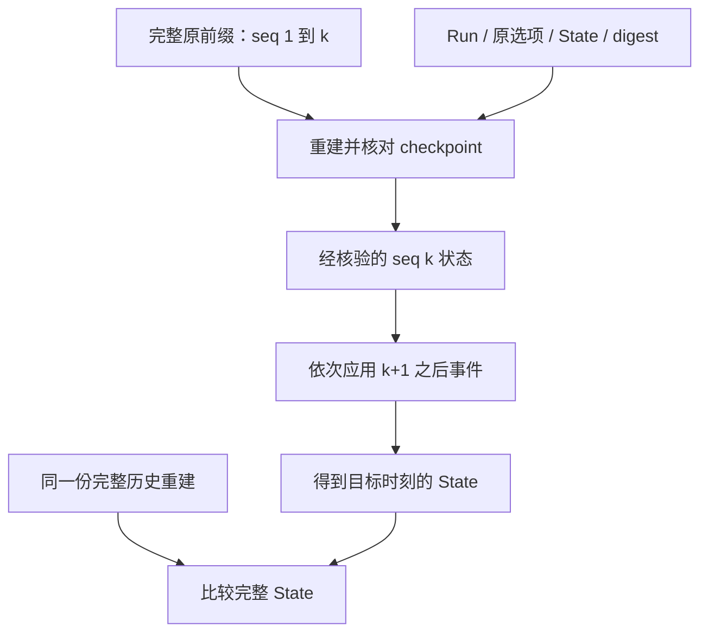

# 第 13 章：Checkpoint、Snapshot 与持久化状态

历史越长，越容易产生一个诱人的想法：把当前 State 保存下来，下次直接接着用。但这份 State 从哪里来、对应到哪个序号、哪些原始事实仍要核验，决定了它是可审查的检查点，还是另一份未经证明的新故事。本章把“保存一个值”推进到“绑定并核对一个历史切片”。

主要入口是 [Checkpoint](../lib/agent_systems_lab/checkpoint.ex)、[CheckpointStore](../lib/agent_systems_lab/checkpoint_store.ex)与 [History](../lib/agent_systems_lab/history.ex)。所有例子绑定实际检出提交及原 `max_turns`；本项目的 checkpoint 协议已实现，裁除历史、分层冷存储与任意可信快照导入尚需单独设计。

## 阅读准备与学习目标

先能从[第 2 章](ch02-agent-state-machine.md)的一条命令轨迹推出 Event 和 State，并理解[第 12 章](ch12-state-versioning-and-context-recovery.md)中版本域与 hash 的边界。这里的 prefix 是检查点覆盖的原历史，tail 是之后尚需应用的事件，不是另一份可任意排序的数据集合。

读完应能创建非空前缀的检查点，验证其内部投影与原前缀，再接上连续 tail；能给自洽伪造、序号重复、终态追加分别提供拒绝证据。首次练习只用纯值；实际数据库提交与新 BEAM 审计另按 L06 的前置完成。

## 13.1 三种 snapshot，先说清来源

“快照”常只是“在某时刻拿到的一份值”。它可能是 RunServer 返回的内存观察，也可能是数据库 Run 投影，还可能是绑定历史前缀的 checkpoint。三者都方便读取，却承担不同证明义务。

| 对象 | 描述哪一时刻 | 使用前还需判断什么 |
| --- | --- | --- |
| RunServer snapshot | 当前 owner 可见的状态、预算与流预览 | 哪些部分易失，是否与持久事实一致 |
| Run 投影 | 数据库中已经提交的当前状态 | 对应 Event 是否完整、能否按原配置重建 |
| Checkpoint | 原历史前缀结束位置的状态 | 前缀、配置、digest 与 State 是否相互吻合 |

Checkpoint 不是“当前 Run”的别名。若检查点在 seq=2，Run 已推进到 seq=4，二者应不同；只有把合法 tail 接上，才能与完整重建比较。读取最近一份快照后直接当成当前状态，会漏掉它之后的取消、结果或预算事实。

检查点保存原状态及其解释条件，而不是把状态投影重新提升为独立权威。当前协议中的 `last_seq`、`run_id`、`max_turns` 与两个 digest 缺一不可。即使业务状态看起来相同，若运行配置不同，也不能声称重建过程等价。

## 13.2 第一次小练习：在等待工具时切一刀

在仓库根目录进入纯内存 IEx；环境安装见 README：

```sh
LAB_DATABASE_ENABLED=false LAB_SCHEDULER_ENABLED=false ./scripts/iex
```

先预测：prefix 停在等待工具时，tail 能否从工具结果开始？若 tail 里重复一次结果、或者检查点中的 input 被改写并重算 hash，会在哪里被拒绝？下面的工具结果都是手工提供的值，没有执行工具。

```elixir
alias AgentSystemsLab.{Checkpoint, History}
alias AgentSystemsLab.Kernel, as: LabKernel
id = "ch13-prefix"
opts = [max_turns: 3]
{:ok, s0} = LabKernel.new(id, opts)
{:ok, s1, [started]} = LabKernel.dispatch(s0, {:start, "保存原任务"})
call = %{operation_id: "cp-1", tool: "mock_write", arguments: %{value: "x"}}
{:ok, s2, [requested]} = LabKernel.dispatch(s1, {:model_response, {:call, call}})
prefix = [started, requested]
{:ok, checkpoint} = Checkpoint.new(id, prefix, opts)
:ok = Checkpoint.verify(checkpoint, prefix)
{:ok, s3, [result]} = LabKernel.dispatch(s2, {:tool_result, "cp-1", {:ok, :saved}})
{:ok, s4, [finished]} = LabKernel.dispatch(s3, {:model_response, {:final, "完成"}})
tail = [result, finished]
{:ok, full} = History.rebuild(id, prefix ++ tail, opts)
{:ok, from_tail} = History.from_checkpoint(checkpoint, tail)
true = full === from_tail and full === s4
{:error, {:invalid_event_sequence, 4, 3}} =
  History.from_checkpoint(checkpoint, [result, result, finished])
forged_state = %{checkpoint.state | input: "被替换的任务"}
{:ok, forged_hash} = Checkpoint.digest(forged_state)
forged = %{checkpoint | state: forged_state, state_sha256: forged_hash}
:ok = Checkpoint.validate(forged)
{:error, :checkpoint_history_mismatch} = Checkpoint.verify(forged, prefix)
```

可验证结果有三层：完整历史与合法 tail 得到相同 State；重复 seq 被精确拒绝；重算 State hash 可以通过内部 validate，却不能通过原前缀 verify。最后一项说明“内部自洽”和“对应原历史”确实不是同一件事。

如果只用 `History.from_checkpoint(forged, tail)`，该纯值接口不会替你去数据库找原前缀；它要求调用方提供可信 checkpoint。外部不可信文件不能仅凭 validate 成功就传入这个入口。数据库路径的 CheckpointStore 会先按权威历史核验，再使用状态与 tail。

## 13.3 prefix、检查点和 tail 如何相互约束



连续序号不仅检查数量，还检查顺序和归属。tail 从 k+1 开始，每次只能推进一个合法事件；重复、缺口、另一 Run 的 Event 或终态之后的事件，都不能通过排序、去重或跳过异常“修复”。这些处理会把原故事变成另一条合法但不同的轨迹。

原配置同样参与解释。一个 max_turns=3 的任务，不能在重建时自动换成默认值，哪怕当前事件尚未触发上限；不同配置会改变后续可接受行为。checkpoint 记录 max_turns，完整重建也需带相同选项，这样比较才是在同一个规则集下进行。

前缀 hash 与 State hash 分别约束历史数据和状态投影，但 hash 不能决定哪份来源值得相信。实际 reader 需要可信的原历史来认证这个对应关系。只比较 State hash 相等，还无法证明读取过程没有调用 Provider 或工具；纯度是另一个执行边界，需要单独观察。

## 13.4 数据库发布需要真正的提交边界

CheckpointStore 创建检查点时要求当前 expected seq，在事务里绑定已有事实与新行。若读者基于旧 seq 发起创建，应拒绝并重新审阅；不能把检查点偷偷更新为它尚未见过的新状态。同一 Run/seq 已有记录时也不覆盖原检查点。

提交前 caller 被杀，检查点不应留下半份记录；COMMIT 后回复丢失，另一个新进程可能已经读到完整检查点。这个差别与第 4 章的业务提交一致。把写检查点包在更外层事务里，会移动真实 COMMIT 边界，因此相关 API 拒绝不支持的嵌套写事务。

这些约束保证发布的是一个完整、对应确定历史位置的对象。它们不意味着历史可以被删除，也不意味着数据库 owner 无法恶意改表；可信宿主与数据库权限仍是本项目的前提。预期错误、真正提交和独立读取要分开记录，不能只保存一次创建调用的退出码。

创建与读取的测试入口见 [CheckpointStore 测试](../test/agent_systems_lab/checkpoint_store_test.exs)。手动构造数据库例子时使用自己的可丢弃实例与新 Run ID，先完成 L02 的事务准备，不在旧冻结材料上写入或覆盖已有检查点。

## 13.5 最近检查点坏了，能否悄悄回退

当前读取协议区分两种情况：没有 checkpoint 时，检查点模式可以退回完整重建，并在 audit 中写明实际 mode 为 full；最新 checkpoint 已损坏时，读取应返回错误。后者不能静默选择旧检查点或完整历史，让调用者误以为最新记录仍有效。

静默回退也许能让页面暂时显示结果，却会隐藏持久数据已损坏这一事实。修复流程应保留错误对象与原字节，查明来源，再在明确策略下重建或重发一个受校验对象。不要为了“可用”而把故障记录从结果中抹掉。

即使有 checkpoint，当前实现仍读取并校验完整对应前缀。本项目没有据此宣称启动更快，也没有完成历史归档裁除。尾部应用较短只是计算路径的一部分；总读取、校验、内存和耗时需要另做实测，才能决定是否值得引入新的可信前缀协议。

若要做性能练习，先固定相同 Run、原选项与目标序号，再分别测 full 和 checkpoint 路径。记录前缀事件数、tail 事件数、数据库读取量、校验工作和总耗时，保留多次原始样本；不能只量最后一次 tail reduce。比如前缀从二条增加到两千条、tail 仍为两条，最后一步看起来没变，总验证成本却可能明显不同。正确比较还要求两条路径得到完整相等的 State，不能删掉检查来换速度。

## 13.6 一次实验证明哪些结论

准备好专用 PostgreSQL 后，可按 [L06](../labs/L06-history-checkpoints.md)运行 `lab.history`，为每次命令选择全新输出目录。这是执行演示：它先真实创建任务并写入自己的工作区，随后才启动新 BEAM 做只读重建。不要将整条命令都叫作零效果读取。

检查原始报告时，将全量/检查点的 State 相等、prefix/tail 数量、文件前后 hash、录制结果验证，以及新进程入口调用计数并列。新 BEAM 的计数全为零，才是其重建阶段未重新执行的证据；旧 VM 的 ETS、控制台没有日志或只比较状态，都不能替代它。

审计入口会观察当前 VM 的相关函数，应在独立或空闲 BEAM 中执行。别的业务同时运行会污染计数，得到非零后也不能直接怪罪重建器。先记录执行范围与进程身份，再判断函数调用来自哪里，保留该次实际输出。

如果前缀缺一条 Event、tail 重复或 State 被改，应分别看到对应拒绝。恢复者不能跳过坏数据后继续 resume；“旧状态还能显示”与“可以按原资格安全执行下一步”之间，仍隔着操作、回执、预算和 claim 的检查。

## 13.7 检查点怎样服务维护而不篡改历史

一个可审阅的 checkpoint 变更应同时说明格式、来源、原选项和验证成本。以后若要支持冷存储或受信任前缀，必须明确定义谁签发、怎样验证、丢失后如何拒绝，以及旧 reader 是否仍能解释；不能把今天的普通 digest 偷换成明天的授权凭证。

检查点也不应消费新的任务预算。它重新解释已接受事实，没有新的模型响应、工具投递或 dispatch。读取发现预算已经耗尽，就保留这个事实，而不是为了让重建得到“可运行”状态把计数清零。预算在何处持久保存，由相关执行路径决定，不能通过 State 切片补造。

完成本章时，应留下纯值比较和两种拒绝、对可信 checkpoint 参数的说明，以及数据库部分实际做过的提交/独立读取证据。未做新进程审计时只写纯值检查，不把目录存在或一个 true 升格为完整持久恢复验收。

## 13.8 练习与教师参考

每题按不变量、反例、证据三项各 0—2 分，至少 5/6。不得用重算 digest、忽略坏行或删除验证前缀来使结果通过。

1. 13.2 的 forged 为什么可以 validate，却不能 verify？若调用方把它直接交给 from_checkpoint，省掉了什么前提？
2. checkpoint 的 last_seq=2，tail 的第一条是 seq=4，为什么不能自动补一个空事件？若 tail 重复 seq=3 呢？
3. “有检查点后可删原历史且启动一定更快”包含哪两项未经证明的结论？应分别增加什么机制或实测？
4. 最新 checkpoint 损坏与完全没有 checkpoint 应怎样区分？报告如何表明实际使用的是完整重建？

<details>
<summary>教师参考：检查自洽、历史与执行三个层次</summary>

1. validate 只检查 checkpoint 内部字段、状态及摘要；重算 hash 可保持这种自洽。verify 从可信原前缀独立重建并逐项比较，所以发现 input 已变。from_checkpoint 是纯值入口，信任 checkpoint 的来源责任仍属于调用方。
2. Event 表示已接受事实，空事件不是原事实，不能补造。缺口或重复都破坏连续序号，应拒绝；例子重复结果时应看到 expected 4、actual 3，而不是通过去重隐藏损坏。
3. 当前协议仍验证完整前缀，没有历史裁除合同；需要另设可信归档/前缀机制。性能还需量化总读取、验证与重建耗时，不能只根据 tail 变短宣称加速。
4. 无检查点可明确采用 full，并在 audit 中标实际路径；最新对象坏了则返回错误并保留证据。静默回退会遮蔽损坏，不能把旧检查点或完整重建的成功冒充最新对象有效。

</details>

## 术语与继续阅读

snapshot 是某时刻的观察或投影；checkpoint 是绑定前缀的状态对象；prefix 提供原事实，tail 延续原序号；digest 检查内容对应，不能代替来源与授权。完整对照见[术语表](glossary.md)。下一章[事件历史与纯重建](ch14-history-checkpoints-and-replay.md)将检查点、模型录制与新进程零调用审计连接起来，再由第 15、16 章进入重试和外部效果。
