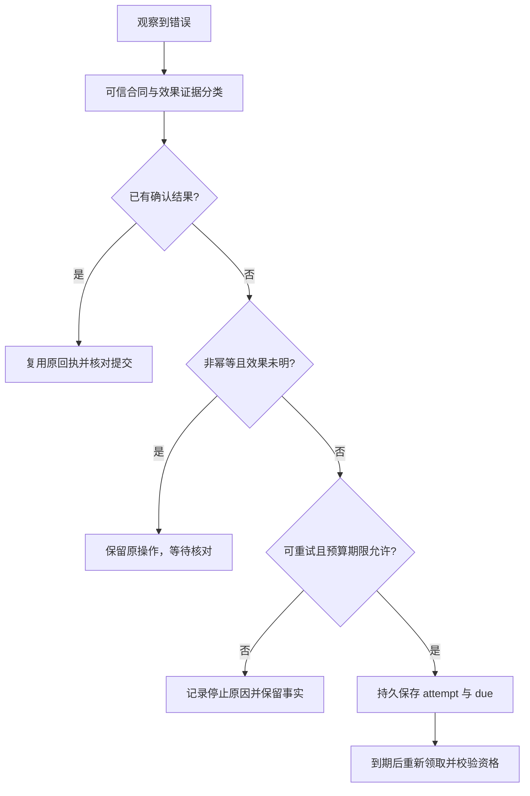

# 第 15 章：Retry、Timeout、Idempotency 与故障语义

“失败后再试一次”只有在说明失败意味着什么之后才有意义。参数没有通过校验、服务暂时不可用、写入后回执丢失，都会在调用方表现为不成功，却要求不同的下一步。本章把错误分类、重试资格、效果能力与时间预算放在同一张决策图上。

实现入口为 [ErrorPolicy](../lib/agent_systems_lab/error_policy.ex)、[RetryPolicy](../lib/agent_systems_lab/retry_policy.ex)、[RetryStore](../lib/agent_systems_lab/retry_store.ex)和 [ReconciliationQueue](../lib/agent_systems_lab/reconciliation_queue.ex)。本文以实际检出源码、原配置和本次原始证据为准；有限重试已实现，真实远端服务的通用幂等保证并没有由本项目签发。

## 阅读准备与学习目标

应能解释工具提议、operation、回执与未知结果，并知道[第 14 章](ch14-history-checkpoints-and-replay.md)的重建只恢复事实。attempt 可以先理解为“对同一逻辑操作的一次执行尝试”；due 是下一次最早允许领取的时刻，deadline 是不能因重试延长的任务边界。

读完应能为明确拒绝、瞬时错误、超时与模糊效果选择停止、有限重试或核对；能计算退避与精确截止条件，说明恢复时哪些计数必须继承。首次练习只执行纯策略，不睡眠、不连接数据库。持久核对与故障演练按 L08 的前置另行完成。

## 15.1 错误名称不是效果事实

客户端收到 timeout，只知道它在某个期限内没拿到所需结果。请求可能未发出，也可能正在运行，还可能已经提交但回复丢失。把 timeout 一律翻译成“没有效果”，会在最危险的窗口批准第二次写入。

| 情境 | 需要保留的判断 | 当前策略的方向 |
| --- | --- | --- |
| schema、权限或全局预算拒绝 | 这次条件不允许继续 | 不自动重试 |
| 已知瞬时模型错误 | 当前适配合同下可有限再请求 | 仍受 attempt、due 与 deadline 限制 |
| 工具已确认效果 | 应复用或提交原结果 | 不因连线错误重复已确认效果 |
| 非幂等工具超时且效果可能发生 | 原操作结果尚未查明 | unknown，进入核对路径 |
| claim 或 seq 冲突 | 执行资格/审阅前提已过期 | 不能用普通网络重试绕过 |

这张表不是凭错误字符串猜现实。ErrorPolicy 的 scope、effect 和 idempotent 参数来自可信宿主的工具合同与执行证据；把参数填成 true，不会使一个远端服务突然支持幂等。未识别原因默认不获自动重试资格，也不因此证明外部效果为零。

分类只回答下一步是否有资格进入某种策略。它不能替代状态转换、权限校验、目标查询或预算预留。若某个外部接口根本没有可靠查询和幂等能力，就应明确保留未决问题，而不是添加一个更宽松的错误分支。

## 15.2 第一次小练习：同一个 timeout 为什么得到不同分类

在仓库根目录终端进入纯内存 IEx：

```sh
LAB_DATABASE_ENABLED=false LAB_SCHEDULER_ENABLED=false ./scripts/iex
```

先预测：一次非幂等工具的可能效果、一次明确无效果的瞬时失败、一次全局期限耗尽，是否都可重试？这里的能力参数只构造教学情境，没有探测或授权真实服务。

```elixir
alias AgentSystemsLab.{ErrorPolicy, RetryPolicy}
ambiguous = ErrorPolicy.classify(:timeout,
  scope: :tool, idempotent?: false, effect: :possible)
true = {ambiguous.class, ambiguous.retryable} == {:unknown, false}
known_none = ErrorPolicy.classify(:fail_before_effect,
  scope: :tool, idempotent?: false, effect: :none)
true = {known_none.class, known_none.retryable} == {:transient, true}
stopped = ErrorPolicy.classify({:budget_exceeded, :run_timeout})
true = {stopped.class, stopped.retryable} == {:permanent, false}
:ok = ErrorPolicy.validate(ambiguous)
{:ok, policy} = RetryPolicy.new(max_attempts: 6,
  base_delay_ms: 100, max_delay_ms: 250, max_elapsed_ms: 10_000)
{:retry, 1_100} = RetryPolicy.next(policy, 1, 1_000, 1_000)
{:retry, 1_300} = RetryPolicy.next(policy, 2, 1_000, 1_100)
{:retry, 1_550} = RetryPolicy.next(policy, 3, 1_000, 1_300)
{:exhausted, :attempts} = RetryPolicy.next(policy, 6, 1_000, 2_000)
{:exhausted, :deadline} = RetryPolicy.next(policy, 1, 1_000, 1_000, 1_100)
{:exhausted, :elapsed} = RetryPolicy.next(policy, 1, 1_000, 10_900)
```

数字时钟是纯函数输入，不是修改数据库时间。第一个重试延迟 100，第二个 200，之后由 250 上限封顶；计算的是从 now 开始的下一次 due。max_attempts 包含已经计入的尝试，达到上限就不再预留下一次；它不是“首次失败之外还能再做六次”。

due 等于 deadline 时已耗尽，不采用“小于等于都可以试”的宽松边界；elapsed 的边界同样严格。观察到 `{:retry, due}` 也不表示调用已经执行，它只是决定最早可再次尝试的时刻。实际执行还需等候持久 due、获得当前 claim 并再次检查预算。

把第三个结果放回时间线：due=1550 的任务在 1400 被扫描，不能因为另一个 Worker 已空闲就提前执行；在 1800 才被扫描，虽然 due 已到，若原 deadline=1600，也已没有执行资格。到期只消除“太早”这一项限制，不会消除“太晚”或预算耗尽。若此时重启进程，把 first 改为 1800 再算一次，就不是恢复原退避，而是在替任务创建新的时间额度。读者应在报告中保留原 due、首次时间和实际领取时刻，才能区分这些情况。

## 15.3 一个逻辑效果，多次投递尝试

operation ID 绑定同一逻辑操作及精确参数，attempt ID 识别某次执行。网络重投、进程恢复或第二个 Worker 不应偷偷生成一个新 operation 来绕过原有事实。参数变了又复用旧身份，应当得到冲突，而不是把旧回执用于新任务。

当前持久 Mock 具备声明的幂等与查询能力，可以在同一 operation 反复投递时返回原结果，实际效果仍只有一次。文件工具和其他外部系统的能力合同不同，不能看到 Mock 演示成功就自动推广。即使模型请求可再次执行，真实服务也可能再次收费；模型尝试账与工具业务效果账仍是两类事实。

幂等也需要定义边界。它可能只保证某个 key 下同参数的效果去重，不保证调用只发一次、不保证响应一定到达，也不保证任务最终成功。错误日志里 requests 增加、effects 不增加，可能正是受控重投的正确结果；只看请求次数会把这种保护误判为重复业务写入。

## 15.4 先决定资格，再等待 due



把 due 保存下来，意味着进程重启后不能立刻从第一档退避重新开始。RetryStore 将尝试身份、次数、首次时间和下一 due 纳入持久事实；预留和安排具有各自提交窗口。恢复者应读已提交状态，分清“已预留但尚未执行”与“执行过但安排确认未到”。

退避期间不应继续占用一个假定永远有效的旧执行资格。到期后由正常领取路径检查原状态、当前 claim、deadline 和预算，再决定是否开始该步。调度器的具体 lease/fencing 在后面展开；这里先理解“等待过了”不是永久授权。

不要为了让实验更快而改数据库 due、expiry 或删除 attempt。纯策略练习可以输入合成时钟来核对算法，真实故障 runner 则需要等待原持久时间资格。两者证据用途不同，不能把前者的数值计算写成真实并发领取通过。

## 15.5 模糊效果需要另一条核对通道

非幂等效果可能已发生却无回执时，自动重试会把不确定性放大。当前持久执行路径把这类 unknown 留在 Run 与操作事实中，并对仍 blocked 的任务提供核对队列。查询原目标台账、接收配对回执或明确的可信人工证据，才可能改变下一步判断。

队列不是所有未决账目的永久全集。当前取消会使 Run 终态并离开活动 blocked 队列，原 operation 的 unknown 仍可保留；队列空不能证明效果已核清。若选择取消而仍需调查，宿主必须明确交接原身份、责任与证据，不能依赖一个已经不再列出的活动项。

核对本身也可能超时。查询失败不能自动变成一次写入重试；如果已取得可信 receipt，却在接受对应 Event 前退出，恢复应复用这份 receipt，而不是再让操作员给出另一份结论。这些提交窗口在下一章逐项展开。

## 15.6 错误恢复不能退款

Run 的原输出字节、模型尝试、工具调用、turn、dispatch、retry due 与绝对 deadline 都会限制续跑。重启、重建、续租或换 worker，不应把已用额度变回初始值。即使 retry policy 还允许下一次尝试，剩余任务预算也可能已经不允许执行。

资源耗尽与效果不确定是两个独立事实。任务停止并不推翻已有回执；deadline 已过也可能仍需核对旧效果，但不应批准新的模型或工具步骤。对于仍 unknown 的操作，保留其状态和原身份，Run 的终态及活动队列归属按实际协议另行判断。

这也是不能把重试设计成一个简单 while 循环的原因。无限循环会隐藏次数、elapsed 和 owner 变化；catch 全部异常后从头再来，又会覆盖精确错误与真实效果。修复需要让每次接受的尝试与停止原因留下可独立读取的事实。

## 15.7 用反例验证修复，而非只跑成功路径

完整练习见 [L08](../labs/L08-retries-and-reconciliation.md)。先按 L01—L07 准备自有数据库和原权限，再分别观察模型瞬时错误、幂等目标暂时失败、非幂等 unknown、次数耗尽与 due 前领取拒绝。每次使用新身份与新输出目录，保留原失败记录。

重要观察不是“最后都 succeeded”，而是每种输入落在正确分支。一个预期仍 blocked 的案例通过，正说明系统没有盲重做效果；一个预期权限拒绝的案例通过，也不是调用成功。报告应把期望终态、效果数、操作/attempt 配对和预算一起列出。

源码级对照从[策略测试](../test/agent_systems_lab/error_policy_test.exs)开始，再看[持久重试测试](../test/agent_systems_lab/recovery_retry_test.exs)、[重试 Store](../test/agent_systems_lab/retry_store_test.exs)和[核对队列](../test/agent_systems_lab/reconciliation_queue_test.exs)。只运行纯策略文件，不等于已经完成数据库恢复；相同名称的错误也需按实际作用域解释。

## 15.8 练习与教师参考

每题按不变量、反例、证据各 0—2 分，至少 5/6；不能用换 operation、删 attempt 或重置 deadline 得到通过。

1. 两次 timeout 为什么可能分别属于可重试和 unknown？谁能提供 idempotent 与 effect 的可信依据？
2. 15.2 中前三个 due 怎样计算？为什么达到 max_attempts 或 due 恰等于 deadline 时不能再执行？
3. caller 在安排 retry 的 COMMIT 后没收到回复，恢复者能否从第一档退避重来？应读取哪些持久事实？
4. 取消后活动核对队列为空，是否说明原非幂等效果不存在？怎样交接一个仍需调查的操作？

<details>
<summary>教师参考：分类、时间与效果分别核对</summary>

1. 超时不说明效果是否发生。明确无效果或具备相应幂等合同的目标，才可能获得有限重试资格；非幂等且可能已发生的效果应保持 unknown。参数来自宿主配置与实际执行证据，不能由模型叙述或 classifier 调用本身签发能力。
2. 延迟依次为 100、200、封顶 250，从各次 now 加得 1100、1300、1550。上限计入已发生的尝试；due 不早于 deadline 时已没有新的执行时间，不能靠时钟相等钻过边界。
3. 不能。应读取原 attempt、次数、first time、due、原 Run 预算与当前意图，再按时间资格领取。丢 ACK 不表示事务回滚；重新初始化计数会加速或增加未经批准的重试。
4. 不说明。取消停止推进并改变活动队列归属，原 unknown 事实仍可能存在。交接应绑定 Run、seq、operation、参数、已知效果与未决证据，由可信宿主安排后续调查；不能把空队列或 cancelled 解释成已撤销。

</details>

## 术语与继续阅读

Retry 是有条件再次尝试；idempotency 是目标能力合同；attempt 属于一次投递；operation 是稳定逻辑效果；due 是最早可尝试时间，deadline 是绝对执行边界。完整对照见[术语表](glossary.md)。下一章[外部效果、提交协议与 Unknown 核对](ch16-durable-effects-and-reconciliation.md)把这些策略放回效果发生、receipt 保存和 Kernel 接受的真实窗口。
