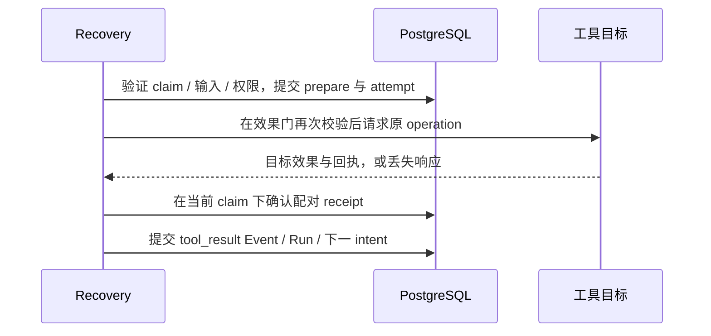

# 第 16 章：外部效果、提交协议与 Unknown 核对

试读修订版，2026-10-25。对应当前 L07—L09，并延伸到 L20 的迁移/还原语义；原计划的实验编号已顺延。
本轮采用多代理模拟评审与代码核查，详情见[首批学习修订审查](../docs/learning-revision-review.md)；模拟不能证明真人独立完成率或学习耗时。

## 16.1 学习路径：从事实转向下一次效果

先修能力：能解释 [第 14 章](ch14-history-checkpoints-and-replay.md)中 rebuild 为何只读，知道 schema/operation 配对与文件授权的用途，能区分事务 COMMIT 与 caller 收到确认。缺项从[先修知识](prerequisites.md)补齐；operation、attempt、receipt、unknown 见[术语表](glossary.md)。
六章主路线从第 14 章直接进入本章；首次小练习只用 Kernel 纯值。运行持久恢复前再完成 [L04](../labs/L04-controlled-tools.md)、[L06](../labs/L06-history-checkpoints.md)的环境和任务，不必先做故障矩阵。本章先拆开 operation、attempt 和 receipt，再观察工具成功后崩溃，最后决定安全续跑或人工交接。
后续：[第 20 章](ch20-scheduling-and-recovery.md)负责多 Worker 下的领取、lease 与 fencing。

最危险的问题通常不是工具抛出了 error，而是工具已经成功，Runtime 却没有拿到可接受的结果。
例如文件已写入，进程在保存本地 receipt 前退出。新进程只看到 `waiting_tool`，并不能推出“工具没有执行”。
如果直接重发，第二次写入可能覆盖其他人的修改；如果直接填成功，又会制造没有证据的事实。
系统需要一种能保留不确定性的状态，并让这种状态有可见去向。
完成本章应能画出 prepare / effect / receipt / 结果事务 COMMIT 四个边界，并为每个边界给出“能证明什么、还不知道什么、允许做什么”。能指出取消后哪些事实仍未确定，比只看到最终 succeeded 更重要。

## 16.2 五类身份与记录不能合并

| 身份或记录 | 生命周期与责任 |
| --- | --- |
| Run ID | 同一任务的业务身份；恢复保留原值 |
| operation ID + 精确输入 | 同一逻辑工具操作；跨投递不变 |
| claim token + generation | 一次短期执行资格；接管时改变 |
| delivery attempt | 一次执行、查询、观察或人工确认的审计记录 |
| receipt | 已核实结果及原 operation/tool 配对；不等于 HTTP 成功文字 |

一次操作可以有多个 attempt；本仓库的受控幂等 Mock 通过稳定 operation 身份维持一个业务效果。任意远端是否支持相同性质，必须单独验证目标的幂等键作用域、保留期、精确输入约束和查询契约，不能只凭传入相同字符串宣称 exactly-once。
相同 operation ID 换参数必须冲突，连 `1` 和 `1.0` 的精确类型变化也不能悄悄接受。
新 claim 不代表新业务操作，旧 claim 失效也不会撤销已经发生的效果。
对应 [DurableTools](../lib/agent_systems_lab/durable_tools.ex)、[配对封装 Result](../lib/agent_systems_lab/tools/result.ex)。

## 16.3 把一条调用拆成可审计的提交



数据库可以原子保存 Run、Event 和调度意图，却不能把任意文件写入或远端请求纳入同一个事务。
因此 prepare、目标效果、本地 receipt、结果事务 COMMIT 是不同边界。最后一项指 Storage 把 Kernel 已算出的合法结果、Run/Event/下一 intent 原子提交到 PostgreSQL；纯 Kernel 自身不执行 SQL。程序必须能解释任意相邻边界间的崩溃。
`prepare` 提交后才调用目标；已确认 receipt 跨进程复用，不因为本次调用又叫 execute 就重新产生效果。
“本地 receipt 完整”和“Kernel 已接受结果”也不同：前者存在而后者缺失时，只需补提交缺失的事实。

| 退出位置 | 可证明的事实 | 下一步 |
| --- | --- | --- |
| prepare 前 | 本地尚无本次准备记录 | 仍按有效资格与原预算决定执行 |
| prepare 后、效果前 | 已准备；其他观察者通常不知道是否跨过效果门 | 按工具能力恢复；不可查询工具保留 unknown |
| 效果后、receipt 前 | 目标可能完成，本地尚未确认 | 按原身份查询或幂等取得结果；无能力则人工核对 |
| receipt 后、Kernel 接受前 | 完整配对结果已确认 | 复用 receipt，提交缺失 Event |
| 结果事务 COMMIT 后、ACK 前 | 状态和下一意图已提交 | 重读新事实，不能再接受同一结果 |

caller error 只能说明没有获得成功确认，不能证明 COMMIT 回滚或远端没有执行。
真实故障测试要等指定 gate，再确认实际调用进程 `:DOWN`；一段普通 sleep 不能定位提交边界。
见 [durable_tools_test](../test/agent_systems_lab/durable_tools_test.exs) 和 [recovery_test](../test/agent_systems_lab/recovery_test.exs)。

## 16.4 Unknown 是结果知识，不是可重试 error

`unknown` 表示无法确认效果结果。接受 unknown 结果时，Kernel 保留原 operation 并进入 `blocked`，下一意图成为 reconcile。
状态、unknown Event 与 reconcile intent 在同一事务提交，待核对队列直接读取这些事实，不依赖另一次 enqueue。
队列里看到的是已提交的不确定性；列队命令本身不会查询目标，也不会执行工具。

```sh
./scripts/mix lab.reconcile --limit 20 --json
```

该命令可列出既有实验的 unknown。队列非空不等于当前章节失败，也不能为获得零项而删除旧记录。
按本次 report 中的原 Run ID 过滤时使用 `./scripts/mix lab.reconcile --run RUN_ID --json`，先替换参数。
`safe_mode: queryable` 当前仅由幂等持久 Mock 契约支持；任意文件、MCP 或外部服务不会自动获得同等能力。
未登记 Recovery 配置的旧 Run 仍可列出，但 `recoverable: false`，不能猜配置接管。
入口：[ReconciliationQueue](../lib/agent_systems_lab/reconciliation_queue.ex)；测试：[reconciliation_queue_test](../test/agent_systems_lab/reconciliation_queue_test.exs)。

### 第一次小练习：取消能把 unknown 变成失败吗

先预测，再在项目根目录用 `LAB_DATABASE_ENABLED=false LAB_SCHEDULER_ENABLED=false ./scripts/iex` 执行。这里的工具名只是 Event 数据，没有调用工具或连接数据库：

```elixir
alias AgentSystemsLab.Kernel, as: LabKernel
{:ok, queued} = LabKernel.new("ch16-first")
{:ok, running, _} = LabKernel.dispatch(queued, {:start, "核对边界"})
call = %{operation_id: "op-1", tool: "mock_write", arguments: %{"value" => 7}}
{:ok, waiting, _} = LabKernel.dispatch(running, {:model_response, {:call, call}})
{:ok, blocked, _} = LabKernel.dispatch(waiting, {:tool_result, "op-1", {:unknown, :lost}})
{:ok, cancelled, _} = LabKernel.dispatch(blocked, {:cancel, :user_requested})
:cancelled = cancelled.status
:unknown = cancelled.operations["op-1"].status
{:error, _} = LabKernel.dispatch(cancelled, {:reconcile, "op-1", {:ok, "unverified"}})
```

<details>
<summary>提示与自检</summary>

Run 的执行生命周期已经终结，operation 的结果知识仍为 unknown。取消不证明效果失败，也没有删除原事实。纯值例子只证明 Kernel 转换；数据库队列的可见性由下面的入口约束决定。

</details>

### blocked 队列有明确的生命周期边界

当前 Kernel 允许取消非终态的 blocked Run。取消后历史和 operation 中的 unknown 仍保留，但 Run 已是 cancelled，`ReconciliationQueue` 不再列出它，`Recovery.reconcile/2` 返回 `:not_blocked`；原 Run 不会继续接受 reconciliation Event。队列为空因此不等于所有外部效果已经查明。

可信宿主若选择直接取消，应先交接 Run/operation/精确输入和现有证据，在该终态 Run 之外继续业务调查、记录结论及必要的另行授权补偿；当前仓库没有“重开 cancelled 再核对”的入口，也没有通用的取消后调查台账。需要使用现有核对入口时，应让 Run 保持 blocked，先核对再终结，而不能靠改 SQL 恢复状态。这是当前接口边界，不代表 unknown 已被解决。

Workflow 父取消使用另一条已实现策略：保留 ambiguous 子 Run 的 blocked 与待核对入口，关闭父级后续执行门；子核对完成也不能重开父 Workflow 或释放依赖节点。不要把父取消策略套用到直接取消单个 Run。对照 [Workflow 协调测试](../test/agent_systems_lab/workflows_coordinator_test.exs)的 ambiguous child 场景和[技术主张核查台账](../docs/technical-claims-review.md)。

### 三种结果，三种处理

确定的临时无效果失败，若同时满足工具能力和有限 retry 政策，可以再次尝试原操作。
已经确认的成功或失败 receipt 直接复用；不能只因想重试就覆盖原结论。
模糊结果先查询或人工核对；查询耗尽后仍 unknown，额度不足不会把不确定性变成确定失败。

当前自动安全重投仅针对幂等 Mock 的已确认 transient/no-effect 分支。
人为填写的 error、任意异常或“超时了应该没发生”，都不构成新的效果授权。
测试见 [durable_retry_tools_test](../test/agent_systems_lab/durable_retry_tools_test.exs)。

## 16.5 最小恢复练习：新进程保留同一身份

先执行 `./scripts/postgres start` 和 `./scripts/mix setup`，再进入 `LAB_SCHEDULER_ENABLED=false ./scripts/iex`。
连续执行下面代码；它创建自己的离线 Mock 任务，后续查旧 Run 时不要再次 create：

```elixir
alias AgentSystemsLab.{DurableTools, Recovery}
id = "ch16-#{System.system_time(:microsecond)}-#{System.unique_integer([:positive])}"
call = {:call, %{operation_id: "once", tool: "mock_write", arguments: %{"value" => 7}}}
{:ok, initial} = Recovery.create_run(id, "一次逻辑效果",
  script: [call, {:final, "done"}], run_timeout_ms: 600_000)
{:ok, waiting} = Task.async(fn -> Recovery.step(id) end) |> Task.await()
:waiting_tool = waiting.state.status
1 = waiting.recovery.progress.cursor
{:ok, completed} = Task.async(fn -> Recovery.resume(id) end) |> Task.await()
:succeeded = completed.state.status
true = completed.recovery.config === initial.recovery.config
true = completed.recovery.progress.deadline_at_ms === initial.recovery.progress.deadline_at_ms
2 = completed.recovery.progress.model_attempts
%{effects: 1, operations: 1, attempts: 1} = DurableTools.stats(id)
{:ok, same} = Recovery.resume(id)
true = same === completed
IO.puts("CH16_RUN_ID=" <> id)
```

这里使用两个独立 Task 验证不依赖原 caller 的内存，不把它冒充跨 BEAM 或工具效果后崩溃的证明。
跨 BEAM 和真实 kill 由下一节 runner 检查；`stats/1` 是教学 Mock 诊断，也不授权任意真实目标的人工确认。
RunServer 的早期内存演示与持久 Recovery 是两条明确入口；旧 Run 没登记原配置时返回不可续跑，而非补猜 cursor。

## 16.6 系统检查崩溃与二次崩溃

所有副作用演示都创建自己的 Run，输出目录必须全新；重跑替换 `reader-01`：

```sh
LAB_SCHEDULER_ENABLED=false ./scripts/mix lab.recover --output artifacts/ch16-recovery-reader-01 --repetitions 1
LAB_SCHEDULER_ENABLED=false ./scripts/mix lab.retry --output artifacts/ch16-retry-reader-01
LAB_SCHEDULER_ENABLED=false ./scripts/mix lab.p2 --output artifacts/ch16-p2-reader-01 --repetitions 1
```

第一条检查崩溃恢复、查询确认和文件 unknown；第二条检查有限重试及原 due；第三条系统覆盖 P2 窗口。
`--repetitions 1` 是快速试读，不替代 P2 默认每故障点 20 次的正式验收。
阅读 [L09](../labs/L09-p2-fault-acceptance.md) 中 16 窗口矩阵，按故障名打开 initial/before/after 和实际 crash 记录。
其中 `recovery_after_effect_twice` 必须有初始 caller 和恢复 caller 两次真实退出，不能把一次退出算两次恢复。

| 必须分别计数 | 合格判据 |
| --- | --- |
| 模型 request attempts / 已接受模型结果 | 重启后已扣 attempts 不减少，cursor 只按接受规则增长 |
| 工具 deliveries / 业务效果 | 同一幂等 Mock operation 可多次投递，业务效果仍为 1 |
| 本地 receipt / Kernel Event | receipt 可先存在；最终事件只接受一次 |
| query attempts / manual unknown | 原 due 和有限窗口保留；未取消的 blocked 项仍在待核对队列 |
| kill 数 / 被杀进程角色 | gate、实际 PID、`:DOWN` 与 COMMIT 边界吻合 |

不要通过更改 SQL expiry、清空 token、删除 attempt 或换 operation ID 来让正式接管更快。
组件测试可能用受控夹具缩短准备过程；正式 runner 的时间资格证据仍要等待真实 lease/due 到期。
真实范围和实际结果分别见 [P2 故障报告](../docs/p2-fault-report.md)、[W10 验收](../docs/validation-week10.md)。

## 16.7 超时、取消、权限和预算共同生效

超时后先停止并等待本地执行器退出，再归档已确认 receipt 或 unknown。
这个顺序不证明远端请求已经取消；本地没有进程也不能推出外部没有效果。
取消停止未来执行，不撤销文件或业务动作；预算耗尽同样不是“未发生”的证据。

恢复保留原权限、工作区根、MCP/隔离策略、输出字节、模型尝试、工具调用、turn、dispatch、retry due 与绝对 deadline。
新进程不能以“恢复”名义重开预算；heartbeat 也不赠送新的任务时间。
Run deadline 后仍可核对旧效果并接收已确认回执，但不授权新的模型或工具步骤。
读 [Recovery](../lib/agent_systems_lab/recovery.ex)、[TaskBudgetStore](../lib/agent_systems_lab/task_budget_store.ex)；对应 [scheduler_deadline_test](../test/agent_systems_lab/scheduler_deadline_test.exs)。

第 21 周迁移与还原后，前述语义仍须成立：原本 blocked 的 unknown 不因迁移而变确定；已取消 Run 的终态和未决 operation 也应保留。旧预算仍耗尽，审批仍绑定原产物 hash。
数据库 layout 升级不修复未知效果；恢复库通过只读 proof 也不能绕过 fence 或扩大文件授权。
扩展验证路径见 [L20](../labs/L20-history-migration-backup-restore.md)。

## 16.8 人工核对与交接

操作员先固定 Run、seq、operation、tool 和精确参数，再取得独立业务回执或明确调查证据。
可信宿主在当前 claim 下写配对结果和 evidence；人的结论若在期间已被新事实超越，应重新审阅，不能偷偷改用新 seq。
程序能验证配对、版本和证据格式，却不能验证现实调查是否诚实；人工 evidence 是可追溯声明，不是密码学证明。
低并发教学示例的 `Recovery.reconcile(id, result: ..., evidence: ...)` 自动绑定调用当时的操作，不提供调用方 `expected_seq` 选项。人的判断需要绑定先前审阅快照时，应使用运行手册的 expected seq helper；前提已变返回 `:review_required`，重新采证后再决定。
若无权威证据，可以让 Run 继续 blocked，明确负责人和下一次核对条件。若另行选择取消，应按 16.4 的终态边界交接；本节的 claim/evidence 接口不能用于 cancelled Run。

人工 receipt 已提交但 reconciliation Event 尚未接受时，再次恢复应复用原 receipt，不再填写不同结论。
操作步骤和带 expected seq 的 helper 见 [运行手册第 5—8 节](../docs/recovery-runbook.md#5-unknown-的显式查询)。
禁止自动重发的文件案例即使当前内容完全匹配，也不能把字节相等当作原 operation receipt。

## 16.9 卡点、习题与完成标准

| 卡点 | 应保留的区别 |
| --- | --- |
| `waiting_tool` 不是没执行吗 | 它只表示 Kernel 尚未接受结果 |
| receipt 已完成，为什么还没 succeeded | 工具确认与 Kernel/最终模型接受是不同提交 |
| `reconcile` 后为什么没继续 | 检查剩余资格、原 deadline 与后台范围，再显式 resume |
| 重试次数耗尽可以删 unknown 吗 | 不能；资源耗尽与效果不确定是独立事实 |
| 取消后 reconcile 队列为空，说明已查明吗 | 不说明；队列只列 blocked，终态里的 unknown 仍需另行交接 |
| token 失效能阻止远端吗 | 本地写入受 fencing；远端仍需自己的能力契约 |

1. 画出工具成功、receipt 和 Kernel 接受三个窗口，分别给出新进程应读取的证据。
2. 为什么同一幂等 Mock 的多次投递不等于文件工具可以重发？比较两者的权威查询能力。
3. 设计恢复者再次在效果后退出的实验，列出必须保留的 operation、attempt、预算和 due。
4. 说明为什么 deadline 已过仍能核对效果，却不能重开模型请求。

首次阅读完成标准：运行纯值小练习，解释 Run cancelled 与 operation unknown 可以同时成立，并准确标出四个提交边界。持久化实验完成标准另含自己的成功路径、至少一个效果后崩溃、一个仍 blocked 的 manual unknown，以及逐项预算/配对核验。
针对性命令：`./scripts/mix test test/agent_systems_lab/durable_tools_test.exs test/agent_systems_lab/durable_retry_tools_test.exs test/agent_systems_lab/recovery_test.exs`。
完整实验见 [L07](../labs/L07-recovery.md)、[L08](../labs/L08-retries-and-reconciliation.md)，尝试后查 [L07 参考解答](../labs/solutions/L07.md)和 [L08 参考解答](../labs/solutions/L08.md)；不把预期结果写成本次实测。
本章验证单机 PostgreSQL、离线 Provider 和明确能力的工具，不承诺任意外部服务 exactly-once 或自动补偿。
