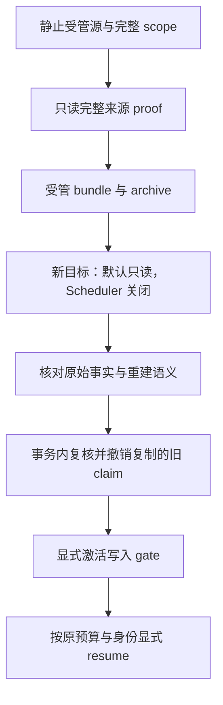

# 第 17 章：Resume、Recovery、状态迁移与任务恢复

一个进程死了，可以启动另一个进程；一份 archive 还原了，也可以连上新数据库。但这两件事都没有自动回答“下一步能做什么”。恢复的起点应是已提交事实，终点则是一个经过检查的执行决定，而不是从头重演所有旧动作。

本章连接 [Recovery](../lib/agent_systems_lab/recovery.ex)、[HistoryMigration](../lib/agent_systems_lab/history_migration.ex)、[ReadonlyProof](../lib/agent_systems_lab/history/readonly_proof.ex)、[RestoreGuard](../lib/agent_systems_lab/history/restore_guard.ex)与 [Backup](../lib/agent_systems_lab/backup.ex)。使用实际检出提交、原环境与来源清单；受管本机逻辑还原已实现，任意 dump 导入和生产灾备不是这套教学协议提供的能力。

## 阅读准备与学习目标

先理解第 12—16 章的版本域、历史、检查点、稳定 operation、receipt 与 unknown。claim 可先理解为“当前一步的有限执行资格”，generation/token 用于拒绝旧资格；后面调度章节会详细解释其竞争与续期。普通恢复阅读不要求先操作整套备份工具。

读完应能区分重建、续跑、布局迁移与还原，说明 proof 与激活各证明什么，并为旧 claim、原预算和未决效果设计拒绝反例。首次练习只检查不完整 proof 的拒绝，完全关闭数据库；真实迁移另在自有环境按 L20 执行。

## 17.1 四种“恢复”，先按是否执行分类

| 入口或流程 | 它要恢复什么 | 是否可能推进业务 |
| --- | --- | --- |
| History / checkpoint rebuild | 原历史解释出的 State | 不执行模型或工具 |
| Recovery.load | 已保存配置、状态与进度 | 只读核对 |
| Recovery.resume / step | 当前可执行的持久意图 | 可能请求 Provider、调用工具、提交新事实 |
| 布局迁移与受管还原 | 存储表示或数据库副本 | 先核验，另经显式激活才允许续跑 |

这张表避免一个常见误判：既然旧历史能够重建，就立即启动执行器。重建只证明这份历史在当前支持的规则下可解释，尚未证明原权限可用、预算未耗尽、意图已到期、执行资格有效或外部效果已经查明。

当前 Recovery 只对创建时明确登记的固定策略教学 Run 工作。普通旧 RunServer 的持久数据不能靠猜配置自动升级成可续跑任务；Provider、原 script、Session、workspace、预算与相关策略需要可信且可验证的来源。恢复不是装载任意模块或把数据文本当成新配置执行。

## 17.2 从已提交 intent 继续，而非从旧栈继续

恢复者先 load 原事实：状态、事件、原配置、Provider 进度、操作台账、回执、attempt 和预算。它不可能从已经消失的调用栈推断“这个函数跑到了哪一行”，也不应把所有 tool_requested 重新解释为现在的工具请求。

如果历史已经接受某个结果，后续只重建该事实；若效果已确认但 Kernel 尚未接受，应复用原 receipt；若只能知道效果可能发生，就保留 unknown 并走核对。只有尚可执行的当前意图，才进入正常领取与预算预留。新的 Worker 不能借换 PID 或 owner 重开操作身份。

恢复循环还需要有限步数。`Recovery.resume` 默认逐步推进，可能停在终态、unknown、到期条件或步数边界。调用者应检查实际返回与 snapshot，而不是把“resume 函数返回了”写成任务成功。一个预期仍 blocked 的任务得到 blocked，可能恰好证明错误的重发被阻止。

## 17.3 第一次小练习：写上 verified 就算证明吗

在仓库根目录终端进入纯内存 IEx：

```sh
LAB_DATABASE_ENABLED=false LAB_SCHEDULER_ENABLED=false ./scripts/iex
```

先预测：给两个 map 填上相同的标签，能否将其当成完整来源 proof？向激活入口传一个空 handle 和空 proof，会先尝试数据库操作吗？

```elixir
alias AgentSystemsLab.History.{ReadonlyProof, RestoreGuard}
scope = %{runs: [], workflows: [], cases: []}
{:error, :invalid_restore_proof} = ReadonlyProof.compare(%{}, %{})
tagged = %{"proof_kind" => "verified_source", "scope_complete" => true}
{:error, :invalid_restore_proof} = ReadonlyProof.compare(tagged, tagged)
{:error, :verified_source_proof_required} = RestoreGuard.activate(%{}, scope, %{})
{:error, :invalid_restore_scope} = ReadonlyProof.capture(%{runs: []})
```

预期全部明确拒绝；本段不需要 Repo，因为输入在不完整 proof/scope 的前置检查就失败。map 相等、某个布尔值为 true 或字段名叫 verified，都不能代替完整的来源与范围验证。这个练习只证明非法输入的拒绝路径，不是成功还原实验。

修复方向是取得真实流程产生的完整 proof 与受管 handle，再在静止源与指定目标上核对。不要不断给伪造 map 补字段，直到内部格式校验“刚好通过”；那没有建立目标确实来自可信 archive 的事实，也没有授予执行资格。

## 17.4 布局迁移保留业务含义

HistoryMigration.plan 只读构造计划，列出源/目标布局、当前 expected seq 与迁移前缀。migrate 再在 Run 锁下核对 seq、历史和无活跃执行 claim，把原 Event 字节包装为 layout 2，并与 Run 格式、journal 一起提交。它不重新录制模型，也不重新执行工具。

当前上限是一次最多 4096 Event、总字节 32 MiB；超限需要另设迁移方案。成功后已消费预算、原 deadline、权限、回执、Context、checkpoint 与业务状态仍保持原义。未知结果不会因存储布局更新而变成确定，已取消任务也不会因此重新开放。

journal 绑定的是迁移时的前缀，而不是未来所有事件。后续合法 Event 以新布局延续，不应让已验证的原前缀失效。再次迁移当前布局时，仍验证已有 provenance 并返回 already_current，不能通过忽略 journal 把任意 v2 行认作正确。

提交前故障应整笔回滚，提交后回复丢失应能由另一进程读到完整布局和 journal。expected seq 过期或活跃 claim 被拒绝，都是需要重新审阅的前提变化；不能删除 token、改 expiry 或强行重写版本号来绕过它。

## 17.5 archive 是数据，handle 才属于受管流程

本项目 Backup 只在可信宿主上创建随机、带 owner marker 的新数据库，通过不公开的能力句柄登记所有权。dump 使用固定版本原生工具产生 custom archive；restore 只接受本流程签发的 bundle，创建新的受管目标，不覆盖已有业务库。

磁盘文件、manifest 和 SHA-256 可以识别字节与损坏，不能使任意 archive 安全。PostgreSQL archive 还原时可能执行源端 SQL，所以“hash 对上了”不足以批准导入陌生 dump。本项目没有暴露供模型生成路径或参数的任意导入入口，也不允许通过 --clean、--create 等选项覆盖旧目标。

句柄与 bundle 属于当前主 BEAM 的可信内存登记，不是复制一个 JSON 文件就能重新获得的授权。把某个句柄写到日志或跨进程复用的方式，需要遵守该受管接口；不能把来源标签、旧 token 或档案文件名当成新能力。

数据库与外部工作区也要分开。逻辑备份不包含 roles、tablespaces、WAL 或真实工具文件，不提供生产 PITR。恢复数据库时，原工作区仍须存在于原授权根，原 receipt 与产物 hash 仍需核对；数据库字节相同没有替你恢复外部世界。

## 17.6 先证明静止副本，再撤销复制的资格



ReadonlyProof 的 scope 覆盖实验数据库的全部 Run、Workflow 和 Case，比较完整原始行、结构与序列位置，并经公共 reader 验证历史及相关事实。静止期间若数据变化，应拒绝；不能把两个时刻拼出的值当成同一个一致副本。

默认只读目标用专门的原生连接 reader 做核验。某些普通业务 reader 会加 `FOR SHARE` 等锁，不能直接拿来放进 PostgreSQL READ ONLY 事务。要选设计用于只读还原的 `capture_connection` 路径，而不是先解除 gate 再证明“还原完全一样”。

exact proof 通过后，RestoreGuard 在事务内再次核对整个目标，撤销所有 pending intent 复制来的 token、owner、expiry，并递增 generation。受保护事实与业务状态保持不变，成功后才允许受管后端解除默认只读 gate。复制来的旧 claim 即使字节正确，也没有成为新目标的授权。

这个 gate 是可信宿主的操作流程保护。数据库 owner 或 superuser 能主动修改会话设置，不能把默认只读当作对恶意同宿主用户的安全隔离。未来跨宿主迁移、认证来源和新能力签发，需要另外的设计与验证。

## 17.7 旧 DDL 还原需要 staging，而非跳过统一协议

旧库可能没有新列与迁移 journal，不能直接用当前 reader 假装它已兼容。L20 先将 legacy bundle 还原到另一个默认只读的 staging 库，仅固定可信子 BEAM 的专用会话进行 DDL 与布局升级；其他会话仍保持 gate，Scheduler 关闭。

取得 staging 的完整 verified proof 后，再导出一个新的 bundle，还原到另一个全新目标，重复统一 exact proof、fence、显式激活流程。staging 自己不会因为“已经升级”就获准承接业务，也不能用裸 SQL 清 token 代替 RestoreGuard。

完整演练会产生多个独立目标和 bundle，各自有 proof 与清理结果。第二个目标成功不能拿来证明第四个目标的路径；报告应绑定每份目标身份、来源 archive 与实际执行结果。清理只接受精确 owned handle 与 marker，仍有他人连接时拒绝，不 force drop，也不停止共享 PostgreSQL。

## 17.8 真正续跑之前的检查表

逐项确认：原配置/权限、已接受 seq、operation/receipt、due 与 deadline、剩余预算、当前 claim、Workflow/审批绑定及原工作区。已完成效果不再写一次，pending 的可安全恢复效果按原身份处理，unknown 不凭迁移推成确定，预算耗尽保持停止原因。

完整受控命令见 [L07](../labs/L07-recovery.md)与 [L20](../labs/L20-history-migration-backup-restore.md)。在已配置的自有 PostgreSQL 实例中，可运行下面的执行演示；输出目录必须全新，重跑更换 reader 编号：

```sh
LAB_DATABASE_ENABLED=true LAB_SCHEDULER_ENABLED=false ./scripts/mix lab.upgrade --output artifacts/ch17-upgrade-reader-01
```

这条命令包含创建任务、工具效果、受控迁移与受管数据库还原，不是整条只读。检查 `report.json`、各份 proof、新进程日志和 `database-cleanup.json`；只有其中指定的核验阶段承诺零执行。没有实际执行该命令时，应保留为操作入口，不填写预期 all_passed 作为实测结果。

## 17.9 练习与教师参考

每题按不变量、反例、证据各 0—2 分自检，至少 5/6。不能靠扩大权限、恢复预算、删除旧 claim 或跳过 exact proof 获得通过。

1. load、rebuild、resume 与布局 migrate 分别可以改变哪些东西？为什么能 rebuild 不等于能 resume？
2. 一个还原数据库与源的原始 hash 相同，为什么还要 fence？旧 Worker 带着复制 token 提交应得到什么方向的结果？
3. 为什么旧 DDL 要经 staging 后重新导出，而不是在还原目标随手清 token 再直接激活？
4. 迁移后 unknown、原 deadline 和已经耗尽的预算应该怎样处理？数据库清理能否证明真实工作区也已备份或删除？

<details>
<summary>教师参考：副本一致与获准执行分别证明</summary>

1. load/rebuild 只读解释已存事实；resume 可执行新步骤；migrate 改受支持布局表示并提交 journal，业务事实保留。执行还需要原权限、预算、due、有效 claim 和已查明效果，不能从可解释历史直接推导。
2. 副本包含旧租约，但复制不产生新执行许可；否则源与副本的执行者可能同时使用同一资格。激活须撤销旧 token 并换代，旧提交应被拒绝，受保护业务事实则保持一致。
3. 旧数据先有明确兼容与迁移条件，staging 保持受管 gate；新导出再走同一个 exact proof 与激活协议。随手改 SQL 会绕过完整比较、所有权与统一 fencing，不能得到相同安全结论。
4. unknown 仍是未决事实，deadline 和消耗保持原值，资源耗尽不获新的执行额度。数据库、工作区与外部效果是不同范围；逻辑备份和清理都不能替代文件备份、回执核对或删除证明。

</details>

## 术语与继续阅读

Resume 是继续当前可执行事实；migration 改明确的表示；restore 建立受管副本；proof 核对完整来源与语义；activation 在受控条件下允许后续执行。对应验证入口见[恢复测试](../test/agent_systems_lab/recovery_test.exs)、[只读还原测试](../test/agent_systems_lab/readonly_restore_test.exs)和[迁移测试](../test/agent_systems_lab/history_migration_test.exs)。下一章[队列、优先级与背压](ch18-queues-priority-and-backpressure.md)讨论由谁、何时和以多大并发承担这些步骤。
