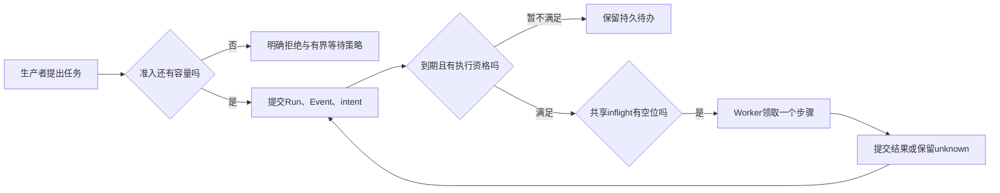

# 第 18 章：Queue、Priority、Backpressure 与流量控制

任务产生得比处理得快时，增加一个 Worker 只能改变消化速度，不能说明积压会停在哪里。任务可能挤在数据库、调用方进程、邮箱或另一个隐蔽列表中。本章先规定系统愿意接受多少未完成工作，再讨论哪些已接受任务现在有资格被领取。

本章对照 [QueueStore](../lib/agent_systems_lab/queue_store.ex)、[IntentStore](../lib/agent_systems_lab/intent_store.ex)、[Scheduler](../lib/agent_systems_lab/scheduler.ex)与 [L12](../labs/L12-backpressure-budgets-fairness.md)。前置是第 4 章事务与第 17 章持久恢复。这里先把 claim 理解为数据库原子确认的当前执行资格，lease 是该资格的有效期限，后续提交仍须核对当前 token 与期限；第 20 章再深入讲解它们的故障语义。本章最小练习不要求先完成第 20 章或 L11；动手部分需要自己拥有的实验 PostgreSQL。

## 学习目标与观察顺序

读完应能分别解释 capacity、max_inflight、Worker 槽位、retry due 和扫描页上限，并指出 blocked 为什么仍占准入容量。先画出生产者、持久队列和执行者，再做 18.3 的最小准入练习；完整饱和、公平性和预算实验沿 L12 推进。下一章研究 Worker Pool，不能用池大小代替本章的准入合同。

## 18.1 先决定是否接受，再决定是否执行

生产者提出一项任务时，系统可以明确拒绝，也可以接受并承担后续处理责任。若每次都先接受，再依赖执行者“迟早处理”，当到达率长期高于服务率时，未完成工作会持续增长。即使数据库足够大，等待时间、重试记录和外部资源也可能先成为问题。

命名队列的 capacity 限制已准入且未终结的 Run 数量。QueueStore 在创建事务中锁住队列，计算占用，再连同 Run、Event、intent 一起决定是否接受。满载返回 `queue_full`，被拒绝的 ID 不应留下半份持久事实；这与“先创建再稍后删除”是不同的合同。



队列不只是 pending intent 的集合。一个 blocked Run 仍代表未完成且需要核对的真实工作，所以继续占 capacity。终态释放准入名额，但不会自动抹去事件、操作或效果台账。若为了让统计变好就删除 blocked 任务，只是把未解决责任藏起来。

| 上限或条件 | 约束对象 | 不能代替什么 |
| --- | --- | --- |
| capacity | 已准入的非终态 Run | 历史数据保留策略 |
| max_inflight | 同队列有效领取资格 | 所有实例的物理进程数量 |
| 每实例 Worker 槽位 | 该 Scheduler 的本地执行与清理占位 | 全局队列准入 |
| retry due | 某次重试何时才允许再领 | 模型自行要求的立即重试 |
| scan_limit | 命名队列的一次扫描页 | 任意查询或邮箱的统一上界 |

## 18.2 背压必须传回生产者

真正的背压要求生产者看到满载后改变行为：停止继续提交、延迟下一次请求、合并可合并工作，或向上游返回明确的暂不可接受结果。每种选择都应保持边界和计数，不应把拒绝项无上限地转交给新进程、消息邮箱或另一个内存队列。

这不意味着拒绝一定等于任务丢失。若系统尚未接受该任务，调用方仍持有责任，可以按约定的有界策略重试；若任务已经接受，后续业务失败也必须有可见事实。报告中将拒绝数、接受数、完成数、blocked 数与效果数分开，才能辨别系统是在保护容量，还是把已接受工作丢掉。

本项目为可信宿主上的教学 Queue，不提供一般消息中间件的复制、磁盘保留或任意生产者协调协议。准入保证只覆盖通过相应命名队列接口接受的工作。裸 SQL 写表、绕过接口新建进程或外部生产者的积压，需要另一套治理；不能把其中任何一项伪装成 capacity 已经覆盖。

生产者还应分辨配置错误、队列不存在和满载拒绝。前两种通常需要核对输入或宿主配置，满载才涉及等待容量；对所有错误立即反复提交，既不能修好无效配置，也会加重控制面负担。把拒绝原因纳入调用方记录，才能重建一次准入决定的前提。

## 18.3 第一次小练习：拒绝后是否留下任务

先预测：capacity=1 时第二项创建会发生什么？取消第一项之后，原来被拒绝的 ID 是否已经存在？这次只观察准入，不启动 Scheduler，不产生模型或工具效果。

按 README 准备自己的实验 PostgreSQL，并在仓库根目录的同一终端执行：

```sh
export LAB_DATABASE_ENABLED=true
export LAB_SCHEDULER_ENABLED=false
./scripts/mix setup
./scripts/iex
```

在新 IEx 中连续执行：

```elixir
alias AgentSystemsLab.{QueueStore, Recovery, Storage}
suffix = "#{System.system_time(:microsecond)}-#{System.unique_integer([:positive])}"
queue = "ch18-queue-" <> suffix
first = "ch18-first-" <> suffix
second = "ch18-second-" <> suffix
{:ok, _} = QueueStore.create(queue, capacity: 1, max_inflight: 1,
  aging_ms: 1000, starvation_ms: 10000)
{:ok, _} = Recovery.create_run(first, "观察准入",
  queue: queue, script: [{:final, "done"}], run_timeout_ms: 600_000)
{:error, :queue_full} = Recovery.create_run(second, "观察拒绝",
  queue: queue, script: [{:final, "done"}], run_timeout_ms: 600_000)
{:error, :not_found} = Storage.load(second)
{:ok, %{active: 1, available_slots: 0, live_leases: 0}} = QueueStore.stats(queue)
{:ok, _} = Recovery.cancel(first)
{:ok, %{active: 0, available_slots: 1}} = QueueStore.stats(queue)
{:ok, _} = Recovery.create_run(second, "容量释放后重新提出",
  queue: queue, script: [{:final, "done"}], run_timeout_ms: 600_000)
{:ok, _} = Recovery.cancel(second)
{:ok, %{active: 0, available_slots: 1, live_leases: 0}} = QueueStore.stats(queue)
```

匹配应全部成功。拒绝后 load 为 not_found；释放容量后才能接受第二项。两个取消对象均是自己刚创建、尚未执行效果的 Run，这里的无效果条件不能推广到任意已运行任务。重复练习使用新的队列和编号，不删除别人的任务来获得名额。

练习创建的队列配置是固定的，不能同名重建来偷偷调整 capacity。这里的 `active` 是非终态 Run 数，`live_leases` 是有效领取资格数；尚未启动调度器时后者为零，并不表示准入没有发生。完整的超量并发拒绝、blocked 占位和多实例场景仍需 L12，不由这个顺序小例子代替。

当前配置范围也是合同的一部分：capacity 为 1—10000，max_inflight 为 1—capacity，aging_ms 与 starvation_ms 都为 1—86400000。默认老化间隔为 1000ms，饥饿观察阈值为 10000ms。它们是教学参数边界，不是经过生产流量容量规划得到的推荐值；调整参数前应先说明任务成本与等待目标。

并发准入和命名队列领取按 Queue→Run→Intent 的顺序锁定有关对象，避免不同入口以相反顺序竞争。已有转换、续租与 release 只需要各自的 Run/Intent 保护，不应为了画一张统一图就给所有路径补上不存在的队列锁。判断上限是否共享，需要沿真正的事务入口检查，而不是只看 Scheduler 配置中出现同一个队列名。

## 18.4 优先级与老化怎样参与领取

只有具备执行资格的候选才进入服务次序的讨论。未来 retry、当前活跃 lease、blocked/manual 和终态不能因为 priority 高就绕过原有保护。先证明候选该被服务，再谈它和其他候选谁先服务；否则所谓优化可能只是提前执行或重复执行。

当前命名队列在有界候选页内计算有效优先级：`min(9, priority + floor(wait_ms / aging_ms))`，再以 intent ID 破同分。wait_ms 是当前 intent 从创建到观察的年龄。它不是 Run 一生累计的等待，也不是从“开始具备资格”后单独累积的计时器。

因此旧 intent 刚到 retry due 后，可能马上出现在饥饿观察中。正确解释要同时保留原 due、intent 年龄和当前资格。提高有效优先级不会改写 retry 时间、回退已消费预算，也不会让人工核对中的 unknown 自动变为已知结果。

老化有助于处理长期等待，却不是无条件公平定理。这里按有限页候选排序，不保证每次选中全队列最高优先级；高优先级步骤也不抢占一个正在执行的步骤。等待分布、低优先级获得服务的次数、负载持续时间与服务成本都应进入评价，不能只展示最终全部成功。

## 18.5 LIMIT 与有界扫描还差什么

设扫描每次都先看前 32 项，而前 32 项全在等待未来重试。即使每条 SQL 都带 LIMIT，后面的到期任务仍可能一直得不到服务。有界查询回答“这次看多少”，游标轮转回答“下一次从哪里继续”，它们共同决定活性。

命名队列保存 scan_cursor 与本轮 scan_ceiling，按持久 intent ID 推进扫描，避免每次重扫同一前缀。ceiling 将一轮观察的范围固定下来，新加入的任务留待后续轮次；不要在实验里手动移动游标来“帮助”任务完成，那会绕过要验证的协议。

scan_limit 默认 32，范围 1—256，限制一页候选。一次 poll 按当前空闲 Worker 槽位逐次领取，不在本地预存整批业务队列。未入队的 legacy 路径保留先前扫描语义，不能把命名队列的新页上限套到所有入口上，再宣称整机任何扫描都已相同有界。

SQL 锁允许竞争者绕开已经被其他事务锁住的 Run，但这也不等于严格 FIFO。PostgreSQL 对 `SKIP LOCKED` 的说明将其定位于避免锁争用的领取类用途；隔离级别、锁和候选排序仍各有职责。[官方 SELECT 文档](https://www.postgresql.org/docs/18/sql-select.html)可用于核对语义，本项目的具体排序与轮转要以 IntentStore 为准。

## 18.6 饥饿检测与故障处置

`QueueStore.stats/1` 与 `starvation/2` 是观察入口。它们报告当前 ready、waiting_retry、blocked、live lease、可用容量及超阈值候选；读取指标不会领取任务、扩大权限或执行模型。诊断输出也不应被当成调度授权，需要写入的动作仍走原协议。

当队列满时，先看占用来自正常执行、未来 retry、人工核对还是无效候选，再决定处置。不同原因不能用同一个“清空队列”按钮解决。unknown 任务需要原操作证据，过期 lease 需要当前资格校验，输入过载需要生产者节流；单纯提高 capacity 可能放大问题。

这里的失败与修复可以从两个反例开始：无限生产者把积压搬进 mailbox，修复是让拒绝回到生产者并明确上界；固定前缀扫描忽略后续到期项，修复是持久轮转并留下扫描活性测试。每个修复都应有反向断言，防止只增加日志而没有改变失效条件。

进入完整 L12 时，分别记录数据库工作集合上界与进程高水位。样本内观测到的最大值与设计硬上限分开列；并发测试至少覆盖多个 Scheduler 共享同一队列、blocked 继续占位，以及恢复后仍遵守原 due 和预算。该证据可用于解释本机固定负载，不能直接称为生产服务等级承诺。

## 练习与教师参考

每题按“不变量、反例、可检查证据”三项各 1 分自查；静态判断与实际运行分别标注。

1. Worker 只有两个，为什么仍可能存在无限积压？应在哪里对生产者施加什么约束？
2. blocked Run 没有被后台继续执行，为何仍占 capacity？取消后哪些事实仍需保留？
3. 每条扫描 SQL 都有 LIMIT，为什么不能由此证明低优先级任务最终获得服务？
4. 一个旧 retry 刚到期就出现在 starvation 输出中，应核对哪些时间和资格，才能避免误判？

<details>
<summary>教师参考：把准入、资格与服务次序分开</summary>

1. 执行并发只限制消耗速度，不限制接受速度；生产者可将工作积压到数据库或邮箱。需要命名队列准入及向上游传播的有界拒绝策略，分别量测接受集合和进程数量。
2. blocked 仍代表需要核对的未完成责任。终态可释放名额，但不能撤销已发生效果或删除原操作证据；当前小例子尚未执行效果，不能代替 unknown 情境。
3. 固定前缀可能全是 future retry 或不合资格项，后续候选永远看不到。需要有界轮转、原 due 过滤与实际服务记录；页内老化不是全局严格 FIFO 或无条件公平证明。
4. wait_ms 按 intent 创建年龄计算，不是累计 eligible 时间。检查原 due、当前 lease/manual/终态过滤、阈值和观测时点，再结合实际服务顺序解释；指标本身不授予执行资格。

</details>

## 术语与下一站

admission 决定是否接受责任，backpressure 将容量约束传回上游，priority/aging 影响合资格候选的选择，starvation 是等待问题的可见观察，due 是重试事实。继续第 19 章，比较本地 Worker 池与跨实例共享配额；需要综合证据时再按 L12 的原始负载报告逐项验收。
