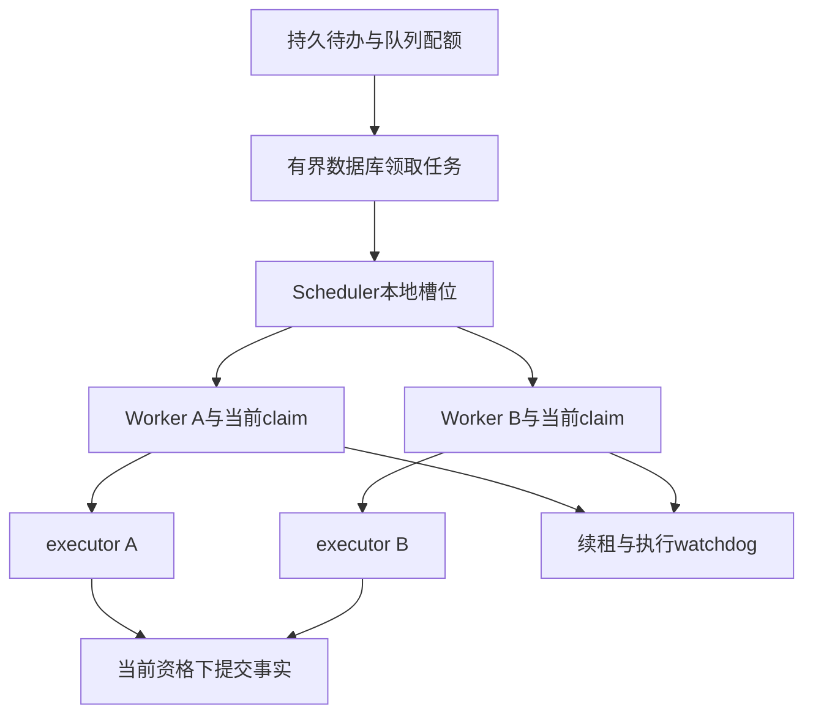

# 第 19 章：Worker Pool、并发控制与公平调度

“同时只运行两个 Worker”听起来像完整的资源上限，实际上还需要问：有几个 Scheduler，每个 Worker 又创建几个执行者，领取数据库时是否还会排队，旧执行者清理时占不占槽位？本章将进程上限、持久资格和业务预算分别观察，解释一个有限池为什么仍可能失去控制。

源码入口是 [Scheduler](../lib/agent_systems_lab/scheduler.ex)、[Worker](../lib/agent_systems_lab/scheduler/worker.ex)、[DatabaseTask](../lib/agent_systems_lab/scheduler/database_task.ex)与 [TaskBudgetStore](../lib/agent_systems_lab/task_budget_store.ex)。前置为第 3 章进程消息与第 18 章准入/队列。沿用上一章的最小桥接：claim 是当前执行资格，lease 限定其有效期，token 让提交门识别旧资格；详细故障协议在下一章展开，不是本章最小练习的必读前置。先做限定队列的两任务例子，再按课程前置进入 [L12](../labs/L12-backpressure-budgets-fairness.md) 的饱和与超时窗口。

## 学习目标与三条上界

读完后应能为本地 Worker、队列有效 lease、持久 dispatch 预算各写一条不变量，并指出它们不足以推导 CPU 配额或远程请求已停止。第一次练习使用两个固定 final Run，只验证限定队列的驱动与预算事实；高水位与公平性需要后面的持续观测，不能从终态反推整个过程。

## 19.1 池中的成员与数据库中的资格

Scheduler 不把整条业务队列复制进内存。它扫描已提交 intent，按空闲槽位逐次领取，每个临时 Worker 持有一个 claim 和一个 executor。claim 是数据库核验后的当前执行资格，executor 才负责推进一个恢复步骤；这两类对象不要在图里合并成“一个后台任务”。



一个实例有两个槽位，另一个实例也有两个，并不意味着共享队列允许四个有效执行资格。max_inflight 在领取事务内共同限制同队列有效 lease；每实例槽位则限制自己的本地执行和清理。配额与进程不是同一个计数，报告应同时保留。

当旧 lease 到期后，新的执行者可以获得资格；旧进程可能仍在暂停、等待网络或清理中。有效 lease 有界不表示任何时刻只存在同样数量的物理进程。旧资格不能提交由 fencing 校验保证，旧本地资源回收由各实例的生命周期协议负责；外部服务还要有自己的效果协议。

## 19.2 领取本身也会耗尽资源

如果 Scheduler 在自己的 GenServer 回调里无限等待一条数据库查询，status、取消或其他控制就可能一起卡住。因此当前实现把数据库工作放进受管任务，限制一个待处理领取，并为数据库超时、失败与退避保留状态。恢复连接后继续查询已提交事实，而不是复用一批未经确认的预领工作。

另一方面，给每次 poll 无上限 spawn 一个查询进程也不成立。数据库慢时查询者会叠加，连接池和邮箱都可能成为另一条无界队列。需要同时观察 pending_claim、受管数据库任务数、Worker 槽位和错误退避，不能只在最终数出 active=[] 就宣称过程有界。

`wake/1` 是降低发现延迟的提示，不是传递任务内容的可靠队列。周期性 poll 即使没有通知也能发现持久待办；重复 wake 通过当前实例的信号合并。这个合同不覆盖任意直接 `$gen_cast` 或其他外部消息，不能推导所有订阅者邮箱都已自动有界。

status 中的 claimed、completed、failed、scans 和 wake_requests 属于当前实例的诊断计数，重启后会重新开始；持久任务是否接受、是否有未决效果仍需查询数据库。比较两个实例时先注明各自生命周期和采样时点，不能把局部计数相加就当全局无重复账本。计数器方便观察，业务身份与提交规则负责正确性。

## 19.3 第一次小练习：两个槽位不等于两次并行效果

先预测：Scheduler 配置两个 Worker，队列 max_inflight=1，会不会自动允许两个同队列资格？本例的最后状态不能测出运行过程的峰值；它用于核对配置归属、完成条件与每任务一次 dispatch。

按 README 准备自己的 PostgreSQL；同一终端显式启用数据库、关闭全局 Scheduler，执行 setup 后进入新的 IEx：

```sh
export LAB_DATABASE_ENABLED=true
export LAB_SCHEDULER_ENABLED=false
./scripts/mix setup
./scripts/iex
```

在同一会话连续执行，下文只停止本例自己创建的 Scheduler：

```elixir
alias AgentSystemsLab.{QueueStore, Recovery, Scheduler, TaskBudgetStore}
suffix = "#{System.system_time(:microsecond)}-#{System.unique_integer([:positive])}"
queue = "ch19-queue-" <> suffix
ids = for n <- 1..2, do: "ch19-run-#{suffix}-#{n}"
{:ok, _} = QueueStore.create(queue, capacity: 2, max_inflight: 1,
  aging_ms: 1000, starvation_ms: 10000)
for id <- ids do
  {:ok, _} = Recovery.create_run(id, "限定队列驱动",
    queue: queue, script: [{:final, "done"}], run_timeout_ms: 600_000,
    task_budget: [max_dispatches: 4, execution_timeout_ms: 5000])
end
{:ok, scheduler} = Scheduler.start_link(queue: queue, workers: 2,
  lease_ms: 1000, renew_interval_ms: 100, poll_interval_ms: 20)
try do
  deadline = System.monotonic_time(:millisecond) + 30_000
  wait = fn recur ->
    complete = Enum.all?(ids, fn id ->
      {:ok, saved} = Recovery.load(id)
      saved.state.status == :succeeded
    end)
    cond do
      complete and Scheduler.status(scheduler).active == [] -> :ok
      System.monotonic_time(:millisecond) >= deadline -> raise "保留本次状态：等待到期"
      true ->
        Process.sleep(20)
        recur.(recur)
    end
  end
  :ok = wait.(wait)
  true = Scheduler.status(scheduler).max_workers == 2
  {:ok, %{active: 0, live_leases: 0, available_slots: 2}} = QueueStore.stats(queue)
  for id <- ids do
    {:ok, %{progress: %{dispatches: 1}}} = TaskBudgetStore.load(id)
  end
after
  if Process.alive?(scheduler), do: Scheduler.stop(scheduler)
end
```

有截止时间的轮询每次都核对真实完成条件，20ms 是采样间隔，不是“睡完就认定成功”。若超时，保留这次状态与日志，再分析原因；不能清零 dispatch 或重新创建同名任务掩盖失败。Run 的十分钟时限是为了读者交互留出余量，不改变单次执行预算。

本例没有工具效果，也没有测量饱和期的并发峰值。要验证 max_inflight=1 的过程约束，需要让一个执行者停在自己拥有的 gate 上，持续记录共享有效 lease 和各实例 active；L12 提供这类受控负载。把本例两个最终成功相加，无法证明它们曾并行，也无法证明公平调度。

## 19.4 并发上界应在最危险的时刻采样

吞吐低时数两个 Worker，不能证明饱和时仍只有两个。构造负载应先明确容量、队列配额、实例数和服务步骤成本，然后固定一个受控阻塞窗，记录高水位。检查对象包括 Worker、executor、数据库任务、清理中的执行者、pending claim 和相关邮箱长度。

这些指标不是整台 VM 的进程总数。Repo 连接、Registry、观察缓冲与固定监督者会形成基线；把机器进程总数等同于业务 Worker 数会错误报警。反过来，只报告 active 项也可能漏掉尚未退出的子进程。实例级诊断应与确切 PID、monitor 和退出观察配对。

释放 gate 后再核对成功、预期失败、blocked、原 operation 效果数和最终清理。若报告只保留最后一个时刻，它能够说明最后状态，却无法解释先前是否越界。设计硬上限、样本内最大值和采样可能漏掉的瞬间应分别描述，避免制造不存在的实时保证。

## 19.5 超时与调度预算不能相互退款

持久任务预算记录 max_dispatches 与 execution_timeout_ms。每个新的 claim token 在执行前预留一次 dispatch；放弃的预留仍算消耗，同一 claim 已开始后不能再次启动另一份业务。重启 Scheduler、换 Worker 或新 BEAM 续跑，都不应把这项消费清零。

任务预算与模型、工具预算各自存在。一次 dispatch 可能执行一个模型步骤或一个工具步骤；已接受的模型响应轮数、输出字节和工具调用计数仍按自己的规则扣减。读取 `TaskBudgetStore.load/1` 时应将固定 config 与累积 progress 对照，而不是选择一个最宽松的剩余量作为整个 Run 的统一额度。

单次执行还受原 Run 绝对 deadline 约束。实际 watchdog 使用任务上限、Scheduler 上限和 Run 剩余时间中更早的边界；heartbeat 证明的只是续租成功，不能延长任务预算或把一个挂起步骤变成无限占位。执行超时、Run 超时和模型轮数耗尽也需要各自保留原因。

当前 Worker 在超时路径先停止并等待自己的 executor 退出，再依据当前 claim 读取持久事实。已确认 receipt 可以复用；有准备记录但结果未查明的工具需要 blocked/核对；没有相应工具事实的未完成执行可明确失败。这些分支不能仅靠“进程没了”判断。

本地 watchdog 依赖当前进程与数据库可响应。它不是 CPU/内存硬配额，也不能收回已经发送给远端服务的请求。外部效果的幂等、查询、fencing 和 unknown 处置仍需要目标合同。停止本地等待与确认远端效果从来不是同一个事件。

保存超时证据时，至少对应到原 Run、seq、claim token 和确切执行者 PID，再区分计时器触发、退出被观察、事实被提交三个时点。只有这样，后继的恢复决定才能与这次执行关联，而不是误用另一轮的退出或回执。

## 19.6 怎样公平，先说明比较单位

一个短任务和一个长任务各被领取一次，不表示获得相同服务成本；一个低优先级任务最终完成，也不表示等待满足产品要求。公平性评估先选单位：领取次数、实际执行时间、完成数量、等待分位数，还是某类用户的份额。单位不同，结论也不同。

当前教学实现观察 priority aging、intent 等待与固定负载下的服务顺序；它没有跨租户成本调度器或跨机容量平台。应同时保留低优先级候选等待、高优先级持续到达、原 retry due 和服务记录。仅一次短 sleep 后查看没有饥饿报警，不是长期无饥饿的证明。

一个有价值的失败反例是：总吞吐一直很高，低优先级任务却长期等不到。修复首先让等待可见，再检验老化与轮转是否覆盖它；若长短任务成本相差极大，还需另设计服务份额或成本策略，而不是把调大 Worker 数量写成公平性修复。新增机制应有自己的验收边界。

## 19.7 将过载与故障报告写成可复验材料

L12 的负载 runner 将 saturation、fairness、budgets 分段保存，报告自己的 Run ID 和队列名，并保留 timeline。审查时将准入拒绝、共享 lease、进程峰值、预算、效果和预期 blocked 分开读；P3 的 all_passed 不意味着每个 Run 都 succeeded。

数据库断连又是另一类窗口：领取失败应有退避，正在执行的 Worker 不能越过资格检查提交，恢复连接后读取原事实。观察有界数据库任务和回收过程，才能解释为什么系统在控制面受阻时仍保持边界。不要用一次网络重连成功推导数据库 HA 或租户隔离。

每份报告还应标明平台、固定源码、参数、原始退出码和排除项。纯内存测试、真实 PostgreSQL、信号暂停与完整隔离是不同范围；同一台开发机的结果也不能自动成为生产公平 SLO。后续章节会把这些边界接到复制、故障转移和系统交付。

## 练习与教师参考

1. 两个 Scheduler 各有两个槽位、队列 max_inflight=2 时，应分别量测哪些资格与进程上界？为什么有效 lease=2 不证明物理进程永远只有两个？
2. 为什么只检查最终 active=[] 不能证明饱和期间资源有界？应增加哪类时间与进程证据？
3. heartbeat 一直成功，单次执行是否可以无限继续？超时后的 dispatch 消耗与 unknown 应如何处理？
4. 总完成数很高但某类任务等待很长，为什么吞吐指标不够？怎样设计一个有限、可重复的公平性反例？

<details>
<summary>教师参考：同时解释资格、进程与服务</summary>

1. 量测每实例槽位、共享有效 lease、executor 与清理中的 PID。过期旧执行者可能仍存在，新的资格已发给后继；提交由 fencing 保护，本地资源由各实例生命周期约束。
2. 最终为空只说明结束时没有 active。应在受控饱和窗持续记录高水位、确切 PID/退出及数据库任务和 pending claim，分别声明采样值与硬上限。
3. 不可以。续租不延长执行预算或原 Run deadline；原 dispatch 预留仍保留。按持久回执与准备事实区分确认、unknown 和明确失败，不能因停止等待就重发效果。
4. 吞吐是总量，不能说明等待分布或服务份额。固定候选、持续高优先级到达和观察期限，保留低优先级实际等待及领取顺序，并明确只证明该负载范围。

</details>

## 术语与下一站

Worker Pool 组织本地执行槽位，claim 表示持久执行资格，executor 执行一个步骤，watchdog 负责本地时间边界，fairness 要以明确的服务单位讨论。继续第 20 章验证 lease 和 fencing，再在第 21、22 章区分多 Worker、复制和真正的故障转移。
