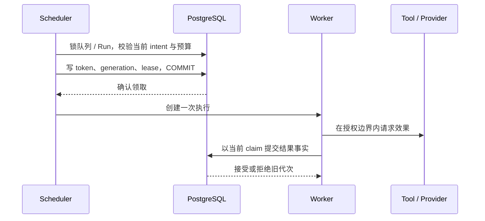

# 第 20 章：Lease、Heartbeat、超时与任务所有权

试读修订版，2026-10-25。由第 14 周初稿按当前源码修订，核心故障证据仍对应 W11—W14；L20 补充还原后 claim fencing。源码环境与既有实验结果见 [第 14 周验收记录](../docs/validation-week14.md)、[P3 报告](../docs/p3-report.md)及 [W21 验收](../docs/validation-week21.md)。本轮采用多代理模拟评审，范围见[首批学习修订审查](../docs/learning-revision-review.md)；旧故障报告没有因此变成本轮新测量。

## 本章目标

读完本章，应能解释短期任务所有权为什么必须由数据库确认，指出 renew SQL 中防止资格复活的条件，区分本地 watchdog 与持久 fencing，并从故障记录判断哪些动作可以继续、哪些需要核对。可检查的产物是：一张旧/新 claim 比较表和一项同 seq 下拒绝旧代次的证据，而不是只报告最终 succeeded。

先修能力：能解释纯状态机、事务提交和行锁，理解 OTP 进程暂停不等于终结，已掌握 [第 14 章](ch14-history-checkpoints-and-replay.md)的历史与 [第 16 章](ch16-durable-effects-and-reconciliation.md)的 prepare/effect/receipt。读 SQL 有困难时先看[先修知识](prerequisites.md)；lease、heartbeat、fencing、deadline 的区别见[术语表](glossary.md)。首次概念阅读无需先运行 SIGSTOP 或数据库故障实验。

本章学习顺序是领取资格 → 续期 → 暂停旧 Worker → 到期接管 → 拒绝迟到写入 → 按原业务事实恢复。先完成 [L10](../labs/L10-background-scheduling.md)的小批多 Worker，再做 [L11](../labs/L11-leases-heartbeats-fencing.md)的真实信号实验；背压与断连分别在 L12、L13 展开。章节按原计划编号，实验按当前仓库编号，二者不是同一序列。

| 要回答的问题 | 主要权威 |
| --- | --- |
| 下一步应该做什么 | 当前已提交 Run/Event/intent |
| 现在由谁推进 | 数据库中当前有效 token/generation/expiry |
| 是否允许开始效果 | 原权限、有效 claim、预算与绝对 deadline |
| 效果是否已经发生 | 配对 receipt 或工具能力允许的权威核对 |
| 本地执行是否失控 | Worker watchdog、执行器退出和有界槽位 |

### 第一次小练习：一份旧 claim 还有资格吗

无需环境，先判断下面三种情形，再读提示。它们是推理题，表中的时间不是本次运行采样。

| 情形 | 已知事实 | 能否仅凭这些信息接受旧 claim 的新结果 |
| --- | --- | --- |
| A | 本地缓存 expiry 在未来，数据库当前同代次已过期 | 先写预测 |
| B | 原 Worker 还活着，但数据库已是新的 token/generation，seq 恰好未变 | 先写预测 |
| C | 本地缓存 expiry 已过，数据库中同一 token/generation 已成功续期且仍有效 | 先写预测 |

<details>
<summary>提示与自检</summary>

A 拒绝：资格取数据库当前时间和持久 expiry。B 拒绝：相同 seq 不能代替 token/generation 检查。C 不能仅凭旧缓存拒绝；仍须在事务中读取并验证数据库的当前身份、expiry 与业务门，全部满足才可提交。三种情况都不能由 Worker 是否存活来决定。

</details>

## 20.1 一个没有死亡的旧 Worker

Worker A 领取一个工具步骤，随后整个 BEAM 被 SIGSTOP 暂停。数据库仍然运行。lease 过期后 Worker B 获得新执行代次并提交结果。此时 SIGCONT 恢复 A，A 的内存里还保留着工具参数、旧 token 和曾经有效的 deadline。

如果系统只问“A 是不是曾经领取成功”，A 的迟到结果可能覆盖 B。若系统只相信“lease 已过期，所以 A 已经死亡”，这个实验已经给出反例。暂停的进程没有及时处理 heartbeat、取消或超时消息，恢复后仍可以运行原来的指令。

本实验室的真实复现命令为：

```sh
./scripts/postgres start
./scripts/mix setup
LAB_SCHEDULER_ENABLED=false ./scripts/mix lab.fence --output artifacts/ch20-fencing-reader-01 --repetitions 2
```

输出目录必须尚不存在；复测把 `reader-01` 改成新编号。保留 PID、暂停/恢复时间、旧新 claim、提交拒绝与最终状态，公开报告仅保留 token 摘要。runner 只向自己创建并确认所有权的独立子 BEAM 发信号，不暂停数据库、当前终端或其他实验。这个案例和第 14 周的数据库断连共同说明：时间提供发现失去联系的机会，提交时的权威检查决定旧执行能否改变事实。

## 20.2 四个对象，四种责任

| 对象 | 它表达什么 | 它不证明什么 |
| --- | --- | --- |
| 当前 intent | 已提交状态下，下一步应做什么 | 有进程正在做或已经做完 |
| lease | 当前代次在数据库时间上的短期资格 | 旧进程死亡、远端请求终止 |
| heartbeat/renew | 当前持有者尝试延长资格 | 工具一定健康、预算仍够用 |
| receipt/业务事件 | 已经确认的结果及其进入状态机的事实 | 所有可能的外部效果都已被观察 |

Run 是业务身份，intent seq 是当前步骤；一次新的领取产生随机 token 和单调 generation。恢复不能为相同未知动作换 operation ID，否则会丢失跨 attempt 的核对关系。本地 Worker 槽位约束进程并发，共享 queue quota 约束有效 lease；二者的计数范围不同。

## 20.3 先提交领取，再执行效果



`IntentStore.claim_next/2` 先检查候选是否对应当前 Run，持久配置是否可读，retry 是否真正到期，以及预算和队列配额。命名队列扫描限制页大小，并保存游标继续越过不能领取的前缀。只有收到领取事务 COMMIT 确认后，Scheduler 才创建 Worker。[实现入口](../lib/agent_systems_lab/intent_store.ex)

命名队列领取按 Queue → Run → Intent 的顺序取得权威；未入队 Run 没有 Queue 锁。renew/release 在 Run 锁内验证 intent，不能把不同入口描述成一个会随意交换的锁序。`available_at` 是扫描提示，真正 retry due 仍从原 journal 验证。claim 返回只是领取成功，不等于工具已经执行。

`Recovery.execute_claim/2` 再次在 Run 行锁中校验当前事实，然后预留原任务的调度预算。这个第二次检查防止领取与真正执行之间发生取消、接管或状态变化。`Storage.dispatch/4` 在结果提交时继续检查同一权威；执行前检查不能替代提交时检查。

核心不变量是：一个已失效的执行代次，不能通过任何业务入口提交新事实。模型输出、工具准备、效果授权、receipt、人工确认、retry 完成和状态转换都需要对应检查，不能只保护最后的 Run.status。

## 20.4 renew 必须拒绝复活

假设 A 读取到自己尚未过期，随后暂停，等数据库时间已经超过 deadline 后才执行 UPDATE。若 UPDATE 只比较 token，A 可以给自己的旧资格写入未来 deadline。这会把已过期资格复活。

因此 renew 的写 SQL 同时要求数据库中的原 expiry 仍大于 PostgreSQL 当前时间，新的 expiry 也由数据库时间计算；0 行更新意味着失去资格。内存 claim 中的 expires_at 只是观察值，后续真实续租可能已经改变数据库 deadline。提交授权应读取数据库中同一 token/generation 的当前有效 deadline，不能要求内存时间戳与它永久相等。

本地测试分别覆盖“旧观察值不阻止仍活着的当前代次”“伪造未来时间不能复活过期 claim”“在检查之后暂停仍不能越过 UPDATE 条件”。前两项见 [fencing_safety_test](../test/agent_systems_lab/fencing_safety_test.exs)，最后一项见 [lease_heartbeat_test](../test/agent_systems_lab/lease_heartbeat_test.exs) 的 `before_renew_write` 屏障。实现使用 `clock_timestamp() AT TIME ZONE 'UTC'`；这里需要语句执行中的当前时钟，不能替换成事务开始后保持不变的 `now()`。两种函数的差别见 [PostgreSQL 18 当前时间文档](https://www.postgresql.org/docs/18/functions-datetime.html#FUNCTIONS-DATETIME-CURRENT)。明确 UTC 避免 session timezone 改变资格比较；数据库墙钟仍有运维前提，不能据此宣称跨数据库全局同步或硬实时保证。[IntentStore renew/verify](../lib/agent_systems_lab/intent_store.ex)

heartbeat 的成功只延长资格，不重置 dispatch、模型尝试、输出字节、turn 或绝对 Run deadline。为了防止活着但无进展的执行不断续租，第 13 周增加独立 watchdog；它先停止并等待 executor 退出，再按已提交 receipt 或 unknown 协议回收。

## 20.5 数据库失联以后，控制面要继续工作

同步 SQL 若直接运行在 Scheduler 的 GenServer 回调中，一个连接等待会拖住 status、wake 和停止；若 renew 同步阻塞 Worker，watchdog 也不能及时处理消息。第 14 周把领取和续租交给有界异步 helper，控制进程保留自己的 timer、状态与并发记账。每个 Scheduler 只有一个在途领取，每个 Worker 只有一个续租或清理 helper；超时或停止时等待它退出，不能一边遗留旧请求一边无限启动新请求。

数据库故障与模型失败是不同事件。数据库退避控制基础设施探测频率；业务 RetryStore 控制模型、工具或核对尝试。前者失败不能随意扣一次新的 provider attempt，也不能编造一个工具确定失败的 result。status 提供在途领取和连续数据库失败的可见诊断，避免把热循环隐藏在 supervisor 重启中。

这仍然不是实时系统。OS 暂停、数据库长锁、驱动回调与网络行为会影响本地时限。helper 被停止也不撤销数据库中可能已经提交的事务，因此下一节的未知结果仍必须处理。

## 20.6 COMMIT 的回报丢失了

一次数据库连接在 COMMIT 后断开，有至少两个观察：客户端调用失败，服务器可能已经提交。把前者推导成“业务没发生”会制造重复；把一个内存成功值推导成“数据库已确认”则会虚报完成。

第 14 周 `commit_ack_lost` 通过 `Recovery.step/2` 驱动模型，再在专用 pgwire 故障点截断底层 `Storage.dispatch/4` 的 COMMIT 成功回报：代理已收到后端 CommandComplete，但没有把成功送达调用者，父进程另用连接确认终态和 seq+1。恢复后查询原身份并核对事实，不能立即发起第二个业务动作。对领取采用相同原则时，未确认的 claim 不能创建业务执行；已提交 lease 会占位，直到数据库证明其到期，再由新的已确认 claim 接管。这项领取策略由相应组件测试验证，不能误写成该协议探针的直接覆盖。

运行数据库故障实验：

```sh
LAB_SCHEDULER_ENABLED=false ./scripts/mix lab.database --output artifacts/ch20-database-reader-01 --repetitions 2
```

检查提交前回滚、COMMIT ACK 丢失、heartbeat 断连、同一 Scheduler 自动重连、效果后待确认五条路径的逐次证据。[L13](../labs/L13-database-outages-p3.md) 定义观察项；本章不把协议代理故障扩大为数据库节点高可用验证。

工具效果可能已经发生而 receipt 尚未提交。此时停止进程、释放槽位或耗尽预算，都不能撤销效果。可查询工具用原 operation ID 查证；无法确定的非幂等工具进入 blocked 待核对。保持 blocked 时它占位并留在核对队列；直接取消则进入终态、退出该队列，未决 operation 仍保留，需由可信宿主另行交接调查，原 Run 不再接受 reconcile。Workflow 父取消会保留 ambiguous 子 Run 的核对入口，属于不同策略。详见[第 16 章的生命周期边界](ch16-durable-effects-and-reconciliation.md#blocked-队列有明确的生命周期边界)。队列变短不是效果已查明的证据。

## 20.7 读 Oban 时要比较相同的责任

本章使用 Oban 2.24.2，固定提交 `0704bf0018bfc915560998fbdfb899dd508f5aff`。[S6 源码记录](../docs/research/oban-scheduling-recovery.md) 包含逐文件 SHA-256、调用链与相邻测试，上游测试未运行。

Basic fetch 在事务中使用 SKIP LOCKED/CTE，并按 Producer 的本地 demand 返回工作；Executor 先 perform，再提交 ack。其 ack_query 比较 job ID、允许 state 和 attempted_at，所以确有旧 attempt 的保护。不能为了突出本地 token/generation 协议而把这个条件省略。[Basic fetch](https://github.com/oban-bg/oban/blob/0704bf0018bfc915560998fbdfb899dd508f5aff/lib/oban/engines/basic.ex#L92-L134)、[ack_query](https://github.com/oban-bg/oban/blob/0704bf0018bfc915560998fbdfb899dd508f5aff/lib/oban/engines/basic.ex#L543-L548)

Executor 对数据库完成回报的 retry 不再次 perform；Lifeline 则按时间把过久的 executing 工作重新投入 available，可能与尚活着的旧执行重叠。这两件事不矛盾：它们处理不同失败窗口。unique 作用在插入阶段，不能等同于执行互斥或远端幂等。[Executor](https://github.com/oban-bg/oban/blob/0704bf0018bfc915560998fbdfb899dd508f5aff/lib/oban/queues/executor.ex#L69-L93)、[Lifeline 约束](https://github.com/oban-bg/oban/blob/0704bf0018bfc915560998fbdfb899dd508f5aff/lib/oban/lifeline.ex#L1-L40)、[Unique guide](https://github.com/oban-bg/oban/blob/0704bf0018bfc915560998fbdfb899dd508f5aff/guides/learning/unique_jobs.md#L81-L112)

选择成熟组件可以减少队列维护，但业务仍需自己的提交权威、稳定 operation、权限和核对。当前保留教学引擎；未来 adapter 必须只有一个调度权威，并通过相同故障契约。选型依据是已验证责任和实际测量，不是框架名称。[ADR 0013](../docs/adr/0013-queue-engine-selection-and-database-recovery.md)

## 20.8 实验、评分与解释边界

先完成 L10 多 Worker、L11 SIGSTOP/SIGCONT、L12 饱和与预算、L13 数据库故障，再运行 `lab.p3` 汇总真实子报告。判分时不只看最终 succeeded；还要检查旧 token 拒绝、目标效果数、已确认事件连续性、未知核对可见性和 Worker/helper 高水位。

本章对应单 PostgreSQL、少量可信参与者、Scripted Provider 和受控工具。它没有验证数据库复制切换、跨区一致性、多租户隔离、任意不可信代码或任意远端 exactly-once。默认演示次数为开发反馈；未来 v0.1 每故障点至少 20 次的建议门槛另行计数。实际结果引用 [P3 报告](../docs/p3-report.md)，不在教材中抄写会随复测失效的单次延迟数字。

## 20.9 背压、预算与公平性的四种口径

| 限制 | 约束对象 | 不能推导的性质 |
| --- | --- | --- |
| queue capacity | 该队列尚未终结的 Run，包括 blocked | 历史表、文件或整机进程永久有界 |
| queue max_inflight | 共享数据库中的当前有效 lease | 过期旧 Worker 和远端请求已经死亡 |
| Scheduler workers | 该实例尚未结束的本地 Worker | 多个实例总进程数等于单实例上限 |
| task budget | 原 Run 的 dispatch 和单次执行时间 | 替代原模型字节、turn、工具调用或 retry 限额 |

命名队列是显式 opt-in，省略 `queue` 的 Scheduler 只扫描未入队 Run；`run_ids` 不会把另一队列纳入范围。
blocked 继续占准入容量，因为它代表尚未解决的业务。直接取消可释放准入名额；这只关闭执行生命周期，不证明其中 unknown 已解决。终态不能删除原 operation 去重身份来回收空间。
满载请求应明确拒绝。用无限 spawn 或无界内存列表接住所有拒绝，只是把队列搬到不可观察的地方。

执行前预留 dispatch，崩溃不返还；新 Worker 接管也不清零。执行上限取本地 watchdog、任务预算和原 Run deadline 的更早边界。
watchdog 先停止并等待 executor，再归档已确认 receipt 或 unknown。把 unknown 改 failed 后重发，会把资源治理变成重复业务。
本地时间用于 duration/age，数据库 UTC 时间用于资格；不能把不同 BEAM 的 monotonic 起点拿来比较 lease。

命名队列扫描使用固定页和 cursor/ceiling，避免不能领取的前缀永久挡住后续；aging 提高等待任务的服务机会。
测量时报告 ready wait、服务次数、饥饿告警与高水位，不能把一次没有饥饿的样本写成任意负载公平性证明。
实现见 [QueueStore](../lib/agent_systems_lab/queue_store.ex)、[TaskBudgetStore](../lib/agent_systems_lab/task_budget_store.ex) 和 [Scheduler](../lib/agent_systems_lab/scheduler.ex)。

快速试读命令如下；每条均创建自己的演示范围，使用尚不存在的输出目录：

```sh
LAB_SCHEDULER_ENABLED=false ./scripts/mix lab.schedule --output artifacts/ch20-schedule-reader-01 --runs 6
LAB_SCHEDULER_ENABLED=false ./scripts/mix lab.load --output artifacts/ch20-load-reader-01 --jobs 12
```

保留 `report.json` 与原始采样，分别核对队列活跃数、有效 lease、本地 Worker/executor/helper 最大值及最终退出。
`Scheduler.status.completed` 是步骤返回的诊断计数，不是业务成功任务数；进程诊断在重启后清零，业务事实仍在 PostgreSQL。
`Scheduler.wake/1` 返回 `:ok` 只是异步提示，既不代表已经领取，也不保证立即执行；标准入口会合并提示，不承诺任意消息有界。
对应 [L12](../labs/L12-backpressure-budgets-fairness.md) 和 [task_budget_store_test](../test/agent_systems_lab/task_budget_store_test.exs)。

## 20.10 还原目标也不能继承旧资格

数据库还原会复制 token/generation/expiry；这些字节与原库完全一致，不代表原 Worker 可以同时对两个库提交。
L20 先在默认只读的新目标核验全部 proof，再显式撤销 pending claim 并递增 generation，最后才解除 gate。
原源库 token 对激活目标提交必须失败；之后显式领取新资格，继续原权限、预算、due、deadline 与 operation。
不要在只读 proof 之前先续跑，也不要为了恢复方便清空预算、放宽文件根或把 unknown 视作无效果。

```sh
LAB_SCHEDULER_ENABLED=false ./scripts/mix lab.upgrade --output artifacts/ch20-restore-reader-01
```

此演练只管理自己创建的数据库，不覆盖 dev/test；数据库默认只读是可信宿主流程 gate，owner/superuser 仍能主动改变会话设置。
数据库备份没有包含工作区，文件与外部效果还要按原回执和授权单独检查。见 [L20](../labs/L20-history-migration-backup-restore.md) 和 [RestoreGuard](../lib/agent_systems_lab/history/restore_guard.ex)。

## 20.11 可验证判据与试读卡点

| 观察 | 必须补齐的证据 |
| --- | --- |
| 旧 Worker 最后退出了 | 还需真实迟到调用被拒绝，而非只被本地提前终止 |
| 旧提交 seq 冲突 | 还需同 intent、同 seq 的 token/generation fencing 用例 |
| 新 Worker 最终 succeeded | 还需旧写入不覆盖状态、receipt、cursor、已扣预算和新 claim |
| heartbeat 连续成功 | 还需独立 watchdog，避免永远无进展地续租 |
| 数据库重连成功 | 还需读原提交事实；连接 error 不证明 COMMIT 回滚 |
| 手动 unknown 仍在队列 | 未取消的 blocked 项禁止自动重发且交接明确，这是正确保留事实 |

同 seq 场景中 successor 先保持 claim 而不推进 seq，让旧调用真正跨过 token/generation 检查。
SIGSTOP 会同时暂停 executor 和 heartbeat；只 gate executor 而让 heartbeat 正常续期，测试的是续期并行，不是旧代次接管。
CONT 后 runner 通过受控 gate 先观察迟到写入，再放开 heartbeat 清理，避免“进程先死了”掩盖提交门缺陷。
信号、停止态确认、SQL 读取或清理失败都应记失败；父进程遭不可捕获 OS kill 时，需要按保存的 owned PID 人工收尾。

针对性测试：`./scripts/mix test test/agent_systems_lab/fencing_safety_test.exs test/agent_systems_lab/scheduler_database_test.exs test/agent_systems_lab/scheduler_deadline_test.exs`。
测试链接：[fencing_safety_test](../test/agent_systems_lab/fencing_safety_test.exs)、[scheduler_database_test](../test/agent_systems_lab/scheduler_database_test.exs)、[scheduler_deadline_test](../test/agent_systems_lab/scheduler_deadline_test.exs)。
完整 P3 会再次运行真实子实验；需要阶段验收时使用新目录执行 `./scripts/mix lab.p3 --output artifacts/ch20-p3-reader-01 --repetitions 2`。
首次阅读完成标准：能解释三情形小练习、renew 的实时钟条件与同 seq fencing 反例。完整实验另要求上述故障证据；记录自己执行的范围和次数，快速试读、已有验收、今后正式重复门槛分别报告，不把文档中的预期字段充当新一轮结果。

## 习题

1. A 在本地读取到 lease 还剩 100ms，随后暂停 1s。它恢复后为什么不能直接 renew？SQL 的哪项条件决定结果？
2. COMMIT 成功回报丢失时，客户端 error 能证明什么？分别设计 claim 与工具结果的恢复步骤。
3. heartbeat 正常但 Provider 永久等待，应该由什么机制回收？为什么不能在 budget 耗尽时将工具 unknown 改成 failed 并重发？
4. 一个 Oban adapter 仅使用 unique job 和 queue limit 就删除本地 lease/operation 台账。列出至少三项尚未满足的业务契约，并设计反例。
5. 设计一个实验，区分“旧 Worker 被停止”和“旧 Worker 的迟到写入被 fencing 拒绝”。报告至少应保存哪些原始字段？

## 教师参考答案

<details>
<summary>先独立作答，再展开参考答案</summary>

1. 读取与 UPDATE 之间存在时间窗口，旧 token 匹配不代表资格仍有效。UPDATE 必须比较数据库中的 expiry 与当前数据库时间，并由数据库计算新 deadline；过期后 0 行更新，不复活。
2. error 只表明客户端没有获得成功确认，不能证明服务器回滚。claim 回报未知时不启动业务，重连后等待或读取原 lease，再以新确认的 claim 继续；结果回报未知时读原 seq/receipt/operation，复用已确认结果或进入查询/人工核对。
3. 独立 watchdog 与绝对任务预算回收本地执行，先停止并等待 executor。unknown 描述效果不确定，预算描述资源，不可互相替代；重发可能重复非幂等效果。
4. 尚缺原子 Run/Event/Job 提交、业务提交时旧代次检查、效果后回报丢失的核对、持久预算与 retry 映射等。反例可用暂停旧 Executor 后救援接管，再恢复旧执行；或远端效果已发生但 ack 丢失。unique 不会阻止这类同一 job 的重复 attempt，也不自动约束业务表。
5. 将旧 BEAM SIGSTOP，等待真实 lease 过期并让新 Worker 提交，再 SIGCONT。保存 PID、OS 信号、故障 gate、原新 token/generation/seq/deadline、旧写入返回、最终投影与目标效果台账。只看旧 PID 最终退出无法证明数据库拒绝旧写入，必须展示它实际尝试的结果和新状态保持。

</details>

术语：lease 是短期资格，heartbeat 是续期请求，fencing 是对迟到权威的持久拒绝，receipt 是效果结果证据，reconcile 是基于原身份核对已发生结果。它们互相配合，但不能彼此代替。
