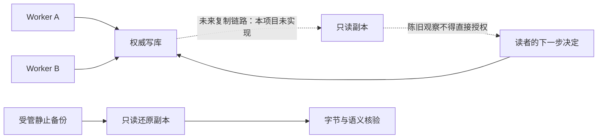

# 第 21 章：Distributed State、Consistency 与 Replication

两个 Worker 都能处理同一数据库中的任务，并不意味着系统已经有两个权威数据库；把一份备份还原到另一处，也不意味着那里持续接收最新提交。本章从当前单 PostgreSQL 事实源出发，用陈旧读取和提交丢失的反例讨论复制、一致性与接管的责任。

本项目已实现的是 [Repo](../lib/agent_systems_lab/repo.ex) 上的事务、claim 与持久恢复，以及静止数据集的[只读核验](../lib/agent_systems_lab/history/readonly_proof.ex)。物理/逻辑 replication、只读 replica 路由、共识选主与跨机调度没有在这里实现。本章的复制时间线和故障矩阵是设计案例；唯一代码练习只用纯 Kernel 模拟两份不同新旧的值，不会启动复制服务器。

## 学习目标与前置

先读第 4 章的 COMMIT/ACK、第 17 章的还原与接管、第 20 章的当前执行资格。读完应能区分单库事务一致性、复制可见性与数据库权威选择，为一项任务写出读写路由和未知结果的处理规则。先完成纯值反例，再设计复制实验；不要把未来实验名当作本次已有的通过结果。

## 21.1 一致性问题先问“谁的事实”

在当前实现中，多个 Scheduler 通过同一个 PostgreSQL 领取 intent。数据库锁、seq、claim token 和 generation 约束同一事实源上的竞争。Worker 数量增加，增加的是计算执行者；数据库仍是同一个权威位置。它可能形成可恢复的应用执行层，却仍然存在数据库层的可用性和容量边界。

假设未来增加一个只读副本，问题就发生变化：客户端从副本读到的 Run，是否包含它刚在主库提交的事件？主库已发出成功回复，副本是否已经应用相应日志？当连接断开时，哪个库有权接受新写入？这些问题不能由现有 Worker 的 heartbeat 回答。



图中实线和虚线表达不同的材料状态，不表示当前仓库已经装配这套在线系统。写设计文档时，至少给每一条链路标出数据方向、故障检测者、确认条件和读写角色；一个名为 replica 的变量并没有这些能力。

## 21.2 三种“日志”不能互相替换

业务 Event 记录应用接受的转换，数据库 WAL 用于数据库层的恢复和复制；模型录制、回执与权限配置又有各自持久对象。只传 Event 列表可以让纯 Kernel 重建业务 State，却不会自动复制所有调度资格、预算、工作流绑定、外部文件或效果端事实。

PostgreSQL 的 standby 可持续应用来自主库的 WAL，流复制默认采用异步方式，主库提交与副本可见之间可能有间隔；具体机制见[官方 standby 与复制说明](https://www.postgresql.org/docs/18/warm-standby.html)。这是理解设计案例的数据库知识，不是当前项目已有复制链路的执行证据。

应用侧要继续追问“复制完整”覆盖哪些对象。例如 Run 和 Event 相符，但收到过的工具结果未被带入；或者预算恢复到较早值，已经消耗的调用又能再次发生。它们都可能令一个看似正确的状态继续执行错误。恢复证明应绑定完整范围，而不是只给一个最终 state hash。

如果同时允许两处独立接受写入，单个整数 seq 也不能自然解决冲突。两个分支都可能从 seq=10 接受不同的第 11 个事件。把较大序号当作唯一权威，甚至不能分辨两个同序号但不同历史的分支；还需清楚的权威、谱系与冲突协议。本项目不提供这样的多写合并机制。

## 21.3 一个陈旧读取怎样产生错误决定

设计一条时间线：主库已经接受 seq=12 的工具结果并完成任务，副本仍停在 seq=10 的待处理状态。一个读取副本的调用者看到“未完成”，便决定再次执行。若提交时回到当前权威写库并核对 seq/claim，旧决定应被拒绝；若它绕过这一步直接产生外部效果，就可能重复。

更危险的是主库响应丢失，而旧副本没有操作记录。副本没有看见，不等于权威事实不存在；拿这份旧读作为“从未发生”的证明，会把不确定结果变成一次新效果。应保留原操作身份，查询能回答该操作事实的权威位置或效果端，在未知时按原协议停止核对。

读写路由必须随查询用途划分。展示历史页面与确认当前执行资格，所需的新鲜度不同；一个允许陈旧展示的页面可以标明观察时间，但不能顺手变成 Worker 的授权来源。读完较旧页面再发起动作时，动作本身仍需在权威边界重新验证。

未来系统可选择把关键读送回写库，或使用明确的追赶条件等待副本满足所需位置；这属于尚需实现、记录和测试的路由政策。仅把 HTTP 请求依次发给两个节点，不会自动获得“读到自己的写入”或会话单调读保证。

## 21.4 第一次小练习：同一任务的两个新旧视图

先预测：一份旧的 running 值允许取消，而真实当前值已是 succeeded；能否仅凭旧值中的合法转换决定真实系统下一步？本例只做纯值对照，没有 Repo、网络、数据库副本或复制服务。

在项目根目录终端进入无数据库的 IEx：

```sh
LAB_DATABASE_ENABLED=false LAB_SCHEDULER_ENABLED=false ./scripts/iex
```

在同一会话运行：

```elixir
alias AgentSystemsLab.Kernel, as: LabKernel
{:ok, s0} = LabKernel.new("ch21-views")
{:ok, old_view, _} = LabKernel.dispatch(s0, {:start, "比较新旧观察"})
{:ok, current_view, _} = LabKernel.dispatch(old_view, {:model_response, {:final, "done"}})
true = {old_view.seq, current_view.seq} == {1, 2}
{:ok, stale_decision, _} = LabKernel.dispatch(old_view, {:cancel, :from_old_view})
true = stale_decision.status == :cancelled
{:error, {:terminal_run, :succeeded}} =
  LabKernel.dispatch(current_view, {:cancel, :from_old_view})
true = stale_decision.seq == current_view.seq
true = stale_decision.status != current_view.status
```

所有匹配应成功。两份 seq=2 的值具有不同状态，并不表示当前 Storage 会同时提交两个结果；它说明纯计算依据什么值，就只能证明该值上的转换是否合法。实际提交必须重新核对权威事实。本练习只模拟陈旧观察的危险，没有测量复制延迟、选主或跨机一致性。

<details>
<summary>核对解释：该修复哪里</summary>

不应通过让纯 Kernel 查询数据库来修复这个反例。Kernel 的输入输出合同仍有价值；应在提交和外部效果的边界核对当前版本与执行资格，并让读写路由明确哪些查询可接受陈旧结果。把两个分支的 seq 比大小，不能替代这些检查。

</details>

## 21.5 静止还原证明与在线复制证明

本项目 ReadonlyProof 针对静止数据集。它在前后核对 schema、序列与行指纹，读取业务材料并独立重建，数据库变化会使证明拒绝继续。还原副本在默认只读 gate 下与已验证来源核对原始字节及范围。这是一种受控、离线的核验合同，不是任意活跃库的在线快照接口。

还原字节相同仍不能把复制来的旧 lease 当成新授权。显式接管要核验 proof、撤销复制的资格并换代，再允许新的执行者领取；预算与 deadline 保持原事实，unknown 不自动确认。默认只读 gate 是运维互锁，不是对数据库 owner 或 superuser 的强安全隔离。

对比来看，在线复制还要持续说明日志是否传输、接收、应用，副本读到了哪个位置，以及故障切换时哪些已确认写入可能缺失。一次成功 dump/restore 没有覆盖这些时间维度；一次新 BEAM 重建成功也没有测试网络分区或多个权威写入者。

因此 L20 证据可以作为“复制的数据范围必须完整、接管前必须重新建立资格”的对照，而不能改名为实时 replica 验收。复用材料时保留原故障模型，是把已有成果连接到新设计的前提。

## 21.6 用 RPO、RTO 与读语义写出需求

RPO 描述可接受的数据损失范围，RTO 描述希望恢复服务的时间目标；两者都是需求，不是写在配置文件里就已获得的结果。对 Agent 任务还需补一项：哪些效果在数据库状态未知时必须阻塞，不能为了更快恢复而重做。

例如“允许展示页短时陈旧，但任何工具执行必须读权威事实”比“支持最终一致性”更可测试。“主库不可达时停止新领取，已有结果按原操作核对”也比“自动切换”更明确。先把具体操作映射到读写语义，再选择复制和故障转移机制，避免从一个流行名词反推所有保证。

同步确认可以改变某些数据丢失窗口，却仍需定义究竟等到了哪种确认，以及确认方故障后如何选择权威。副本节点数量也不自动等于法定多数协议；共识算法需要成员、任期、日志和故障假设。本项目没有实现 Raft 或通用共识，本章不提供照抄即得 HA 的部署配方。

## 21.7 复制设计的故障矩阵

以下是后续实验设计，不是本章已执行的项目。每行先写允许的结果，再写独立观察路径；禁止只用客户端报错来认定数据库和效果事实。

| 设计窗口 | 必须观察的材料 | 危险的错误推断 |
| --- | --- | --- |
| 主库提交、副本未应用 | 两边位置、原操作和读路由 | 副本不存在就等于未提交 |
| 主库 ACK 丢失 | 原请求身份、权威读取、效果台账 | 新 ID 重发总是安全 |
| 副本只读查询落后 | 查询用途与可见位置 | 任何读都能授权执行 |
| 网络分区双方可达不同客户端 | 写入权威与旧写端隔离 | 多数客户端可达的节点自然是主库 |
| 还原后旧执行者恢复 | 谱系、资格换代与提交拒绝 | 字节相同就继承旧授权 |
| 接管时最近预算事实缺失 | 消耗、deadline 与原回执 | 恢复成较旧额度等于退款 |

审查这张表时，区分“我们希望系统怎样工作”与“现有测试在哪个层面证明了什么”。真实复制链路、延迟注入、节点故障、旧主隔离、路由和回滚策略都需独立环境验证。静态推演用于发现缺项，不换算为服务恢复时间、吞吐或故障成功率。

## 21.8 设计案例：让任务看板分担读取，又不改变执行权威

一家报表服务希望增加一个只读任务看板。业务提出两条可分别验收的需求：历史列表允许短时陈旧，页面必须显示观察来源及时间；用户刚提交任务后的详情确认，以及所有领取、续期、取消和结果提交，仍以当前写库为准。假设后续平台已有受管复制链路，并能可信地识别当前写库；本节负责选择应用读写政策，不把这个假设当作现仓库已经部署复制的结果。

先比较三个方案，再选最小满足需求的一种：

| 候选方案 | 得到什么 | 付出什么或仍缺什么 |
| --- | --- | --- |
| 所有查询都去写库 | 查询语义简单，确认操作不依赖副本进度 | 看板没有分担读取，写库故障时也不能读取新状态 |
| 历史列表去副本，确认与控制去写库 | 读负载可以分流；执行资格仍有单一事实源 | 页面可能落后，必须区分展示与控制，并保留明确回退政策 |
| 所有查询先去副本，必要时等待追赶 | 有机会保持更多副本读取 | 需要新增提交位置、谱系、追赶超时与重定向协议；不能只比较业务 seq |

本案例选择第二种。用户提交后跳转的确认页从写库读取；列表可读副本，但列表中的“取消”按钮只是请求入口，真正取消仍在写库上按当前事实校验。副本不可用时，看板明确显示不可用或按预先选择的策略回到写库读取，不把一份更旧缓存冒充当前状态。PostgreSQL 的接收、落盘和应用有不同阶段；本案例没有选择或实现第三种位置等待协议，相关数据库确认语义可继续查阅[同步复制说明](https://www.postgresql.org/docs/18/warm-standby.html#SYNCHRONOUS-REPLICATION)。

用一条具体故障时间线检查这个选择。下表中的时间点是推演顺序，不是测量出的延迟：

| 时点 | 发生什么 | 按所选方案应怎样处理 |
| --- | --- | --- |
| T0 | 写库接受 run-r 的第 12 个事实并向调用方确认；副本仍只有第 10 个 | 确认页从写库返回 seq=12；列表可显示旧状态及其观察来源 |
| T1 | 用户在旧列表点取消，但写库中的任务已 succeeded | 控制请求发往写库，按终态规则拒绝；不能先在副本上批准再发送工具动作 |
| T2 | 另一次提交的 ACK 丢失，副本也没有该操作 | 调用方保留原身份，查询当前写库；若写库不可达则保留未知，不签发新 operation 重做 |
| T3 | 写库恢复连接，原身份查询表明提交已成立 | 以权威结果更新确认页；副本稍后追赶只是展示改善，不是第二次业务提交 |

设计评审应得到一张“查询用途→允许的数据来源”表、一条 ACK 丢失的状态时间线，以及将来复制环境的验收计划。至少检查：人为拖慢副本后列表确实可旧、确认页仍读取写库；旧列表发出的控制动作被当前版本拒绝；写库不可达时没有新增效果；连接恢复后用原身份找到既有事实。每项同时保存读路由和权威端材料，不能仅截一张网页状态图。

现在就能完成的是画出上述材料、用第 21.4 节的纯值反例反驳错误路由，并说明选择第二种方案的原因。真实副本延迟、故障切换和新鲜度目标仍待独立复制环境验证。这个结论既给出了可实施的方向，也把当前代码对照与将来的平台验收分开。

## 练习与教师参考

1. 两个 Scheduler 访问同一 PostgreSQL，与主从复制架构分别增加了什么参与者和故障边界？
2. 旧副本没有 operation 行，为什么不足以确认“工具未执行”？需要哪些原身份与权威证据？
3. 两份 seq=2 的重建状态不同，为什么不能简单取 seq 较大者？单库 seq 校验与跨库权威选择有何差别？
4. 静止还原 proof 完全匹配，为什么仍不能立即启动复制来的旧 Worker？还缺哪些接管和在线复制证据？

<details>
<summary>教师参考：先选择权威，再解释一致性</summary>

1. 多 Scheduler 增加执行者，但仍共享一个权威事实源。复制增加数据传输、接收与应用、陈旧读取、权威切换及可能的数据损失窗口；现有 claim 规则不能自行解决这些新问题。
2. 观察可能落后，效果还可能在外部目标已成立。保留原 Run/operation，读取权威提交和配对回执或效果端台账；仍不确定时保持 unknown，不以副本缺行作为重发依据。
3. 相同序号可以属于不同分支，较大序号也不自带权威。单库检查基于共同写库的版本事实；跨库还需要写入权威、谱系、复制与冲突协议。本练习只展示值上的反例。
4. proof 说明特定静止范围的字节与语义核验，不签发执行资格。还需按还原协议核验和换代旧 claim；在线复制的持续延迟、路由、旧主隔离与 failover 另需实证。

</details>

## 术语与下一站

权威写库接受当前事实，replica 保存复制来的观察，复制延迟描述传播和应用的时间差，RPO/RTO 表达恢复需求，谱系区分历史分支。继续第 22 章，把 Worker 接管、数据库故障转移、资源调度和租户隔离分别放入责任图。
