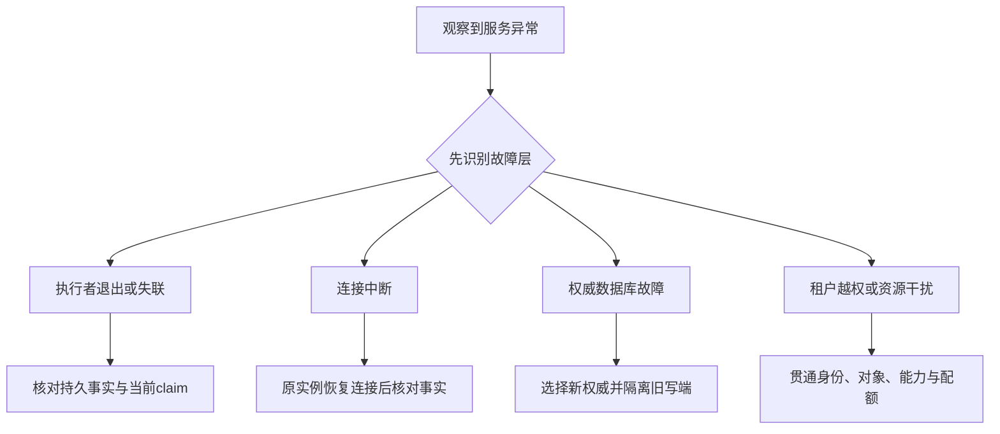

# 第 22 章：故障转移、资源调度与多租户隔离

一个 Worker 崩溃后任务被别的 Worker 继续，数据库主机故障后服务切到另一主库，以及租户 A 过载时租户 B 仍能获得安全服务，是三类不同的承诺。本章把它们分别展开，避免让一次代理重连或私有目录演示承载整个平台的保证。

当前源码已经有 [DatabaseProxy](../lib/agent_systems_lab/faults/database_proxy.ex)、[DatabaseFaultDemo](../lib/agent_systems_lab/database_fault_demo.ex)、[QueueStore](../lib/agent_systems_lab/queue_store.ex)与本地执行策略。它们用于受控断连、单库恢复和有界工作，尚未实现数据库自动 failover、租户身份体系、跨租户配额隔离或云资源调度。本章是一份有明确实现对照的设计案例，纸面演练不计为这些平台能力已通过。

## 学习目标与前置

先掌握第 18—21 章的准入、执行资格、复制与当前权威。读完应能为每种“接管”指出谁失效、谁判定、谁获得新资格、谁拒绝旧资格，并为未来租户设计找齐身份、对象、执行能力和资源配额的绑定位置。本章首次练习是桌面故障分类，无需数据库管理命令或其他人的服务权限。

## 22.1 四种恢复不能共用一句成功声明

| 情境 | 发生变化的对象 | 当前项目的对照 | 仍需另外证明 |
| --- | --- | --- | --- |
| Worker 接管 | 应用执行者与 claim | lease/generation/fencing、恢复步骤 | 普通远端目标是否拒绝旧执行 |
| 连接恢复 | 连接可用性 | loopback 代理断连与恢复 | 数据库主机切换、数据损失窗口 |
| 数据库 failover | 权威数据库 | 只有概念设计与只读还原对照 | 选主、旧主隔离、路由、复制追赶 |
| 租户隔离 | 身份与资源边界 | 私有工作区、显式工具策略和命名队列 | 跨租户授权、配额与攻击面隔离 |

这张表不是降低目标，而是让验收对象可检查。若故障从“某条连接断开”换成“权威数据库丢失”，原来保存在数据库里的 lease 和预算本身也进入待确认范围；若参与者从一个可信宿主变成互不信任租户，工作区路径检查的威胁模型也随之改变。

## 22.2 数据库切换还要拒绝旧权威

设计一个两库情境：旧主库与部分客户端失联，另一个节点被提升为新主；随后旧主又恢复。若两边都继续接受写入，两个数据库都可能认为自己的 claim 有效。应用在各自库内做对了事务检查，也不能据此保证全系统只有一个权威。

PostgreSQL 的 failover 说明强调，新主接管后需要防止旧主继续作为主库运行，并说明故障识别与通知还需系统软件配合。[官方 failover 文档](https://www.postgresql.org/docs/18/warm-standby-failover.html)用于理解这一责任；本书不给共享机器或他人数据库提供直接执行切换的命令。

未来架构应明确：谁有权宣布新权威、依据什么故障证据，怎样隔离旧写端，以及客户端连接如何更新。只改 DNS 或让健康检查“看见一个可连接节点”，没有说明原写端是否已经失权。切换后的只读成功也不证明新写入路径和工具效果已遵守相同协议。

还需核对复制与业务事实的损失范围。假如最新操作回执或预算未进入新权威，恢复到旧状态不能自动解释为“可以再做一次”或“额度已退款”。外部效果可能已经成立，数据库丢了对应观察；恢复策略应保留并处理这类不确定性，而不是用更快重试掩盖它。

## 22.3 第一次小练习：给四份事故报告分类

本节是静态推演。先为每条报告写出“实际证明了什么”和“还缺什么证据”，再展开参考；没有运行任何复制、选主或租户攻击实验。

1. 一个应用 Worker 被暂停，lease 到期后另一个 Worker 完成任务，旧 Worker 恢复时提交被拒。
2. loopback 代理阻断连接，恢复代理后，客户端重新读到同一 PostgreSQL 中的原状态。
3. 将备份还原到新库，字节核对通过，随后直接使用复制来的旧 claim 执行。
4. 队列 A 设置 capacity=10，队列 B 设置 capacity=10，因此报告宣称两租户的 CPU、内存和数据访问已经完全隔离。

核对分类与缺失证据

第一条属于应用执行资格接管，具体效果保证仍取决于参与 fencing 的目标。第二条属于原数据库连接恢复，没有切换权威数据库。第三条的还原核验没有签发执行资格，必须先按协议核验并换代；它更不是在线复制验收。第四条只有队列准入配置，缺身份授权、共享资源与真实攻击边界，不能推导强租户隔离。

保留自己的分类理由，再与 L13、L20 的实际报告对照。最小完成标准是能指出每份报告跨越了哪条未经验证的边界；不以答对四个名称计算真实事故处置能力或平台可用性。

## 22.4 连接恢复中的旧资格与效果未知

DatabaseFaultDemo 每个探针拥有自己的子 BEAM 与 loopback TCP 代理，父进程直连数据库做独立读取。窗口包括提交前回滚、提交 ACK 丢失、续租断连、工具效果未确认及自动轮询重连。代理恢复后仍连接原来的实例，不能因为测试名含 recovery 就改称数据库主从切换。

断连期间，旧 Worker 不能凭内存里的 lease 或过去一次 heartbeat 继续提交。恢复连接后先查当前事实和资格，再决定完成、重试、失败或核对。过期与失联只影响当前可确认的资格，无法反向证明旧远端请求从未发生；unknown 的依据仍是效果与回执。

报告最好保留进程、连接、事务、逻辑操作和效果端五层证据。控制面状态恢复为 available，说明当前访问可行；它没有认证所有先前在途请求都已完成或撤销。事故指标也应把恢复连接耗时、任务恢复耗时和结果核清耗时分开，不能用最快的一项代表全部恢复。

## 22.5 多租户首先是身份与对象的问题

将 Run ID 加上 `tenant-a-` 前缀有助于阅读日志，但不是授权。请求中自报的 tenant、模型内容中的用户名、trace ID 和工具参数都不能自行确定可信身份。将来需要由可信接收边界解析身份，并把身份贯通到持久对象、领取、工具能力与审计；不是只在 HTTP 入口检查一次。

设计时至少列出以下绑定：谁可以创建和读取哪项 Run，Session、Context 和回执属于谁，某个 claim 在哪个租户范围有效，工作区与外部凭据由谁解析，审批对象与产物 hash 绑定到谁，取消或管理接口是否能跨域。任何一个入口遗漏过滤，都可能绕过其他层正确的限制。

数据库的行级安全可以成为未来防线之一，但它有适用角色和绕过条件；表所有者、superuser 等角色需要特别审查。[PostgreSQL 行级安全文档](https://www.postgresql.org/docs/18/ddl-rowsecurity.html)说明了这些边界。当前项目没有因此自动获得 tenant 字段、RLS 策略或端到端租户身份，设计表格不能冒充已部署策略。

还要为恢复与导出考虑同样的范围。备份、只读核验、历史查询和观测导出往往拥有广泛读取能力；若它们只检查 Run 存在，却不检查租户归属，在线接口的隔离也可能被维护路径绕开。安全需求必须覆盖正常路径与故障恢复路径，而不是只覆盖演示请求。

## 22.6 资源隔离与调度公平是另一条轴

每队列的 capacity 与 max_inflight 控制特定工作集合，不能等同于租户总 CPU、内存、磁盘、数据库连接或供应商费用上限。一个租户可以创建许多队列，或提交成本极大的少量任务；若只有单队列数量限制，聚合资源仍可能失控。

未来设计需说明配额的层级、计量单位、预留时点和结算方式。例如并发槽位只管理当前活跃数，持久费用预算还要面对结果未知和供应商账单；内存配额若依赖操作系统设施，就不能由一个 Elixir 计数器替代。跨机容量调度也需要资源观测和故障假设，不是简单扩大 Worker 数。

公平性还应定义服务份额与成本模型。两个租户领取次数相同，但任务成本不同，并不意味着资源份额相同；一个队列等待可见，也不等于系统能承受恶意流量。第 19 章的固定负载观察可作为起点，新的成本模型与攻击场景要另有验收。

当前私有工作区与同宿主执行策略面向可信宿主及受控工具。共享 OS 账户、文件描述符、网络凭据和内核资源的参与者，不应仅因目录不同就被视为强隔离租户。本书不会把路径规范化、拒绝 symlink 或某个平台的教学 sandbox 直接推广为完整多租户安全平台。

## 22.7 失败与修复应落在哪一层

第一类反例是把代理恢复当 failover。修复报告时，重新标明原数据库身份、代理故障窗和独立读取；若目标真是数据库 HA，就补上复制、权威选择、旧写端隔离与路由实验，不能只重命名原日志。

第二类反例是在新副本上重用旧 claim。修复执行协议时，在独立核验后换代资格，保留原 operation、预算与 deadline，并确认旧执行者无法提交。若原效果未查明，接管不是给它一个“成功”标签的机会；应先保留核对责任。

第三类反例是租户 A 在请求参数填入 B 的对象 ID。修复需要可信身份与对象范围校验贯通所有读取、修改和恢复入口，并加入反向测试。不能只把 ID 改成长随机字符串，或希望模型会遵守提示中的租户说明；难猜并不等于获准访问。

## 22.8 下一套独立验收矩阵

真正实现这些能力时，至少分开设计以下测试：主库失联与旧主恢复、复制滞后与最近预算丢失、连接切到错误目标、跨租户对象访问、跨租户工作区和凭据访问、聚合配额耗尽与高成本任务、维护导出的租户范围、管理操作与审批绑定。每项都要先写允许结果及可信观察者。

这些测试需要独立的环境、授权和可恢复资源。普通本地开发数据库、CI 核心回归或静态设计审查无法替代故障转移环境。交付时将“已实现的断连与恢复对照”和“未来验收设计”分别列出，保留失败和限制，而不填不存在的安全通过率。

## 练习与教师参考

1. loopback 代理恢复后任务完成，为什么还不能声明数据库 failover？最少缺少哪三类对象或证据？
2. 两个数据库各自都能通过 seq/claim 检查，为何仍可能产生双写？接管应新增哪条权威边界？
3. 一个可信 tenant 字段只在入口验证，历史导出接口没有检查对象范围，会出现什么反例？
4. 私有目录、队列 max_inflight 和服务份额分别约束什么？为什么不能将三者相加称为完整多租户隔离？

教师参考：按故障层与权限层组织证据

1. 仍是原数据库的连接恢复。还缺复制与新权威的数据状态、旧写端失权，以及客户端读写路由和切换后的验收；原报告没有测试这些对象。
2. 各库的局部事实不能自行选择全局权威。新主接管需要可信的权威协议与旧写端隔离，防止旧库恢复后继续接受写入；还需处理最近事实缺失与外部 unknown。
3. A 可通过维护路径取得 B 的对象或回执。可信身份必须贯穿持久对象和每个读写/恢复/导出入口，参数内自报身份与随机 ID 都不能补齐缺失授权。
4. 私有目录限制特定文件路径，max_inflight 限制同队列有效资格，服务份额评价一组负载的资源分配；身份、防越权、共享内核与凭据、聚合资源和管理边界仍需分别实现及验证。

## 术语与继续阅读

Worker 接管改变应用执行者，数据库 failover 改变权威位置，tenant 是可信授权范围，quota 限制资源消费，isolation 限制不同主体的影响。继续第 23 章研究任务 DAG；它组织业务依赖，也不能替代本章尚未实现的平台边界。
