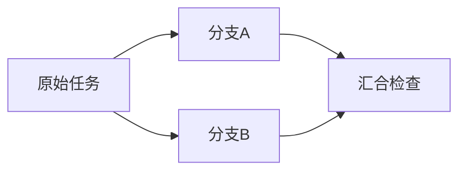

# 第 23 章：Task Planning、DAG 与 Workflow Engine

一个任务要分别修复两个模块，再检查它们的组合结果。把两个分支交给不同 Worker 并不难，难的是下游何时能启动、谁的输出进入汇合、某个分支未知时怎样停止，以及协调进程消失后还能凭什么继续。Workflow 把这些责任显式写进图与持久事实，不能只靠一条“下一步交给 Reviewer”的消息。

本章对应 [L16](../labs/L16-dag-workflows.md)，入口是 [Definition](../lib/agent_systems_lab/workflows/definition.ex)、[Join](../lib/agent_systems_lab/workflows/join.ex)、[Store](../lib/agent_systems_lab/workflows/store.ex) 与 [Coordinator](../lib/agent_systems_lab/workflows/coordinator.ex)。当前实现接受宿主静态 DAG，复用持久 Run、intent、预算与恢复；没有实现 LLM 动态增图、任意循环或跨主机通用编排。

## 阅读准备与学习目标

先理解前面关于稳定 operation、预算和 lease/fencing 的约束，能区分“节点待处理”和“某次 Worker 正在投递”。本章先用纯 Definition 推演依赖，无需数据库；实际 Workflow 执行依赖真实 PostgreSQL，需按 L16 完成前置实验。

读完应能画出一个 diamond，说明图校验、ready 判定、持久创建和结果汇合分别提供什么保证，解释并行容量与失败传播，并给出协调器重启后的核验路径。下一章把固定角色与人工审批放进同一责任链，不把更多 Agent 直接等同于更好结果。

## 23.1 图首先是一份宿主合同

节点有稳定 ID、原始任务输入、直接依赖、角色及有限的执行选项。边表达“需要前驱已确认成功”，不是提示模型先读哪段文字。宿主在创建时固定这些值，模型输出作为数据进入节点结果，不能新增依赖、队列或权限。



这个图的两个分支互不依赖，理论上可并行；join 必须同时看到两条直接依赖的成功结果。图的结构还限制了运行形态：当前最多八个节点，静态最大反链宽度为三，`max_parallel` 允许一到三。宽度描述图中互不可达的节点集合，不是某次轮询碰巧看到了几个 ready 节点。

允许两条分支并行，不表示每条分支都能自行取得总预算。节点分配在创建时固定，所有子节点的五维预留之和须落在父包络内。没有执行的节点也占原先预留，未用额度不会自动转给别的节点；重试与恢复继续使用原子任务的计数和 deadline。

## 23.2 第一次小练习：下游到底何时 ready

先预测：root 成功、a 成功而 b blocked 时，join 可以开始吗？把 max_parallel 改成一，能否因此接受有环图？以下只使用手工状态值推演定义，不创建或执行真实 Workflow。

在仓库根目录的终端运行：

```sh
LAB_DATABASE_ENABLED=false LAB_SCHEDULER_ENABLED=false ./scripts/iex
```

在同一个 IEx 会话执行：

```elixir
alias AgentSystemsLab.Workflows.Definition
nodes = [
  %{id: "root", input: "保留原验收"},
  %{id: "a", deps: ["root"], input: "完成A"},
  %{id: "b", deps: ["root"], input: "完成B"},
  %{id: "join", deps: ["b", "a"], input: "检查两个完整结果", role: :reviewer}
]
{:ok, definition} = Definition.new(nodes, max_parallel: 2)
["root", "a", "b", "join"] = definition.order
["root"] = Definition.ready(definition, %{})
["a", "b"] = Definition.ready(definition, %{"root" => :succeeded})
[] = Definition.ready(definition,
  %{"root" => :succeeded, "a" => :succeeded, "b" => :blocked})
["join"] = Definition.ready(definition,
  %{"root" => :succeeded, "a" => :succeeded, "b" => :succeeded})
{:ok, ^definition} = Definition.from_map(Definition.to_map(definition))
{:error, :cyclic_workflow} = Definition.new([
  %{id: "a", deps: ["b"], input: "A"},
  %{id: "b", deps: ["a"], input: "B"}
])
```

预期匹配全部通过。这里输入的 `:succeeded` 是教学推演值，不是数据库成功证明；实际 Store 从受控子 Run 观察持久结果后才释放依赖。学生应先解释这个区别，再阅读调度过程。

<details>
<summary>核对预测：ready 不等于已经领取</summary>

blocked 不是 succeeded，因此 join 不 ready。纯 ready 函数也没有创建 Run、预留并行槽或执行工具；这些工作需要持久事务和后续领取。降低并行度只改变允许的执行容量，不会消除图中的依赖环。

</details>

## 23.3 静态校验解决哪些错误

Definition 先检查有界节点输入，拒绝重复 ID、未知依赖、自依赖、重复依赖与环，再生成稳定的字典序拓扑顺序。输入列表排列不同，规范定义仍应相同。保存后用 `from_map/1` 读取要求完整且规范的结构，不能把损坏记录重新填默认值，假装还是原图。

子节点选项也不是任意 Map。当前只允许有限的 Recovery 配置；Session、隔离与 MCP 策略通过各自严格的 inert 数据形状往返。PID、函数、引用、hook、queue 或直接 permissions 覆盖都不应成为持久定义。这个限制使图能在新进程中被解释，也避免把上游输出变成下游的宿主控制对象。

静态合法仍不表示任务规格足够。两个分支可能各自写出合法字符串，却没有满足原验收；Reviewer 的脚本也可能预先固定 approved。图校验证明依赖结构及配置边界，业务正确性还要检查实际产物与验收。报告应分别列出这两层结论。

## 23.4 让依赖释放成为持久事实

实际执行通过 `Workflows.create/2` 保存定义与节点，Coordinator 周期性观察并推进。协调器不是另一个可以凭内存决定成功的权威，它必须使用 Store 的事务规则。两个协调器同时工作，也不能因为各自都看见 ready 就重复创建同一子任务或突破数据库容量。

子 Run ID 由 Workflow ID 和节点 ID 确定，不随某次投递 attempt 改变。父定义、节点状态、子身份、已观察事件位置与持久 intent 共同支撑恢复。一个协调器退出后，新协调器应继续核对这些事实，而不是从头生成一组新 Run，把已经发生的效果重复做一遍。

并行槽与有效执行资格同样需要区分。节点可能已获得父图的容量，而某次子任务投递后来失去 lease；新的执行者仍须遵循原 claim/fencing 协议。静态 DAG 并没有替外部工具提供全局唯一执行保证，它只把既有受控执行链组合起来。

当上游失败或取消，后续应按既定规则终止或停止推进；unknown 则保留原核对事实，不能伪造成成功来释放 join。父取消要停止后续调度并处理活动子 Run，但无法撤销此前文件或远端效果。具体 blocked 子任务与核对队列的保留边界见 L16 和恢复手册。

还应区分资源预留、实际消耗与观察到的并行量。父定义按所有节点的上限计算能否接纳，子 Run 在执行时累积自己的真实消耗；一个分支提前完成，不会把剩下的轮数自动退款给另一分支。否则同一图会因完成顺序不同而得到不同授权，恢复时也难以重建原预算。

`max_parallel` 在当前实现中映射到 Workflow 专属 Queue 的 `max_inflight`，约束有效 claim 数；登记 ready 子 Run 的流程会把所有合资格节点标为 running，节点标签不等于正在执行的 Worker 数。例如三个独立根节点、`max_parallel=1`，可以有三个已登记的 running 节点，而有效领取仍受一份额度约束。核查依据是 [Workflow Store](../lib/agent_systems_lab/workflows/store.ex) 的专属队列创建与 ready 节点登记。

max_parallel 只是允许的容量，不是吞吐承诺。依赖、数据库竞争、重试到期与工具速度都可能让一次运行低于这个值。证明并行时应观察两个实际活跃子任务及对应领取，不能从“总耗时比串行短”反推所有窗口都重叠，也不能把一次成功图作为生产容量 benchmark。

父图观察子结果也有位置边界。子 Run 已经提交成功，而协调器尚未把该 seq 记进节点，是一种正常可恢复的中间状态；这时应继续读取同一子身份，而不是重新启动一个新编号子任务。相反，父表里的一条旧成功投影若与原子历史不一致，应保留错误并追查，不能靠“模型还记得上次结果”修复数据库事实。这也是验证中同时检查父、子与 intent 的原因。

## 23.5 失败案例：共享结果里只剩最后一个分支

若 a 与 b 都写一个共享 `result` 键，最后写入者可能覆盖先前结果。即使 join 读到“成功”，也不知道缺的是哪个分支、采用了哪个 Run 的输出，或是否接受了上一轮的迟到结果。把数组按完成时间临时拼接，也会让同一图的输入随时序改变。

当前 Join 按源节点身份构造确定性、完整的依赖包。每项保留 node_id、原 Run ID、seq、状态、完整 output、operations 与结果 hash，原始下游任务也保留。节点只取得自己的直接依赖，不能顺便读取另一个独立分支的权限或未声明结果。

操作结果可能含 atom、tuple 或非字符串 Map 键，不能靠普通 JSON 强行改类型。Join 使用带标签的数据表示保留 inert 值的类型，不把数据解释成代码或 Run 选项。整个包有明确字节上限；超限时拒绝，不能为了成功汇合截掉一半回执。

修复这个失败的关键是换成“按来源收集”，并在实际 Workflow 的 final.nodes 中核对每条 completion，而不是只检查最终输出有两个段落。源 hash 检测绑定与漂移，不证明每段业务结论为真；评分或产物验证仍需要独立标准。

## 23.6 怎样验证恢复而不只验证跑完

先在单协调器路径取得一份完整记录，列出每个子 Run、节点状态、依赖输入与实际效果。再在 fork 已启动而 join 未创建，或一个分支已提交而父尚未观察的明确窗口终止自己拥有的协调器。没有屏障或持久位置证据，就不能声称命中了那个窗口。

重启后检查原子身份没有变化、已确认子结果没有重做、未满足依赖的下游没有提前启动、并行数与预算仍受原约束。最终图状态相同只是其中一个条件，还需逐项核对原事件与工具台账。Coordinator 的新 PID 不表示新任务，也不表示恢复已经完成。

这些真实运行放在专属实验数据库中，按 [L16](../labs/L16-dag-workflows.md) 使用全新 Workflow ID 与输出目录。本文纯小练习只推演规则，没有取得数据库容量、kill 或工具唯一性的运行证据。完整验收的证据入口见 [W17 记录](../docs/validation-week17.md)，不能把旧计数继承为当前修改的实际结果。

一个实用审查顺序是先核定义，再核每个依赖包，再核节点创建与完成的事务事实，最后核真实效果。若顺序反过来，只看最终“图成功”，许多来源串错和重复投递问题都会被一条好看的汇总掩盖。

## 23.7 练习与教师参考

每题按“不变量、反例、实际证据”各 1 分核对，先独立解释再看参考。

1. root 成功后 a、b 都 ready，是否证明它们已并行运行？需要再检查哪两层事实？
2. 两个 Coordinator 同时扫描，怎样避免重复子 Run 与容量超限？为什么只用本地 Map 不够？
3. join 输入只含两个文本输出，缺少原 Run ID 和 seq，有什么风险？hash 又能补到哪一层？
4. 一个分支 unknown、另一个 succeeded 时，为什么不能先把 unknown 写成 failed 再让 Reviewer 猜一个答案？

<details>
<summary>教师参考：按持久依赖解释图</summary>

1. ready 仅是依赖推演；还需父 Store 的原子容量/创建记录，以及子 Run 的实际 claim 与执行证据。配置 max_parallel 也不是实际并行量。
2. 通过稳定子身份、同一数据库事务及原并行上限协调，不能让两个内存判断各自生效。只读源码仍不替代实际并发测试，应检查每个子 Run 与被拒竞争。
3. 可能混用别的任务或上一轮结果，也难以确定来自哪个已提交位置。带身份的完整依赖包与 hash 绑定内容；它们不认证业务结论或远端效果。
4. unknown 表示原操作效果未查明，不能由编排改写其事实。保留原操作与核对路径，只有实际成功依赖才释放下游；失败传播也不能创造缺失的成功证据。

</details>

## 术语与下一步

DAG 是无环依赖图，ready 是依赖满足条件，Coordinator 是推进者，Join 是带来源的完整汇合，child Run 是独立执行与预算范围。模型生成的计划文字可以作为待审建议，当前实际图仍由宿主固定。

继续读[第 24 章](ch24-multi-agent-handoffs-and-approvals.md)，把角色分工、产物核对和批准对象放进这条链。实现依据是[静态 DAG ADR](../docs/adr/0016-static-dag-workflows.md)、[定义测试](../test/agent_systems_lab/workflow_definition_test.exs)与[汇合测试](../test/agent_systems_lab/workflow_join_test.exs)；它们是本项目合同，不是通用分布式 Workflow 的能力声明。
