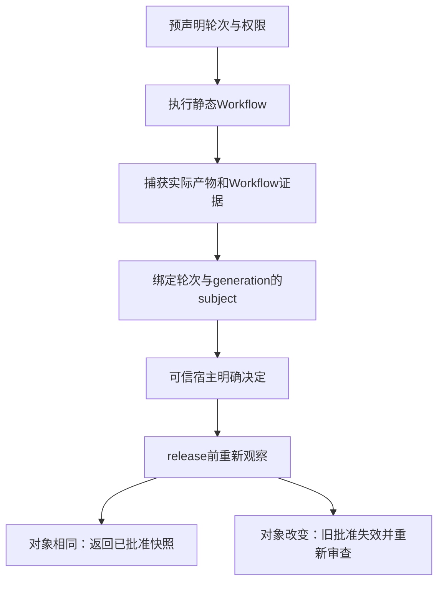

# 第 24 章：Multi Agent、Handoff、Reviewer 与人工审批

把一个任务分给 Implementer，再让 Reviewer 说“通过”，看起来像是增加了一层保障。但如果两者都只复述同一段文字，Reviewer 没有看到实际产物，或批准后文件已经改变，多一个角色只会增加传递与协调。真正需要回答的是：交给了谁、交了什么、谁能决定继续，以及批准绑定的对象有没有变化。

本章复用 [L16](../labs/L16-dag-workflows.md) 与 [L17](../labs/L17-human-approvals.md)，入口为 [Approvals.Plan](../lib/agent_systems_lab/approvals/plan.ex)、[Artifact](../lib/agent_systems_lab/approvals/artifact.ex)、[Cases](../lib/agent_systems_lab/approvals/cases.ex) 和 [Approvals.Audit](../lib/agent_systems_lab/approvals/audit.ex)。当前实现是宿主预声明的静态图、固定脚本角色与本地决定，不是自主模型 handoff、通用多 Agent 协议或登录身份系统。

## 阅读准备与学习目标

先读[第 23 章](ch23-planning-dags-and-workflows.md)的静态依赖与完整汇合，理解 operation、回执、原预算和绝对 deadline。首次练习只在本次新临时目录读取与改变普通文本，不需要数据库或真实模型。完整 Case 执行需真实 PostgreSQL，并按 L17 的前置组织。

读完应能区分角色输出、业务成功和宿主批准，解释 artifact snapshot 与 subject hash 的用途，说明审批、返工、暂停和释放分别改变什么，并为多角色增加的成本列出可测条件。

## 24.1 分工要带着责任一起交接

一个角色标签不产生新能力。Implementer 可以负责产物，Reviewer 可以检查结构化结果，但两者仍受各自的 Session、工具策略、工作区、预算和执行资格限制。依赖输出只作为后续输入数据，不会成为新 command、权限或任意 Run 选项。

| 交接内容 | 应保持的身份与约束 |
| --- | --- |
| 子任务 | 原 Workflow、节点与稳定子 Run ID |
| 结果 | 完整输出、操作回执、seq 与来源 hash |
| 产物 | 宿主指定路径、实际字节、基线与大小上限 |
| 控制决定 | 被观察的 Case 版本、subject 与决定者声明 |

当前节点与角色在创建前固定。所谓 handoff，是宿主已批准的图按成功依赖推进，不是模型随时生成一个新角色并交给它更多权限。固定 Scripted Reviewer 返回 approved 只验证角色协议与控制链，不证明评审质量优于单模型。

真正比较多角色方案时，还需记录实际任务验收、总调用量、延迟和返工情况。不能只比较最终输出是否更长，也不能因对方叫 Reviewer 就免除独立产物核验。更多交接会增加来源串错、迟到消息和预算归属的解释成本。

## 24.2 把产物审查对象固定下来

审批不能只记一个可变路径。`report.txt` 今天和明天都叫这个名字，字节可能完全不同。Artifact spec 由宿主指定输出文件、受保护基线和可选初始版本；capture 读取有界 UTF-8 字节，检查路径、文件类型与基线，形成不可变快照。



快照包含来源路径、内容、字节数和 hash；hash 用于绑定与变化检测，不认证文字正确或作者身份。capture 也不是文件系统的跨进程锁，可信宿主必须在捕获时保持工作区私有，防止同账户恶意并发改写祖先目录。路径检查不能据此声称有通用 inode 固定保证。

## 24.3 第一次小练习：同名文件是否还是原对象

先预测：捕获第一版后改变同一路径，旧快照会跟着改变吗？旧快照仍然能通过自身校验，是否就意味着可释放当前文件？下面只演示产物身份，不创建 Case，也没有产生人工批准。

在仓库根目录的终端进入新 IEx：

```sh
LAB_DATABASE_ENABLED=false LAB_SCHEDULER_ENABLED=false ./scripts/iex
```

在同一会话执行，只操作本次新建的目录：

```elixir
alias AgentSystemsLab.Approvals.Artifact
base = if File.dir?("/private/tmp"), do: "/private/tmp", else: System.tmp_dir!()
workspace = Path.join(base, "ase-ch24-#{Ecto.UUID.generate()}")
:ok = File.mkdir(workspace)
try do
  path = Path.join(workspace, "report.txt")
  :ok = File.write(path, "draft-one\n")
  {:ok, spec} = Artifact.new(workspace, ["report.txt"])
  {:ok, first} = Artifact.capture(spec)
  :ok = File.write(path, "draft-two\n")
  {:ok, second} = Artifact.capture(spec)
  true = first.hash != second.hash
  "draft-one\n" = hd(first.files).content
  "draft-two\n" = hd(second.files).content
  :ok = Artifact.validate_snapshot(first)
  :ok = Artifact.validate_snapshot(second)
after
  File.rm_rf!(workspace)
end
```

预期全部匹配通过。两份快照分别描述两个合法对象，旧快照没有被就地修改。`validate_snapshot/1` 检查保存数据的结构和绑定，不读取当前文件；所以它不能单独回答当前目录里还是不是被批准的那一版。

<details>
<summary>核对预测：还缺哪一步</summary>

需要在 release 时重新观察当前产物与当前 subject，比较原批准绑定的内容、轮次和 generation。这里根本没有 decide 调用，因此没有任何批准可供释放。把“快照合法”写成“批准有效”，会混淆数据完整性与控制决定。

</details>

## 24.4 审批决定绑定版本，而非一句 passed

Case 在等待审查时，subject 绑定当前轮次、Workflow 证据、产物快照和 generation。请求还携带 expected seq、subject hash、request ID、actor 与理由等宿主字段。目的是让决定作用于实际看到的对象，并能区分重复请求、陈旧请求和新决定。

Reviewer 的业务输出不能直接替代决定。即使某个脚本写出 `approved=true`，Case 仍需由可信宿主调用决定接口，核对允许的 actor、当前控制位置和精确 subject。当前 actor 字符串是宿主 allowlist 中的声明，不是已验证的登录身份；把它当认证系统会超出实现范围。

approved 与 released 也不能合并。批准后到释放前，文件可能被另一个受控步骤改变，Workflow 证据也可能变化。release 会重新观察并核对；一次成功 decide 不承诺未来任意时刻都可输出同一路径的新字节。返回的应是核验过的不可变快照，而不是让调用方继续从可变路径随便读取。

控制请求同样有“提交了，但回复丢失”的窗口。调用方看到超时，不能直接改成新 request ID 再假定第一次未发生。应保留原请求与精确 subject，读取当前 Case 和已保存控制事件，区分重复交付与新的决定。是否已经决定、决定针对哪个对象、当前对象是否仍相同，是三个独立问题。

尤其不能把重复 release 当成免检快捷路径。即使请求身份曾经出现，当前文件和 generation 仍需重新观察；否则第一次释放后改变路径内容，第二次相同请求就可能输出未批准的新字节。可重复的控制响应必须建立在同一对象绑定上，而不是只在内存里缓存一句“上次成功”。

这也是 expected seq 和 subject hash 要同时存在的原因：前者标识控制历史位置，后者标识审阅对象。只比较其中一个，会漏掉“位置已变但内容相似”或“路径相同但内容已变”的情况。冲突后需要重新读取与审阅，而不是机械地替换数字后再次发送。

## 24.5 失败案例：先批准，再偷偷改产物

假设审阅者看到 A 版修复，决定通过，随后某个过程把原测试或报告改成 B 版。如果系统只保存路径和一句“人工已批准”，它就可能把 B 版冒充审阅过的 A 版。另一个变体是在返工后沿用上一轮的批准，忽略了当前生成代次已改变。

当前修复链把对象变化显式化：受保护基线冲突会阻止捕获；产物快照或 Workflow 证据变化会使旧 subject/批准不再适用；新 generation 和轮次需要新的明确决定。清除旧错误记录或仅把 expected seq 改到最新值，不构成重新审阅。

返工计划也不是现场扩权。Plan 在创建前声明一到三轮，每轮的静态图、独立工作区、产物范围和预算都固定；请求返工只选下一预声明轮次。未执行轮次仍参与父包络预留，剩余额度不自动转移，人工等待或暂停不会重开原父 timeout。

这个约束使“修复一个失败案例”有边界。若新要求需要额外工具、更多预算或新的图，应作为宿主另行设计的新任务处理，不能把它塞进返工理由，让模型自行修改旧授权。理由是解释数据，不是程序入口。

## 24.6 暂停、取消与恢复分别证明什么

暂停记录控制面状态，阻止后续按原方式推进，但不把已经发生的效果清零。取消也不能根据父标签推断所有子工具都没执行；子 Run 的终态、原 unknown 与核对队列应按具体路径检查。把可见队列为空直接写成“所有效果均已核清”仍然不成立。

恢复时先读取原 Case、轮次 Workflow、控制历史、子 Run 与产物证据。新 Coordinator 的 PID 不构成新审批，也不允许返工轮数重置。输入、权限、预算和绝对期限继续由已保存的事实约束；旧决定即使可被审计，也不能自动转授到新的 subject。

`Approvals.Audit` 是只读重建核验，不调用 decide、release、capture 或继续执行。审计应分别检查当前投影与控制历史、子 Run 与原操作、产物快照及关系 hash；新进程审计还需要零执行入口证据。只比较最终 Case status，可能漏掉一个错误地复用的旧批准。

这些真实持久窗口按 L17 在专属实验数据库验证。首次文件练习仅说明不可变快照与可变路径的区别，不提供 Case 事务、并发请求或真实审批人的身份认证证据。读者报告应将这两类完成范围分开。

## 24.7 让分工收益成为可验证的问题

是否值得增加 Reviewer，应在明确任务上比较，而不是先把角色数当成质量指标。可以固定同一验收，比较单路径与分工路径的实际错误、调用成本和返工次数，并检查失败样本是否完整保留。固定脚本能先证明编排机制，真实模型质量还需另一份评测协议。

角色独立工作区有助于保留各自输出，却不是完整租户隔离。运行仍在声明的可信宿主与数据库上，路径、进程、网络和资源边界还要由下一章的具体后端实现。本章没有把多角色命名、Reviewer 叙述或 actor allowlist 当成跨租户安全平台。

一个清楚的交付记录至少包括：任务与角色图、各子身份及结果包、实际产物快照、审阅的 subject、明确决定及 release 的再核验。缺少哪个环节，就把哪种结论标成尚未取得，而不要让最终自然语言补写中间证据。

## 24.8 练习与教师参考

每题按“对象绑定、反例、原始证据”各 1 分核对，先独立作答。

1. Reviewer 返回 passed、Artifact 快照合法、Case approved，三者分别证明什么？能否互相替代？
2. 同一路径被改写后，为什么旧快照仍可校验而旧批准不应继续适用？
3. 等待人工决定很久，能否重开父 deadline 或给下一轮退回全部预算？
4. actor 写着 `lab-human` 是否证明已有真实用户登录？如需实际身份体系，还缺什么边界？

<details>
<summary>教师参考：批准的是哪一版产物</summary>

1. 前者是角色结果，中者是保存字节与结构一致性，后者是宿主对当前 subject 的控制决定。实际任务验收、当前对象匹配与 release 再核验仍分别需要证据。
2. 快照保存旧字节，因此不受实时路径改变影响；当前捕获得到新 hash。批准绑定旧 subject、轮次和 generation，不能覆盖后改内容，需按当前对象重新审查。
3. 不能。暂停与等待不退款、不重开期限；轮次与资源预留在创建前固定。记录真实等待与超时，而不是用新 Case 冒充原任务继续。
4. 不能，当前由可信宿主声明并校对 allowlist。真实认证、会话、授权撤销和秘密管理需另行设计，不能从一个合法字符串或审计 hash 推导已经具备。

</details>

## 术语与下一步

handoff 在本项目表示固定图的数据交接；Reviewer 是有任务与约束的角色；artifact snapshot 是不可变审查对象；subject 是当前轮次与证据的绑定；release 是重新核验后的输出步骤。它们不自动构成模型能力、身份认证或生产发布许可。

继续读[第 25 章](ch25-sandbox-files-processes-and-network.md)，核对分工节点实际可访问哪些资源。实现依据见[审批 ADR](../docs/adr/0017-human-approvals-and-rework.md)、[产物测试](../test/agent_systems_lab/approval_artifact_test.exs)与[Case 测试](../test/agent_systems_lab/approval_cases_test.exs)；资料路径及实际实验以 L17 为准。
