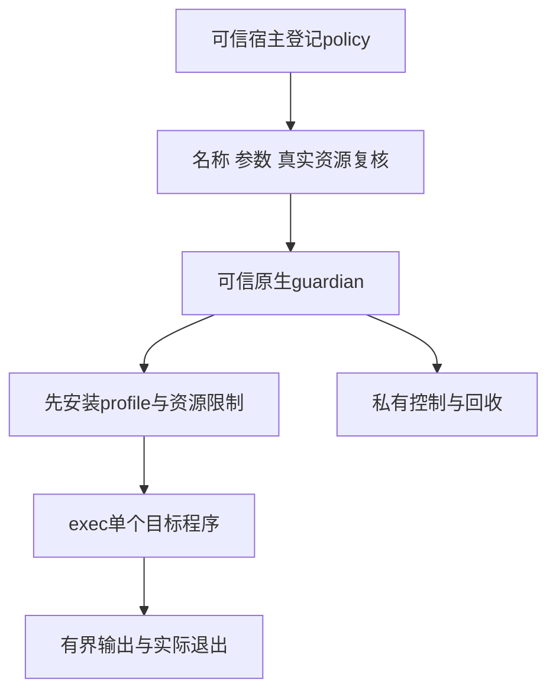

# 第 25 章：Sandbox、文件系统、进程与网络隔离

参数验证可以拒绝一个越界路径，却不能阻止已经获准运行的程序自己调用 `open` 或 `connect`。如果执行器只在启动前检查字符串，程序仍可能绕过工具网关。沙箱要把资源边界交给实际执行环境，同时保留超时、取消和调用者退出后的清理证据。

本章对应 [L14](../labs/L14-isolated-execution.md)，入口为 [Isolation](../lib/agent_systems_lab/isolation.ex)、[Policy](../lib/agent_systems_lab/isolation/policy.ex)、[guardian](../priv/isolation/guardian.c) 与[固定原生探针](../priv/isolation/probe.c)。当前后端是 Darwin 上的 Seatbelt 教学实现，既有实际环境为 macOS arm64；Linux namespace/cgroup、总内存、总磁盘和强多租户隔离没有因此实现。

## 阅读准备与学习目标

先理解[第 3 章](ch03-processes-actors-and-messages.md)的 BEAM PID 与 OS PID、工具调用的宿主授权，以及超时后仍可能有外部效果。首次练习只读能力声明，可在内存运行；真实隔离实验另需受支持的 macOS、clang 和仓库固定工具，先按 L14 核对环境。

读完应能区分参数拒绝、OS 权限拒绝、进程退出和效果核对，解释为什么不存在的文件与未启动的服务不能作为隔离成功证据，并列清资源上限实际限制了什么。下一章把这些资源能力与身份、秘密及审计串起来。

## 25.1 三道门分别承担什么责任

第一道是宿主登记：指定窄工作区、固定命令白名单、资源上限和网络策略。第二道是执行前复核：重新检查真实目录、可执行文件及内容前置。第三道是 OS 强制：目标程序直接访问文件或网络时仍受 profile 与硬限制约束。



模型只提供已登记命令及 argv，不提供 policy、环境、profile 或新的根目录。当前网络模式只有 deny，执行不经过隐式 shell。把一串命令交给 shell 解释，会引入完全不同的命令与参数语义，不能据此沿用原白名单结论。

Policy 在启动时重新验证路径，但这不是抵御恶意同账户并发替换的 inode 固定机制。可信宿主要保持工作区根和可执行文件的所有权及稳定性。私有目录有助于控制实验输入，不等于已经实现跨用户、多租户或恶意宿主对抗。

## 25.2 第一次小练习：能力声明等于已经验证吗

先预测：当前机器被识别为支持的 Darwin，是否就能把隔离执行记为通过？下面只查看静态能力报告，不编译或运行目标程序，也不会暂停、终止任何进程。

在仓库根目录的终端进入新 IEx：

```sh
LAB_DATABASE_ENABLED=false LAB_SCHEDULER_ENABLED=false ./scripts/iex
```

在同一个 IEx 会话执行：

```elixir
alias AgentSystemsLab.Isolation
capabilities = Isolation.capabilities()
"seatbelt.v1" = capabilities.backend
:deny = capabilities.network
:single_fork_denied_target = capabilities.process_scope
false = capabilities.enforcement_verified
false = capabilities.hard_memory_quota
false = capabilities.total_disk_quota
false = capabilities.production_supported
true = is_boolean(capabilities.available)
```

所有匹配应通过，`available` 可以随平台为 true 或 false。即使为 true，`enforcement_verified` 仍为 false：它只说明当前能力入口的声明与前置检查，不是刚执行过每个 OS 探针。真实结论必须绑定本次命令、源版本、参数和实际拒绝/清理证据。

<details>
<summary>核对预测：为什么这些 false 很重要</summary>

输出中明确未提供硬内存和总磁盘配额，也未声称生产支持。改成 true 不能新增机制，只会改变报告。平台可用与实际强制已验证必须分别记录；失败环境不能以“同样是 Unix”继承其他平台结果。

</details>

## 25.3 文件系统边界要有真实基线

越界读取实验先由父进程创建自己拥有的 canary，并证明普通受控程序可以读取它；随后让沙箱目标直接尝试同一路径。目标返回 EPERM/EACCES 才支持权限阻断判断，ENOENT 只说明没有找到文件，可能是路径写错。

越界写入还要保存原 canary 的 hash，运行后确认字节未变。只看程序非零退出，不知道它是否先改了一部分再失败。报告保存路径身份和判定材料，canary 内容不需要进入公开日志，也不应读取用户私人文件来制造测试。

符号链接可能使表面上位于工作区内的路径指向外部，硬链接则可能把同一 inode 暴露为另一个名字。当前配置禁止创建文件链接，已有普通多链接文件会在受限预检中拒绝；符号链接的最终目标访问仍需 OS profile 阻断。字符串前缀判断不能替代这些真实访问条件。

工作区也不能覆盖执行器源码或缓存，否则一次可写访问可能污染下一次可信启动。当前执行器把 guardian 放在授权目录之外，编译与缓存绑定受信任源码及二进制 hash。这个绑定用于本次教学运行时完整性，不是对下载来源或恶意同账户的完整认证。

## 25.4 网络与进程边界的反例

网络拒绝实验需要一个父进程拥有且确实可连的 loopback 服务。普通探针成功连接同一目标后，再观察沙箱 connect 的权限错误；ECONNREFUSED、服务没启动或端口填错不能算网络隔离通过。服务端和客户端都应属于本次实验，不向外部服务发送探针。

当前进程模式只允许一个目标，明确拒绝 fork 等新增进程路径。guardian 与 BEAM 控制器仍然存在，`max_processes: 1` 不是整个系统只有一个进程。目标被置为新 session/group leader，也限制其脱离原控制组的方式。

这个边界是刻意缩小的。若未来允许目标 fork，它可能再用 setsid 脱离原组；只杀原进程组就不能证明所有后代消失。要支持那种模式，必须重新设计拥有关系和回收机制并取得新证据，而不是把当前单目标报告套过去。

## 25.5 资源上限各自度量什么

| 上限 | 当前约束 | 不应推导的结论 |
| --- | --- | --- |
| wall time | 宿主等待与回收时限，受剩余 deadline 收紧 | 已用预算会退款 |
| CPU seconds | 目标的硬 CPU 时间限制 | 整体机器 CPU 配额已隔离 |
| max output bytes | 返回输出有界并在越界后停止 | VM 总内存严格受同一值限制 |
| max file bytes | 单文件大小限制 | 整个工作区总磁盘配额 |
| max processes | 当前单目标、禁止新增进程模式 | 通用进程树都可任意 fork 后清理 |

限制要在 exec 之前由可信 guardian 安装，不能让目标运行一阵子再补设。父进程还需关闭非契约文件描述符并最小化环境；预先继承的 Repo socket、目录 FD 或秘密本身也是能力，路径规则无法自动取消已经继承的访问。

CPU、输出和 wall-clock 可能同时触发，实验要设计能区分的窗口。一个持续计算探针若先被很短的 wall-clock 杀掉，就没有证明 CPU 限制生效。报告保留真实退出原因、上限与实际身份，不把任何异常都算成预期阻断。

例如验证 CPU 时，选择仓库的固定计算探针，给 wall-clock 留出更长空间，再检查实际资源终止原因与拥有的进程退出；验证 wall-clock 时则用已经打印启动身份后进入等待的探针，避免 CPU 消耗成为主要触发器。两份记录的程序模式和上限不同，不能只把耗时都写成“约一秒”便合并为一种证据。

文件与输出也需要分开。向 stdout 连续打印直到有界返回，只证明输出路径的限制；在工作区写入一个新文件并核对最终大小，才涉及单文件边界。若程序已经写出允许字节后被终止，报告应保留那份产物，而不是删掉它来让“失败未留痕”看上去成立。对照案例中的文件、监听器和进程均由本次 fixture 创建，原来的源码与外部基线保持可核对。

## 25.6 第二层实验与清理证据

退出 IEx 后，在受支持环境的项目根目录运行固定探针。父目录可存在，输出子目录必须全新：

```sh
mkdir -p artifacts
isolation_parent="$(mktemp -d artifacts/ch25-XXXXXX)"
LAB_DATABASE_ENABLED=false LAB_SCHEDULER_ENABLED=false ./scripts/mix lab.isolate --output "$isolation_parent/probes"
```

这个 CLI 执行仓库控制的 C 探针，创建自己的 canary、工作区和 loopback 服务；它不是从模型响应执行任意程序。检查实际退出码，再读 report、逐项 execution、fixture 身份和独立审计。输出目录存在或日志里出现“denied”都不足以证明所有计划项完成。

超时、取消和调用者崩溃的案例先证明目标确实启动，再通过私有控制通道回收，核对本次实际目标 PID 与 guardian 都退出。不能搜索系统进程列表后随意 kill 一个看起来相似的 PID，也不能把 Port 关闭直接当成 OS 进程已经消失。

后端不可用或初始化失败时，正确结果是明确失败关闭。退回 `System.cmd` 直接执行原命令，会使“同一 API 名字”背后的权限合同改变；后续产物再正确，也不能算原隔离实验通过。Linux 部分目前是后续设计与独立验收范围，普通 Linux core CI 不提供 Seatbelt 等价证明。

## 25.7 沙箱停止不等于业务效果撤销

目标可能在时限到达之前已经写入授权工作区，随后被回收。此时需要同时保留执行终止与文件变化两条证据，不能因“进程不在了”就把原操作判成没有效果。结果接入 Runtime 后仍要经过稳定 operation、配对回执、原预算与 fenced 提交。

对于外部效果不明确的失败，遵守已有 unknown/reconcile 合同；重新获得执行资格只决定谁可以继续，不决定是否可重做效果。若原确认已存在，就复用已确认事实；若没有足够证据，不能换调用 ID 盲重试。隔离约束的是可访问范围，不替代事务或效果端去重。

因此一个通过报告至少列出被保护资源的正向基线、预期拒绝、未变字节、真实退出与未支持能力。能力表、当前探针与持久恢复分别陈述，才能知道自己验证了哪一层边界。

## 25.8 练习与教师参考

每题按“前提基线、拒绝/退出证据、范围限制”各 1 分核对。

1. 越界读取返回 ENOENT，网络连接返回 ECONNREFUSED，能否判隔离通过？怎样补上正向基线？
2. 有单文件大小限制，为什么仍不能写“总磁盘已限额”？能力报告还明确缺哪项资源保证？
3. Port 已关闭，为什么还要检查目标与 guardian 的实际退出？允许任意 fork 后会增加什么问题？
4. 沙箱写入后超时，怎样同时报告执行结果与业务效果？能否换 operation ID 重做？

<details>
<summary>教师参考：证明实际强制与清理</summary>

1. 不能，资源可能根本不可用。父进程创建并确认可读 canary、可连的自有 loopback 服务，再观察同一资源上沙箱的权限拒绝；写入还比较原 hash。
2. 单文件限制不约束所有文件之和；硬内存配额也未实现。分别报告现有 CPU、输出、wall-clock 等边界，不能用一个成功资源探针替代其他配额。
3. 通道关闭不等于 OS 生命周期已经观测结束。核对本次拥有的 PID、回收及 guardian 退出；允许后代脱组后需要新的所有权与清理设计，不能沿用单目标结论。
4. 记录时限/退出、已发生的文件变化、原操作与可确认回执；效果不明时保留 unknown。取消或停止不撤销已写字节，不能凭新 ID 自动重做。

</details>

## 术语与下一步

policy 是宿主能力配置，guardian 是可信原生监督者，target 是本次目标，canary 是本次自有基线资源，cleanup 是实际生命周期核对。它们共同支持有限的隔离结论，不构成通用恶意代码执行服务。

继续读[第 26 章](ch26-identity-authorization-secrets-and-audit.md)。实现与真实判据见[隔离 ADR](../docs/adr/0014-isolated-execution.md)、[策略测试](../test/agent_systems_lab/isolation_policy_test.exs)、[执行测试](../test/agent_systems_lab/isolation_test.exs)和 [L14](../labs/L14-isolated-execution.md)。
