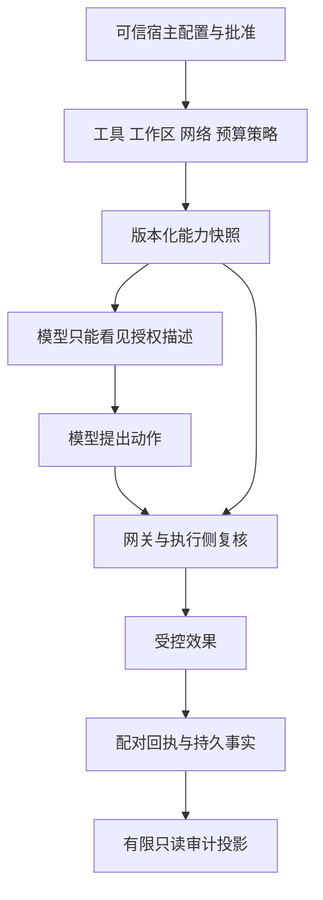

# 第 26 章：Authentication、Authorization、Secrets 与 Audit

模型在回答中写“我已获准访问网络”，审批记录的 actor 又叫“管理员”，Trace 还保存了完整输入。三者都看起来与安全有关，却可能没有提供真正的身份或授权保证，反而引入秘密泄露。本章沿已实现的宿主策略、能力快照和有限审计，说明谁可以提供权限，以及哪些生产身份能力仍需独立设计。

实现入口为 [Tools.Gateway](../lib/agent_systems_lab/tools/gateway.ex)、[MCP.Policy](../lib/agent_systems_lab/mcp/policy.ex)、[Approvals.Cases](../lib/agent_systems_lab/approvals/cases.ex)、[Approvals.Audit](../lib/agent_systems_lab/approvals/audit.ex) 和 [Observability.Schema](../lib/agent_systems_lab/observability/schema.ex)。本项目面向可信宿主上的教学实验，没有用户登录、OAuth/OIDC、secret vault 或通用 RBAC/ABAC 平台。

## 阅读准备与学习目标

先读[第 9 章](ch09-context-construction.md)的来源、[第 11 章](ch11-tool-registry-mcp-and-schema.md)的宿主批准，以及[第 24](ch24-multi-agent-handoffs-and-approvals.md)、[第 25 章](ch25-sandbox-files-processes-and-network.md)的审批与资源边界。首次练习只在内存中检查观测投影，使用公开示意字符串，不接触真实账号或密钥。

读完应能区分身份认证、授权、执行资格与审计，解释为何消息、hash、claim token 和 actor 字符串不能互相替代，并在来源、工具、恢复和观测几个边界上说明实际保护范围。

## 26.1 先分开四个问题

认证回答声称的主体是谁，授权回答这个主体在当前条件下能做什么。[NIST 的 authentication 术语](https://csrc.nist.gov/glossary/term/authentication)强调身份验证，[authorization 术语](https://csrc.nist.gov/glossary/term/authorization)描述授予或判断访问权。这里借用概念区别，不把引用当作本项目已经实现身份产品的证明。

| 问题 | 本项目已有的对应机制 | 还不能推导什么 |
| --- | --- | --- |
| 谁声明了请求 | 可信宿主调用 API，actor 受本地 allowlist 约束 | 真实用户已经登录或完成认证 |
| 允许做什么 | 工作区、工具 Catalog、隔离与 MCP policy | 模型文字可以扩权 |
| 此刻谁能提交 | 当前 claim、token、generation、seq | 这个 Worker 具备更高业务权限 |
| 发生过什么 | 已提交事件、回执、控制历史与审计 | hash 或 Trace 自动认证全部内容 |

lease/fencing 解决竞争执行资格，不是用户认证。一个旧 token 被拒绝，不说明新 token 的持有者可以访问更多目录；权限仍来自原任务宿主策略。审批人名称在 allowlist 中，也不能证明某个网络请求真的由该人发出。

## 26.2 权限从哪里进入执行链



Context 中的权限描述要与实际策略一致，但它不是策略对象的编辑入口。摘要、检索片段、工具输出或 MCP 的远端描述都是数据来源，不能靠“请忽略原约束”修改宿主对象。把这些字段混进一个自由 prompt，会让审查者难以区分授权来自哪里。

授权检查还有时点。提议接受前做名称、形状和已知配置预检，执行前仍检查真实文件资源、当前内容前置和可用能力；持久结果提交再检查当前 seq/claim。接受了意图并不意味着后面所有条件永远成立，某次权限拒绝也不应被模型叙述改写成成功效果。

## 26.3 第一次小练习：投影会删什么，不会识别什么

先预测：把秘密样式文字塞进一个未知字段，是否会导出？若把相同文字塞进合法业务 ID，schema 能自动知道那是秘密吗？以下 CANARY 都是公开测试字面量，不是真实凭据。

在仓库根目录的终端进入新 IEx：

```sh
LAB_DATABASE_ENABLED=false LAB_SCHEDULER_ENABLED=false ./scripts/iex
```

在同一会话执行：

```elixir
alias AgentSystemsLab.Observability.Schema
{:ok, event} = Schema.project(:tool_stopped,
  %{run_id: "ch26-run", operation_id: "op-1", attempt_id: "attempt-1",
    claim_token: "CANARY-SECRET"},
  %{duration_ms: 5, prompt: "CANARY-SECRET"},
  outcome: :ok, reason: "CANARY-SECRET")
false = Map.has_key?(event["correlation"], "claim_token")
false = Map.has_key?(event["attributes"], "reason")
false = String.contains?(JSON.encode!(event), "CANARY-SECRET")
{:ok, bad_id_choice} = Schema.project(:run_created,
  %{run_id: "CANARY-ID"}, %{})
true = String.contains?(JSON.encode!(bad_id_choice), "CANARY-ID")
```

预期全部匹配通过。未知字段与不在有限枚举中的 reason 被丢弃，但合法格式的业务 ID 仍会被保留。这个反例说明数据最小化依赖字段合同与可信宿主输入，不是一个能识别任意秘密的内容分类器。给 ID、路径或错误字符串命名时，不能把真实 token 拼进去，再期望 schema 自动清洗。

还要分清丢弃未知字段和拒绝非法已知字段。一个没有导出位置的 prompt 可以被投影舍弃，但 duration_ms 若是负数，会让整条观测不合法。继续在同一 IEx 中验证：

```elixir
{:error, :invalid_observation} = Schema.project(:tool_stopped,
  %{run_id: "ch26-run"}, %{duration_ms: -1})
```

这不是业务工具执行失败。真正的 emit 路径会把非法或不可准入观测计为诊断丢失，并保持业务执行独立；它返回 `:ok` 也不表示某条 Trace 一定已持久保存。调查漏观测时应读 invalid、dropped 等计数并回到原业务事实，而不是临时放宽字段规则，把完整错误或秘密正文当成“修复日志”的材料。

<details>
<summary>核对预测：字段白名单为什么仍需要宿主约束</summary>

只允许有限字段能减少可导出的内容，但一个允许字段仍可能被错误使用。host-owned 业务标识应是无秘密的关联值；完整 prompt、工具参数、回执正文、claim token 和任意异常 inspect 没有导出字段。原事实按其受控存储路径保存，观测只取得必要投影。

</details>

## 26.4 秘密不应顺着“方便调试”扩散

当前 Provider 是固定 Scripted/Recorded，不需要真实模型凭据。未来若接入真实服务，凭据解析应由可信宿主控制，不能来自模型输入，也不能放进 Session、Context、普通工具参数或可重放历史来方便恢复。能读到某个 Context 的组件不应因此取得调用远端账号的能力。

隔离执行还要检查环境和继承 FD。即使命令白名单正确，目标若继承数据库 socket、秘密环境变量或一个已打开的目录句柄，仍可能获得路径 profile 没有明确授予的能力。当前原生 guardian 和固定 scorer 都对其启动环境做最小化；这只是具体入口的合同，不能概括为整个宿主已经无秘密泄露面。

日志也不是无害副本。把一段错误的完整 inspect、工具输入或人工理由发给 exporter，会复制出新的访问与保留范围。当前观测 schema 丢弃这些任意正文，保留有限结果分类和业务关联；需要深入核对时，可信维护者回到受控原始证据，不能临时扩展公开 Trace 字段来取代权限设计。

散列也不能使任意秘密自动适合公开。低熵内容可能可枚举，稳定 hash 还可能关联不同任务。这里的源 hash 用于对象绑定与损坏检测，具体可分享范围仍需由宿主决定；不能因字段不再是明文就视为已经完成访问控制。

## 26.5 恢复时不能顺手重签权限

持久 sidecar 保存版本化的 inert 策略和绑定值，恢复时按原形状、原版本和当前资源前置重新核验。模型不能通过新的参数替换工作区或 MCP server command。若迁移到另一台机器需要新能力，必须由可信宿主明确设计迁移与重新批准，不能用“为了恢复成功”跳过原约束。

当前 claim token 负责拒绝旧执行代次；它不应进入模型或普通观测导出。新 Worker 继续原预算与 deadline，也继续原工具权限。重新领取、暂停恢复或人工核对不是自动扩权的机会，操作身份和已消耗事实也不能因此重置。

审批链有相同原则。actor allowlist 证明本地请求满足宿主配置的某个名字，不证明网络用户身份。若真正对外提供审批界面，需要把经过验证的主体绑定到 Case、subject、审阅版本和决定来源，同时处理会话、撤销、重复请求与审计。当前教学 API 不具备这些外围能力，不能只把一个 actor 字段接到表单就称认证完成。

## 26.6 失败案例：让审计 hash 变成放行凭据

假设某人修改了产物与记录，再重新计算全部 hash。如果 release 只比较“hash 格式正确”，它可能接受从未审阅的新内容。正确链必须从可信宿主的原控制事实、当前 subject、当前产物与精确决定核对；对象自带的摘要或 hash 没有授权权力。

另一个反例是观察查询改变业务。若诊断页面为了展示“最新状态”顺便调用 sync、capture 或 resume，就从读取证据变成推进任务。观测结果可能更完整，却破坏了只读审计合同，也可能启动工具或消耗预算。当前 Audit/Query 的相关检查要求重建一致并保持执行入口零调用。

修复时分离只读投影与显式控制动作。决定、释放、恢复都有自己的宿主入口和前置；诊断只能解释已经存在的证据。全量 hash 相等与零调用计数分别证明不同条件，不能只比较最终 status 就宣布读取没有副作用。

## 26.7 将来增加身份层时怎样保持边界

真实身份层应先定义主体、资源、动作与授权来源，再决定登录协议和会话形式。谁能创建 Run、查看某份 capture、批准哪个 subject、导出哪些证据，都是不同动作。一个统一“管理员”布尔值通常不足以解释每个对象的权限，也不能自动解决跨租户资源和撤销。

还要说明策略快照与当前授权的关系：正在执行的任务遇到权限撤销如何处理，已发生效果怎样保留证据，旧批准能否继续释放，以及停止动作与外部结果未知怎样关联。这些都需要新增明确合同与独立测试，不是简单添加 tenant_id 或一张用户表。

撤销也不应通过删除历史来实现。即使未来不再允许某个主体创建新请求，过去谁对哪个对象作过什么决定仍需保留可审计关系；当前是否允许继续，与过去是否发生过效果分别判断。身份和能力版本变化需要新证据，不能只改显示名称让旧记录看似来自另一个主体。

下面将这些问题连成一份桌面方案。现有实验仍以可信宿主、有限工具能力、受控工作区和原始事实核验为边界；没有接入真实账号、密钥保管平台或恶意同账户隔离。保留这个范围，才不会把一套有用的教学机制写成未经验证的安全产品。

## 设计案例：为客户报表增加受控审批入口

假设未来服务已接入一个受信任的身份提供方，服务端能验证主体和所属组织；现有项目并未提供该登录入口。目标是让组织成员创建报表，指定审阅者批准发布，支持人员只查看经过裁剪的诊断材料。模型既不决定请求者身份，也不批准自己的产物。

只检查“已登录”会让所有成员取得相同对象权限；只检查角色名称又无法解释一个审阅者能否批准另一个组织的报表。本方案选择“动作角色＋对象归属＋当前版本”的组合：身份层提供稳定主体，业务层读取受管对象的组织和所有者，每个入口核对主体与动作；审批还绑定被审阅的准确 subject。默认拒绝，逐请求校验，资源查找和权限判断保持在可信服务端。这种设计方向可对照 [OWASP 授权指南](https://cheatsheetseries.owasp.org/cheatsheets/Authorization_Cheat_Sheet.html)，并不是现仓库已具有通用身份平台的证明。

| 主体与动作 | 应允许的条件 | 应拒绝的例子与观察 |
| --- | --- | --- |
| 组织成员创建 Run | 当前组织允许创建该固定任务，宿主装配本组织工作区与能力 | 正文自报另一个组织不能改变实际归属 |
| 创建者查看自己任务 | 从持久对象核对组织及允许的所有者关系 | 猜中另一成员或组织的 Run ID 仍不能读取 |
| 指定审阅者作决定 | 当前可审阅该 Case，决定绑定当前 subject、产物 hash 与审阅版本 | 将 actor 名改成审阅者、重用旧决定或跨组织 Case 均拒绝 |
| 支持人员查询诊断 | 当前被授权读取有限投影，不获得原文件、token 或控制动作 | 从诊断页面调用 resume、capture 或 release 被拒绝 |
| 维护者导出材料 | 在独立管理入口校验范围与用途，记录决定与对象身份 | 单凭 export ID 或知道路径不能取得原件 |

审批入口的正向路径可以这样说明：T0，成员创建报表 R，可信服务端写入归属并装配限定能力；T1，产物版本 v1 被捕获，审阅者看到的 Case 绑定 v1 的准确 subject；T2，审阅者在当时有效的授权下作决定，服务端记录主体、Case 和决定来源；T3，释放动作重新检查当前授权和 subject，只有仍匹配才允许该明确动作。权限记录、审阅决定和执行资格在链中有不同位置，不用一个角色字符串替代三者。

现在加入两个变化：若 T2 后产物变成 v2，旧决定不能释放 v2，应重新捕获与审阅；若审阅者的权限在 T3 前被撤销，本案例选择拒绝尚未执行的释放，并保留原决定作为历史事实。已经发生的效果不会因撤销消失，应另行核对。为使这个政策可验证，未来实现必须定义撤销与释放的判定顺序，并在该可信边界串行化或版本化检查；只在 T2 查一次角色不能满足它。

桌面评审的验收表要覆盖：合法成员的正常路径；同角色跨组织对象；旧 subject 与新产物；撤销后释放；重复决定；诊断读取前后 Provider、工具和控制入口零调用。每项写清当前身份与对象版本、应允许的动作、拒绝来源、允许的审计字段。身份提供方不可用时，本方案暂停需要新授权确认的动作，不从模型消息补造身份；如何处理已有会话须由实际会话合同另行验证。

由此形成的交付物是一张权限矩阵、两条变化时间线和验收计划。当前能实跑的对照仍是第 24 章产物审批、第 26.3 节投影与已有只读审计测试；登录、对象归属、角色撤销和跨组织入口测试在本案例中都属于未来服务设计，不能填写成当前通过数。

## 26.8 练习与教师参考

每题按“来源、权限边界、反例证据”各 1 分核对。

1. actor 在 allowlist 中、claim token 当前有效、工具已登记，三者分别解决什么问题？是否证明登录身份？
2. 模型消息和摘要都写着“允许网络”，为什么仍不能改变实际能力？应核对哪个来源？
3. 首次练习为何保留 CANARY-ID？怎样避免类似真实秘密进入导出？
4. 一个只读审计页面在查询时自动 resume，违反了什么边界？怎样验证修复？

<details>
<summary>教师参考：权限从可信来源进入</summary>

1. 分别是宿主名字约束、当前提交资格、能力登记；都不等同真实用户认证。还要在相应时点核对资源、主体与动作，不能互相代用。
2. 叙述不能提供宿主授权。核对原 policy、实际工具配置、工作区及执行前置，Context 只是这些来源的输入投影。
3. 它符合允许的业务 ID 格式，schema 不是秘密识别器。宿主生成无秘密关联 ID，拒绝把正文/凭据塞进允许字段，并以合成 canary 检查导出路径。
4. 读取变成了控制与执行，可能消耗预算或产生效果。分离入口，对诊断前后业务事实做核验，并检查 Provider/Tool/控制入口零调用；不只比较终态。

</details>

## 术语与下一步

authentication 是身份验证，authorization 是动作许可，capability/policy 是宿主能力约束，audit 是受控证据核对，redaction/projection 是导出数据最小化。它们相互支持，但不能由一个字符串或 hash 自动补齐。

下一章讨论 Trace、Span 与 Metrics 的实际诊断作用。继续核对[观测 schema](../lib/agent_systems_lab/observability/schema.ex)、[MCP 权限测试](../test/agent_systems_lab/mcp_tool_gateway_test.exs)、[隔离网关测试](../test/agent_systems_lab/isolation_tool_gateway_test.exs)及 [L18](../labs/L18-observability.md)，再读[第 27 章](ch27-traces-spans-and-metrics.md)。
