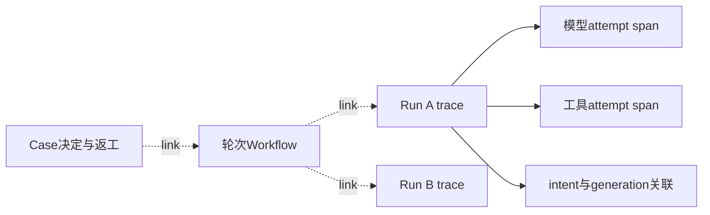

# 第 27 章：OpenTelemetry、Trace、Span 与 Metrics

一个任务似乎卡住了：可能在等模型、等工具、等重试到期，也可能正在等待人工决定。把所有日志按时间排在一起，仍未必知道哪条属于同一个操作，哪条来自旧执行代次。观测需要稳定关联、清楚的度量和可见的丢失，同时不能因为导出器故障改变业务结果。

本章对应 [L18](../labs/L18-observability.md)，入口为 [Observability](../lib/agent_systems_lab/observability.ex)、[Context](../lib/agent_systems_lab/observability/context.ex)、[Schema](../lib/agent_systems_lab/observability/schema.ex)、[Buffer](../lib/agent_systems_lab/observability/buffer.ex) 和 [Query](../lib/agent_systems_lab/observability/query.ex)。当前实现是内部 schema、确定性关联、有限聚合和本地 exporter；没有接入完整 OpenTelemetry SDK、OTLP Collector 或远端上下文传播。

## 阅读准备与学习目标

先理解 Run、operation、attempt、intent generation 与审批轮次各自的身份，以及持久事实与诊断投影的区别。首次练习使用手工观测值检查关联和聚合，不执行模型或数据库；L18 完整故障与持久查询实验另按其前置推进。

读完应能为一次模型/工具尝试找到对应 span，解释跨 Run 为什么使用关联 links，区分实时观测与只读重建，说明缓冲丢失、导出失败和业务失败，并给出有限指标维度而不泄露原始正文。

## 27.1 Trace 是关联，不是成功证明

OpenTelemetry 用 span 表达一个工作单元，多个带关系的 span 组成 trace；parent 适合表示同一 trace 内的层次，links 可以表达相关操作之间的联系。这个概念区分见[官方 Trace 说明](https://opentelemetry.io/docs/concepts/signals/traces/)。本项目借用这些诊断概念，实际字段与行为仍以内部实现为准。

Run 有自己的根 span，模型 attempt 和工具 attempt 关联到该 Run。不同 Run 各自有独立 trace；Workflow 依赖与 Case 的轮次关系用 links 表达，不能把另一 trace 的根随意当作当前 trace 的 parent。这样才能在分工、返工和恢复时保留原身份。



当前 trace/span ID 由版本化确定性 hash 生成，新 BEAM 可从相同业务身份算出相同关联值。它们不是授权凭据，也不证明某事件真实发生；一个能构造合法输入的调用者也能得到格式正确的观测。业务事实仍要查原 Event、回执和控制历史。

## 27.2 第一次小练习：关联与聚合分别保留什么

先预测：两个不同 Run 各有一次成功模型观测，metric 是否应该因为 Run ID 不同而生成两个 label？下面数值是手工教学数据，不是实际模型请求延迟；练习不启动导出器。

在仓库根目录的终端进入新 IEx：

```sh
LAB_DATABASE_ENABLED=false LAB_SCHEDULER_ENABLED=false ./scripts/iex
```

在同一会话执行：

```elixir
alias AgentSystemsLab.Observability.{Schema, Metrics}
alias AgentSystemsLab.Observability.Context, as: TraceContext
trace = TraceContext.trace_id("ch27-a")
true = byte_size(trace) == 32
true = byte_size(TraceContext.root_span_id("ch27-a")) == 16
true = trace == TraceContext.trace_id("ch27-a")
{:ok, first} = Schema.project(:model_stopped,
  %{run_id: "ch27-a", attempt_id: "model-1"}, %{duration_ms: 12},
  outcome: :ok, observed_at_unix_ms: 0)
{:ok, second} = Schema.project(:model_stopped,
  %{run_id: "ch27-b", attempt_id: "model-1"}, %{duration_ms: 18},
  outcome: :ok, observed_at_unix_ms: 0)
true = first["trace_id"] != second["trace_id"]
true = first["parent_span_id"] == TraceContext.root_span_id("ch27-a")
metrics = %{} |> Metrics.add(first) |> Metrics.add(second)
[%{"event_name" => "model_stopped", "outcome" => "ok", "count" => 2,
   "sums" => %{"duration_ms" => 30}}] = Metrics.export(metrics)
```

预期匹配全部通过。关联字段保留各自 Run 和 attempt，指标只按有限事件名与 outcome 聚合。这避免把每个任务 ID、路径或任意错误文本变成无限增长的标签集合；需要看单个任务时，转到有界事件与原始事实核对。

<details>
<summary>核对预测：为什么两个层次都需要</summary>

只有聚合会丢掉单次来源，只保存所有明细又无法控制指标维度与成本。当前实现把两者分开：明细用于有限诊断，metric 用有限 label 做汇总。30 是这两条手工数值的和，不是整套系统真实耗时或持久预算。

</details>

## 27.3 一个观测事件应怎样解释

内部事件带 schema_version、有限 event_name、trace/span/parent 标识、correlation、attributes、measurements 与观察时间。Run Event seq、模型轮次、operation、attempt、intent generation 都有独立位置，不能用一个通用 seq 覆盖它们。

模型开始、结束和录制应能按同一 attempt 关联；工具开始、完成、unknown 与核对要追到原 operation 及相应 attempt。观察时间说明何时看见这条记录，不等于事务 COMMIT 的精确时刻。跨进程时钟和 exporter 排序更不能自动提供全局因果序。

Schema 只导出允许的无正文投影。未知字段被舍弃，非法已知字段使观测无效；完整 prompt、工具参数、回执正文、路径、claim token 与任意 exception inspect 没有导出字段。业务 ID 自身仍必须由可信宿主保证不含秘密，投影不是任意内容的秘密分类器。

一个 span 完整配对，只支持相应尝试的诊断结论；它不能让 failed Run 变成功，也不能从“tool_stopped”推断外部效果已回滚。尤其 unknown 需要保留原配对回执与核对链，不能靠观测中的 outcome 字符串替代。

同一 operation 的第二次 attempt 应能与原操作关联，同时保留自己的尝试身份；不能复用上一尝试的结束通知来补齐本轮 span。领取换代时还要检查相应 intent 与 generation，否则看见同一个 Run ID 就可能混入旧执行者的迟到事件。

重复观测也不自动意味着重复效果。已确认结果可能在不同诊断位置被观察到多次，反过来真实效果也可能缺少某条导出。调查时先按有限关联找到原操作，再核持久回执与效果端事实；Trace 的行数只提供线索，不能代替效果计数。

## 27.4 让观测故障留在旁路

默认 exporter 是 Null，不做文件或网络输出。明确配置本地 JSONL 后，只有独立 exporter Worker 执行输出；生产者的 emit 路径不进行数据库、文件、网络、同步 GenServer 调用或 exporter 回调。应用不能把“等 Trace 写入成功”放进工具结果的接受事务。

生产者向有固定槽位和字节上限的缓冲预留记录，原子竞争尝试也有界。满额、事件过大或准入竞争时丢弃观测，唤醒消息合并，避免为每条事件积累一个无界 cast 邮箱。Buffer 逻辑上只跟踪一个在途导出任务；结果消息到达时会解除 monitor 并继续 drain，超时则发 kill、解除 monitor 后退避。这些分支没有等待旧 PID 的 `:DOWN`，因此逻辑槽位上界不能当作任意瞬间物理存活 Worker 数量的强证明。失败批次丢失并退避，不把导出重试变成业务执行背压。

这些边界度量内部 ETF 载荷，不是精确 VM 总内存或磁盘配额。默认队列、每事件、batch、recent 都分别有限，记录高水位能检查实际压力。即使配置有上限，也要通过饱和与挂起 exporter 的实验核对实际表现，不能只从一个参数值推断整个进程内存固定不变。

## 27.5 失败案例：丢了 Trace 就重做工具

假设工具结果已在数据库确认，但 exporter 在写日志前超时，诊断界面看不到 tool_completed。若系统据此重做工具，就把一种观测丢失变成重复业务效果。修复应回到持久化事实与原 operation，保持已确认结果，不让旁路缺行变成执行许可。

反过来，Trace 里出现完成通知，也不能抵销 COMMIT 前回滚。需要用原数据库行与事件判断是否提交，而不是数 exporter 的成功行数。实时观测可能少发、迟到或丢失；持久审计也要核验自身来源，两个渠道都不能越过业务合同。

当前 Query 从已保存的 Run、Workflow、Case 和相关记录生成有界诊断投影；某个重建 span 不表示过去一定发过相同实时通知。Query 不执行 sync、capture、decide、release 或续跑，诊断前后应保持原事实不变并取得零执行调用证据。否则“为了补日志”就已经改变被观察对象。

## 27.6 指标缺失与丢失怎样记录

`dropped` 记录准入丢弃，`invalid` 表示 schema 拒绝，`export_lost` 表示已经准入但导出失败的批次行数，不能都算作成功导出。还需看队列条目与字节、真实 ETS 行数、在途 Worker、超时和错误计数，才能知道丢失发生在哪一步。

生产者在预留后、插入前被终止，可能留下有限 permit，使有效观察容量下降。实际排队条目与包含预留的条目数短暂不同，不代表突破上限；持续差异需要宿主调查。显式重建观察器会丢掉易失状态，不会自动补发业务历史，也不应重启正在执行的 Run。

Metrics 聚合的是已经从缓冲排出的观测，导出失败时仍可能有本地聚合。准入丢失或 observer 死亡仍会造成欠计数，所以不能拿 metric 计数结算真实预算、断言总工具次数或放行审批。预算与效果的权威来源在持久台账。

首次练习中的 count 与 duration sum 还能得到一个局部平均值，但它们没有保留完整分布。平均 15 毫秒不表示每次都接近 15，也不能据此计算 p95。模型尝试时长、等待队列时间、工具时长和整项任务 wall time 是不同度量；把相邻几条 span 的时长相加，遇到并行或缺行就可能重复计算或漏算。

flush 也有明确范围：它是宿主有界等待接口，检查缓冲已排空且无被跟踪的在途导出任务，不是业务关键路径；这不是观察到旧 Worker PID 的 `:DOWN`。一个失败批次被丢弃后，缓冲仍可能排空，因此 flush 返回成功不能单独证明每行已经写入文件。还要同时看 exported、export_errors、export_timeouts 和 export_lost，必要时核对实际 JSONL、原始诊断记录与自有 PID 的退出证据。

Query 的结果同样应保留自己的范围标记。请求可能因为相关 Run 数量上限而截断，也可能有某一投影不可用；这些应显式显示，不能补成空集合然后宣称“没有相关失败”。一个可读的诊断页面首先应告诉维护者查了哪些对象、哪些证据取得了、哪些未取得，再用关联图解释时序。这个范围信息比把所有节点涂成绿色更有用。

## 27.7 用故障对照检验观测设计

完整 L18 先固定一条业务轨迹，再分别注入 exporter 返回错误、抛异常、退出、挂起与超时，核对原结果、预算和回执与基线一致。对挂起场景同时增加事件压力，分别检查容量、recent、唤醒邮箱及被跟踪导出任务的逻辑上界；物理进程清理另查自有 PID 的退出证据，而不是只看进程最终没崩溃。

observer 消失后，旧 handle 的 emit 仍应不影响业务；恢复观察器是显式宿主操作。此类生命周期测试必须针对本次拥有的独立 observer 或独占 BEAM，不能在共享 IEx 中随意停止应用全局监督树。查看 actual PID 和退出证据，不根据固定短 sleep 猜测已经清理。

还应放入公开合成 canary，分别经过任务输入、工具参数、输出、人工理由与错误路径，检查导出无正文泄露。它测试的是选定入口的最小化行为，不是整个系统的全面保密证明。业务标识、原始证据与文件权限仍各有责任。

## 27.8 练习与教师参考

每题按“关联、原始事实、丢失边界”各 1 分核对。

1. exporter 100% 成功，是否证明所有关键操作都有完整关联？应另外核对什么？
2. 数据库已经确认效果，Trace 缺少完成行，能否重做？反向情况又怎样判断？
3. 为什么不同 Run 的根 span 不应随意用作 parent？什么时候适合 links？
4. 把 Run ID、错误全文和路径作为 metric labels，会造成哪些问题？

<details>
<summary>教师参考：旁路诊断保持业务独立</summary>

1. 不证明。还需事件来源、固定身份、span 开始/结束配对、重试与核对关联，并查看准入丢失和 invalid。成功导出的分母不等于全部业务操作。
2. 不能，查原台账复用已确认结果；观测存在而事务回滚也不能算已提交。两种情况都以持久业务事实和原操作证据判断。
3. 每个 Run 有自己的 trace，跨任务依赖与返工应使用 links 保留关系，不能伪造同一 trace 的层次。具体关联 ID 也不是执行授权。
4. 可能泄露正文并导致无界高基数。使用有限事件名与 outcome 聚合，个例查询走有界诊断和受控原始材料；指标不作为预算或审批台账。

</details>

## 术语与下一步

trace 是相关工作的诊断链，span 是工作单元，link 是相关操作关系，metric 是有限维度聚合，exporter 是输出适配器。当前项目没有因使用这些词就成为完整 OpenTelemetry 实现。

继续读[第 28 章](ch28-evaluation-datasets-and-scorers.md)，用独立评分与完整样本计划判断任务结果。实现依据见[观测 ADR](../docs/adr/0018-observability-and-diagnostic-evidence.md)、[执行测试](../test/agent_systems_lab/observability_execution_test.exs)、[查询测试](../test/agent_systems_lab/observability_query_test.exs)和 [L18](../labs/L18-observability.md)。
