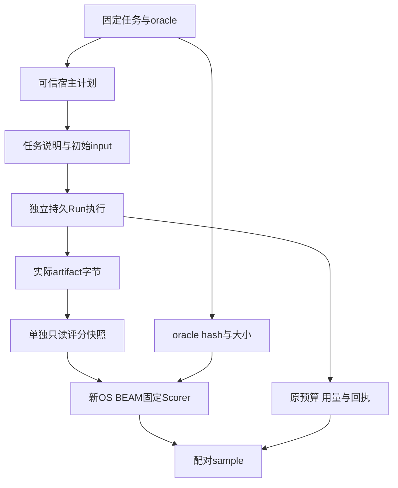

# 第 28 章：Agent Evaluation、Dataset、Rubric 与 Scorer

一次 Agent 运行结束，模型说任务成功，工作区里也有一个文件。评测却仍可能失败：文件字节不对、额外工具请求超预算、评分进程没能取得产物，或者失败样本被悄悄移出分母。评测首先要固定“计划测什么、怎样判断、怎样报告未知”，才有资格比较两个方案。

本章对应 [L19](../labs/L19-repeatable-evaluation.md)，入口是 [Suite](../lib/agent_systems_lab/evaluation/suite.ex)、[Runner](../lib/agent_systems_lab/evaluation/runner.ex)、[Scorer](../lib/agent_systems_lab/evaluation/scorer.ex)、[Report](../lib/agent_systems_lab/evaluation/report.ex) 与 [Comparison](../lib/agent_systems_lab/evaluation/comparison.ex)。当前数据是原创公开固定语料、Scripted Provider 和合成价格，不是真实模型能力成绩、真实账单或生产 benchmark。

## 阅读准备与学习目标

先理解受控文件工具、预算、独立进程与[上一章](ch27-traces-spans-and-metrics.md)的度量范围。首次练习只读取仓库固定语料并计算纯统计，不调用 Provider、数据库或 scorer 子进程。完整 task/trial 执行需 L19 声明的专属 PostgreSQL 与前置实验。

读完应能固定数据和 oracle 身份，区分任务失败与评分失败，解释所有计划样本的分母，核对成本未知及小样本分位数，并判断两份报告是否有资格逐项比较。

## 28.1 评测协议比一列成功率更重要

当前 suite 有十个任务，六个 dev、四个 holdout，每个目标是工作区里的 `artifact.txt`。任务定义绑定说明、输入、预期字节和 reference/regressed 两种固定响应源。两种分割的 task ID 独立，但材料全部公开，holdout 不是保密机制；读过之后也不能继续声称从未接触。

| 协议部分 | 固定内容 | 改变后的处理 |
| --- | --- | --- |
| 数据身份 | manifest 与全部 fixture 字节、任务 hash | 生成新的 suite/task identity |
| 评分身份 | 固定 scorer 源码与 oracle | 重新取得对应基线 |
| 执行合同 | 预算、权限、runtime、split、重复数 | 不沿用原协议的比较结论 |
| 测量口径 | 用量、合成定价、延迟范围与门槛 | 明确记录新口径 |

Suite 读取器拒绝重复 JSON 键、未知字段/版本、不匹配定价、错误分割、越界路径、符号链接和超量输入。manifest 不能指定任意命令、模块或评分源码。固定文件 hash 绑定字节，不认证来源；读取可信项目副本仍是前提。

这种冻结首先为机制比较服务。Reference 脚本已经包含固定正确输出，regressed 脚本故意制造部分错误；它们可以检查执行、评分与回归门槛有没有接对，不能拿来证明模型从未知需求推导出了正确答案。

## 28.2 第一次小练习：分割、身份与小样本 p95

先预测：三个观察值中的 p95 会是哪一个？把最慢的失败样本删掉，会怎样改变结果？以下数字是教学输入，不是当前机器的性能测量。

在仓库根目录的终端进入新 IEx：

```sh
LAB_DATABASE_ENABLED=false LAB_SCHEDULER_ENABLED=false ./scripts/iex
```

在同一个会话执行：

```elixir
alias AgentSystemsLab.Evaluation.{Suite, Report}
{:ok, suite} = Suite.load()
dev = Suite.tasks(suite, "dev")
holdout = Suite.tasks(suite, "holdout")
6 = length(dev)
4 = length(holdout)
10 = length(suite["tasks"])
true = MapSet.disjoint?(MapSet.new(Enum.map(dev, & &1["id"])),
  MapSet.new(Enum.map(holdout, & &1["id"])))
true = Enum.all?(suite["tasks"], &(&1["oracle"]["kind"] == "exact_bytes_v1"))
{:ok, same} = Suite.load()
true = same["hash"] == suite["hash"]
25_000 = Report.quantile([10_000, 25_000, 900_000], 50)
900_000 = Report.quantile([10_000, 25_000, 900_000], 95)
nil = Report.quantile([], 95)
nil = Report.pricing()["currency"]
```

预期匹配全部通过。nearest rank 把排序后第 `ceil(n×p/100)` 个值作为分位数；三个值的 p95 是最大值。删掉最慢失败样本既改变了延迟分布，也破坏完整计划的分母，不能称为同一评测结果。

<details>
<summary>核对预测：这段代码没有证明什么</summary>

它验证固定分割、可重复内容身份和统计函数口径，没有执行任何 task 或评分产物。相同 suite hash 只支持输入身份相同；它不意味着两次运行的 PID、耗时、完整 report hash 都应相等，更不说明真实模型能力。

</details>

## 28.3 让执行与评分走不同证据链



每个 task/trial 使用独立 Run ID 与新工作区。初始工作区提供任务输入，不把 golden 文件或 grader 请求当作普通任务材料。参考输出由宿主固定脚本生成，因此它仍是一种可控机制演练，而不是对公开答案保密的真实模型盲测。

任务执行经既有 Recovery、持久录制和文件工具产生实际产物，框架不能直接把 oracle 写成“模型结果”跳过执行链。评分前再捕获候选字节，复制到单独 scoring 目录并限制写权限；原 Run 与评分副本分别保留来源绑定。

Scorer 在新 OS BEAM 中只读取候选、计算 hash 和大小，按 `exact_bytes_v1` 与固定 oracle 比较，不启动项目应用，也不执行候选代码。它是可信固定 grader 的进程分离，不是不可信程序的安全 sandbox。读取权限和同账户恶意修改的保护范围不能混为一谈。

## 28.4 对结果配对，也对错误分类

评分请求与结果绑定 sample ID、task hash、候选 artifact hash 和 scorer hash。合法 JSON 但身份不符仍应拒绝，不能把上一份成功响应配给当前失败样本。候选文件写着“TASK SUCCEEDED”，也不能代替独立 oracle。

产物错误属于任务失败；缺失或不可读产物、评分超时、超量输出、非零退出、畸形结果和配对错误需要保留各自分类。不能把 scorer/harness error 排除后，只用拿到结果的样本计算成功率。Report 要求计划中的每个 task/trial 恰好有一行，缺失、重复或复用 Run 都拒绝。

一个任务的两次重复只有一次成功，sample 成功率与 task 成功率会不同。当前 task_success_rate 要求该任务所有重复都成功，不能把“至少成功过一次”偷偷替换成任务稳定通过。报告同时列总体、逐任务和分割结果，避免总体改善掩盖某个任务退步。

例如两个任务各计划两次，每个任务都恰好成功一次，总共是四个 sample、两个成功，sample 成功率为 50%；因为没有任何任务全部重复成功，task 成功率为 0%。其中一次若属于评分错误，也仍占原来的计划行，不能删去后重新计算成更高比例。这是报告协议的具体含义，不是对当前模型能力的测量。

评分进程的生命周期也属于证据。guardian 持有 Port 并监控调用者，超时、输出超限或调用者退出时尝试终止本次自有 OS 进程并有界轮询。当前 helper 最多轮询约 1.5 秒，到截止时仍可返回 `:ok`，评分结果也没有独立的 `cleanup_verified` 字段，因此函数返回本身不认证进程已退出。实际清理须结合固定测试或宿主对该次自有 OS PID 的独立观察；仅关闭 Port 不证明 grader 已消失。评分前后还应检查候选与原事实的绑定没有变化。

## 28.5 成本和延迟都要保留未知

当前合成成本按模型 attempt、持久输出字节和工具 attempt 计算：每次模型尝试 1000 单位、每输出字节 1 单位、每工具尝试 250 单位。dispatch 数另外报告但不加价。这里没有币种，usd 为 null，输出字节不是 token，也不能换算供应商账单。

失败样本保留已经消耗的用量。原来源不可取得或评分前后出现漂移时，usage 应未知；报告保留已知和与未知数量，完整总成本为 null，而不是把未知填零。没有成功样本时，每成功样本成本也应为空，不能通过除数处理伪造廉价成功。

延迟分别测 execution、scoring、total，使用本机单调时钟。Scoring 含外部 BEAM 启动与读取开销；total 还含两段之间的证据操作，因此不能简单把两个子项相加替代真实总测量。全部失败样本仍参与分位数，小样本 p95 往往接近最大值，不能据此估计可靠总体尾延迟。

稳定语义与真实耗时也分开。相同任务重复可以要求 outcome、产物 hash、失败分类和用量一致；PID、观察时刻与延迟会变化。semantic_signature 排除这些运行身份和时序项，完整 report hash 则绑定当次样本，通常不同。

## 28.6 失败案例：总体更好，局部却退步

候选版本在多数任务更快，但把一个排序任务写错。如果只看平均延迟或整体分数，局部回归可能被掩盖。当前 Comparison 同时检查总体和每个任务，按 `(task_id, trial)` 配对变化，成功率、成本和 execution/scoring/total 的分位数分别比较。

比较前先验证两份完整报告，重新计算派生 summary 与 hash；改汇总数字而底层样本不一致会被拒绝。协议中的 suite/scorer/pricing hash、分割、任务身份、重复数、执行合同、runtime 与测量范围必须一致；profile 可以不同，以便比较固定候选响应。

默认质量门槛不允许成功率下降，合成成本不允许增加；延迟同时要求越过相对比例与绝对噪声门槛才判回归。阈值需在查看候选结果前确定并保留。它们是宿主回归政策，不是统计显著性检验；只有两次重复也不足以证明两方案等价。

以默认延迟规则举例：基线为 100,000 微秒，候选为 140,000 微秒，相对增加 40%，但绝对只增加 40,000 微秒，尚未同时越过 25% 与 50,000 微秒两道门。若候选为 160,000 微秒，则两道都超过，会触发该项回归判断。这个计算解释门槛，不能拿来宣称较小增加已被统计证明无害。

计量或评分不完整时，结论是 indeterminate，不能通过。如果另外已有确定回归，也可能保留 regressed。API 返回合法 comparison 不等于门槛通过；CLI 遇到回归或未知会保存报告再非零退出，必须保留这个真实判断，不能把演示程序最终结束写成全部比较绿色。

## 28.7 怎样完成完整实验

按 [L19](../labs/L19-repeatable-evaluation.md)先跑相同 profile 的独立重复，再跑故意回归的候选，并分别保存 dev 与 holdout 基线。每次选择全新输出目录，带 baseline 时先核协议再执行，不覆盖原失败。查看 report 和 comparison 中实际样本行、用量、延迟与逐任务变化。

本项目 regressed 固定制造排序字节错误、工具预算超限与去重顺序错误。前两类还说明 Run 成功、产物正确和整个任务合规并不等价：一个 Run 可以接受 final 但文件错误；也可能文件正确而后续额外工具请求违反预算。评分应保留所有条件，不能只选最有利的一项。

原始比较即使判回归也是有用证据。修复候选后取得新的报告，与对应同协议基线重新比较；不能修改原 oracle、样本分母或阈值来让旧报告变绿。真实模型评估若以后加入，还需另外冻结模型、服务、请求参数与任务分布，并分别报告用量估计和可取得账单。

## 28.8 练习与教师参考

每题按“协议身份、反例、完整证据”各 1 分核对。

1. 为什么公开 holdout 不能证明保密盲测？固定 reference 脚本通过又能证明什么？
2. 一个 harness error 是否可从分母删除？若成本来源未知，怎样表示总成本？
3. 两份 semantic_signature 相同，是否要求 report hash 与 p95 完全相同？
4. comparison JSON 生成成功而 passed=false，CLI 应怎样结束？发现回归后能否临时放宽阈值覆盖原记录？

<details>
<summary>教师参考：报告所有计划中的尝试</summary>

1. 文件可读，且看过后不再是未接触集合；当前固定脚本预置输出，只支持执行/评分机制验收，不是实际模型泛化表现。
2. 不可，计划行完整且错误可见。保留 known sum、unknown count，完整 total 为 null；未知不是零消耗，比较不能据此判廉价通过。
3. 不要求。稳定语义排除了 PID、时刻与延迟，完整报告绑定当次真实测量。保留实际延迟及其门槛，不强行让数值一致。
4. 保存完整 report/comparison 后按失败退出，区分合法结果与门槛通过。新阈值若确需改变必须形成新的明确政策和比较，原记录保留，不能重写成未回归。

</details>

## 术语与下一步

dataset 是固定任务集合，split 是显式分割，oracle 是独立判定依据，scorer 是执行判定的固定程序，rubric 是评分条件，regression gate 是比较政策。它们共同提高可解释性，不自动等同真实模型能力或统计显著性。

继续读[第 29 章：重建、回归与故障注入](ch29-replay-regression-and-fault-injection.md)，将评测身份与完整测试证据连接。实现依据见[评测 ADR](../docs/adr/0019-repeatable-evaluation-and-regression.md)、[报告测试](../test/agent_systems_lab/evaluation_report_test.exs)、[评分测试](../test/agent_systems_lab/evaluation_scorer_test.exs)与 L19。
