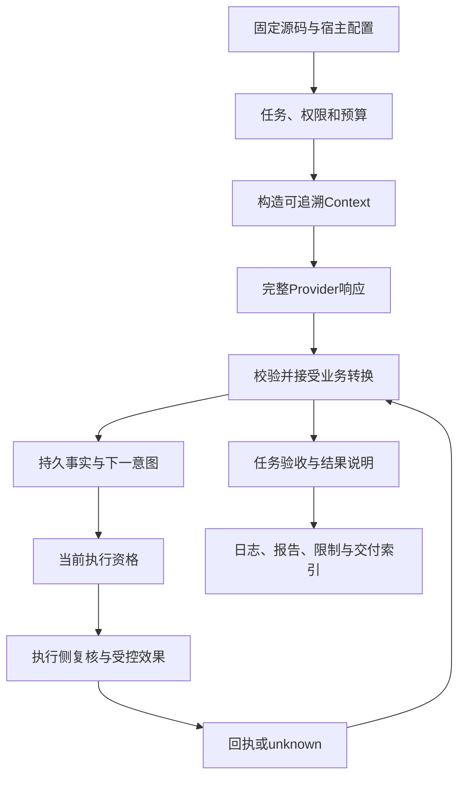

# 第 30 章：完整 Agent 系统的设计、实现、测试与交付

一份可运行的演示、一套章节正文、一份源码清单和一个正式生产服务，是四种不同的交付物。本章用贯穿全书的受控修复任务，把设计、实现、测试、材料获取和运维责任连成一条可审查的路线，说明读者最终应拿到哪些证据。

这里的“完整”指问题和责任能够相互对照，不表示本项目已经实现任意生产平台。当前实验仍是 `0.1.0-dev`、固定 Scripted/Recorded Provider、单可信宿主和单 PostgreSQL；真实模型效果、数据库 HA、跨租户平台与新主机冷安装分别保持自己的能力边界。三十章正文齐备可以说明书稿覆盖成套，不能自动改写软件发行或生产部署状态。

## 学习目标与进入方式

读过前面章节后，应能为一个具体任务回答：系统接受了什么、谁有权执行、预算如何消耗、效果如何核对、故障后从哪里继续、交付材料如何复验。若以课程答辩方式使用本章，先按[课程地图](../docs/course-map.md)完成你选择的实验范围并保留报告；只读本章不意味着已经独立完成 L01—L25 全部挑战。

本章首次练习是低成本的源码准备检查，不需要数据库或模型密钥；后续给出完整交付检查表。没有执行的环境、故障和真实模型评测按待验证记录，不用把计划中的结果填成成功。

## 30.1 从一项任务确定系统合同

用“修复配送费边界并留下说明”作为案例。目标是金额达到门槛时免运费，工作区和测试由宿主提供，模型可以提出受控读、补丁和写入。任务不是“让模型最后说 done”，而是让独立验收能够对应到指定代码、测试和实际产物。

设计时先写输入、目标、可用能力、预算与停止条件。再明确哪些状态是纯值，哪些事实必须持久化，哪些外部效果不能随事务回滚。这样后续模块图才来自具体责任，而不是为了使用某个框架而预先堆出全部组件。

| 责任 | 当前实现入口 | 验收时应看到什么 |
| --- | --- | --- |
| 合法转换 | [Kernel](../lib/agent_systems_lab/kernel.ex) | 命令、事件、拒绝原因与重建 |
| 模型与工具驱动 | [RunServer](../lib/agent_systems_lab/run_server.ex) | 完整响应、预算、取消与配对结果 |
| 接受事实的提交 | [Storage](../lib/agent_systems_lab/storage.ex) | Run/Event/intent 同事务与旧版本拒绝 |
| 受控文件效果 | [Gateway](../lib/agent_systems_lab/tools/gateway.ex) | 预检、执行侧资源检查、diff 与回执 |
| 恢复和调度 | [Recovery](../lib/agent_systems_lab/recovery.ex)、[Scheduler](../lib/agent_systems_lab/scheduler.ex) | 原操作、当前 claim、原预算与 due |
| 来源与观察 | Context、History、Observability | 输入来源、历史核验和不越权的观察 |

表格不是说每个任务都要同时启动全部组件。纯值小练习不需要数据库，内存演示不自动得到持久恢复，持久模式又不能自动授权真实网络工具。先选任务所需范围，再把实际启用的路径记录下来。

## 30.2 把实现连接为可解释的执行链



顺序中有多个不能合并的边界。模型提议不是权限，接受意图不是效果，效果发生不是回执已收到，final 被接受不是内容验收通过。数据库事务只覆盖参与它的持久事实；外部效果需要目标支持的幂等、查询或核对协议。任何一个箭头都应能找到具体实现与反例。

贯穿任务的固定修复属于离线机制演示：宿主确认受信任的源文件和测试后运行验收，Scripted Provider 提供预定提议。它能够展示读、补丁、说明、diff 和上下文审计如何连接，却不能证明真实模型会发现任意缺陷。未来接入真实 Provider 时还要新建网络、凭据、价格与能力评估的证据。

## 30.3 第一次小练习：源码就绪到底证明了什么

先预测：一个只读材料检查输出 source_ready=true，能否说明测试已经运行、正式版本已经发布、网站已经公开？在项目根目录终端执行：

```sh
LAB_DATABASE_ENABLED=false LAB_SCHEDULER_ENABLED=false ./scripts/mix lab.release check
```

该任务对照固定发布源码契约检查文件、迁移、章节设计卡、课程与本地链接，输出 JSON。记录实际命令、退出码、project_version、source_ready、release_ready 与源码检查 hash；不复制别人的输出作为自己的执行结果。它不启动数据库或业务应用，也不运行整套课程。

当前 v1 工具的报告明确区分 source_ready 与 release_ready，后者保持 false。章节卡中的历史状态字段沿用旧清单，当前正文进度单独说明；不能为了显示“全书完成”而修改冻结字段或旧真人统计。新的书稿编辑、代理审查和例子实跑，以本轮独立报告说明。

再做一项观察，把源码材料与机制运行分开：

```sh
LAB_DATABASE_ENABLED=false LAB_SCHEDULER_ENABLED=false ./scripts/mix lab.demo --lost-response
```

这条命令驱动内存 Demo，先显示 blocked，再经内置 Mock 台账核对，最终 effects=1、rebuild_matches=true。它证明该固定轨迹的运行机制，与上面的材料检查有不同证据；仍没有真实文件报告、真实模型能力或数据库故障转移。首次练习完成后，分别写一句两条命令的结论范围。

<details>
<summary>核对预测：哪些说法应改写</summary>

“源码检查通过，所以测试全部通过”应改为“材料满足该固定源码契约，测试另有实际记录”；“Demo 完成，所以可上线任意 Agent”应改为“离线固定场景中 unknown 被显式核对且效果未重复”。正式 tag、公开托管、完整平台与生产运维都不是这两条命令的返回值。

</details>

## 30.4 证据应围绕同一份源码组织

先固定要检查的源码与配置，再执行相应验证，保存每步 argv、退出码、平台和原始目录。报告中的源码身份必须能对应到真正运行的字节；如果后续改动了实现或例子，就为受影响内容取得新的验证。一个旧提交的绿色 Actions 不能代替新提交的结果。

Git commit 标识仓库快照，source manifest 再列出受契约覆盖的路径、模式与内容摘要。二者便于定位和检测漂移，却不自动认证一个未知下载者或未知压缩包。第三方材料、运行时下载与宿主凭据仍需各自的可信来源；不能让报告里的字符串决定任意代码加载。

导出时先冻结实际版本和内容，输出使用新目录，校验解压后的清单和路径。不要让 manifest 声称自己包含最终还没有产生的文件，也不要为了让 hash 看起来稳定而删除必要范围。核心便携源码包与阅读站 Node 构建产物使用各自契约，文件数量不同不是可以随意忽略的差异。

不存在的历史 start/solution tag 不应被新标签伪造出来。学生从当前完整参考实现开始独立练习时，保存自己的修改 diff、反例和验证；教师可以评估这些证据，却不能因为课程有编号就宣称 Git 中存在逐课演进版本。

## 30.5 验证矩阵怎样支持交付结论

| 验证层 | 合适的证据 | 应保留的范围限制 |
| --- | --- | --- |
| 纯状态与纯值 | 精确返回、非法轨迹、重建一致 | 没有实际外部效果 |
| 内存执行 | 流、取消、Mock 与文件例子 | 无跨重启持久保证的部分明确标注 |
| PostgreSQL | 真提交、旧版本拒绝、故障窗口 | 数据库和故障模型写明 |
| 效果与恢复 | 原操作、回执、unknown、fencing | 任意远端目标能力不自动继承 |
| 调度与负载 | 准入、有效资格、进程高水位、等待 | 固定负载不等于生产 SLO |
| 书与阅读站 | 原文实跑、解答核对、链接、搜索、窄屏 | 模拟审查不是人类学习数据 |
| 平台与部署 | 所需设施、运维演练和实际环境记录 | 未执行的平台继续待验证 |

测试通过数要与排除数、平台和具体提交一起读。Linux 核心回归排除 Seatbelt，内存模式另排除数据库；把两次不同排除集合相加，不能合成一次不存在的全量平台通过。源码准备、固定场景、真实数据库故障和页面构建也不应互相抵销失败。

首个失败需要保留命令、原始结果与对应资源。若日志被截断或输出随清理消失，先完善证据保留，再解释具体故障窗；下一次通过只说明复验通过，不证明未查明的首因已经修复。把“未复现”如实写出来，比持续运行直到只剩绿色更适合长期维护。

## 30.6 从技术结果交付到读者可以使用

读者需要的不只是源码 ZIP，还包括适用起点、先修桥接、阅读路线、准确术语、首次小练习、实际平台要求和遇错入口。章节中的 shell 与 IEx 应分开，变量跨会话边界要明确；默认时限短的自动测试不能直接当成人工观察脚本而不解释等待成本。

参考答案也属于技术产品。每项结论都应能回到具体不变量、反例和检查证据；成功输出只是预期形状，不能替学习者完成独立任务。采用 subagent 模拟时记录其角色、静态判断和发现的问题，实跑另列；真人成绩、满意度和学习耗时没有数据就不编造。

阅读站将入口、目录、搜索、图示、代码复制和按需展开答案连起来。最近阅读只表示浏览器打开过章节，不代表学会或完成课程。还要检查窄屏的页面溢出与表格/代码局部滚动，避免“内容存在”却很难读。静态网页本身不运行 BEAM、PostgreSQL 或隔离实验。

代码与教材沿仓库已有许可范围说明，第三方资料和原创示例分清来源。材料获取也要准确：当前源码仓库为私有，克隆与 Actions artifact 需要访问权限；Pages 发布任务保持跳过，没有公开教材地址。私有预览与后续公开托管按各自授权和实际结果描述。

## 30.7 生产部署是一套新的可操作合同

把这套教学机制变成生产服务，至少还要确定真实 Provider 和成本上限、身份与权限、部署环境的隔离设施、数据备份与恢复、监控与告警、容量和事故操作权。第 21、22 章已经说明复制、HA 和多租户的未实现边界，不能因为本章叫“完整系统”就从目录中消除它们。

运维首先需要一份可执行的责任分工：谁接收任务，谁查看结果未知的操作，谁可以停止调度，谁确认还原来源，谁批准新权威和公开范围。每个动作都应保留对象、版本和证据。操作手册中的“停止”还要说明停止哪一层，不能一遇故障就清空任务、换操作编号或重开预算。

风险与回退也应是具体的：改了哪项配置、影响哪些新任务、已有任务沿哪个版本运行，失败时怎样保留事实而停止新增效果。回退程序不等于回退已经发生的文件或远端动作；数据兼容、凭据撤销和效果核对各有路径。没有经过真实环境演练的程序只能列为设计与待验收项。

## 30.8 一份可以答辩的交付包

最终答辩可以围绕五组材料组织：任务合同与架构选择；固定源码和输入来源；成功及故障的原始证据；当前能力和未覆盖范围；读者入口、许可、操作手册与后续计划。让评审者从一条结论走到原始材料，而不是只能阅读一段“全部通过”的总结。

如果三十章正文都已形成草稿，应准确称为三十章草稿成套；仍要分别记录每章的审阅、原文例子和题解验证。若某章讨论尚未实现机制，就应保留设计案例的身份。书的结构完整不要求虚构生产功能，软件的实际能力也不应因为教材标题更全面而被夸大。

## 练习与教师参考

1. source_ready=true、Demo 通过、两套 Actions 通过，分别支持哪些结论？哪些仍不足以宣称正式生产上线？
2. 受控修复最后文件正确，为什么仍要保留原工具提议、hash、diff、回执和验收范围？
3. 一个失败后增加诊断，下一次相同参数通过，报告能否直接写“首因已修复”？应该保留怎样的记录？
4. 三十章正文草稿齐备，与全部实验独立挑战、真实模型评测、平台验收和公开托管有什么关系？

<details>
<summary>教师参考：让交付声明与证据范围一致</summary>

1. 源码准备检查材料合同，Demo 检查离线固定机制，Actions 检查该提交在各 job 声明范围内的实际验证。真实服务还需适用环境、Provider、身份、资源、运维和发布决定，不能继承未执行范围。
2. 最终正确可能来自旧文件、人工修改或另一条路径。原身份和配对材料说明谁基于哪个字节提出并执行什么，任务验收再说明覆盖的行为；仅一个最终 hash 不解释过程或语义。
3. 不能。保留首次失败、诊断改动、后续源码与复验结果；若未得到具体原因，写“未复现/首因未知”。业务修复结论需要可说明的失效条件及相应保护证据。
4. 草稿齐备说明书稿结构，不自动赋予这些独立成果。每项按实际完成度和原始材料记录；当前代理审查不写进旧真人反馈字段，私有预览不写成公开部署。

</details>

## 全书的继续使用方式

把本章检查表用于下一次任务：先定义成功和权限，再找事实边界；先保存原身份与证据，再决定重试和恢复；先说明测了什么，再表达结论。可以从课程地图返回具体实验，也可以沿[运行手册](../docs/recovery-runbook.md)、[当前状态](../docs/current-status.md)与[后续计划](../docs/next-stage-plan.md)寻找真实入口。系统工程的完成标准，是每个声明都能找到足以支持它的事实。
