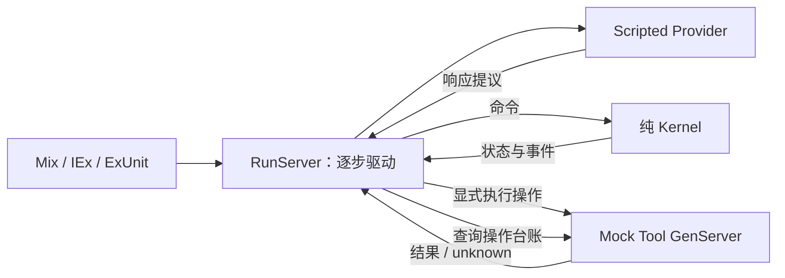
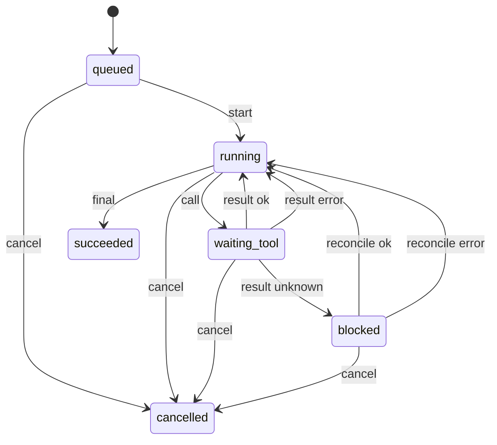

# Agent Systems Lab：第 1—2 周架构

这是一个离线的 Agent Runtime 教学基线。目标是把任务生命周期、模型提议和工具效果分开，让每个状态变化都能通过命令与事件解释。

本文描述 L01 的内存模式。第 3 周新增的 PostgreSQL 模式及其事务保证见 [ADR 0002](adr/0002-transactional-storage.md) 和 [L02](../labs/L02-transactions.md)。

第 4 周把模型调用移入 Task.Supervisor 下的异步任务；RunServer 保持串行决策，并通过逐帧确认控制输入。监督树顺序现为可选 Repo、Registry、ProviderSupervisor、RunSupervisor。Streaming、取消与预算的当前契约见 [ADR 0003](adr/0003-streaming-cancellation-and-budgets.md) 和 [L03](../labs/L03-streaming-control.md)；下文保留 L01 的教学基线说明。

第 5 周新增 Catalog/Gateway、带 ID 与工具名的结果封装，以及显式授权 workspace 的文件读写和精确补丁。Kernel 仍只重建业务事实，文件效果与 PostgreSQL 事务分开；当前契约见 [ADR 0004](adr/0004-controlled-tools-and-call-pairing.md) 和 [L04](../labs/L04-controlled-tools.md)。

第 6 周将完整 Session 与模型 Context 分开：Context 只裁剪叙述，保护任务、回执和宿主权限；manifest 记录来源与构造策略。持久模式先保存输入快照再启动 Provider，读取时只做纯重建核对。详见 [ADR 0005](adr/0005-session-context-and-manifests.md) 和 [L05](../labs/L05-session-context.md)。

## 调用链



Kernel 决定哪些转换合法。RunServer 组织调用顺序。Provider 只返回预先写好的响应。Mock Tool 是唯一模拟业务效果的地方。内核重放事件时不会调用图中的任何外部组件。

## 状态机

| 当前状态 | 允许的动作 | 后续状态 |
| --- | --- | --- |
| `queued` | 开始 | `running` |
| `running` | 模型提出工具调用 | `waiting_tool` |
| `running` | 模型给出最终回答 | `succeeded` |
| `waiting_tool` | 当前操作确认成功 | `running` |
| `waiting_tool` | 当前操作确认失败 | `running`，让驱动决定继续或结束 |
| `waiting_tool` | 当前操作结果未知 | `blocked` |
| `blocked` | 查询后确认操作成功 | `running` |
| `blocked` | 查询后确认操作失败 | `running`，让驱动决定继续或结束 |
| 非终态 | 取消 / 显式失败 | `cancelled` / `failed` |
| 任意终态 | 再次发送业务命令 | 拒绝，状态不变 |

`running` 收到超出 `max_turns` 的模型响应时，Kernel 返回预算耗尽错误，状态不变；RunServer 在驱动下一步前检查预算，显式发出 `fail` 命令。默认预算为 4 轮；一轮是一个被接受的模型响应，包括工具调用提议与最终回答。工具执行和结果核对本身不消耗模型轮数。



图省略了所有非终态上的显式失败箭头。具体拒绝原因与边界由 Kernel 和对应测试定义。

## 数据契约

### 命令与事件

命令是要求系统尝试做什么，可以被拒绝。事件是内核已经接受的事实，按顺序应用。

事件封装包含 `schema_version`（当前为 1）、`run_id`、连续递增的 `seq`、`type` 和 `data`。重放拒绝任务编号不匹配、序号断裂或重复、未知版本和非法状态转换；不能把任意 map 当成可信事件。非默认的 `max_turns` 是运行配置，重建时需要传入相同选项。

| 命令 | 成功接受时的主要事件 |
| --- | --- |
| `{:start, input}` | `run_started` |
| `{:model_response, {:call, call}}` | `tool_requested` |
| `{:model_response, {:final, text}}` | `run_succeeded` |
| `{:tool_result, operation_id, result}` | `tool_result_recorded` |
| `{:reconcile, operation_id, result}` | `tool_reconciled` |
| `{:fail, reason}` | `run_failed` |
| `{:cancel, reason}` | `run_cancelled` |

工具提议 `call` 是 map，包含 `operation_id`、`tool` 和 `arguments`。操作编号由调用者稳定提供。Kernel 保存已见操作，拒绝再次申请同一编号；工具端仍需要独立保证重复传输不产生重复效果。当前 RunServer 仅路由 `tool: "mock_write"` 到 Mock，其他名称得到受控的工具错误。

状态包含任务标识、生命周期状态、`seq`、`turn_count`、`pending_operation_id` 和 `operations`。不要把状态中的某一个字段视作完整事实：例如 `blocked` 必须结合当前操作及其结果理解。

### Scripted Provider

```elixir
Scripted.new([{:final, "done"}])
Scripted.respond(context, provider_state)
```

每次响应返回新的 Provider 状态。调用者必须使用返回的状态，才能消耗下一条脚本响应。脚本耗尽和脚本中的显式错误都通过错误元组表达；它们与 Kernel 的业务状态转换分开处理。脚本固定了响应顺序，便于测试重复运行的确定性。

### Mock Tool

```elixir
Mock.execute(pid, operation_id, arguments, response: :ok)
Mock.execute(pid, operation_id, arguments, response: :lost)
Mock.execute(pid, operation_id, arguments, response: :fail_before_effect)
Mock.lookup(pid, operation_id)
Mock.stats(pid)
```

`arguments` 是任意 map。本实验只传测试数据，不写实际文件。

| 新操作的模式 | 是否产生效果 | 本次调用的观察结果 | 后续用途 |
| --- | --- | --- | --- |
| `:ok` | 是 | 确认成功 | 正常路径 |
| `:lost` | 是 | 结果未知 | 查询台账后核对 |
| `:fail_before_effect` | 否 | 确认失败 | 验证无效果的失败 |

`stats/1` 返回 `%{requests: n, effects: n}`。已通过参数校验的执行请求会增加请求数，包括重复提交与编号冲突。重复提交同一编号与参数不能增加效果数；同一编号与不同参数发生冲突，不允许悄悄复用旧结果。表格描述首次执行新编号的行为；已提交的同编号同参数操作复用已有回执，`:lost` 仍可模拟回执丢失。`lookup/2` 查询工具已知事实，查询本身不产生业务效果。

## OTP 监督边界

顶层采用 rest_for_one，按 Registry、RunSupervisor 的顺序启动。Registry 子树有序停止后，运行进程也被停止；注册与运行监督恢复后，可以创建新的 Run。单个 Run 使用 temporary child，结束或崩溃后不会自动重跑业务。Registry 对已退出进程的清理是异步的，测试等待清理完成后再检查名字释放。

本阶段不承诺任意监督进程被强制终止后的可用性。直接 kill Registry 顶层时，旧命名分区的清理可能与重启竞争，并导致应用安全停机；这不等于任务已恢复。后续持久化阶段将从已提交事实恢复任务。

## 运行与边界

`mix lab.demo` 展示普通执行，`mix lab.demo --lost-response` 展示回执丢失后的 `blocked → 查询 → reconcile`。`mix lab.verify` 加载 `fixtures/tasks.exs`，按受控场景实现逐条运行。用户输入是任务数据，不会动态转换成 Elixir 表达式。这些 fixture 验证固定脚本下的机制行为，不能代表真实模型的任务完成率。

RunServer、Provider 游标、工具台账和事件列表都在本机进程内存中。Supervisor 管理进程生命周期，并不能让业务状态自动持久化。演示中的事件重建要求调用者已经保存事件列表；停止 BEAM、断电或丢失列表后，本阶段没有恢复保证。

关于这一边界的决定见 [ADR 0001](adr/0001-pure-kernel-and-explicit-effects.md)。学习步骤、独立任务与验收见 [L01](../labs/L01-state-machine.md)。
