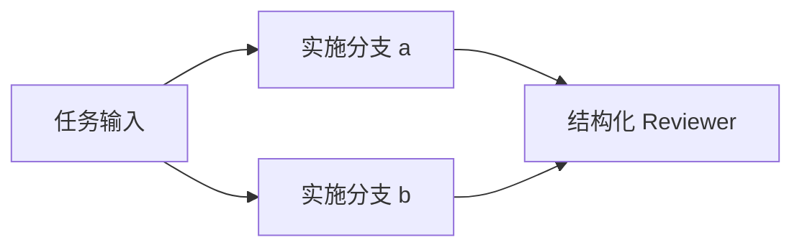

# L16：静态 DAG、并行依赖与持久化汇合

对应第 17 周；前置 L01—L15，建议用时 12—16 小时。先读 [静态 DAG ADR](../docs/adr/0016-static-dag-workflows.md)、[运行手册第 15 节](../docs/recovery-runbook.md#15-dag-编排与子任务恢复) 与 [验收记录](../docs/validation-week17.md)。连续实验编号沿用前序，本周对应 L16。

本实验把一个任务拆成固定的小图，复用现有 Run、持久化调度意图、预算、权限、回执与恢复机制。需要证明依赖按提交事实释放、并行容量受数据库约束、结果不会互相覆盖，并且编排进程消失后可以从原事实继续。

## 1. 准备与运行

在项目根目录执行，先确认现有 PostgreSQL 已运行。正式实验需要真实数据库，不提供内存 DAG 执行替代路径。

```sh
./scripts/postgres status
./scripts/mix ecto.migrate
./scripts/mix lab.workflow
./scripts/mix lab.workflow --output artifacts/week17-workflow-repeat
./scripts/mix check
LAB_DATABASE_ENABLED=false ./scripts/mix test
```

默认输出 `artifacts/week17-workflow`，已存在时拒绝覆盖。重新运行时选新目录，失败时保留原始证据。正式案例、审计和测试数量以本次真实运行的 [验收记录](../docs/validation-week17.md) 为准；不能把本文列出的待验证条件算作已通过。

## 2. 定义并执行一个 diamond

当前图最多 8 个节点，最大静态并行宽度为 3，`max_parallel` 可设为 1—3。图和宿主选项在创建时固定，模型不能新增节点、依赖、队列或权限。以下例子有两个可并行分支，再由汇合节点读取它们的成功结果：



在 `./scripts/iex` 中运行：

```elixir
alias AgentSystemsLab.Workflows
alias AgentSystemsLab.Workflows.{Definition, Join}

nodes = [
  %{id: "root", input: "分解本次离线任务", options: [script: [{:final, "验收条件 A 和 B"}]]},
  %{id: "a", deps: ["root"], input: "完成 A", role: :implementer,
    options: [script: [{:final, "A 的完整结果"}]]},
  %{id: "b", deps: ["root"], input: "完成 B", role: :implementer,
    options: [script: [{:final, "B 的完整结果"}]]},
  %{id: "join", deps: ["a", "b"], input: "核对 A 和 B，不遗漏来源", role: :reviewer,
    options: [script: [{:final, ~s({"approved":true,"findings":[]})}]]}
]

{:ok, definition} = Definition.new(nodes, max_parallel: 2, timeout_ms: 30_000)
id = "L16:" <> Ecto.UUID.generate()
{:ok, created} = Workflows.create(id, definition)
:running = created.status
{:ok, coordinator} = Workflows.start_link(workflow_id: id, poll_interval_ms: 20)

# 有界等待；实验不能因为状态没有收敛就无限等下去。
final = Enum.reduce_while(1..500, nil, fn _, _ ->
  {:ok, current} = Workflows.load(id)
  if current.status in [:succeeded, :failed, :cancelled] do
    {:halt, current}
  else
    Process.sleep(20)
    {:cont, current}
  end
end)

:succeeded = final.status
{:ok, bundle} = Join.build(definition, Map.new(final.nodes, fn {key, node} ->
  {key, node.completion}
end))
["a", "b", "join", "root"] = Enum.map(bundle["results"], & &1["node_id"])
:ok = Workflows.stop(coordinator)
```

Scripted Provider 返回预先固定的输出。这段代码验证调度、来源和汇合，不说明模型已理解依赖内容，也不能据此宣称 Reviewer 质量优于单 Agent。检查 `final.nodes["join"].input`：它必须包含原始任务、两个直接依赖完整输出、原 Run ID、事件序号和哈希，而不是只保留最后结束分支。

## 3. 图的静态校验

`Definition.new/2` 规范化可信宿主输入；`Definition.from_map/1` 对持久化值要求完整且规范，不能把缺字段的损坏记录重新补成默认值。节点 ID 是有界 ASCII；依赖唯一且存在，拒绝重复节点、自依赖和环。顺序采用稳定的字典序拓扑排序。静态宽度按图中最大反链计算，不能只观察一次调度时的 ready 数量。

节点 `options` 只能使用有限的既有 Recovery 配置，持久化为 inert map。Session、隔离策略与 MCP 策略通过各自严格的 `to_map/from_map` 往返；函数、PID、引用、hook、queue 和直接 permissions 覆盖均拒绝。依赖输出始终是数据，不能转成下一节点的宿主选项。

## 4. 权限、预算和独立工作区

每个节点保留自己的 Session 事实、约束、工具 schema、隔离和 MCP sidecar。`:implementer` 与 `:reviewer` 只是静态角色标识，不赋予额外能力。Reviewer 不继承实施者文件路径、MCP tools 或 shell 权限。需要文件工具时，为每个节点创建不同的私有工作区；相同或互为祖先的工作区配置在建图时拒绝，避免并发写入变成隐式共享状态。

工作流采用静态分配的五维预算：`max_turns`、`max_model_attempts`、`max_output_bytes`、`max_tool_calls` 和 `task_budget.max_dispatches`。所有子节点的分配总和不得超过固定工作流上限。字节计数沿用原 Budget 的模型响应与 stream 口径，不是所有工具结果大小或总磁盘配额。重试继续消耗原子 Run 的计数，崩溃不会重置；未花完的额度不返还，也不转给其他节点。这是保守的预算预留，不是动态 credit 池或真实模型计费系统。

工作流 deadline 由 PostgreSQL 时钟在创建时固定，下游较晚创建时也不能得到新的完整时长。子 Run 的原 deadline、执行期限、lease 与 fencing 仍继续执行。`max_parallel` 在私有持久化队列上约束所有竞争 Coordinator 的总领取数；单个进程的 Task 数量限制不能代替这个约束。

同预算对照需要同时核对总上限和子节点分配总量。只让两组使用相同 envelope，而给双 Agent 更多实际分配，不能称为同预算对照。比较相同任务、固定脚本、结构化审查输出、模型尝试数、工具调用数、耗时与最终状态；保留小样本和 Scripted Provider 的限制。

正式演练区分两种对照。`serial_baseline` 与 `parallel_diamond` 使用相同四节点图，只把执行容量从一改为二，验证并行重叠及结果不变；它们不能证明单 Agent 与双 Agent 的差异。另一个 `same_budget_reviewer_comparison` 使用相同的两产物任务，对照“一个 Run 完成实施和结构化意见”与“实施者 Run 加 Reviewer Run”，核对两组五维 cap、分配总量、产物与结构化意见。后者才是本周的静态单/双 Agent 对照，固定意见仍不构成真实模型质量证据。

## 5. 结果汇合

`Join` 按依赖节点 ID 排序，保留每个来源的 Run ID、成功事件序号、完整输出、完整 operation ledger 和源哈希，再给整个 bundle 计算哈希。不把两条结果 merge 成共享 map，因此不会出现 last-writer-wins。

工具回执中的 atom、tuple、二进制和不同类型的 map key 用无损 tagged JSON 表示。例如 atom `:value` 和字符串 `"value"` 不能互相覆盖。结果配对仍由原 operation ID 与工具名检查，未完成或 unknown 操作不能伪装为成功来源。依赖 bundle 只包含直接父节点；祖先已作为对应父节点的输入留在原 Run 历史里。

单个汇合输入上限为 1 MiB。完整任务或回执放不下时应显式失败，不能静默裁剪证据、删权限约束或只保留部分父节点。Context 的既有 protected payload 限制也不会因此放宽。

## 6. 故障、取消与恢复

| 窗口 | 必须观察的事实 |
| --- | --- |
| 两分支并行，其中一条未成功 | join 尚未创建或运行，成功兄弟结果仍保留 |
| 子任务明确失败 | 失败向父传播，未创建节点 skipped，其他运行节点停止，已有回执保留 |
| 子任务结果 unknown | blocked 与核对队列可见；不自动重投非幂等工具，不释放依赖 |
| 工作流取消 | 父先提交取消门禁，再收敛子任务；取消不证明工具效果被撤销 |
| Coordinator 崩溃 | 新进程读取同一图、同一子 Run ID、同一分配和 deadline，再继续观察与领取 |
| 根事务 COMMIT 前后崩溃 | 图、事件、节点、私有队列和已就绪 Run 一起回滚或一起存在 |
| 下游建 Run 事务 COMMIT 前后崩溃 | 不出现脱离图的子 Run，也不重复创建同一节点 |
| 重复 sync 或多个 Coordinator | CAS/锁和确定的子 Run ID 拒绝重复推进，队列控制总并发 |

`Workflows.load/1` 与 `rebuild/1` 是只读入口；它们校验定义、事件链、投影和子节点身份，不调用模型、工具或自动续跑。`sync/2` 会推进依赖及持久化停止状态；`start_link/1` 启动可替换 Coordinator 和受工作流队列范围约束的 Scheduler。`stop/1` 暂停该 Coordinator，不等于持久化取消；需要终止任务使用 `cancel/3`。

故障注入要在真实窗口已经到达后触发，再核对数据库、操作回执、外部效果次数及重新进入次数。父状态已经 failed/cancelled 时，unknown 子节点仍应在 `unresolved_nodes` 可见。人工核对沿用原 Run 的 `Recovery.reconcile/2`，核对成功不能重新开启已经取消的父图。

## 7. 交付与自测问题

完成正式演练并检查保存的定义、子节点输入、事件历史、预算、并发高水位、停止状态与恢复证据；新增用例和全部旧测试均需通过。分别解释：为什么不是为每个节点再写一个执行器；为什么成功来源仍需带 seq 与哈希；为什么取消与 unknown 可以同时存在；为什么 kill Coordinator 不能证明工具没有执行；为什么同预算固定脚本对照不能证明多 Agent 的任务质量优势。

对照 [参考解答](solutions/L16.md)。本周实现静态 Reviewer 与独立工作区；人工审批、产物改变导致批准失效、动态返工和动态 DAG 留在后续阶段，不能由 Reviewer 输出一个 `approved` 字段自动获得发布权限。
