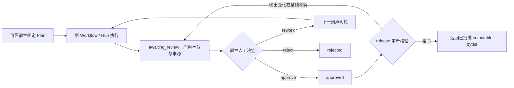

# L17：人工审批、产物绑定与受控返工

对应第 18 周；前置 L01—L16，建议用时 12—16 小时。先读 [审批与返工 ADR](../docs/adr/0017-human-approvals-and-rework.md)、[运行手册第 16 节](../docs/recovery-runbook.md#16-人工审批暂停与受控返工) 和 [本周验收记录](../docs/validation-week18.md)。连续实验编号沿用前序，本周对应 L17。

本实验把“模型完成任务”和“宿主认可某份确切产物”分成两个持久化事实。需要证明人工决定绑定所见字节与来源，产物改变后旧决定无法放行，暂停后的旧 Worker 无法继续提交，而返工只能使用事先声明的图、权限和预算。

## 1. 准备与执行

在项目根目录执行；正式实验需要现有 PostgreSQL，不提供内存审批执行替代路径。

```sh
./scripts/postgres status
./scripts/mix ecto.migrate
./scripts/mix lab.approval
./scripts/mix lab.approval --output artifacts/week18-approval-repeat
./scripts/mix check
LAB_DATABASE_ENABLED=false ./scripts/mix test
```

默认输出 `artifacts/week18-approval`，已有目录拒绝覆盖。重复演练选择新目录，失败时保存原始事实和注入窗口。正式用例、审计和测试数量以实际生成的报告及 [验收记录](../docs/validation-week18.md) 为准，不根据本文的检查清单填入通过结论。

## 2. 三层事实与审批边界



`Plan` 是可信宿主配置；模型只能执行原图并提供结果。`Case` 保存轮次、人工请求、待审 subject、generation 和决定；`Workflow` 与子 Run 继续保存原执行事实。结构化 Reviewer 即使输出 `{"approved":true}`，也只是模型数据，不能调用人工决定接口，更不能自动取得 release 权限。

本地接口通过 `plan.approvers` 校验宿主提供的 actor ID，默认 `"lab-human"`。这是一条可信宿主边界，尚未提供真实登录、身份凭据、签名或组织角色系统。调用接口的外层应用必须先鉴别真人身份；把模型生成的 actor 字符串传入接口不构成人工授权。

## 3. 输出、初始版本和受保护基线

`Artifact.new(root, files, opts)` 只接受宿主声明的私有 Workspace 和相对输出路径。三个概念有不同用途：

| 字段 | 例子 | 核验时机 |
| --- | --- | --- |
| `files` | `["patch.diff"]` | 轮次成功后捕获内容，决定和 release 再采样 |
| `initial` | `%{"patch.diff" => "absent"}` | 本轮准入前核对原始输出版本；生成后允许变化 |
| `baselines` | `%{"source.txt" => sha256}` | 准入、捕获、决定和 release 始终核对未应用的目标基线 |

输出与 protected baseline 必须分开，路径不能重叠或通过大小写、Unicode 折叠指向同一文件。`"absent"` 是显式不存在版本，不能用缺失文件冒充空文本。基线改变返回 `{:artifact_baseline_conflict, path, expected, observed}`，不替换原哈希、不静默合并，也不自动应用补丁。

每个 Artifact 最多 16 个输出文件，每个文件最多 65,536 字节，单次捕获最多 1 MiB。每轮全部 Artifact 的 `max_total_bytes` 静态总和不得超过 1 MiB；多根工作区需要显式分摊，例如两个根各 524,288 字节。快照保存完整 UTF-8 字节、相对路径、字节数、SHA-256 以及基线与 initial 元数据，再计算确定的快照哈希。

文件路径和祖先拒绝符号链接，普通文件拒绝硬链接和目录入口的非规范拼写；保护 `.git`、`.aws` 等既有元数据路径。工作区根必须恰好匹配本轮某个节点原有 Workspace、隔离策略或 MCP 策略的文件授权根。依赖结果、产物内容和人工理由均不能扩大授权根。

捕获在读取输出前后检查 protected baselines，读取文件前后检查身份和大小。这是私有工作区里的有界采样，不是多文件原子快照，也不能对抗恶意宿主并发重命名祖先。release 返回不可变字节；真正消费补丁的宿主还应以基线哈希执行自身的原子 CAS。本实验不执行补丁应用、发布或部署。

## 4. 建立两轮固定计划

在 `./scripts/iex` 中运行下面的独立示例。它只生成待审补丁文本，不修改 source.txt。

```elixir
alias AgentSystemsLab.Approvals
alias AgentSystemsLab.Approvals.{Artifact, Plan}
alias AgentSystemsLab.Tools.Workspace
alias AgentSystemsLab.Workflows.Definition

id = "L17:" <> Ecto.UUID.generate()
temporary = if File.dir?("/private/tmp"), do: "/private/tmp", else: "/tmp"
base = Path.join(temporary, "lab-L17-" <> Ecto.UUID.generate())

rounds = Enum.map(["first", "rework"], fn round_id ->
  root = Path.join(base, round_id)
  File.mkdir_p!(root)
  File.write!(Path.join(root, "source.txt"), "before\n")
  patch = "--- source.txt\n+++ source.txt\n@@ -1 +1 @@\n-before\n+after #{round_id}\n"

  {:ok, definition} = Definition.new([
    %{id: "implement", input: "产生本轮待审补丁", role: :implementer,
      options: [workspace: root, script: [
        {:call, %{operation_id: "write-patch", tool: "file_write",
          arguments: %{path: "patch.diff", content: patch, expected_sha256: "absent"}}},
        {:final, "请人工核对 patch.diff 与 source.txt 的基线"}
      ]]}
  ])

  {:ok, artifact} = Artifact.new(root, ["patch.diff"],
    baselines: %{"source.txt" => Workspace.sha256("before\n")},
    initial: %{"patch.diff" => "absent"})

  %{id: round_id, definition: definition, artifacts: [artifact]}
end)

{:ok, plan} = Plan.new(rounds, approvers: ["lab-human"], timeout_ms: 60_000)
{:ok, created} = Approvals.create(id, plan)
{:ok, coordinator} = Approvals.start_link(case_id: id, poll_interval_ms: 20)

review = Enum.reduce_while(1..500, nil, fn _, _ ->
  {:ok, current} = Approvals.load(id)
  if current.status in [:awaiting_review, :failed, :cancelled] do
    {:halt, current}
  else
    Process.sleep(20)
    {:cont, current}
  end
end)

:awaiting_review = review.status
snapshot = hd(review.subject.artifacts)
IO.puts(hd(snapshot.files).content)
```

到这里应由操作者阅读所保存的确切字节和来源后选择决定。示例采用 Scripted Provider，不能证明模型理解了补丁，也不能把复制代码执行的固定 actor 当作真实身份系统。

## 5. 带 CAS 的人工决定与 release

每次宿主操作都带 actor、非空理由、唯一 `request_id`、所见 `expected_seq` 和 `subject_hash`。审批决定再带 `action: :approve | :reject | :rework`。不存在可审 subject 时，暂停、取消、拒绝或返工可按当前状态传 `subject_hash: nil`；批准仍需要成功 Workflow 及完整产物。

```elixir
request = %{
  actor: "lab-human",
  reason: "人工核对 source 基线和 patch 字节后同意",
  request_id: Ecto.UUID.generate(),
  expected_seq: review.seq,
  subject_hash: review.subject.subject_hash,
  action: :approve
}

{:ok, approved} = Approvals.decide(id, request)
:approved = approved.status

release = %{
  actor: "lab-human",
  reason: "取出本次已批准的不可变产物",
  request_id: Ecto.UUID.generate(),
  expected_seq: approved.seq,
  subject_hash: approved.subject.subject_hash
}

{:ok, released} = Approvals.release(id, release)
bytes = hd(hd(released.snapshot.artifacts).files).content
true = is_binary(bytes)
:ok = Approvals.stop(coordinator)
```

Subject 哈希绑定 Case ID、Plan 哈希、轮次、generation、Workflow ID/seq/来源 proof 及所有产物字节哈希和版本元数据。只对一个文件算哈希、只用 Case ID、只检查 seq 或只保留 Reviewer 文本，都不足以代替整个 subject。

相同 `request_id` 与相同内容用于请求去重；同一 ID 换理由、actor、动作或 subject 必须冲突。历史决定与只读 `load/rebuild` 只说明曾经批准哪些字节，不是当前文件的授权检查。release 每次调用和重复投递都重新采样，先验证当前内容、基线、generation 和原始 deadline，再返回已批准快照。

## 6. 验证变化导致旧审批失效

依次执行以下独立演练并保存每次前后的 seq、generation、subject、人工决定、快照与错误：

1. 在 awaiting_review 后改变 `patch.diff`，用旧 seq/hash 批准。请求必须拒绝或提交可见 invalidation，不能把旧 subject 自动绑定新内容。
2. 批准后改变输出，再执行 release。旧 approval 清空，状态回到 awaiting_review，新产物需要新的人工请求；历史决定保留。
3. 将输出改回旧字节。即使内容 SHA-256 恢复一致，generation 与 subject 也不能让已撤销审批复活。
4. 改变 `source.txt`。它是 protected baseline，不能仅通过再次捕获输出解决；应看到 baseline conflict，并选择拒绝或预声明返工。
5. 删除输出、换成符号链接或硬链接。都不能复用原 approval，也不能把缺失解释成空产物。
6. 读历史快照并重建状态，确认没有自动 capture、模型调用、工具执行、决定或续跑。独立新 BEAM 的审计应得到相同持久化事实和零执行入口调用。

只读历史校验不重新读取当前产物内容；原 Workflow 的宿主工作区和策略仍有既有配置校验前提。工作区已经移除时，应修复宿主环境或查看保留证据，不能以临时放宽权限绕过校验。

## 7. 持久化暂停与恢复

`Approvals.pause/resume/cancel` 使用与人工决定相同的请求字段（不带 action），从刚读到的 Case 构造 CAS 请求。`Approvals.stop(coordinator)` 只停止观察进程，持久化 pause 会关闭所属 Workflow 的 delivery gate 并撤销已有 claim token。仅 kill 或 stop Coordinator 不能代表人工暂停。

暂停后不能领取新工作，旧 Worker 的 frame、effect、续租或迟到结果继续受门禁与 fencing 校验。恢复必须重新领取原 Run 的新代次，不能给旧 claim 续命。Run ID、已确认回执、重试次数、已扣 dispatch 和其他预算保持；整个 Case 的绝对 deadline 在暂停和等待人工时继续经过。

已经进入外部工具的操作可能产生效果。暂停不能证明效果不存在或已回滚；非幂等模糊结果仍进入原 unknown/reconcile 队列。人工批准产物也不能把 unknown 操作标为成功，不能换 operation ID 逃避核对。已确认回执继续复用，恢复不重复执行已知效果。

批准状态暂停后，恢复也要检查产物是否仍匹配。变化时应失效并重新进入待审，而不是恢复旧授权。Case 到期或取消后，核对原工具结果仍是原恢复问题，不能重开关闭的任务。

## 8. 受控返工与崩溃窗口

选择 `:rework` 只前进到下一个预声明 round；最多三轮，最后一轮没有下一轮时明确拒绝。不能临时加入新节点、修改脚本、扩大权限、共享工作区或增加预算。不同轮使用独立工作区，需要消费前轮结果时由可信宿主在建 Plan 前明确准备输入；模型不能在返工时修改 Plan。

Case 的五维预算预留覆盖全部预声明轮，包括最终未用到的轮；某轮未花完不退款，也不能转给后轮。Case 创建时固定唯一绝对 deadline，后轮创建时裁剪到这个原期限，人工决定和崩溃恢复不重新计时。

检查创建、暂停、批准与返工事务 COMMIT 前后崩溃：Case、事件、所属 gate 和新 round Workflow 必须一起回滚或一起存在。COMMIT 后调用者丢失响应，使用原 request ID 重试，不能重复生成决定、重复建下一轮或改变原预算。竞争操作者使用同一旧 seq 时只能有一个有效推进，另一方需要读取新状态再明确决定。

完成正式演练后，对照 [参考解答](solutions/L17.md)。本周可交付的是有限计划、可信宿主人工决定、可见失效、持久化门禁和不可变产物交付边界；真实身份系统、动态 Planner、自动补丁应用和部署需要独立设计与验收。
