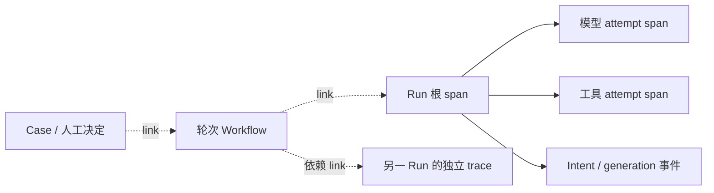

# L18：Trace、Metrics 与结构化事件关联

对应第 19 周；前置 L01—L17，建议用时 10—14 小时。先读 [观测 ADR](../docs/adr/0018-observability-and-diagnostic-evidence.md)、[运行手册第 17 节](../docs/recovery-runbook.md#17-trace-metrics-与按-run-id-诊断) 和 [本周验收记录](../docs/validation-week19.md)。

本实验需要同时证明两件事：按 Run ID 能找到模型、工具、领取、恢复、审批和返工的关联；观测丢失、导出报错或导出进程卡死时，原权限、预算、事务、回执和 fencing 仍由原执行层决定。

## 1. 准备与运行

在项目根目录执行。正式实验与持久化诊断需要现有 PostgreSQL；本周不增加业务数据库表或外部模型凭据。

运行下段完整回归前，先按[完整回归的环境准备](../docs/command-reference.md#完整回归的环境准备)确认自己的可丢弃 PostgreSQL 实例；自定义实例先设置 `PGHOST/PGPORT/PGUSER/PGPASSWORD`，再清除 `DATABASE_URL`。完整回归使用默认测试库名 `agent_systems_lab_test`；另开终端时重新做同样准备。

```sh
unset DATABASE_URL MIX_ENV
export LAB_DATABASE_ENABLED=true
export LAB_SCHEDULER_ENABLED=false
./scripts/postgres status
./scripts/mix ecto.migrate
./scripts/mix lab.observe
./scripts/mix lab.observe --output artifacts/week19-observability-repeat
./scripts/mix lab.trace RUN_ID --json --scope run --limit 100
./scripts/mix lab.trace RUN_ID --json --scope related --max-related-runs 24
env -u DATABASE_URL MIX_ENV=test LAB_DATABASE_ENABLED=true LAB_SCHEDULER_ENABLED=false ./scripts/mix check
LAB_DATABASE_ENABLED=false LAB_SCHEDULER_ENABLED=false ./scripts/mix test
```

用报告中的实际 Run ID 替换 `RUN_ID`。已有输出目录拒绝覆盖，重复演练使用新目录。正式用例、审计与测试数量以实际报告和验收记录为准，不能由本文的检查清单推定通过。

## 2. 两种证据不能混用

| 证据 | 来源 | 能回答的问题 | 限制 |
| --- | --- | --- | --- |
| 运行观测 | `Observability.emit` 的有界、易失缓冲与 JSONL | 哪个请求尝试开始、何时结束、租约或导出是否出现问题 | 允许丢失、重复及乱序；进程或 BEAM 消失会丢失未导出记录 |
| 持久化诊断 | `Observability.Query.run/2` 的只读 SQL 快照 | 数据库实际保存了哪些 Run、事件、回执、预算、审批和轮次关联 | 只反映已保存事实；不是恢复、执行、重新审批或当前文件授权 |

即使观测行带 `phase: :committed`，它也只是“提交后发出的通知”。通知可能在 COMMIT 后、入缓冲前丢失；JSONL 的一行不能代替原数据库的提交、claim、权限或审批检查。反过来，没有某行 JSONL 也不能证明工具没有执行。

Query 在一次 repeatable-read、read-only 事务中读取有界元数据。`scope: :run` 限定当前 Run；默认 `:related` 沿已保存的 Workflow 与 Case 归属查找关联轮次。多行历史集合使用 `limit`；Run 集合及其预算、恢复单例使用 `max_related_runs`，Workflow/Case 归属另有固定轮次上限。截断或不可用投影必须显式显示。这是可信宿主诊断接口，不提供多租户身份或访问控制。

## 3. 关联标识与 span



`Context.trace_id(run_id)` 使用版本化确定性哈希生成 32 位小写十六进制 ID；`Context.root_span_id(run_id)` 和 `span_id(kind, business_id)` 生成 16 位 ID。同一 Run 在另一个进程或新 BEAM 内仍能得到同一关联标识。它们是本地逻辑关联标识，不是随机远端采样 ID，也不是授权凭据。

模型开始、结束与录制使用同一模型 attempt 关联；工具开始、结束与核对关联 operation 和 attempt。Run 内的 span 可指向根 span。不同 Run 各自有独立 trace，Workflow 依赖和 Case 的返工轮次用 links 表示，不能把另一条 trace 的根 span 填成当前 trace 的 parent。

检查每条结构化事件的 `schema_version`、有限 `event_name`、`trace_id`、`span_id`、`parent_span_id`、`correlation`、`attributes`、`measurements` 与时间字段。`seq` 是持久化序列，`turn_id` 是模型轮次，`intent_id` 与 `generation` 是领取关联；这些字段不能互相替代。只读 Query 生成的 span 是已保存事实的诊断投影，不声称每个投影都曾发出对应的实时通知。

## 4. 默认无外部导出，显式配置本地 JSONL

默认导出器是 Null，不进行文件或网络输出。在 `./scripts/iex` 中可用独立缓冲做宿主演练：

```elixir
alias AgentSystemsLab.Observability
alias AgentSystemsLab.Observability.{Buffer, Exporters}

path = Path.expand("artifacts/L18-example.jsonl")
File.mkdir_p!(Path.dirname(path))

{:ok, observer} = Buffer.start_link(
  name: nil,
  capacity: 16,
  max_bytes: 16_384,
  max_event_bytes: 4_096,
  batch_size: 2,
  recent_capacity: 4,
  recent_max_bytes: 8_192,
  export_timeout_ms: 100,
  backoff_ms: 200,
  exporter: {Exporters.JSONL, [path: path]}
)

handle = Buffer.handle(observer)
:ok = Observability.emit(:model_started,
  %{run_id: "L18-example", attempt_id: "attempt-1"}, %{}, buffer: handle)
:ok = Observability.emit(:model_stopped,
  %{run_id: "L18-example", attempt_id: "attempt-1"}, %{duration_ms: 12},
  buffer: handle, outcome: :ok, phase: :observed)
:ok = Observability.flush(observer)
Observability.stats(observer)
Observability.recent(observer)
Observability.metrics(observer)
```

JSONL 的绝对路径来自可信宿主。导出模块与配置也来自宿主，不能来自模型或工具参数。只有隔离的导出 Worker 调用 exporter；调用 `emit` 的执行进程不执行文件、数据库、网络、同步 GenServer 调用或 exporter 回调。

默认应用缓冲的宿主接口为 `Observability.configure(exporter: {Module, options})`。先 `flush` 再切换；有在途 Worker 时配置返回 `{:error, :busy}`。配置、flush、stats 和 recent 都是诊断控制接口，不放入模型、工具或调度提交的关键路径。

## 5. 有界性与可见丢失

默认配置为 256 个槽位、1,048,576 字节队列载荷、每事件 8,192 字节、每批最多 32 行、至多一个导出 Worker；recent 另限 128 行和 524,288 字节。字节限额按 Erlang external-term payload 计量，不是精确的 VM 内存、JSON 文件大小或磁盘配额。槽位、单行、batch 和 recent 上限共同限制额外对象开销。

生产者直接向固定槽位 ETS 缓冲预留条目和字节，原子 CAS 仅做有限次尝试；满额、槽位竞争或事件过大时丢弃观测。唤醒消息通过原子标志合并，不能把每个事件塞入无界 `GenServer.cast` 邮箱。导出失败后丢失当前批次并退避，不把导出重试变成执行背压。等待退避期间缓冲仍受同一限制。

检查 `admitted`、`dropped`、`invalid`、`exported`、`export_errors`、`export_timeouts`、`export_lost`、`buffer_entries`、`buffer_bytes`、高水位、recent 限额、mailbox 与在途 Worker。`dropped` 是准入丢弃；`invalid` 是 schema 拒绝；`export_lost` 是已准入但导出失败的批次行数，三者不能混成成功导出数。

生产者在原子预留后、ETS 插入前被 kill，可能遗留有限 permit，令观察容量下降；不会突破条目或字节上限。`queued_entries` 是实际 ETS 行数，`buffer_entries` 包含在途预留。持续差异需要宿主诊断，不能仅凭一瞬间差异推定故障；必要时 `Observability.restart()` 只重建观察器并丢弃易失状态，不重启业务，也不补发历史通知。

Metrics 只以有限事件名和有限 outcome 聚合，Run、operation、attempt、actor、路径与错误文本不能成为 metric label。度量的是已排出缓冲的观测，导出失败仍可保留本地聚合；准入丢失和观察进程死亡仍会造成欠计数。实际预算、回执和审批必须查原持久化台账，不能用 metrics 结算或放行。

## 6. 故障注入与语义对照

保留每组前后证据，并完成以下检查：

1. 让 JSONL 路径不可写或父目录不存在，再分别使用返回 error、raise、exit 和挂起的可信测试 exporter。原 Run 的成功、失败、预算与工具结果必须与基线一致。
2. 导出挂起期间并发发出大量事件。检查队列条目、载荷字节、recent、batch 和邮箱有界，只有一个 exporter Worker；超时后 Worker 消失，超时与丢失计数增加。Observer 被 kill 时挂起 exporter 也应立即退出，不能变成失去 timeout 的孤儿进程。
3. 在独立 observer 被 kill 后继续用旧 handle 发事件；调用仍返回 `:ok`。默认 observer 是应用树末尾的 temporary child，不消耗业务父监督树的重启预算。显式 `Observability.restart()` 恢复观察器，原 Registry、ProviderSupervisor、RunSupervisor 和正在运行的 Run 不能因此重启。
4. 在 COMMIT 前回滚和 COMMIT 后丢响应的窗口对照 Query。只能由数据库事实判断是否提交；无行或多行实时通知都不能修改原结论。
5. 对同一 Run 比较模型请求、模型录制、工具准备与确认、重试、claim generation 和恢复投影；已确认效果仍只执行一次，unknown 仍留原核对队列。
6. 对带返工的 Case，找到旧轮与新轮、暂停与恢复、旧审批失效及新人工决定。确认关联用 links 表达，subject、generation、权限和总预算没有因观测或查询改变。
7. 将敏感 canary 放入任务输入、模型输出、工具参数和结果、人工理由、路径与错误消息。检查导出中没有这些正文、令牌或异常 inspect；业务 ID 自身也不得夹带秘密。

Query 不能调用模型、执行工具、sync、capture 当前产物、人工 decide/release 或续跑。对诊断前后做只读哈希与执行入口审计，确认业务事实不变。新 BEAM 的确定性关联只能证明可以重新关联事实，不代表观察器会自动补发历史通知。

## 7. 本周交付

提交一份按 Run ID 可复现的诊断、导出故障与饱和缓冲报告、数据最小化检查以及全量回归结果。对照 [参考解答](solutions/L18.md)，标明缺失证据、截断和未知结果，避免根据一张成功 trace 推导整个系统没有丢失或重复。

本周提供内部 schema v1、确定性逻辑关联、有限聚合与本地 JSONL 适配器。尚未接入完整 OpenTelemetry SDK、OTLP 网络传输、外部 collector、分布式采样或远端上下文传播；Scripted Provider 的机制演练也不能证明真实模型质量或生产性能。
