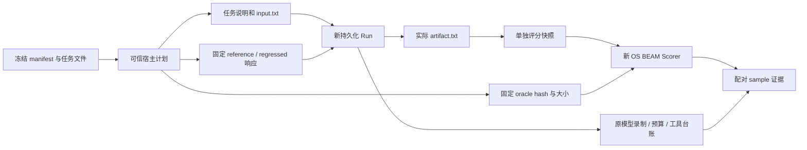

# L19：可重复评测、固定任务集与回归比较

对应第 20 周；前置 L01—L18，建议用时 10—14 小时。先读 [评测 ADR](../docs/adr/0019-repeatable-evaluation-and-regression.md)、[运行手册第 18 节](../docs/recovery-runbook.md#18-可重复评测与回归比较) 和 [本周验收记录](../docs/validation-week20.md)。

本实验要求把“本次跑完了”变成可以核查的评测协议：在冻结任务、oracle、预算、成本模型和运行环境下，以新的持久化 Run 执行每个 task/trial，独立检查实际文件产物，保留失败样本及其已消耗成本，再与相同协议的完整基线逐项比较。

固定 corpus 是本项目原创的公开教学数据。Scripted Provider 的参考答案来自宿主固定脚本；holdout 是显式独立分割，golden 可以从源码读取。本实验验证评测和执行机制，不是保密盲测，不衡量真实模型的推理能力，也不构成生产性能或外部 benchmark 成绩。

## 1. 准备和命令

在项目根目录执行，使用现有 PostgreSQL。评测要求关闭全局后台 Scheduler，以免它与顺序评测争领任务；本周不需要真实模型凭据或新的数据库表。

```sh
./scripts/postgres status
./scripts/mix ecto.migrate

./scripts/mix lab.eval --output artifacts/L19-dev-reference \
  --split dev --profile reference --repetitions 2
./scripts/mix lab.eval --output artifacts/L19-dev-repeat \
  --split dev --profile reference --repetitions 2
./scripts/mix lab.eval --output artifacts/L19-dev-regressed \
  --split dev --profile regressed --repetitions 2 \
  --baseline artifacts/L19-dev-reference/report.json

./scripts/mix lab.eval --output artifacts/L19-holdout-reference \
  --split holdout --profile reference --repetitions 2
./scripts/mix lab.eval --output artifacts/L19-holdout-regressed \
  --split holdout --profile regressed --repetitions 2

./scripts/mix lab.eval.compare \
  artifacts/L19-dev-reference/report.json artifacts/L19-dev-repeat/report.json \
  --output artifacts/L19-dev-repeat-comparison
./scripts/mix lab.eval.compare \
  artifacts/L19-holdout-reference/report.json artifacts/L19-holdout-regressed/report.json \
  --output artifacts/L19-holdout-regression

./scripts/mix lab.eval.verify
./scripts/mix check
LAB_DATABASE_ENABLED=false ./scripts/mix test
```

已存在的输出目录拒绝覆盖，重复执行需换目录。`lab.eval` 默认 dev、reference、每任务 2 次；CLI 允许 1—10 次。带 `--baseline` 时，基线协议会在创建输出和执行样本前核验。发现回归后仍保存完整 report/comparison，再以失败退出；这与执行中断、没有完整 report 的情况不同。

`lab.eval.compare` 读取保存的报告，只进行验证、重算与比较，不启动项目应用、不连接 Repo、不重新执行或评分。要比较不同分割，应分别保留各自的参考基线，不能把 dev 与 holdout 直接配对。测试、正式样本、独立审计数量以实际验收记录为准。

## 2. 冻结任务与独立分割

数据入口为 `fixtures/evaluation/manifest.json`。固定 schema v1 包含 suite/version、合成定价和 10 个任务定义；每项绑定 instruction、input、expected、reference、regressed 源文件。每个任务的目标都是工作区中的 `artifact.txt`。

| 分割 | 任务 ID | 固定目标 |
| --- | --- | --- |
| dev | `dev-normalize-lines` | 清理空白并转为小写 |
| dev | `dev-sort-inventory` | 按名称排序 CSV 库存 |
| dev | `dev-total-ledger` | 汇总有符号整数账本 |
| dev | `dev-repair-csv` | 修复缺失数量 |
| dev | `dev-redact-ticket` | 按固定规则隐藏 ticket token |
| dev | `dev-bounded-response` | 在单次工具调用额度内写入 READY |
| holdout | `holdout-merge-labels` | 合并标签、去重并排序 |
| holdout | `holdout-format-config` | 按 key 排序配置 |
| holdout | `holdout-deduplicate-events` | 保留事件第一次出现的顺序 |
| holdout | `holdout-extract-summary` | 提取指定字段并格式化 |

分割按任务身份冻结，6 个 dev 与 4 个 holdout 不共享 task ID。开发与调试先使用 dev，显式选择 holdout 才运行保留集。把看过的 holdout 再称作“未接触测试集”是不成立的；本项目没有自动封存或阻止人阅读它。

`Suite.load/0` 严格拒绝未知字段、重复 JSON 键、未知版本、不匹配定价、重复任务、错误分割、越界路径、符号链接和过大的输入。Manifest 不能指定任意命令、模块或评分代码。manifest 原始字节、全部 fixture 字节、Suite 与 Scorer 源码参与 suite identity；task identity 同时绑定本任务 oracle 与源码。即使只改 manifest 空白，suite hash 也会变化。SHA-256 用于内容身份与变更检测，不是签名、身份认证或来源可信证明。

## 3. 执行输入与 oracle 的边界



执行初始工作区只有任务输入 `input.txt`，Provider enrollment 只接受 task input 与固定响应脚本；不会把 golden 文件、oracle 正文或 grader 请求放入模型输入和工作区。宿主选择 reference/regressed 仅改变固定响应，不改变任务输入、预算、工具许可或评分标准。

每个 task/trial 有独立 Run ID 和新目录；`run.json` 记录身份。实际动作通过已有 Recovery、持久化模型录制、受控文件工具和预算层完成，而不是由评测框架直接写一份“成功产物”。初始输入是宿主 fixture enrollment，不计为模型发起的工具调用。评分前通过受控读取捕获产物，复制到单独的 `scoring/artifact.txt`，设置只读文件权限。

## 4. 独立评分与配对

`Scorer.score/5` 启动固定 Elixir 入口的新 OS BEAM，只有项目 scorer 所需 code path，不启动项目应用，不继承数据库和 API 凭据。子进程只读取候选快照、计算字节数与 SHA-256，按 `exact_bytes_v1` 比较固定 oracle；它不执行产物代码，不接受 manifest 指定的命令或模块。

请求和结果绑定 sample ID、task hash、artifact SHA-256 与 scorer hash。产物自报“TASK SUCCEEDED”或模型最终文字都不能替代独立判定。缺失、过大、不可读取的产物，以及超时、输出超限、非零退出、错误 schema 或配对不符，必须可见为 scorer error 或已有执行失败，不能算成功。默认评分 timeout 3 秒、stdout 上限 8 KiB；宿主接口有硬上限。

独立 guardian 持有 Port 并监控调用者。超时、输出超限或调用者被 kill 时，会终止实际 owned OS PID、关闭 Port 并等待退出；仅关闭 Port 不足以证明 BEAM 已终止。测试还需用实际 PID 检查进程消失。评分前后核对原持久化 source fingerprint 与捕获产物 hash，scorer 不得修改业务事实。上述隔离用于运行可信固定 grader，不是执行不可信代码的安全 sandbox；只读权限也不代表对同一宿主账户的恶意写入有完整隔离。

## 5. 成功率、成本与延迟口径

所有计划中的 task/trial 都在分母内。`success_rate_pct` 统计成功 sample 比例；`task_success_rate_pct` 要求一个任务的全部重复都成功，才把该任务计为成功。执行 permission、budget、timeout、unknown，产物 incorrect，以及 scorer/harness error 必须保持有限分类，不能通过少写一行样本降低失败率。

成本来自原持久化模型尝试、模型输出字节与工具 execution attempt，采用固定公式：

```text
synthetic_lab_units = model_attempts × 1000
                    + output_bytes × 1
                    + tool_attempts × 250
```

`dispatches` 同时报告但不加价。输出字节是持久化执行计量，不能当成 token；合成单位不能换算成 USD，`cost.usd` 为 null。失败样本保留已经产生的消耗。source 不可用或评分前后发生漂移时 usage 为未知，不能填零；报告保留 known sum 与 unknown count，完整总成本为 null，对应比较检查为 indeterminate，整体不能通过；若另有已证回归，整体 status 可为 regressed。

延迟使用本机 monotonic 微秒，分别记录 `execution`、`scoring` 和 `total`。评分包含启动外部 BEAM、读取和判断产物的时间；total 还包括执行和评分之间的证据读取等开销，因此不能只把两个子项相加伪造 total。p50/p95 使用 nearest rank：排序后取第 `ceil(n × percentile / 100)` 项，包含失败样本。小样本的 p95 往往就是最大值，不是尾延迟的可靠总体估计。

## 6. 参考、重复和主动回归

reference 应在两种分割中产出正确文件。regressed 只改变三个宿主固定响应：

- `dev-sort-inventory` 写入顺序错误的 CSV；Run 可成功结束，但任务评分失败。
- `dev-bounded-response` 写入正确文件后请求额外工具调用；在同一工具预算下被拒绝，不能因为产物碰巧正确而算任务成功。
- `holdout-deduplicate-events` 写入错误顺序的去重结果；独立评分失败。

先比较相同 profile 的重复：task outcome、产物 hash、有限失败类、持久化用量和语义结果应一致。`semantic_signature` 排除新 Run ID、OS PID、测量时刻和延迟，因此用于检查这些稳定事实。完整 report hash 绑定当次实际样本，通常不同；不可宣称延迟、PID 或 report 字节完全复现。

随后比较 reference 与 regressed，要求同时从总体和逐任务检查发现真实回归，并查看 `(task_id, trial)` 的 paired changes。总体改善不能掩盖某一任务变坏。

## 7. 严格兼容性与回归门槛

比较前必须重建保存报告的 summary/hash，验证样本完整、唯一且与计划任务和重复数一一对应。任意修改成功率、成本汇总或 hash 而不与底层样本一致，都应被拒绝。即使重新算出所有 hash，也不构成认证；正式审计还需独立核对原 Run 与产物。

可比较协议必须逐项相同：suite/scorer/pricing hash、split、task IDs 与 hashes、repetitions、execution contract、runtime version 和 measurement scope。profile 可不同，用于测试候选策略；dev 与 holdout、改变 oracle、预算、runtime 或定价后不能沿用旧基线。

默认门槛：成功率允许下降 0 个百分点；合成成本允许增加 0%；延迟允许增加 25% 且有 50,000 微秒绝对噪声门槛。成本与延迟都只有同时超过相对和绝对门槛才判回归，严格大于才越线；零基线有显式分支。各项对总体及每个任务都执行，延迟覆盖 execution/scoring/total 的 p50/p95。

```sh
./scripts/mix lab.eval.compare BASE/report.json CAND/report.json \
  --output artifacts/L19-explicit-thresholds \
  --success-drop-pp 0.0 \
  --cost-increase-pct 0.0 --cost-increase-units 0 \
  --latency-increase-pct 25.0 --latency-increase-us 50000
```

阈值应在看到候选结果前确定并记录。改变门槛会写入新的 comparison，不改原 report。门槛是宿主政策与噪声防护，不是统计显著性检验；重复两次不足以估计置信区间或证明两方案等价。发生 scorer/harness error 或计量缺失时，比较不能通过；status 为 indeterminate 时也返回失败。

## 8. 中断、不完整与证据目录

评测先保存 manifest 与完整 planned samples，再逐项写 sample JSON 和安全字段 `samples.jsonl`。成功结束才保存经校验的 `report.json`。`status.json` 区分 running、completed 与 incomplete，记录计划数、已写样本数和有限原因。完成的失败样本仍属于完整 cohort；执行框架中断或任务集运行中发生变化，则整批 incomplete，禁止用现有几行临时“补成”有效基线。

保留原目录和已创建的 Run，不自动覆盖、续跑或删去最差 trial。需要重新测量时创建新目录和新 Run。报告与样本的安全摘要没有完整模型/工具正文；原业务台账仍按原权限保存。Trace/Metrics/JSONL 允许丢失，不能用观测计数替代已扣预算、模型录制或工具 attempt。

## 9. 实验检查与交付

1. 冻结 manifest，记录两个分割、全部源文件 hash、预算与 scorer identity。验证修改 input、golden、scorer 或定价会改变身份或导致拒绝。
2. 每个分割分别运行 reference、相同 reference 重复和 regressed。对照稳定语义与真实延迟，保留失败成本。
3. 让模型最终自报成功但写错文件，确认任务失败；让预算超限但文件正确，确认仍失败。
4. 实际注入 grader timeout、输出超限、非零退出、畸形结果和串号，核对有限错误、成功率分母、计量及 owned PID 清理。
5. 保存完整报告后篡改 summary、hash、样本数量、task ID 或 trial 配对，确认校验拒绝。修改运行协议后确认比较拒绝；只改候选 profile 则可比较。
6. 在断开观察导出的情况下核查原台账。评分与保存报告比较前后，原 source fingerprint 必须一致；纯比较不调用执行入口。
7. 保留被中断 cohort，确认没有可用完整 report，不会被当基线；使用新目录重新运行。

交付固定集 manifest、逐 sample 证据、汇总报告、配对回归报告、独立原事实审计和全量回归结果。对照 [参考解答](solutions/L19.md)，把机制验收、公开 Scripted Provider 结果与未来真实模型评测的结论范围写清楚。
